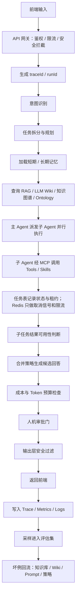
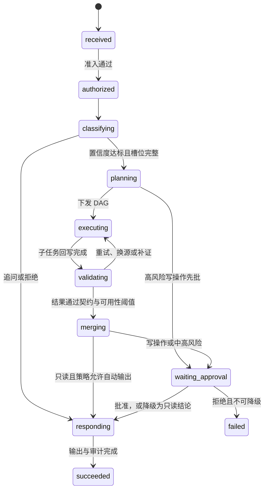

# Agent 系统完整架构方案

| 项目 | 说明 |
|---|---|
| 版本 | v2.1（整理归档版） |
| 基准 | 原方案 v2 |
| 日期 | 2026-11-14；2026-11-20 起降为契约与检查清单 |
| 适用 | RAG / 知识库 + LLM Wiki + 多子 Agent + MCP Tools / Skills 的生产级 Agent 架构 |

2026-11-20：请求怎么走、失败怎么降级，以生产架构 v3 和《Agent 应用开发全流程》为准。本文保留 Schema、指标和检查清单。正文里若与 v3 的状态名或切换规则不一致，改本文。

### 必须与现行文档一致

实现和评审只认下表。正文其余章节若出现旧的大写状态名，改成这里的值。

| 类别 | 唯一来源 | 值 |
|---|---|---|
| 任务状态 | 《Agent 应用开发全流程》第 4.1 节 | `queued`、`running`、`waiting_approval`、`waiting_tool`、`succeeded`、`failed`、`cancelled`、`timed_out`、`handed_off` |
| 阶段（只写 Trace） | 《Agent 系统生产级架构方案》第 4 节 | `received`、`authorized`、`classifying`、`planning`、`executing`、`validating`、`merging`、`responding` |
| 对外错误码 | 《Agent 应用开发全流程》第 0.2 节，常量在《Agent 开发语言》6.11 | 含 `policy_unavailable`、`budget_exceeded`。预算耗尽时状态为 `failed` |
| `TaskSpec` | 生产架构第 7.1 节，字段名如下 | `taskId`、`type`、`dependsOn`、`parallelGroup`、`inputRefs`、`contextRefs`、`allowedTools`、`timeoutMs`、`tokenBudget`、`costBudget`、`riskLevel`、`sideEffect`、`needApproval`、`idempotencyKey`、`retryPolicy`、`outputSchema` |
| 审批落库 | 《Agent 应用开发全流程》第 4.4 节 | `task_id`、`session_id`、租户、用户、`tool_id` 与版本、已校验参数、`parameter_hash`、幂等键、业务影响、策略版本、截止时间、审批人。`parameter_hash` 为规范 JSON 的 SHA-256 |

附录 B.5 的大写码是子任务内部原因，不原样返回给调用方。审批单自己的 `draft → preview → …` 是单据生命周期，不是任务状态。

本文在原 v2 主线之上补了契约，并修正过「19 成本治理接在 12 后面」的编号错位。Schema、指标和检查清单放在附录，便于实现时单独引用。

**面试讲解优先顺序：** 意图识别、任务规划、子 Agent 协作、知识层（LLM Wiki / RAG / 图谱）、结果可用性、合并策略、成本硬预算、审批门与写操作事务、评估回流、数据血缘。这些是与常见方案差异最明显的部分。

---

## 1. 本版补强对照

原方案主线已经完整。进入生产级后，优先补强下表 6 类能力。本整理版已将各改进点落到对应章节，不再只停留在建议清单里。

| 优先级 | 改进点 | 落地建议 | 正文位置 |
|---|---|---|---|
| P0 | 编排器缺少显式状态机 | 任务状态与《Agent 应用开发全流程》第 4.1 节同一套；阶段只写 Trace。每步检查取消、预算、超时 | §5、§3 |
| P0 | 子任务 / 结果缺少契约 | 定义 `TaskSpec`、`SubAgentResult`、`Citation`、`ErrorCode` Schema，禁止用自然语言结果直接合并 | §8、§13、附录 B |
| P0 | 结果可用性缺量化 | 增加可用性评分公式和阈值：可用 / 降级 / 重试 / 追问 / 转人工 | §13 |
| P0 | 写操作缺事务边界 | `draft → preview → confirm → execute → audit`；幂等键；不可回滚动作标记；不自动回滚已落库数据 | §21 |
| P0 | 成本治理缺硬预算 | Run 预算分配到 Task；80% 降级，100% 停止；成本异常自动关闭自动执行 | §18 |
| P1 | 意图识别可更工程化 | 规则 / 小模型 / LLM 兜底分层；双阈值；槽位 Schema；路由表；意图缓存与评估集 | §7 |
| P1 | LLM Wiki 需 Schema 化 | 词条含版本、适用范围、权限、来源、置信度、有效期、关系；与 RAG / 图谱对齐 | §10、附录 B |
| P1 | 缓存缺权限与版本 | RAG 语义缓存 key 必须含 `tenantId`、权限范围、知识版本，防止越权或过期命中 | §10.1、§12 |
| P1 | 多租户隔离需前置 | 存储、召回、工具、日志、Wiki 全链路带 `tenantId`；权限过滤在召回前后都做 | §4、§22 |
| P1 | 版本治理 | Prompt、模型、工具、知识库、Wiki 版本绑定 `traceId`，支持按版本灰度和回滚 | §23 |
| P2 | SLO / 压测 / 混沌 | 增加 P95 延迟、成功率、错误预算；工具超时、Redis 故障、模型限流演练 | §27、§29 |
| P2 | 安全体系映射 | 对齐 OWASP LLM Top 10、AI-SPM、红队回归；安全不只写在 Prompt | §6、§17 |

---

## 2. 设计原则

1. **模型负责生成，策略层负责边界。** 权限、合规、成本、写操作不能交给模型自由判断。
2. **编排器中心化。** 子 Agent 不直接互调，通过编排器、消息总线和状态存储通信。
3. **契约优先。** 任务、结果、引用、错误、审批都使用结构化 Schema，不用自然语言结果直接合并。
4. **最小上下文。** 子 Agent 只拿完成任务所需的最小事实，Just-in-Time 投递。
5. **可追溯。** 每次回答可回溯到消息、文档、Wiki 词条、工具、权限决策和合并步骤。
6. **可降级。** 任何依赖失败都能重试、切换、保守回答、追问或转人工。

补充约束：所有状态流转、缓存命中、工具调用和知识召回都必须携带 `tenantId` 与版本信息；策略判决写入审计，不能只存在于 Prompt 文本中。

---

## 3. 架构总览

系统按「入口策略 → 编排状态机 → 知识与工具 → 校验合并 → 审批输出 → 治理回流」分层。编排器是唯一调度中心，子 Agent、RAG、Wiki、图谱和 MCP 工具都对编排器负责。

### 3.1 逻辑分层

| 分层 | 职责 | 典型组件 |
|---|---|---|
| 接入层 | 鉴权、限流、安全前置、路由、上下文组装 | API 网关、策略服务 |
| 编排层 | 状态机、意图、规划、派发、取消、预算、审批 | Agent Runtime、任务表 / 工作流引擎 |
| 知识层 | 结构化与非结构化知识的召回、对齐、校验 | RAG、LLM Wiki、知识图谱、Ontology |
| 执行层 | 子 Agent 并行、MCP 工具 / Skills 调用 | 子 Agent Runtime、MCP Gateway |
| 运行时状态层 | 会话缓存、取消、限流、事件 | Redis。任务状态、租约和幂等以任务表、业务表为准 |
| 治理层 | 审计、评估、版本、多租户、成本、可观测性 | Trace / Metrics / Logs、配置中心、AI-SPM |

### 3.2 完整请求链路



检查点：鉴权失败、限流命中、硬安全拦截在网关直接拒绝并记录审计，不进入编排状态机。

### 3.3 阶段与任务状态

下图的小写节点里，`waiting_approval`、`failed`、`succeeded` 是任务状态，其余是阶段。任务状态的完整集合见文首清单。`cancelled`、`timed_out`、`handed_off` 可以从任一非终态进入：取消信号进入 `cancelled`，deadline 进入 `timed_out`，需要人接手进入 `handed_off`。



每个阶段开始前检查：是否取消、是否超时、是否超出 Token 或成本预算、是否命中 Kill Switch、是否需要人工审批。取消进入 `cancelled`，超时进入 `timed_out`，预算耗尽进入 `failed`（`budget_exceeded`），需要审批则把任务状态改为 `waiting_approval`。

---

## 4. 请求入口：网关与上下文组装

目标：判断「能不能进、交给谁、按什么策略跑」。

### 4.1 关键设计

- **鉴权：** 校验 `userId`、`tenantId`、`role` 和资源权限。缺少 `tenantId` 的请求一律拒绝。
- **限流熔断：** 按用户、租户、模型、工具维度限制 QPM / TPM。
- **安全前置：** 违禁词、提示词注入、越权指令、敏感数据泄露检测。
- **路由：** 选择 Agent 编排器、模型版本、知识库、工具集、策略集；路由结果写入 `traceId`。
- **标识生成：** 生成 `traceId` / `runId` / `conversationId`。
- **上下文组装：** 生成 `RequestContext`，包含身份、会话历史、设备、时区、语言、风险等级、租户策略、知识版本和工具版本。

### 4.2 输出与检查点

输出：`RequestContext` + `traceId`。

检查点：鉴权失败、限流命中、硬安全拦截直接拒绝并记录审计，不创建下游任务。

`RequestContext` 建议字段见 [附录 B.1](#b1-requestcontext)。

---

## 5. Agent Runtime：状态机与记忆加载

### 5.1 阶段与任务状态

任务状态以文首清单为准，此处不另列一套。阶段只写 Trace：

| 阶段 | 目标 | 进入条件 | 主要输出 |
|---|---|---|---|
| `received` | 固化请求上下文，加运行锁 | 网关准入通过 | `RequestContext`、`runId`。任务状态进入 `queued` 或 `running` |
| `authorized` | 身份和租户已核对 | 令牌有效，且覆盖了客户端自填身份 | 策略入口可用 |
| `classifying` | 得到结构化意图与槽位 | 上下文完整 | `IntentResult` |
| `planning` | 输出可执行 DAG | 意图置信度达标，或已完成澄清 | `TaskSpec[]` |
| `executing` | 按依赖与并行组执行子任务 | DAG 通过约束校验，预算已分配 | 任务状态为 `running` 或 `waiting_tool` |
| `validating` | 按契约校验子任务结果 | 子任务完成、失败或超时 | 结构化 `SubAgentResult` |
| `merging` | 按策略合并候选答案 | 至少有一份达到可用性门槛的结果，或进入部分成功合并 | 候选回答 + 引用 |
| `responding` | 输出过滤并返回用户 | 只读自动通过，或审批通过 / 降级完成 | 最终回答。成功后任务状态为 `succeeded` |

任务状态补充：`waiting_approval` 表示人机确认尚未完成；`failed` 表示不可恢复或预算耗尽；`cancelled` 表示明确取消；`timed_out` 表示 deadline；`handed_off` 表示交给人。已落库的写操作不因进入这些状态而自动回滚。

### 5.2 每步必检项

1. 是否收到取消信号（`stop_flag`）。
2. 是否超过 run / task 超时。
3. 是否超过 Token 或成本预算（80% 降级，100% 停止）。
4. 是否命中 Kill Switch。
5. 当前动作是否需要人工审批。

### 5.3 记忆类型

| 记忆类型 | 内容 | 存储 |
|---|---|---|
| 短期工作记忆 | 当前轮消息、已执行步骤、工具返回、中间状态 | 会话库。检查点在 Postgres |
| 长期记忆 | 用户偏好、历史结论、常用模板 | 文档库。只追加，规则见《Agent 应用开发全流程》第 4.2 节 |
| 业务记忆 | 订单、工单、文档、知识片段 | RAG / 知识图谱 / LLM Wiki |
| 策略记忆 | 权限、黑白名单、风险阈值 | 配置中心 / 策略服务 |

任务状态、租约、`lease_version` 和检查点在任务表（Postgres）。已执行步骤放在会话库，随检查点落库。Redis 只放会话缓存、取消信号、分布式限流、重试计数和唤醒队列。Redis 里的缓存或锁过期之后，以任务表和业务表唯一约束为准。所有记忆读写都必须带 `tenantId`。长期记忆按用户、会话、Agent 三个范围分开，坏记录整批拒绝，细则见《Agent 应用开发全流程》第 4.2 节。长期记忆和业务记忆还必须带权限范围与知识版本。

---

## 6. 安全与策略校验

调用模型前先判断「能不能答、能不能做」，由策略层而不是模型做最终裁决。

校验内容：

- 是否有权访问目标知识库、工具、数据表。
- 是否包含敏感词、越权指令、注入攻击。
- 当前场景是否允许自动写操作。
- 是否需要人工确认。
- 是否命中成本控制策略。

策略层输出：`allow` / `deny` / `require_approval` / `degrade`，并写审计日志。该判决需绑定策略版本，随 `traceId` 一并保存。

输出层还要做一次对称校验：即使子 Agent 或工具已经返回内容，敏感数据也不得因「已经查到」就直接展示。

---

## 7. 意图识别

目标：为任务拆分、路由和风险控制提供结构化输入。意图识别应低成本、低延迟，避免每次都用大模型重跑。

详细规则、样本和评估集可单独沉淀为 `意图.txt`；本章给出工程化流水线与门槛。

### 7.1 识别流水线

1. **规则前置：** 关键词、正则、黑白名单、租户策略、敏感操作识别。
2. **轻量分类模型：** 领域、任务类型、风险等级。
3. **LLM 兜底 / 复核：** 仅在低置信、歧义、多意图时调用。
4. **实体抽取：** 订单号、用户 ID、服务名、时间范围、文件 ID、API 名称等。
5. **槽位补全：** 缺失参数从历史会话、用户画像、默认策略补全；仍缺失则追问。
6. **置信度评估与路由：** 采用双阈值，并查询路由表决定目标 Agent。
7. **缓存：** 相同租户、相同 query 指纹、相同上下文指纹可短 TTL 缓存。缓存 key 必须含 `tenantId`、权限范围和策略版本。

### 7.2 输出 Schema 示例

```json
{
  "domain": "customer_service",
  "taskType": "multi_step",
  "riskLevel": "medium",
  "intents": [{"name": "refund_status_query", "confidence": 0.91}],
  "entities": {"orderId": "123", "timeRange": "last_30d"},
  "slots": {"orderId": "123", "refundPolicy": null},
  "missingSlots": ["refundPolicy"],
  "route": "refund_agent",
  "needClarification": false,
  "needApproval": false
}
```

完整字段见 [附录 B.2](#b2-intentresult)。

### 7.3 双阈值策略

| 置信度 | 动作 |
|---|---|
| ≥ 0.8 | 进入规划 |
| 0.6–0.8 | 轻量澄清或保守回答 |
| < 0.6 | 追问、降级或人工路由 |

高风险或写操作：无论置信度高低，都必须进入审批门。

### 7.4 工程化配套

- **槽位 Schema：** 按意图类型定义必填 / 可选槽位、来源和校验规则。
- **路由表：** `domain + taskType + riskLevel + intent` 映射到 Agent、工具集和策略集。
- **意图缓存：** 只缓存低风险、槽位稳定、知识版本未变化的请求。
- **评估集：** 用黄金集持续评估意图准确率、误路由率、槽位补全率。

---

## 8. 任务拆分与规划

规划器输出 DAG，而不是自然语言计划。每个节点都是一份 `TaskSpec`，必须带输入契约、输出契约、预算和风险标记。

### 8.1 TaskSpec 必填项

- 标识：`taskId`、`type`、`dependencies`、`parallelGroup`
- 输入：`inputs`、`contextRefs`、`allowedTools`
- 边界：`timeout`、`tokenBudget`、`costBudget`
- 控制：`riskLevel`、`needApproval`、`retryPolicy`、`idempotencyKey`
- 契约：`outputSchema`

完整 Schema 见 [附录 B.3](#b3-taskspec)。

### 8.2 规划约束

- 最大子任务数、最大并行度。
- 最大执行时间、最大 Token / 成本预算。
- 是否允许写操作。
- 是否允许重试，或降级为纯问答。
- Run 级预算必须在规划阶段切分到 Task，预留合并、校验和重试缓冲。

### 8.3 规划示例

```text
Task-1 查询订单状态 [并行]
Task-2 查询退款政策 [并行]
Task-3 基于 Task-1 / Task-2 判断是否可退款
Task-4 若可退款，生成退款申请草稿，等待确认
```

Task-1 与 Task-2 可并行；Task-3 依赖二者的结构化结果，不得直接消费原始自然语言；Task-4 为写操作，必须带 `needApproval=true` 和幂等键，只生成草稿，不直接提交。

---

## 9. 子 Agent 并行：通信、隔离、共享

### 9.1 通信

主 Agent 下发子任务 → 子 Agent 把状态写回任务表 → 编排器收集、校验，并决定重试、合并或继续规划。Redis Stream 或 MQ 只负责把 Worker 叫回来。子 Agent 之间不直接互调。

### 9.2 隔离

- 每个子任务使用独立 `subRunId`。
- 只携带最小上下文，不暴露完整会话。
- 不得直接访问未授权工具；写操作单独鉴权。
- 子 Agent 输出不直接返回用户，必须经过校验、合并、策略和输出过滤。

### 9.3 共享

只共享必要事实和中间产物：原始意图、已确认实体 / 槽位、关键文档、结构化工具结果、权限边界、风险等级、合并策略。共享数据用 JSON Schema 结构化存储，并带 `tenantId`、来源和版本。

---

## 10. 知识层：RAG、知识图谱、Ontology、LLM Wiki

### 10.1 语义检索

Query 改写、扩展、同义词、时间过滤、权限过滤、Top-K 召回、Rerank、去重、片段合并。

缓存 key 必须包含：

```text
tenantId + 权限范围 + 知识版本 + query 指纹
```

缺少其中任一项的缓存都不得命中。过期、权限变更或知识版本升级后必须失效。

权限过滤要做两次：召回前按权限收缩候选集，召回后再次校验片段、词条和实体是否越权。

### 10.2 知识图谱 / Ontology

- Ontology 定义实体类型、属性、关系、约束。
- 知识图谱保存实体关系，支持路径查询、依赖推断、冲突检测。
- 语义圈聚合相关实体、文档、事件、工具能力，用于扩大召回并控制边界。

高级 RAG 路径：语义检索召回候选 → 图谱 / 本体做实体对齐、权限校验、关系推理 → 将结构化事实与非结构化片段一并注入上下文。

### 10.3 LLM Wiki

定位：面向模型可消费的结构化知识层，不是普通文档库。

词条建议包含：`wikiId`、类型、标题、定义、适用范围、负责人、版本、有效期、来源、关系、权限、置信度、发布状态。完整 Schema 见 [附录 B.6](#b6-wikientry)。

```json
{
  "wikiId": "refund_policy_v3",
  "type": "policy",
  "title": "退款政策",
  "definition": "……",
  "scope": {"tenant": "t1", "product": "A", "role": "agent"},
  "owner": "biz_ops",
  "version": "3.2",
  "validFrom": "2025-01-01",
  "validTo": null,
  "sourceRefs": ["doc:123", "ticket:456"],
  "relations": ["order", "after_sale"],
  "permissions": ["customer_service_agent"],
  "confidence": 0.95,
  "status": "published"
}
```

内容类型：概念词条、决策记录、流程规范、FAQ / 坏例库、工具说明、版本与血缘、可验证引用。

治理闭环：

- 从工单、文档、代码注释、会议记录提取候选知识。
- 人工或半自动审核后发布。
- 与 RAG 片段、图谱实体对齐。
- 过期标记归档，并做冲突检测。
- 线上错误答案回流修订。
- 按租户、部门、角色做权限隔离。

检索融合建议：先查 Wiki 的精确 / 结构化词条，再做 RAG 语义召回，再用图谱做关系校验。输出必须带来源、版本、置信度和适用范围。

### 10.4 知识治理指标

召回率、命中率、Rerank 提升率、引用可用率、幻觉率、坏例回流率、知识过期率、权限误拦率、负反馈率。

---

## 11. MCP / Tools / Skills 调用

标准流程：

1. Agent 输出结构化调用提案，不得直接发原始请求。
2. Runtime 校验参数 Schema。
3. 策略层检查权限和风险；写操作还要检查审批状态与幂等键。
4. 通过 MCP 或适配器执行。
5. 捕获超时、权限和格式错误，并标准化为 `ErrorCode`。
6. 将结构化结果写回上下文。
7. 按重试策略决定重试、切换备用工具或降级。

MCP 负责统一工具发现、参数校验、协议适配和错误标准化。允许或拒绝只调用那一份策略服务。Skills 是复合能力，例如「排查告警」「生成周报」，带输入输出契约和版本号。文件头里的工具列表只是说明，上限在 Agent 配置和策略服务。

工具供应链需要校验来源和版本：未登记、版本不匹配或权限越界的工具不得执行。

---

## 12. Redis 运行时状态

Redis 保存会话缓存、取消信号 `stop_flag`、重试计数、限流和事件广播。任务状态、租约、`lease_version` 在任务表。写操作是否做过，以业务表唯一约束为准。Redis 锁只减少同时更新同一行的次数。

所有 key 建议带 `tenantId` 和 `runId`。涉及知识命中的缓存还要带权限范围和知识版本。取消信号通过 Pub / Sub 广播，编排器在每个状态入口读取，不依赖子 Agent 自觉停止。

---

## 13. 结果可用性判断

子任务结果必须是 `SubAgentResult`，不能把一段自然语言直接送进合并层。

建议字段：`status`、`confidence`、`sourceRefs`、`structuredData`、`citations`、`warnings`、`errorCode`、`latency`、`cost`、`usableScore`。完整 Schema 见 [附录 B.4](#b4-subagentresult)。

### 13.1 可用性评分

```text
usableScore =
    0.3 * 任务匹配
  + 0.2 * 置信度
  + 0.2 * 来源可信
  + 0.1 * 时效
  + 0.1 * 权限合规
  + 0.1 * 完整性
```

上述权重为建议起点，上线后需用评估集校准，但公式和阈值必须显式配置，不能只写在 Prompt 里。

### 13.2 阈值与动作

| usableScore | 动作 |
|---|---|
| ≥ 0.7 | 可用，进入合并 |
| 0.5–0.7 | 降级使用，或补证后再用 |
| < 0.5 | 重试、换源、追问或转人工 |

不可用时的处理顺序：重试子任务 → 更换检索源 → 切换工具 → 保守回答 → 追问 → 转人工 → 标记部分成功。权限不合规的结果直接丢弃，不得降级使用。

---

## 14. 合并策略

| 策略 | 适用场景 | 说明 |
|---|---|---|
| 顺序拼接 | 多段独立信息 | 例如政策 + 订单状态 |
| 投票合并 | 多检索源 | 冲突事实按多数投票或来源加权 |
| 优先级合并 | 存在权威源 | LLM Wiki、图谱、官方文档优先 |
| 摘要合并 | 内容过长 | 由合并 Agent 生成精简结论，保留引用 |
| 冲突检测合并 | 结果矛盾 | 不强行合并，追问或降级 |
| 引用合并 | 需要可解释 | 保留来源、版本、`traceId` |
| 部分成功合并 | 部分失败 | 返回已验证内容，并说明缺失部分 |

合并层受安全策略控制。敏感数据不能因子 Agent 已经返回就直接展示。合并输入只能是通过契约校验的 `SubAgentResult` 和 `Citation`。

---

## 15. 失败重试、兜底与降级

| 失败类型 | 处理 |
|---|---|
| 网络超时 | 指数退避，限制最大次数 |
| 参数错误 | 返回模型修正参数，再次校验 Schema 后再执行 |
| 权限不足 | 不重试，提示授权或转人工 |
| 工具不可用 | 切换备用工具，或降级为只读回答 |
| 格式错误 | 按输出契约做格式校验重试 |
| 子 Agent 超时 | 终止该子任务，使用其他已验证结果 |
| 死循环 | 到达最大步数后强制终止 |
| 成本超限 | 停止新的模型 / 工具调用，返回已有部分结果 |

统一兜底：只给可验证事实和来源、关闭自动执行、转人工、触发 Kill Switch。权限类、安全类失败禁止重试同一动作。

---

## 16. 用户取消与新消息

处理顺序：

1. 前端发出取消事件。
2. Redis 写入取消标记，并向运行中的子任务广播。
3. Runtime 在每个状态入口检查 `stop_flag`。
4. 停止尚未开始的子任务。
5. 中断或标记可丢弃正在执行的工具调用。
6. 已完成的写操作记录审计，但不自动回滚。
7. 新消息作为新 `run` 处理，保留旧 `run` 的 trace，不把两次请求混在同一个状态机里。

---

## 17. 安全拦截与深度防御

安全分三层：输入层、执行层、输出层。企业侧再区分为硬拦截、软拦截、审计拦截。安全决策属于策略服务，不能只写在系统 Prompt 中。

### 17.1 防护面

- **提示词注入防护：** 输入净化、指令边界隔离，外部内容不直接拼进系统指令。
- **敏感数据防护：** PII 检测、脱敏、最小上下文。
- **过度代理防护：** 权限不超过当前任务需要，写操作默认走审批门。
- **供应链安全：** 校验 MCP 工具、插件、第三方 API、模型版本的来源与完整性。
- **输出安全：** 防止泄露配置、密钥、系统提示和未授权数据。
- **AI-SPM / 治理平台：** 集中管理模型访问、策略、审计和风险态势。
- **红队与回归：** 覆盖注入、越权、幻觉等用例，并纳入发布门禁。

### 17.2 与 OWASP LLM Top 10 的映射

下表按 OWASP Gen AI Security Project 的 LLM Top 10（2025）对齐，便于和企业安全体系共用语言。映射用于缺口检查，不替代具体控制措施。

| OWASP 项目 | 本方案落点 |
|---|---|
| LLM01 Prompt Injection | 输入层净化、指令隔离、外部内容不可直接进入系统指令；红队回归 |
| LLM02 Sensitive Information Disclosure | PII 检测与脱敏、最小上下文、输出过滤、权限前后过滤 |
| LLM03 Supply Chain | MCP 工具 / 插件 / 模型版本来源校验，未登记工具拒绝执行 |
| LLM04 Data and Model Poisoning | 知识准入审核、Wiki 发布状态、坏例回流需人工或半自动审核 |
| LLM05 Improper Output Handling | 输出契约校验、输出层安全过滤、引用与权限复查 |
| LLM06 Excessive Agency | 策略层裁决写操作、审批门、最小工具权限、禁止子 Agent 直接互调 |
| LLM07 System Prompt Leakage | 输出过滤、最小上下文、系统提示不得进入用户可见内容 |
| LLM08 Vector and Embedding Weaknesses | 缓存和召回 key 含 `tenantId`、权限范围、知识版本；召回前后都做权限过滤 |
| LLM09 Misinformation | 可用性评分、来源 / 版本 / 置信度、冲突不合并、坏例回流 |
| LLM10 Unbounded Consumption | 限流熔断、Run / Task 硬预算、80% 降级 / 100% 停止、Kill Switch |

---

## 18. 成本治理与 Token 硬预算

成本是策略约束，不是模型可选建议。预算在 `PLAN` 阶段完成切分，在每个状态入口检查。

### 18.1 硬预算规则

- Run 先确定总预算，再分配到 Task，并预留合并、校验、重试缓冲。
- 消耗达到 Run 预算 80%：触发降级，例如切换小模型、降低并行度、停止低优先级子任务、关闭自动写操作。
- 消耗达到 100%：停止新的模型与工具调用，返回已验证的部分结果，run 进入受控结束。
- 出现成本异常（突发放大、重试风暴、单次请求异常偏高）：自动关闭自动执行，后续写操作改走人工审批。

### 18.2 常态治理手段

- 模型分层路由：简单意图走小模型，复杂推理走大模型。
- 上下文压缩：摘要、去重、关键事实抽取。
- RAG 缓存：对高频问题和稳定知识片段做语义缓存，key 必须含租户、权限和版本。
- 限制工具调用次数。
- 按 `traceId` 记录 LLM、RAG、工具成本。
- 单次请求成本、Token、重试次数超过阈值时自动降级或告警。

---

## 19. 上下文优化与 Just-in-Time 投递

只给当前子任务必要上下文。工具返回后再注入相关片段；RAG 按需追加；Ontology / Wiki 用于即时澄清；长文档先摘要再定位；冲突定义必须保留来源和适用范围。禁止把完整会话、未授权知识和历史工具原始输出一次性塞给子 Agent。

---

## 20. 多 Agent 协作模式

| 模式 | 特点 | 场景 |
|---|---|---|
| 垂直协作 | Leader-Follower，主 Agent 统筹 | 流程清晰、需要集中控制 |
| 水平协作 | 多 Agent 平等协商、共享黑板 | 方案对比、专家评审 |
| 混合协作 | 主 Agent 规划，部分子任务再协商 | 复杂流程 + 多视角决策 |

无论哪种模式，通信都必须经过编排器和结构化状态存储。所谓「黑板」也是带契约、权限和版本的共享事实区，不是自由文本聊天。

---

## 21. 人机协同与写操作事务边界

### 21.1 风险分级

| 类型 | 执行方式 |
|---|---|
| 只读查询 | 自动执行，保留来源 |
| 低风险写 | 自动执行，写审计 |
| 中风险写 | 先生成预览，用户确认后再提交 |
| 高风险写 | 人工审批，例如删除、转账、发布、权限变更 |
| 生产变更 | 默认不全自动，保留人工检查点 |

### 21.2 写操作事务边界

审批门状态：

```text
draft → preview → pending_approval → approved / rejected → executed → audited
```

强制规则：

- 写操作必须带幂等键；相同幂等键重复提交不得产生第二次业务副作用。
- 不可回滚动作要显式标记，例如外部打款、已对用户生效的通知、不可逆删除。
- 只允许对未执行的草稿取消；已落库或已对外生效的数据不自动回滚。
- 需要补偿时，走独立的补偿单和审批流程，不在原 run 内静默撤销。
- 取消、超时、预算耗尽或 Kill Switch 只能阻止后续动作，不能冒充回滚成功。

---

## 22. 多租户隔离

多租户不是存储层的附加字段，而是全链路前置约束。任何缺少 `tenantId` 的读写、召回、工具调用和日志查询都应失败。

| 链路 | 隔离要求 |
|---|---|
| 存储 | 会话、任务、Wiki、向量库、对象存储均按 `tenantId` 分区或强制过滤 |
| 召回 | 召回前按租户和权限收缩候选，召回后再校验 |
| 工具 | 工具目录、凭证、执行环境和结果回写都绑定租户 |
| 日志 / Trace | 查询和分析必须带租户边界，禁止跨租户排查时看到原始内容 |
| LLM Wiki | 词条 `scope.tenant` 与权限角色同时生效 |
| 缓存 | key 含 `tenantId` 与权限范围，禁止共享无租户前缀的语义缓存 |

默认采用逻辑隔离；对高敏感租户可升级为独立知识库、独立 Redis 前缀或独立部署单元。跨租户共享知识必须是显式发布的公共版本，不能靠「模型已经见过」间接复用。

---

## 23. 版本治理

Prompt、模型、工具、知识库、LLM Wiki 的版本必须绑定到 `traceId`，才能做灰度、对照和回滚。

### 23.1 版本绑定

每次 run 记录：

- Prompt 版本
- 模型名称与版本
- 工具集 / Skills 版本
- 知识库 / 索引版本
- Wiki 词条版本
- 策略集版本

没有版本号的组件视为不可发布。

### 23.2 灰度与回滚

- 按版本灰度：先影子流量，再白名单，再 1% / 5% / 20% 流量。
- 能力灰度优先于模型灰度：先只读，再低风险写，最后才开放高风险写。
- 回滚以版本为单元：回滚 Prompt、工具集、模型或知识版本时，要保证它们的组合仍然经过验证。
- 出现质量或安全回退时，可按版本一键切断路由，同时保留旧版本对照 trace。

---

## 24. 评估体系与坏例回流

评估分三层：

1. **离线黄金集：** 覆盖意图、RAG、工具、合并、安全回归。
2. **在线 Judge / 规则：** 衡量正确性、引用质量、安全性、满意度。
3. **坏例回流：** 把负反馈、人工修正和失败 trace 沉淀到评测集、Wiki 和 Prompt。

核心指标：任务成功率、工具准确率、RAG 引用命中率、幻觉率、安全误拦率、人工接管率、平均重试次数、单次成本、P95 延迟。意图准确率、误路由率和槽位补全率纳入意图子系统评估。

坏例进入 Wiki 或 Prompt 前必须经过审核，避免把错误知识写回生产。

---

## 25. 数据血缘、审计与合规

每次回答都应能追溯到：

- 使用了哪些历史消息
- 召回了哪些文档
- 引用了哪些 Wiki 词条及其版本
- 调用了哪些工具
- 谁有权访问这些资源
- 最终答案由哪一步合并而成
- 是否经过人工确认
- 是否被安全拦截
- 使用了哪一组 Prompt / 模型 / 知识 / 策略版本

审计日志与业务数据一样要带 `tenantId`，并按合规要求定义保留周期和访问权限。

---

## 26. 本地化与私有化部署

需要考虑：数据不出内网、本地模型、VPC 工具、MCP 网关隔离、向量库 / Redis / 日志私有化、租户物理或逻辑隔离、混合部署。私有化环境中，版本治理、审计和 Kill Switch 仍为必选项，不能因为内网部署而省略。

---

## 27. 可观测性与 SLO

### 27.1 四类信号

- **Trace：** 在同一 `traceId` 下记录意图、规划、RAG、子 Agent、工具、合并、安全拦截、预算消耗和版本快照。
- **Metrics：** 延迟、成功率、重试率、Token、工具失败率、幻觉率、负反馈率、成本、人工接管率。
- **Logs：** Prompt、工具入参出参、RAG 片段、Wiki 引用、权限决策、错误堆栈。对外展示和长期存储时需脱敏。
- **Eval：** 离线回归、线上采样、坏例回流。

### 27.2 建议 SLO

具体数值由业务场景标定，但生产环境应至少定义以下 SLO，并配置错误预算：

| 对象 | 建议观测量 | 用途 |
|---|---|---|
| 端到端请求 | P95 延迟、成功率 | 判断编排和依赖是否健康 |
| 意图识别 | 准确率、误路由率、P95 延迟 | 控制低成本前置环节质量 |
| 知识召回 | 引用命中率、权限误拦率 | 避免越权与沉默失败 |
| 工具执行 | 成功率、超时率 | 决定是否切换备用工具 |
| 写操作 | 审批时效、幂等冲突率、补偿率 | 检验事务边界是否有效 |
| 成本 | 单次成本、超预算率 | 触发降级和关闭自动执行 |

错误预算耗尽时，应自动收紧灰度、降低并行度，或将写操作切回人工审批。

---

## 28. 灰度、回退与 Kill Switch

发布路径：影子模式 → 白名单灰度 → 流量灰度 1% / 5% / 20% → 能力灰度（先只读）→ 模型灰度。

回退手段：

- 回滚 Prompt、工具集或模型版本
- 降级为纯问答
- Kill Switch 阻断路由
- 写操作改人工审批
- 并行度降为串行

Kill Switch 是编排状态机的第一检查项之一。命中后不再进入 `executing`，也不再执行写操作。已经执行的写操作只做审计，不自动回滚。

---

## 29. 压测与混沌演练

生产级方案需要把演练纳入发布节奏，而不是等线上故障再补。

建议至少覆盖：

- **工具超时：** 单个工具无响应时，是否按重试策略终止、切换备用工具并做部分成功合并。
- **Redis 故障：** 取消信号、限流和会话缓存不可用时，写操作失败关闭。重复写由业务表唯一约束挡住。幂等键不放在 Redis。
- **模型限流：** 主模型 429 或配额耗尽时，是否分层路由到备用模型，或降级为保守回答。
- **预算耗尽：** 在 80% 与 100% 阈值处是否准确降级和停止。
- **取消并发：** 用户取消与新消息同时到达时，是否拆成独立 run，且已落库写操作不被错误回滚。

演练结果应回流到失败处理表、SLO 和 Kill Switch 预案。

---

## 30. 线上问题排查清单

按以下顺序排查，每一步都先定位 `traceId` 和版本快照：

1. 看 `traceId` 与版本绑定是否完整。
2. 是否发生安全误拦。
3. 是否意图误路由或槽位补全错误。
4. 任务拆分是否遗漏依赖。
5. 子 Agent 是否超时或结果冲突。
6. 是否出现记忆污染。
7. RAG 召回是否不准或知识过期。
8. LLM Wiki 词条、版本或权限是否有误。
9. 图谱关系是否推断错误。
10. 工具调用参数、权限或供应链是否异常。
11. Redis 取消、重试或锁是否异常。
12. 合并策略是否误合并冲突事实。
13. 输出过滤是否过严或过松。
14. 成本预算是否过早降级或未生效。
15. 将该案例纳入评估坏例回归。

---

## 附录 A 完整请求链路

```text
前端输入
→ API 网关鉴权 / 限流 / 安全拦截
→ 生成 traceId / runId
→ 意图识别
→ 任务拆分与规划
→ 加载短期 / 长期记忆
→ 查询 RAG / LLM Wiki / 知识图谱 / Ontology
→ 主 Agent 派发子 Agent 并行执行
→ 子 Agent 通过 MCP 调用 Tools / Skills
→ 任务表记录状态与租约；Redis 只做取消信号和限流
→ 子任务结果可用性判断
→ 合并策略生成候选回答
→ 成本与 Token 预算检查
→ 人机审批门
→ 输出层安全过滤
→ 返回前端
→ 写入 Trace / Metrics / Logs
→ 采样进入评估集
→ 坏例回流治理知识库、LLM Wiki、Prompt 和策略
```

---

## 附录 B 核心 Schema

下列 Schema 是归档用的建议契约，实现时可映射为 JSON Schema / Protobuf，但字段语义应保持稳定。所有对象默认包含 `tenantId`、`traceId`、`runId` 和时间戳。

### B.1 RequestContext

```json
{
  "traceId": "tr_...",
  "runId": "run_...",
  "conversationId": "conv_...",
  "tenantId": "t1",
  "userId": "u_...",
  "role": "customer_service_agent",
  "permissions": ["kb:refund", "tool:order_query"],
  "locale": "zh-CN",
  "timeZone": "Asia/Shanghai",
  "device": "web",
  "riskLevel": "medium",
  "tenantPolicyVersion": "policy_1.4",
  "modelVersion": "llm_x@2026-11",
  "knowledgeVersion": "kb_22",
  "toolsetVersion": "tools_9",
  "sessionRefs": ["msg:88", "msg:89"]
}
```

### B.2 IntentResult

```json
{
  "domain": "customer_service",
  "taskType": "multi_step",
  "riskLevel": "medium",
  "intents": [{"name": "refund_status_query", "confidence": 0.91}],
  "entities": {"orderId": "123", "timeRange": "last_30d"},
  "slots": {"orderId": "123", "refundPolicy": null},
  "missingSlots": ["refundPolicy"],
  "route": "refund_agent",
  "needClarification": false,
  "needApproval": false,
  "policyDecision": "allow"
}
```

### B.3 TaskSpec

字段名与《Agent 系统生产级架构方案》第 7.1 节相同。`dependsOn`、`timeoutMs`、`inputRefs` 是现行名字。

```json
{
  "taskId": "task-3",
  "type": "decision",
  "dependsOn": ["task-1", "task-2"],
  "parallelGroup": null,
  "inputRefs": ["task-1.structuredData", "task-2.structuredData"],
  "contextRefs": ["wiki:refund_policy_v3"],
  "allowedTools": [],
  "timeoutMs": 8000,
  "tokenBudget": 2000,
  "costBudget": 0.03,
  "riskLevel": "medium",
  "sideEffect": "none",
  "needApproval": false,
  "idempotencyKey": null,
  "retryPolicy": {"maxAttempts": 1, "retryableCodes": ["UPSTREAM_TIMEOUT"]},
  "outputSchema": "RefundEligibility"
}
```

### B.4 SubAgentResult

```json
{
  "taskId": "task-1",
  "subRunId": "sub_...",
  "status": "succeeded",
  "confidence": 0.88,
  "usableScore": 0.81,
  "structuredData": {"orderId": "123", "status": "paid"},
  "sourceRefs": ["tool:order_query"],
  "citations": [
    {
      "citationId": "c1",
      "type": "tool",
      "ref": "tool:order_query",
      "version": "tools_9",
      "confidence": 0.9,
      "scope": {"tenant": "t1"}
    }
  ],
  "warnings": [],
  "errorCode": null,
  "latencyMs": 420,
  "cost": 0.004
}
```

### B.5 Citation 与 ErrorCode

`Citation` 建议字段：`citationId`、`type`（`wiki` / `document` / `graph` / `tool` / `message`）、`ref`、`version`、`confidence`、`scope`、`retrievedAt`。

`ErrorCode` 是子任务内部原因。对外 HTTP 只返回《Agent 应用开发全流程》第 0.2 节的小写码。映射：`PERMISSION_DENIED` → `policy_denied`；`SAFETY_BLOCKED` → `content_blocked` 或 `policy_denied`；`BUDGET_EXCEEDED` → 任务状态 `failed` 且错误码 `budget_exceeded`；整次 run 超时 → 任务状态 `timed_out`；`CANCELLED` → 任务状态 `cancelled`。

内部原因：

| 错误码 | 含义 | 是否可重试 |
|---|---|---|
| `TIMEOUT` | 网络或工具超时 | 可，受最大次数限制 |
| `INVALID_PARAM` | 参数不符合 Schema | 可，需先修正参数 |
| `PERMISSION_DENIED` | 权限不足 | 否 |
| `TOOL_UNAVAILABLE` | 工具不可用 | 可切换备用工具 |
| `FORMAT_ERROR` | 输出不符合契约 | 可 |
| `SUBAGENT_TIMEOUT` | 子 Agent 超时 | 否，改用其他结果 |
| `LOOP_DETECTED` | 超过最大步数 | 否 |
| `BUDGET_EXCEEDED` | Token 或成本超限 | 否 |
| `CANCELLED` | 用户取消或 Kill Switch | 否 |
| `SAFETY_BLOCKED` | 安全硬拦截 | 否 |
| `VALIDATION_FAILED` | 结果未通过可用性或契约校验 | 视原因而定 |
| `APPROVAL_REJECTED` | 审批拒绝 | 否 |
| `KNOWLEDGE_STALE` | 知识过期或版本不匹配 | 可换源 |
| `CONFLICT` | 结果冲突且不能自动合并 | 否，需追问或转人工 |
| `IDEMPOTENCY_CONFLICT` | 写操作幂等冲突 | 否，需人工核验 |

### B.6 WikiEntry

见 §10.3 示例。必填字段为：`wikiId`、`type`、`title`、`definition`、`scope`、`version`、`validFrom`、`sourceRefs`、`permissions`、`confidence`、`status`。

### B.7 ApprovalTicket

单据生命周期是 `draft → preview → pending_approval → approved / rejected → executed → audited`。这是审批单状态，不是第 4.1 节的任务状态。落库字段与《Agent 应用开发全流程》第 4.4 节对齐。

`parameterHash` 的算法：取已经通过 Schema 校验的参数，序列化成 JSON。对象的键按 Unicode 码点升序，数组顺序保持调用方传入的顺序，不加空白，编码为 UTF-8，再计算 SHA-256。任一步骤换成带空格的 JSON 或按插入顺序排键，都会得到另一个哈希，继续接口会把它当成参数已变。

```json
{
  "ticketId": "appr_...",
  "taskId": "task-4",
  "sessionId": "sess_...",
  "tenantId": "t_...",
  "userId": "u_...",
  "toolId": "refund_create",
  "toolVersion": "1.3.0",
  "parameterHash": "sha256:...",
  "actionType": "refund_create",
  "status": "preview",
  "riskLevel": "high",
  "idempotencyKey": "refund:123:v1",
  "policyVersion": "pol_2026_11",
  "deadline": "2026-11-20T12:00:00Z",
  "impactSummary": "为订单 123 创建 100.00 的退款",
  "rollbackable": false,
  "preview": {"orderId": "123", "amount": "100.00"},
  "decision": null,
  "decidedBy": null
}
```

---

## 附录 C 指标与检查清单

### C.1 核心指标

| 类别 | 指标 |
|---|---|
| 任务 | 任务成功率、人工接管率、平均重试次数、P95 延迟 |
| 意图 | 意图准确率、误路由率、槽位补全率 |
| 知识 | 召回率、命中率、Rerank 提升率、引用可用率、知识过期率、权限误拦率 |
| 质量 | 幻觉率、负反馈率、引用命中率 |
| 工具 | 工具准确率、工具失败率、超时率 |
| 安全 | 安全误拦率、越权拦截率、红队回归通过率 |
| 成本 | 单次成本、Token 消耗、超预算率 |
| 写操作 | 审批时效、幂等冲突率、补偿率 |

### C.2 上线前检查清单

- 编排状态机已落地，且每个状态入口都检查取消、超时、预算和 Kill Switch。
- `TaskSpec`、`SubAgentResult`、`Citation`、`ErrorCode` 已作为前后置契约使用。
- 可用性评分和阈值已配置，权限不合规结果不会进入合并。
- 写操作具备草稿、预览、确认、执行、审计链路，以及幂等键和不可回滚标记。
- Run / Task 硬预算生效：80% 降级，100% 停止，成本异常关闭自动执行。
- 缓存和召回 key 含 `tenantId`、权限范围和知识版本。
- Prompt、模型、工具、知识、Wiki、策略版本均绑定 `traceId`。
- 已建立黄金集、在线评估和坏例回流，安全用例纳入发布门禁。
- 已完成工具超时、Redis 故障、模型限流等混沌演练。

---

## 附录 D 建议目录结构

```text
01-请求入口与网关
02-Agent Runtime状态机与记忆
03-安全与策略校验
04-意图识别（意图.txt）
05-任务拆分与规划
06-子Agent并行与通信
07-RAG-知识图谱-Ontology-LLM-Wiki
08-MCP-Tools-Skills调用
09-Redis运行时状态
10-结果可用性判断
11-合并策略
12-失败重试与降级
13-用户取消与新消息处理
14-违禁词与安全深度防御
15-成本治理与Token预算
16-上下文优化与Just-in-Time投递
17-多Agent协作模式
18-人机协同与审批门
19-多租户隔离
20-版本治理
21-评估体系与坏例回流
22-数据血缘与审计合规
23-本地化与私有化部署
24-可观测性与SLO
25-灰度发布与Kill-Switch
26-压测与混沌演练
27-线上问题排查清单
28-附录：Schema、指标与检查清单
```

该目录与正文对应，可直接用于仓库拆分。原 v2 将评估放在 19、将多租户和版本治理散落在各章；本整理版把后两者提升为独立文档，避免落地时被遗漏。

---

## 附录 E 面试讲解路径

如果只用于面试，不必按 30 章逐一展开，建议 10 到 12 分钟按这条主线讲：

1. **原则：** 模型负责生成，策略层负责边界；编排器中心化；契约优先。
2. **意图识别：** 规则 / 小模型 / LLM 分层，双阈值，槽位不足就追问。
3. **规划：** 输出 DAG 和 `TaskSpec`，写操作单独标记。
4. **子 Agent：** 不直接互调，最小上下文，结果不直出。
5. **知识层：** Wiki 先精确查，RAG 再语义召回，图谱做关系校验；缓存必须带租户、权限和版本。
6. **可用性与合并：** 先打分再合并，冲突不强行合成。
7. **成本硬预算：** 预算下到 Task，80% 降级，100% 停止。
8. **审批门与事务：** 草稿到审计的状态机，幂等键，已落库数据不自动回滚。
9. **评估与血缘：** 黄金集 + 坏例回流；每个答案都能追到版本、来源和权限决策。

讲解时主动提到状态机每步都检查取消、预算和超时，能体现生产意识，也正好覆盖原方案最需要补强的 6 类能力。
