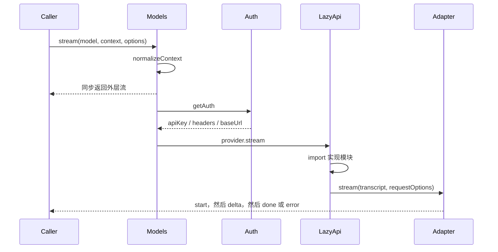
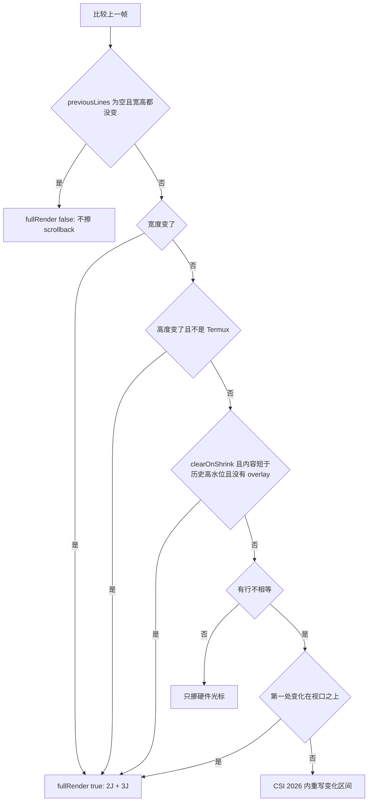
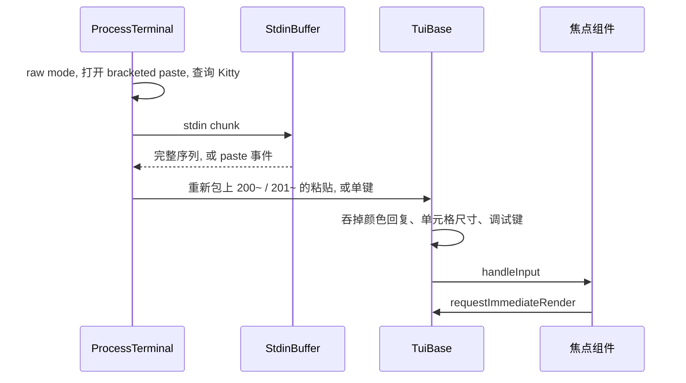
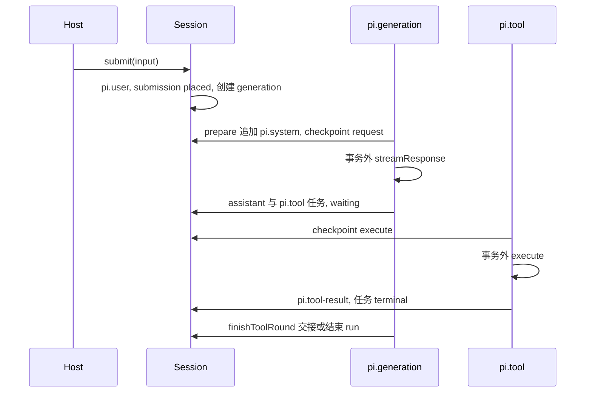
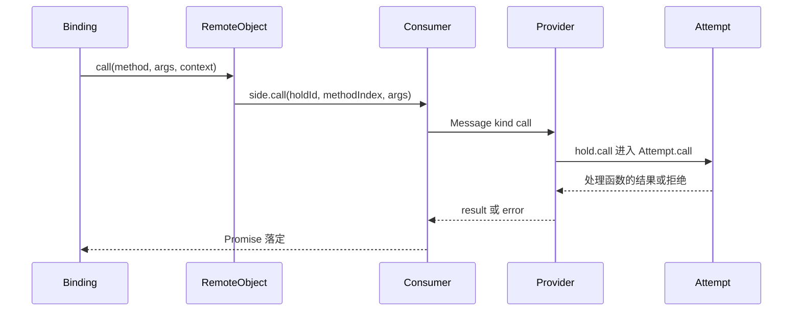
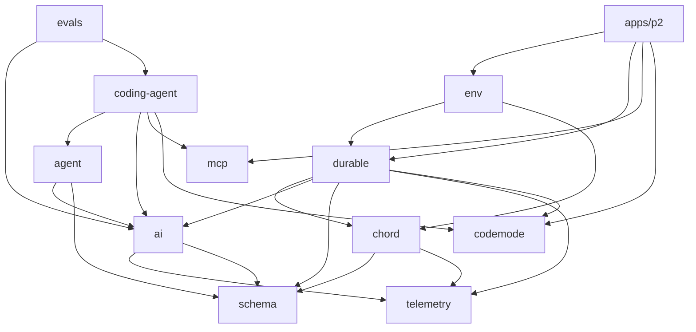
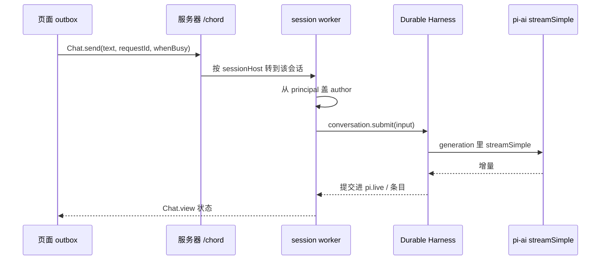

# Pi 源码精读

这份文档面向读源码，不面向使用手册。产品行为以 `packages/coding-agent/docs/` 为准。这里回答三件事：代码在哪、按什么顺序读、一次请求怎么穿过各层，以及这些形状为什么要做成这样。

仓库是 npm workspaces monorepo，Node `>= 22.19`，TypeScript 用 erasable 语法（无 enum、无参数属性）。版本以各包 `package.json` 为准，当前公开包都是 `1.5.1`（核对于提交 `e8ec20291`，2026-11-10）。深挖一到深挖三的行号是在更早的 `085c84e98` 上对的，符号名仍可用。

文档分两部分。第一部分（到「建议的阅读笔记格式」为止）是地图：架构、调用链、设计理由、阅读顺序。第二部分「逐包深挖」按包展开数据结构、关键流程、不变量、坑、练习和自检题。行号会随提交漂移，漂了就按符号名搜。

## 先建立的判断

`pi` 命令是 `@earendil-works/pi-coding-agent`。它**不**依赖 Chord，也**不**依赖 Durable。

仓库里实际有两条运行时：

| | 现在的 CLI / SDK | Durable（实验） |
|---|---|---|
| 入口 | `packages/coding-agent` | `packages/durable` |
| 循环 | 进程内 `Agent` + `runLoop` | 提交后才可见的任务状态机 |
| 会话 | JSONL 树，内存里重建活动分支 | Chord 文档 + 存储提交 |
| 模型 | `@earendil-works/pi-ai` | 同一套 `pi-ai` |
| 状态 | 进程死了，进行中的请求丢了，会话文件还在 | 进程死了，从上次 checkpoint 接着跑 |

先把 CLI 这条读通。Durable 和 Chord 是下一套架构，单独开一轮。

第三样东西是 `apps/p2`：一个自托管的 Web UI，用 Chord 插件把 Durable、pi-env、pi-tui 拼在一起。它在 README 里自称实验原型、很快会被替换，不要在上面建东西，但它是目前唯一把整套新架构串起来跑的参考实现，见「深挖九」。

构建顺序就是依赖方向（根 `package.json` 的 `build`）：

```text
telemetry → schema → chord → tui → codemode → mcp
        → ai → durable → env → agent → coding-agent
```

`evals` 不在这条链上，它是行为评测。

下面是各包 `package.json` 里 `dependencies` 的实际内部依赖（只列 `@earendil-works/*`）：

```text
coding-agent ── agent, ai, tui, mcp, codemode
  agent         工具循环、队列、事件            ── ai, schema
  ai            模型、鉴权、各家 API 流          ── schema, telemetry
  tui           终端差分渲染                    （无内部依赖）
  mcp           MCP 客户端                      （无内部依赖）
  codemode      QuickJS 沙箱里跑模型写的 JS      （无内部依赖）

env ── chord, durable                 工具在远端机器上执行（SSH + Rust daemon）
durable ── chord, ai, codemode, schema, telemetry
chord ── schema, telemetry            对象、契约、可复制状态、链接

schema、telemetry                     叶子包，无内部依赖
evals                                 只有 devDependencies：ai, coding-agent
apps/p2 ── chord, durable, env, ai, tui, mcp, codemode, schema（外加 elanor-* UI 包）
```

两点容易记错：`coding-agent` 不直接依赖 `schema`，它经 `agent`/`ai` 间接拿到；`env` 依赖 `durable`，方向不是 Durable 依赖 env。Durable 自己定义 `ExecutionEnv` 接口（`packages/durable/src/env/index.ts:377`，即 `FileSystem` 加 `Shell`），并带本地实现 `NodeExecutionEnv`（`packages/durable/src/env/node.ts:612`）；`pi-env` 提供远端实现 `RemoteExecutionEnv`。

## 一次交互请求怎么走

用户在交互模式回车，到模型看到工具结果，经过这些函数。行号会变，以符号为准。

```text
cli.ts
  setupCli(); main(argv)
main.ts
  resolveAppMode()          stdin 和 stdout 都是 TTY，且不是 --print / rpc / json → interactive
  createAgentSessionRuntime → createAgentSessionServices → createAgentSession
InteractiveMode             编辑器 onSubmit
  session.prompt(text)

AgentSession.prompt                         core/agent-session.ts
  1. 以 / 开头：扩展命令，不进模型
  2. input 扩展事件；返回 handled 则结束
  3. 展开 /skill:name 和 prompt template
  4. 正在流式：steer（本轮工具结束后插入）或 followUp（整轮结束后插入）
  5. 校验模型和鉴权
  6. _startRun → _prepareRun
       必要时先 compact
       before_agent_start
       组 user 消息（图片按当前模型限制处理）
       系统提示或工具集变了，前面插一条 system 消息
     agent.prompt(messages)
     之后：可重试错误、再次 compact、agent_before_settle，再 agent.continue()

Agent.prompt                                packages/agent/src/agent.ts
  agentLoop() → runAgentLoop() → runLoop()  packages/agent/src/agent-loop.ts

runLoop 一轮（一个 turn = 一次模型请求 + 这批评工具）：
  prepareNextTurn（上一轮结束之后才有）
  把 steering 消息写进上下文
  prepareRequest（每次请求前，可换 context / model）
  streamAssistantResponse → streamFn
  stopReason 是 error / aborted：finishTurn 后直接 agent_end
  有 toolCall：
    stopReason === "length" 时参数可能被截断，全部记失败，不执行
    否则 executeToolCalls（默认 parallel：逐个 preflight，允许的并发执行）
    beforeToolCall 可拦截；afterToolCall 可改结果
    整批结果都带 terminate 才不再请求模型
  finishTurn：end 立即停；continue 保证再请求一次
  有工具结果或 steering → 内层再转
  否则排空 followUp；都没有 → agent_end

会话里的 streamFn 是 ModelRuntime.streamSimple；compat 的 streamSimple 只是 setDefaultStreamFn 的兜底
  Models.stream                               packages/ai/src/models.ts
    解析鉴权、按 model.api 懒加载实现
  例如 api/anthropic-messages.ts
       api/openai-responses.ts
       api/openai-completions.ts
       api/google-generative-ai.ts
  统一吐出 AssistantMessageEvent：
    text_* / thinking_* / toolcall_* / done / error

工具执行回到 coding-agent 注册的 AgentTool
  core/tools/{read,bash,edit,write,grep,find,ls,powershell}.ts
  结果变成 toolResult，再进下一轮 streamFn

会话落盘：AgentSession 订阅 Agent 事件，交给 SessionManager
  core/session-manager.ts
  JSONL，每条有 id 和 parentId，当前条目决定活动分支
  当前格式版本 CURRENT_SESSION_VERSION = 3
```

四个界面共用 `AgentSession`：交互、print、JSON、RPC。JSON 不是单独的 runner，`main.ts` 用 `runPrintMode({ mode: "json" })`。RPC 自己读 stdin 上的 JSONL 命令。`modes/index.ts` 导出 `InteractiveMode`、`runPrintMode`、`runRpcMode`。读到管道内容时，已经判成 interactive 的进程会改成 print（`main.ts:957-961`）。

官方的压缩版说明在 `packages/coding-agent/docs/how-pi-works.md`，和上面这条链一致。

## 优秀设计

下面每条都是读源码时值得停下来的决定。格式固定：要解决的问题、代码落在哪、为什么必须是这个形状。理由来自实现和规格里的约束，不是功能清单。

### 1. 会话是只追加的 JSONL 树

问题：用户会从半路改口、从旧消息开一条新分支、fork 出去试另一种改法。如果会话是一条会被改写的数组，分支要么复制整个文件，要么丢掉没走的那条历史。进程在写入中途崩溃时，改写文件还会留下半截 JSON。

做法：`SessionManager` 把每条记录追加到一个 JSONL 文件。除了文件头，每条都有 `id` 和 `parentId`。当前条目沿 parent 走到根，就是活动分支，也是下一次模型请求的历史。`/tree` 换当前条目，`/fork` 把选中的历史抄进新文件。格式见 `docs/session-format.md`，版本在 `CURRENT_SESSION_VERSION`（现在是 3）。v1 是线性序列，加载时迁到树。

为什么：追加写崩溃了最多丢掉最后一行，已经落盘的行仍是合法 JSON。分支不改旧行，所以同一文件里可以留着没采纳的尝试。活动分支是读出来的投影，文件本身不保存「当前数组」这份会漂移的状态。

读：`core/session-manager.ts` 的 `SessionEntryBase`，然后找按 `parentId` 收集活动路径的函数。

### 2. 压缩是新条目，历史留在树上

问题：上下文窗口满了必须丢掉旧消息，但用户还要在 `/tree` 里看见压缩前发生了什么，下一次压缩也要知道上次摘要已经覆盖了哪一段。

做法：`core/compaction/` 从活动分支末尾往回走，留住最近约 `keepRecentTokens`（默认 2 万）的消息，把更早的一段交给模型写成结构化摘要，再追加一条 `CompactionEntry`，里面有摘要和 `firstKeptEntryId`。下次组请求时，模型只看见摘要加上该 id 之后的消息。原始条目还在文件里。从旧条目开新分支时，另有 branch summary，避免切分支后模型失去那条枝上做过的事。摘要请求关掉 prompt cache 写入，因为这种一次性提示不会被复用。

为什么：删除旧行会让树的 parent 断掉，`/tree` 和重放都无法回到压缩前。用「从哪条开始保留」做游标，摘要可以迭代：下次压缩把上一份摘要当作输入，而不是从会话开头重算。自动压缩的触发是 `contextTokens > contextWindow - reserveTokens`（`reserveTokens` 默认 16384），它只决定何时开始，不决定摘要能写多长。

读：`docs/compaction.md` 的图，再读 `compaction.ts` 的 `findCutPoint` 和 `shouldCompact`。

### 3. 系统提示和工具集写在转录里，重放即得到当前值

问题：系统提示、启用的工具会在会话中途变化（换技能、扩展调用 `setActiveTools`、压缩后重发）。如果这些只存在内存或单独的设置文件里，重开会话、换模型、从旧分支继续时，模型看到的提示会和当时不一致。整段重写系统提示还会打掉供应商的前缀缓存。

做法：第一条请求把完整分段和工具声明写成一条 `role: "system"` 消息。之后只追加补丁：`sections` 按名字替换，`null` 表示删掉一节；工具用 `toolsAdded` / `toolsRemoved` 表示差量。`declareToolChanges`（`agent-loop.ts`）在每次请求前计算「转录里已经声明的工具」和「`context.tools` 里现在能执行的工具」的差，写成下一条 system 消息。重放这些 system 消息就得到当前提示和当前工具，没有第二份提示状态。分段包在同名标签里，例如 `<tools>`、`<skills>`，后一次补丁和前一次正文对得上。

为什么：会话文件是唯一事实来源。差量补丁让稳定前缀保持不动，只有变了的那一节进入新消息，前缀缓存才有机会命中。可执行集合和声明集合分开，是因为隐藏工具、codemode、扩展可以改变「模型该看见谁」，但运行时仍要按真实注册表执行。

读：`docs/session-format.md` 里 system 消息那两行 JSON，然后读 `agent-loop.ts` 的 `declareToolChanges` 和 `system-prompt.ts` 开头的分段说明。

### 4. 会话消息比模型消息宽，边界上再收窄

问题：UI 需要展示 `!` 命令、压缩摘要、扩展塞进来的自定义卡片。供应商只接受 `system` / `user` / `assistant` / `toolResult`。把 UI 类型塞进 `pi-ai` 会让所有供应商实现依赖 coding-agent；在进模型之前丢弃又会让这些内容无法被模型利用（有的应该被看见，例如压缩摘要和 `!` 的输出）。

做法：`pi-agent-core` 的 `AgentMessage` 用声明合并扩展（`CustomAgentMessages`）。coding-agent 在 `core/messages.ts` 增加 `bashExecution`、`custom`、`branchSummary`、`compactionSummary`。循环全程携带 `AgentMessage`。只有调用 `streamFn` 时才经 `convertToLlm` 收成供应商消息：摘要变成带固定前后缀的 user 文本，`excludeFromContext` 的 `!!` 命令直接消失。

为什么：agent-core 保持供应商无关，不引用 `pi-ai/compat`。应用自己决定哪些自定义角色进上下文、以什么角色进去。模型协议变化时只改边界上的转换，会话文件格式不用跟着供应商走。

读：`packages/agent/README.md` 的 Message Flow，然后 `core/messages.ts` 的 `convertToLlm`。

### 5. 模型失败是一条 assistant 消息，不是抛出的异常

问题：供应商超时、用户按中断、上下文溢出、工具参数不合法，都要进会话、进 UI、进下一轮调度。如果 `stream()` 抛异常，调用方要有第二条错误通道，而且抛出点之前已经写出的半条消息很难再落盘。

做法：`StreamFn` 的契约写在 `packages/agent/src/types.ts`：请求失败不要 throw，要返回流，并收成 `stopReason: "error" | "aborted"` 的 `AssistantMessage`。`runLoop` 看到这两种就 `finishTurn`、`turn_end`、`agent_end`。`AgentSession._handlePostAgentRun` 再决定要不要重试或压缩后 `continue()`。`error` 和 `aborted` 上的 `finishTurn` 返回值被忽略，避免钩子把失败轮次接成死循环。

为什么：UI、JSON 模式、RPC、会话树都已经会渲染 assistant 消息。失败走同一条事件序列，订阅者不用再监听一种「循环炸了」的旁路。可恢复的溢出和长度截断留在 `AgentSession`，因为那是产品策略（要不要再花一次请求做摘要），不属于通用循环。

读：`types.ts` 里 `StreamFn` 的注释，再看 `runLoop` 里对 `stopReason` 的两个分支。

### 6. 流在同步时刻就交出去，准备工作放在流后面

问题：解析 OAuth、刷新令牌、按 `model.api` 动态加载某一家 SDK，都是异步的。若 `Models.stream` 本身是 async，调用方得先 await 准备，失败变成拒绝的 Promise，和流里的 `error` 事件成了两种失败。agent 循环希望立刻拿到可迭代对象，好把后续事件推进 `EventStream`。

做法：`api/lazy.ts` 的 `lazyStream` 同步构造 `AssistantMessageEventStream` 并返回。`setup()` 的 Promise 在后面跑；成功就把内层流逐事件转发，失败则推一条 `error` 事件并结束。动态加载放在 `api/*.lazy.ts`，真正的 HTTP 实现可以不被打进不使用的包。

为什么：调用方只有一种消费方式：`for await` 加最后的 `result()`。准备失败和供应商中途失败外观相同，重试、落盘、UI 都不用分支。同步返回也让「还没开始请求就可以 abort」成立：abort 信号在 setup 期间已经挂上。

读：`lazy.ts` 全文很短，接着打开一家 `*.lazy.ts` 看它加载哪个实现。

### 7. `pi-ai` 的包入口不带供应商

问题：OpenAI、Anthropic、Google、Bedrock 各有一份重 SDK。coding-agent 需要全部内置，但嵌进别的应用、或打浏览器包时，不该因为 `import '@earendil-works/pi-ai'` 就把每一家拖进来。

做法：`ai/src/index.ts` 只导出类型、`Models`、鉴权、faux provider 和工具函数，注释写明无副作用。工厂在 `@earendil-works/pi-ai/providers/<id>`，线路实现在 `@earendil-works/pi-ai/api/*`。`package.json` 的 `sideEffects` 只标了少数会注册表的入口。旧的全局函数留在 `compat`，新代码走 `Models` 实例。

为什么：依赖图和打包图一致。测试用 `providers/faux.ts` 可以不碰网络、不碰密钥，`coding-agent/test/suite/` 就是这么跑的。模型目录是生成的（`catalog/`），和「如何呼叫一家 API」分开，换价格和上下文窗口不用改流式解析。

读：`ai/src/index.ts` 前 10 行，再看 `models.ts` 里 `stream` 如何按 `model.api` 选择实现。

### 8. 两条队列：steer 和 followUp

问题：模型还在跑工具时，用户会再打一句。这句话有两种含义。一种是纠正当前步骤（「停，改成只读配置」），应在这一轮工具结果回到模型之前插进去。另一种是追加任务（「做完这个再跑测试」），应等当前目标自然结束。若只有一个队列，纠正会排到长任务之后，追加任务又会把正在进行的工具链打断。

做法：`Agent` 有 `steeringQueue` 和 `followUpQueue`。`runLoop` 在每轮请求前排空 steer；工具结果或 steer 会让内层循环继续。内层不再继续时才排空 followUp。`QueueMode` 为 `one-at-a-time` 时，每个排空点只取最老的一条，所以压缩这种长时间的 `prepareNextTurn` 只会补拉一次，避免一次交出两条。正在流式时，`AgentSession.prompt` 要求调用方显式给 `streamingBehavior`，交互模式据此选择。中断把还没进模型的队列交回编辑器。

为什么：插入点是调度语义，不是 UI 细节。steer 发生在 assistant 回合之后、下一次请求之前，模型能在看到工具结果的同时看到人的纠正。followUp 不参与「还有没有工具要继续」的判断，所以不会把一次已完成的回答再拉开，除非队列里真有内容。`prepareRequest` 自己不读队列，避免和 one-at-a-time 的计数打架；长时间准备之后由循环补一次 steer 轮询，用户在压缩期间打的字不会丢。

读：`packages/agent/README.md` 的 continue / queued input，对照 `runLoop` 里 `getSteeringMessages` 和 `getFollowUpMessages` 的三处调用。

### 9. 工具默认可并行，落盘顺序跟 assistant 原文

问题：一次回复里经常有多路 `read` / `grep`，串行会把延迟加在一起。并行完成后，若按完成顺序把 `toolResult` 写进上下文，下一家供应商或重放会看到和 tool call 不一致的顺序；只靠 `toolCallId` 对齐并不够，因为会话树和部分 API 都按数组顺序消费。

做法：默认 `toolExecution: "parallel"`。每个调用先按源顺序做 preflight（解析参数、`beforeToolCall`），然后允许执行的那些并发跑。`tool_execution_end` 谁先做完谁先发出，UI 可以马上画完。写入上下文和 `turn_end.toolResults` 时再按 assistant 内容里的顺序排好。批里只要有一个工具标了 `executionMode: "sequential"`，整批改回串行。

为什么：preflight 串行，是为了让钩子看到稳定的顺序，并在真正产生副作用前拦截。执行并发，是为了只让纯读重叠。整批降级而不是「串行的那个等别人」，是因为串行工具表达的是「我和同批的其它副作用有顺序」；只把它自己排队，仍会和并行的写交错。事件顺序和消息顺序分开，UI 不需要为了协议正确性而卡住显示。

读：`agent-loop.ts` 的 `executeToolCalls`，以及 `types.ts` 里 `ToolExecutionMode` 的注释。

### 10. 被截断的 tool call 不执行；提前结束必须整批同意

问题：输出顶到 `maxTokens` 时，`stopReason` 是 `length`，最后一个工具的参数 JSON 可能只写了一半。执行它会变成一次真实的半截 `edit` 或 `bash`。另一个方向：某个工具想说「到此为止，别再叫模型」。如果批里还有别的工具正在改文件，单独一条 `terminate` 会丢掉那些结果，模型下一轮看不到。

做法：`length` 且带 tool call 时，`failToolCallsFromTruncatedMessage` 给每个调用一条失败结果，不进入 `execute`。`beforeToolCall`、`afterToolCall` 和工具返回值都可以带 `terminate: true`，但 `shouldTerminateToolBatch` 要求本批每一个已完成结果都为 true，循环才不再为这批结果请求模型。

为什么：残缺参数没有安全的修补方式，失败结果仍然是合法的 `toolResult`，模型能看见「这些调用没有跑」并决定重试。`terminate` 用全批合取，是因为工具结果是一个原子回合：要么模型看见全部结果并停止，要么看见全部结果并继续。混着停会留下没有对应模型回合的副作用。

读：`runLoop` 里 `stopReason === "length"` 的分支，和 `shouldTerminateToolBatch`。

### 11. 同一个文件的修改串行，不同文件仍然并行

问题：默认并行之后，两个 `edit` 读到同一份旧内容再各自写回，后写的覆盖先写的，而且两边的 diff 都「成功」了。路径字符串还可能一个是相对路径、一个是符号链接，看起来像两个文件。

做法：`withFileMutationQueue` 用 `realpath` 当键，把针对同一 inode 的写操作接成 Promise 链。文件还不存在时 `realpath` 会 `ENOENT`，退回 `resolve` 后的路径，让并发创建也进同一条链。不同键互不等待。注册本身还有一条 `registrationQueue`，避免两个调用同时读到「还没有队列」而各建一条。

为什么：锁的粒度是文件而不是进程，读工具和写其它文件的工具保持并行。用真实路径而不是用户传入的字符串，符号链接和 `a/../b` 才会撞上一把锁。队列是进程内的，和「Pi 没有跨进程文件锁」一致；要隔离得靠容器，而不是在这里假装有分布式锁。

读：`core/tools/file-mutation-queue.ts`，看 `edit` / `write` 在哪里包上它。

### 12. 大输出按工具的阅读方向截断，并留下完整副本

问题：把命令输出或文件全文塞进上下文会撑爆窗口，而且模型会在无关日志上浪费注意力。一刀切地只留开头，会切掉命令最后的报错；只留结尾，会切掉源文件的包声明和函数签名。

做法：`truncate.ts` 同时用行数（默认 2000）和字节（默认 50KB），先到先截，并且尽量不切断一行。`read`、`grep`、`find`、`ls` 用 `truncateHead`。bash / PowerShell 的流式累积器用 `truncateTail`（`output-accumulator.ts`），因为进程的结论通常在末尾。截断标记告诉模型发生了截断。临时文件只属于 bash / PowerShell 的 `OutputAccumulator`：全文路径写进 `fullOutputPath`。`read`、`grep`、`find`、`ls` 只在结果文本里提示如何继续，不落临时文件。codemode 里调用 `bash` 时，脚本看到的上限比模型看到的更宽（约 1MiB，两头保留），模型只拿到脚本筛选后的输出。

为什么：截断策略跟「谁在读」绑定。人看文件从上面读，模型也需要头部结构；人看命令从下面看退出原因。把完整输出留在文件里，模型下一轮可以用 `read` 按偏移继续，而不是在这一轮把 10MB 日志都放进提示。

读：`truncate.ts` 文件头注释，再对照 `read.ts` 和 `output-accumulator.ts` 各调用了哪个函数。

### 13. 工具参数是一份 JSON Schema，既发给模型也用来校验

问题：工具参数要有 TypeScript 类型、要放进供应商的 tool definition、还要在执行前拒绝模型编造的字段。三份手写定义会漂移：类型允许的字段，模型 schema 里没有，或相反。用 `eval` 或代码生成做校验，在严格 CSP、以及打包进单文件二进制时都要额外运行时。

做法：`@earendil-works/pi-schema` 的 builder（`obj`、`str`、`opt`…）返回普通 JSON Schema。`Static<typeof Schema>` 从这份 schema 推出类型。`compile` 把 schema 编成一次性闭包，`check` 是无分配的热路径。同一对象交给供应商。不传 `formats` 时，`format` 只是注解（`packages/schema/src/types.ts:16-19`）。`validateToolArguments` 会把标准 `formats` 传进去（`packages/ai/src/utils/validation.ts:15`），已知格式会被检查；映射里没有的名字仍然跳过（`packages/schema/src/compiler.ts:280-282`）。

为什么：模型看见的契约和运行时拒绝的契约是同一份数据。schema 包不依赖其它 pi 包，Chord 的契约、MCP 的 inputSchema、内置工具可以共用。编译成闭包而不是生成源码，是为了在不能 `eval` 的环境里仍然接近代码生成校验器的速度。

读：`packages/schema/README.md` 的 Quick Start，再看 `core/tools/read.ts` 的参数 schema 如何同时成为工具定义。

### 14. codemode：脚本里的工具调用不进入模型上下文

问题：模型若用普通工具循环去「读 30 个文件、过滤、再算」，每一跳都是一轮完整请求，上下文里堆满中间结果，费用和延迟都线性涨。把 Node 的 `fs` 暴露给模型写的脚本，脚本就拥有了和 Pi 进程一样的权限，还绕过了工具钩子。

做法：`@earendil-works/pi-codemode` 在 QuickJS WASM 里把脚本当成 async 函数体执行。沙箱没有文件系统、网络和计时器。外面的能力只通过注入的 `tools.*` 进来，参数和返回值走 JSON。脚本可以用 `Promise.all` 并行调用。回到模型的只有 `text()` / `image()` / `return` 和失败信息。`store` / `load` 的成功写入追加为会话里的 custom 条目，所以换分支不会看见另一条枝上的键。内置扩展是 `replaceable`：用户用同名工具换掉它时，内置实现退出，而不是两个 `codemode` 并存。

为什么：中间结果留在沙箱里，模型上下文只增加一份脚本和一份筛选后的输出。工具调用仍走 `AgentTool.execute`，`beforeToolCall`、文件队列、截断都还在。WASM 解释器没有宿主 API，权限边界是「能调用的工具」，和进程沙箱是两层不同的东西。store 进会话树，是为了和分支语义一致：状态跟着走过的那条 parent 链，而不是一份全局 Map。

读：`packages/codemode/README.md` 开头，再读 `coding-agent/src/extensions/codemode/tool.ts` 如何把会话工具注进沙箱。

### 15. 差分渲染，并且一帧一次提交

问题：每打一个字就清屏重画，光标和选择会闪。逐行 `write` 时，终端会把半帧画出来。主屏模式还要和用户的滚动缓冲区共存，不能接管整个屏幕。

做法：组件实现 `render()`，返回字符串行。`TuiMainScreen` 记住上一帧的行，差分路径只重写变化区间。同步输出序列（CSI 2026，`\x1b[?2026h` / `\x1b[?2026l`）由 `TuiMainScreen.doRender` 和 `TuiAltScreen.doRender` 自己写，调用方只 `requestRender()`。宽度变化、高度变化、变化滚出视口时会整屏重绘，并 `CSI 2J` + `CSI 3J` 清掉 scrollback。图片行用终端图形协议。全量重绘才删掉上一帧全部 Kitty id；普通差分只删变化区间里的旧 id。`TUI` 接口下面还有备用屏实现，滚动由应用自己管，因为备用屏没有可靠的终端滚动缓冲。

为什么：差分把一次按键的输出从「整个对话」降到「改动的那几行」。同步输出把这些写合并成用户可见的一次更新，避免看到先擦掉再补上的中间态。组件不碰 stdout，渲染器才能换主屏或备用屏，测试也能喂一个假终端。

读：`packages/tui/README.md` 的 Features，再看 `tui-main-screen.ts` 里 `previousLines` 如何参与下一帧。

### 16. 项目信任只管加载哪些资源

问题：项目里的 `AGENTS.md`、扩展、skills 是可执行或可影响提示的输入。打开一个不信任的仓库不该自动跑它的扩展。与此同时，如果在工具层做一套「允许读哪些路径」的权限系统，又会和用户真正要用的沙箱（容器、micro-VM）重复，而且必然有漏洞。

做法：`project-trust.ts` 在加载项目设置和项目资源之前做一次信任决定。未信任就不加载那些资源。信任之后，`read` / `bash` / `edit` 使用启动 `pi` 的那个用户的操作系统权限。扩展跑在同一进程里。需要隔离时用文档里的三种容器化，而不是工具里的路径白名单。

为什么：把「这段代码会不会被加载」和「加载之后能做什么」拆开。前者 Pi 能可靠地做，因为它发生在自己的启动顺序里。后者一旦做成应用层 ACL，模型仍可能通过 `bash` 绕过，用户会误以为已经隔离。诚实的边界让容器方案成为唯一的隔离机制。

读：`docs/how-pi-works.md` 最后一节，以及根 README 的 Permissions & Containerization。

### 17. Durable：看得见的进度都已经提交；外部动作不在提交回调里

问题：CLI 的循环把状态放在内存里，进程在模型请求中途死掉，会话文件里有上一轮，进行中的这一轮没有。重开只能靠用户再发一次。若把「调用模型、跑 bash、写会话」放在同一个事务里，事务会跨网络等待，锁住整条写入线，崩溃时还会留下执行到一半的外部副作用和没提交的记录。

做法：`pi-durable` 的规格第一条是：一次 Session 提交把不可变 entry、任务记录和文档原子写下去。已落盘的提交按变更线顺序发布。延迟提交是例外：内存采纳后就给 watch 和会话视图，`observeCommits()` 仍等落盘，崩溃会丢掉那个窗口（`packages/durable/docs/spec.md` 不变量 2、3）。group commit 让存储调用重叠：回调可以在更早一笔还在存储时开始，直到读到那笔写过的 key 才等发布（`packages/durable/src/session/session.ts:204-211`）。任务是状态机，每步 checkpoint。`pi.generation` 调模型，拥有自己的 `pi.tool` 子任务。不变量 4：外部效果不在 Session 的变更事务里执行。存储错误让这次打开的 Session 失败，必须重新打开，避免在坏掉的写入线上继续发看起来成功的事件。

为什么：崩溃恢复变成「从最后一条已提交的 checkpoint 继续」，而不是「猜内存里跑到哪」。模型请求死掉算一次失败的尝试，可以重试；连续把进程打崩的请求会结束，而不是无限重启。外部效果放在事务外，提交回调就可以只做内存里的 JSON 变更并尽快落盘，bash 的副作用用工具任务自己的状态来记录「已经跑过」，避免恢复时无条件再跑一遍。

读：`packages/durable/docs/spec.md` 开头的 core rule 和不变量 1–8，再读 `harness/generation.ts` 的 checkpoint 类型。CLI 主路径不必先读这一套。

### 18. Chord：调用方拿到的是引用；JSON 修订靠所有权，不靠冻结

问题：对象会热更新、会跨进程，调用方如果握住真实对象，换实现时所有指针都失效，远程和本地的调用方式也不一样。状态要同步给多个观察者，若每次全量拷贝，大文档的开销在每次按键上；若 `Object.freeze` 整棵树，又要在热路径上遍历。

做法：`get` 返回引用，不返回对象。`local` 对象的身份是 `(类型, 参数)`；其他对象再加 principal，键是 `name|key|principalKey`（`packages/chord/src/data/params.ts:25-31`）。状态是 JSON，观察者先拿快照再拿增量。`@earendil-works/chord/delta` 用所有权约定不可变：`track()` 之后调用方不再改那棵树，草稿只在 `beginChange` 到 `prepare` 之间可写，`applyImmutable` 与权威版本共享没改过的子树。非法就地修改不会被检测，会静默破坏，这是写明的代价。热更新时每个受影响的 live 对象都 restart，没有安全点上的纯 swap。旧调用只在 `reloadDrainTimeout` 内用旧代码跑完，默认 5 秒且不超过 `closeTimeout`（`packages/chord/src/host/host.ts:620`）。到点未结束的调用被切成 `released`。文档挂在对象上，可以跨 attempt；`self.writable` 从新的 initial 开始，内存 job 以 `aborted { reload }` 结束。

为什么：引用让本地调用和跨链接调用变成同一种写法，热更新只换引用背后的实现。结构共享让增量同步不必复制整份会话。不做防御性冻结，是因为这份代码坐在热路径上，而调用方都是 Chord 自己的运行时；规格把「谁可以写」写成所有权表，而不是在每次读时再检查一遍。

读：`packages/chord/README.md` 前两节，然后 `packages/chord/docs/design.md`。v2 就是现在的 `packages/chord/src`，`docs/next/design.md` 不存在。

### 19. 遥测没有环境上的「当前 span」

问题：异步 agent 里，一个请求会扇出成工具、子任务、压缩。用 `AsyncLocalStorage` 保存当前 span，会在队列、定时器和跨进程恢复时悄悄串线：steer 进来的新输入可能继承到不该继承的 trace，重开进程时又没有这个存储。

做法：`@earendil-works/pi-telemetry` 只定义 `TelemetryContext` / `TelemetrySpan`。span 通过参数传递。`NOOP_TELEMETRY_CONTEXT` 是默认值，库代码不需要判断「有没有装遥测」。适配器由应用持有，不放进 Chord 的 `Context`。Durable 把 trace carrier 存进任务 JSON，恢复时从载体抽出父 span，而不是假设进程内还有调用栈。记录的属性是 id 和控制信息；消息正文、工具参数和结果不进 span，避免遥测后端变成第二份会话库。

为什么：显式传递在序列化、跨进程和测试里都看得见。noop 让库可以无条件打点，调用方不接适配器就没有开销也没有分支。内容和 id 分开，是因为 trace 会送到进程外，而会话里才是正文的存放处。

读：`packages/telemetry/README.md` 开头，以及 `durable/README.md` 里 `pi.durable.*` 那一段哪些字段被记录。

### 设计之间的关系

这几条是一套，不是散点：

- 会话文件是事实来源（1、2、3）。内存里的 `Agent` 状态是活动分支的投影。
- 模型协议是窄边界（4、5、6、7）。宽出来的部分留在会话和 UI。
- 一轮工具调用是一个原子回合（9、10、11）。并行只发生在这个回合内部，对外仍是有序的 `toolResult` 列表。
- 能力尽量做成「少放进上下文」而不是「再加一个代理角色」（12、13、14）。截断、schema、codemode 都是在控制模型每一轮真正看见的字节。
- Durable / Chord 把 CLI 里「投影 + 内存循环」换成「提交 + 引用」（17、18）。读的时候用 CLI 的会话树去对照，不要把两套类型混成一套。

## 精读顺序

每轮读完再进下一轮。大文件按函数读，不要从头滑到尾。

### 第 0 轮：地图（1 小时）

1. 根 `README.md` 的 Packages 表。
2. `packages/coding-agent/docs/how-pi-works.md`（约 50 行，先读完）。
3. `packages/coding-agent/docs/message-types.md`、`session-format.md`、`compaction.md`。
4. 根 `package.json` 的 `workspaces` 和 `build`，确认依赖方向。

### 第 1 轮：把一条请求走通

按调用顺序，只追主路径：

| 顺序 | 文件 | 看什么 |
|---|---|---|
| 1 | `packages/coding-agent/src/cli.ts` | 两行：`setupCli` + `main` |
| 2 | `packages/coding-agent/src/main.ts` | `resolveAppMode`、`createAgentSessionRuntime`、模式分发。文件很长，其余分支先跳过 |
| 3 | `packages/coding-agent/src/core/sdk.ts` | `createAgentSession`、`CreateAgentSessionOptions`。工具白名单、`setDefaultStreamFn(streamSimple)` |
| 4 | `packages/coding-agent/src/core/agent-session-services.ts` | cwd 绑定的服务：`ModelRuntime`、`SettingsManager`、`ResourceLoader` |
| 5 | `packages/coding-agent/src/core/agent-session.ts` | 只读 `prompt`、`_startRun`、`_prepareRun`、`_handlePostAgentRun` |
| 6 | `packages/agent/src/types.ts` | `StreamFn`、`AgentEvent`、`AgentTool`、`QueueMode`、`ToolExecutionMode` |
| 7 | `packages/agent/src/agent-loop.ts` | `runLoop`、`declareToolChanges`、`executeToolCalls` |
| 8 | `packages/agent/src/agent.ts` | `prompt` / `steer` / `followUp` / `continue` 怎么喂给 loop |
| 9 | `packages/ai/src/types.ts` | `Model`、`Context`、`AssistantMessage`、`stopReason` |
| 10 | `packages/ai/src/models.ts` | `Models.stream` / `streamSimple` 如何选 API 和鉴权 |
| 11 | `packages/ai/src/api/lazy.ts` | 同步返回流，鉴权和动态 import 在流后面做 |
| 12 | 任选一个 API 实现 | 建议 `api/openai-responses.ts` 或 `api/anthropic-messages.ts`，看事件如何映射成统一流 |
| 13 | `packages/coding-agent/src/core/tools/read.ts` | 一个工具的模板：schema、`execute`、截断 |
| 14 | `packages/coding-agent/src/core/session-manager.ts` | `SessionHeader`、`SessionEntry`、追加与按 parent 重建分支 |

读完应能回答：用户文本在哪变成 `role: "user"`，工具参数在哪校验，结果在哪写回 JSONL。

### 第 2 轮：上下文怎么拼

模型看不到会话里的全部条目。活动分支要先变成 LLM 消息。

| 文件 | 作用 |
|---|---|
| `core/messages.ts` | 声明合并出 `bashExecution`、`custom`、`branchSummary`、`compactionSummary`。`convertToLlm` 把它们收成 `user` / `assistant` / `toolResult` |
| `core/system-prompt.ts` | 系统提示分段：基础说明、工具、skills 目录、AGENTS/上下文文件、cwd。分段进 `SystemMessage.sections` |
| `core/skills.ts` | skill 发现。正文默认不进每次请求，`/skill:name` 或模型读文件才展开 |
| `core/prompt-templates.ts` | `/template` 在变成 user 消息之前展开 |
| `core/compaction/` | `shouldCompact`、`findCutPoint`、`generateSummary`。摘要是新条目，旧条目留在树上 |
| `packages/agent/README.md` 的 Message Flow | `transformContext` → `convertToLlm` → `Message[]` |

`AgentMessage` 比 LLM 消息宽。只有 `user`、`assistant`、`toolResult`、`system` 能直接送进供应商；其余角色必须在 `convertToLlm` 里消掉。这是 agent-core 用声明合并留的扩展点（`CustomAgentMessages`）。

### 第 3 轮：工具、扩展、资源

| 文件 | 作用 |
|---|---|
| `core/tools/index.ts` | `createCodingTools` 只有 `read` `bash` `edit` `write`。`createReadOnlyTools` 是 `read` `grep` `find` `ls`。`powershell` 只在 `createAllTools` |
| `core/bash-executor.ts` | `!` 命令，和模型调用的 bash 工具不是同一条 UI 路径 |
| `core/tools/file-mutation-queue.ts` | 写文件串行，避免并行 edit/write 互相踩 |
| `core/extensions/types.ts` | 扩展能注册的全部事件和 `ExtensionAPI`。先读类型，再读实现 |
| `core/extensions/loader.ts` | 从设置、包、项目目录加载 |
| `core/extensions/runner.ts` | 按事件调用 handler |
| `core/resource-loader.ts` | skills、prompt templates、themes、扩展、上下文文件 |
| `extensions/index.ts` | 内置扩展：`llama.cpp`、`codemode`、`tool-search`、`mcp`。后三个 `replaceable`：同名注册会换掉内置，而不是叠着跑 |
| `core/project-trust.ts`、`core/trust-manager.ts` | 项目资源加载前的信任决定。信任不等于沙箱；工具权限等于启动 `pi` 的用户 |

扩展事件里和主循环最相关的：`input`、`before_agent_start`、`context`、`tool_call` / `tool_result`、`turn_end`、`agent_before_settle`。完整列表以 `extensions/types.ts` 为准，用户向说明在 `docs/extensions.md`。

### 第 4 轮：交互 UI

TUI 是独立库。先读库，再读 Pi 怎么用它。

| 文件 | 作用 |
|---|---|
| `packages/tui/src/tui.ts` | `TUI` 接口：组件、焦点、overlay、输入 |
| `packages/tui/src/tui-main-screen.ts` | 默认主屏渲染。差分更新，CSI 2026 同步输出 |
| `packages/tui/src/components/editor.ts` | 输入框 |
| `packages/tui/src/keybindings.ts` | 键匹配。应用级动作走 keybinding 表；`Editor` 对换行仍硬编码，这不是编译器强制的禁令 |
| `coding-agent/src/modes/interactive/interactive-mode.ts` | 把 `AgentSession` 事件画成组件。7302 行，按功能跳：启动、提交、渲染消息、slash、中断 |
| `modes/interactive/theme/theme.ts` | 主题加载 |

`interactive-mode.ts` 不要通读。从 `session.prompt` 的调用点往上找编辑器提交，往下找 `AgentSessionEvent` 的订阅。

### 第 5 轮：模型与鉴权

`packages/ai/src/index.ts` 故意没有副作用：不带全量目录、不带各家工厂。工厂在 `@earendil-works/pi-ai/providers/*`，旧的全局 API 在 `@earendil-works/pi-ai/compat`。`sdk.ts` 仍把 compat 的 `streamSimple` 装进 `setDefaultStreamFn` 当兜底。会话里的 `Agent` 用的是 `modelRuntime.streamSimple`（`packages/coding-agent/src/core/sdk.ts:412-422`）。

| 路径 | 作用 |
|---|---|
| `ai/src/models.ts` | `Models`：注册 provider、`getModel`、`stream`、刷新动态目录 |
| `ai/src/auth/` | 环境变量、`auth.json`、OAuth 刷新。解析在 `auth/resolve.ts` |
| `ai/src/providers/*.ts` | 一家一个工厂。先读 `providers/openai.ts`、`providers/anthropic.ts` |
| `ai/src/api/*` | 一家线路一个实现。`*.lazy.ts` 只负责动态加载 |
| `ai/catalog/` | 目录生成。`generate.ts` 拉上游，写出 `providers/data/*.json`（gitignore）和 `models.generated.ts` |
| `ai/src/providers/faux.ts` | 测试用假 provider。`coding-agent/test/suite/` 走它，不打真 API |
| `coding-agent/src/core/model-runtime.ts` | CLI 侧的模型运行时：凭证、`models.json`、覆盖 |
| `coding-agent/src/core/model-registry.ts` | 扩展注册的自定义 provider / 模型 |

改模型数据：改 `packages/ai/catalog/`，再生成。不要手改 `packages/ai/src/models.generated.ts`。

`api` 字段决定走哪个实现，例如 `openai-responses`、`openai-completions`、`anthropic-messages`、`google-generative-ai`。OpenAI 兼容端点多数复用 completions 或 responses，差异在 provider 的 `compat`。

### 第 6 轮：另外三个可独立阅读的包

和主循环正交，用到再读。

**schema**（`packages/schema/src/`）

JSON Schema 构建和校验，无 `eval`。`builders.ts` 产生普通 schema 对象，`compiler.ts` / `validator.ts` 编成闭包。工具参数、Chord 契约都用它。入口：`index.ts`，先看 README 的 builder 表。

**mcp**（`packages/mcp/src/`）

不依赖官方 MCP SDK，也不依赖其它 pi 包。`client.ts` 是协议客户端，`transports/` 是 stdio、Streamable HTTP、内存传输，`oauth/` 是客户端 OAuth 子集。coding-agent 的包装在 `src/extensions/mcp/`。

**codemode**（`packages/codemode/src/`）

模型写的 JS 跑在 QuickJS WASM 里，能力只有注入的 `tools.*`。嵌套工具调用不进 LLM 上下文，只有脚本输出和返回值进去。`runtime/worker.ts` 是 Node/Bun 每执行一个 worker；`runtime/inline.ts` 在调用线程跑。coding-agent 的工具在 `src/extensions/codemode/`。

### 第 7 轮：Durable 和 Chord（另一条产品线）

确认 CLI 主路径已经能跟完再开始。

Durable 的概念在 `packages/durable/README.md` 前 100 行就够用：

- `Harness`：一份打开的存储。单笔提交在落盘后才发布；延迟提交在内存采纳时就进 watch，`observeCommits()` 才等落盘。变更线一次只跑一个回调，但存储调用可以重叠（group commit）。
- `Conversation`：不可变 entry 的转录。模型只看最近一次 reset 之后的 entry。
- `Task`：每步 checkpoint。内置 `pi.generation` 调模型，并拥有 `pi.tool` 子任务。
- 一次回答：`submit` → `pi.user` → `pi.generation` → `pi.assistant` → `pi.tool` → `pi.tool-result` → 下一轮 generation。

源码入口：

| 文件 | 作用 |
|---|---|
| `durable/src/harness/harness.ts` | `Harness.open`、`root`、`submit` |
| `durable/src/harness/generation.ts` | 模型轮次状态机 |
| `durable/src/harness/tool.ts` | 工具任务 |
| `durable/src/harness/compaction.ts` | 压缩任务 |
| `durable/src/entries.ts` | `pi.user`、`pi.assistant`、`pi.tool-result` 等 entry 种类 |
| `durable/src/session/session.ts` | 会话与提交 |
| `durable/src/storage/` | memory、jsonl、sqlite、indexeddb |
| `durable/src/tools/` | 和 CLI 类似的 read/edit/write/bash，但是 Durable 的 `ExecutionEnv` |
| `env/src/` | SSH 上跑 Rust daemon，工具在远端，凭证和存储留在本地 |

Chord 是 Durable 的宿主运行时：对象用引用访问，状态是可观察 JSON，热更新换代码、留下 state。原来的 v2 重写（`src/next/`、`src/next-node/`）已经合入主线，那两个目录不存在了。现在 `packages/chord/src/` 按能力分目录：`contracts/`、`host/`、`link/`、`documents/`、`delta/`、`jobs/`、`registries/`、`store/`、`sync/`，以及客户端面 `surfaces/`、`web/`、`react/`、`tui/`。规则书是 `packages/chord/docs/design.md`，取舍记录在 `docs/decisions.md`，切片 spec 是 `docs/slice-*.md`（目录在 `docs/slices.md`）。读某一片要连同 `design.md` 全文读，不要只读切片 spec 里引用的小节。详见「深挖七」。

`packages/telemetry` 是各包共用的 span / metric 契约，没有全局 current span，也没有导出器。`InMemoryTelemetryContext` 是参考实现。Durable 的 span 名（`pi.durable.submit`、`pi.durable.phase`）写在它的 README 里，实现在 `durable/src/harness/telemetry.ts`。

## 包内文件地图

下面是精读时的目录职责，不是文件清单。

### `packages/agent`（6 个源文件，整包可读）

```text
src/types.ts        类型契约
src/agent-loop.ts   循环。先读这个
src/agent.ts        有状态外壳：队列、订阅、abort
src/stream-fn.ts    可选的全局 fallback。未调用 setDefaultStreamFn 就读它会抛错；sdk.ts 装的是 compat 的 streamSimple，只给没传 streamFn 的 Agent
src/proxy.ts        代理辅助
src/index.ts        再导出
```

事件顺序以 `packages/agent/README.md` 的 Event Flow 为准：`agent_start` → `turn_start` → `message_*` → 可选 `tool_execution_*` → `turn_end` → 可能再 `turn_start` → `agent_end`。`subscribe` 的监听器按注册顺序 await。`agent_end` 之后循环不再发事件，但 `prompt()` 要等 `agent_end` 的监听器跑完。

### `packages/coding-agent/src`

```text
cli.ts / main.ts / rpc-entry.ts     进程入口
cli/                                参数、登录命令、首次设置、会话选择
config.ts                           路径：~/.pi/agent、包内资源。禁止用 __dirname，走这里的 helper
core/sdk.ts                         编程入口 createAgentSession
core/agent-session.ts               会话生命周期。最大的文件
core/agent-session-runtime.ts       换 cwd / 换会话时拆掉并重建 runtime
core/session-manager.ts             JSONL 树
core/compaction/                    自动与手动压缩
core/tools/                         内置工具
core/extensions/                    加载、运行、类型
core/model-*.ts                     模型解析与运行时
core/auth-storage.ts                凭证文件
core/settings-manager.ts            设置层叠
core/resource-loader.ts             资源发现
core/system-prompt.ts               系统提示
core/messages.ts                    自定义消息和 convertToLlm
modes/interactive/                  TUI 应用
modes/print-mode.ts                 打一次就退出
modes/rpc/                          JSONL RPC
extensions/                         内置扩展实现
utils/                              路径、剪贴板、图片、git
```

SDK 对外导出集中在 `src/index.ts`。读公开 API 时从这里进，再跳到实现。

### `packages/ai/src`

```text
index.ts            无副作用核心
types.ts            消息、模型、流事件
models.ts           Models 集合
auth/               凭证解析
api/                各供应商流实现
providers/          工厂和模型表。data/ 是生成的 JSON，不进 git
catalog/            生成器，不在 src 里
utils/              溢出判断、重试、流式 JSON、校验
compat.ts           旧全局 API
```

流事件是统一的：`start`，然后 text、thinking、toolcall 各自的 `*_start` / `*_delta` / `*_end`，最后 `done` 或 `error`（`packages/ai/src/types.ts:831-847`）。`done` 的 reason 还有 `deferred`。工具参数的增量解析是 `ToolCallArgumentsStream` 里的 `StreamingJsonParser`（`packages/ai/src/utils/streaming-json.ts`）。`partial-json` 只留在 `parseStreamingJson`，`src` 里没有调用方。真正执行前 agent-loop 还会 `validateToolArguments`。

### `packages/tui/src`

组件在 `components/`。渲染器是 `tui-main-screen.ts` 和 `tui-alt-screen.ts`，都实现 `TUI`。原生按键修饰在 `native/`（darwin / linux / win32）。读交互模式卡在输入或重绘时再进来。

## 读的时候抓住的不变量

理由在「优秀设计」。这里只留检查清单，读到相关代码时用来核对：

1. **LLM 边界很窄。** 自定义角色留在会话里。`convertToLlm` 只在 `streamFn` 之前执行。见设计 4。
2. **工具声明和可执行工具是两套。** `declareToolChanges` 用差量把它们对齐。见设计 3。
3. **活动分支才是上下文。** 压缩追加摘要，不删历史。见设计 1、2。
4. **steer 和 followUp 插入点不同。** 流式时 `prompt` 必须显式选择。见设计 8。
5. **失败是 assistant 消息。** `error` / `aborted` 结束底层循环，重试和压缩在 `AgentSession`。见设计 5。
6. **并行工具的事件顺序和落盘顺序不同。** 完成顺序发事件，源顺序写 `toolResult`。见设计 9。
7. **项目信任不等于沙箱。** 工具权限等于进程权限。见设计 16。
8. **两套压缩不要混。** CLI 在 `core/compaction/`，Durable 是 `CompactionTask`。见设计 2 和 17。

## 第一遍不要读

| 路径 | 原因 |
|---|---|
| `packages/ai/src/models.generated.ts` | 生成物 |
| `packages/ai/src/providers/data/` | 生成的模型 JSON，且 gitignore |
| `packages/ai/src/providers/*.models.ts` | 每家模型表，需要时再查一家 |
| `packages/ai/src/auth/oauth/` 全部供应商 | 登录流程，和主循环无关 |
| `coding-agent/src/modes/interactive/components/easter-egg-3d.ts` | 彩蛋 |
| `coding-agent/src/core/export-html/` | 会话导出 HTML |
| `packages/chord/` | 不读 Durable 就不要进 |
| `apps/p2/` | 实验原型，读完 Durable 和 Chord 再看 |
| `packages/evals/` | 评测套件，要真模型密钥 |
| `packages/*/test/` | 用来对照行为，不适合当第一遍主线 |

测试想看行为时，优先 `packages/agent/test` 和 `packages/coding-agent/test/suite/`（faux provider）。不要为了读源码跑 `npm test`：根测试包含有密钥才会激活的 e2e。

## 和文档的对照

读源码时这些页面够用，不必先通读 `docs/`：

| 问题 | 文档 |
|---|---|
| 产品级数据流 | `packages/coding-agent/docs/how-pi-works.md` |
| 会话文件 | `docs/session-format.md`、`docs/sessions.md` |
| 消息角色 | `docs/message-types.md` |
| 扩展 API | `docs/extensions.md` |
| SDK | `docs/sdk.md` |
| RPC | `docs/rpc.md` |
| 模型配置 | `docs/models.md`、`docs/providers.md` |
| 压缩 | `docs/compaction.md` |
| agent 循环细节 | `packages/agent/README.md` |
| Durable | `packages/durable/README.md` |
| Chord 入口与 API 总览 | `packages/chord/README.md` |
| Chord 规则书与取舍 | `packages/chord/docs/design.md`、`docs/decisions.md` |
| Chord 插件写法 | `packages/chord/docs/plugin-authoring.md`、`docs/plugin-primer/book.md` |
| p2 | `apps/p2/README.md`、`apps/p2/docs/p2-notes.md`。README 里的 `/voice/listen`、`/voice/speak` 已过时：插件是 `WS /voice/room`，而 `voice-server/server.py` 仍是 `/listen`、`/speak`，没有 `/room` |

## 建议的阅读笔记格式

每读完一个文件，用固定四行，避免笔记变成摘抄：

```text
文件：
职责（一句）：
入口函数：
它调用的下一跳：
我仍不确定的不变量：
```

第 1 轮结束后，用自己的话写出「从 `InteractiveMode` 到 `anthropic-messages` 再回到 `SessionManager.append`」的调用链。写不出来就回到 `agent-session.ts` 的 `_startRun`，不要进入 Chord。

## 逐包深挖

下面按包展开。深挖一到深挖三的行号对应提交 `085c84e98`，深挖四及以后对应 `e8ec20291`。第一部分已经讲过的概述这里不重复，只补它没写到的分支和不变量。

## 深挖一：pi-agent-core（Agent 与 agent loop）

### 定位

`@earendil-works/pi-agent-core`（`packages/agent`，6 个源文件）只做一件事：拿一份已经存在的 `AgentContext`，反复向 `StreamFn` 要 assistant 消息，执行里面的工具调用，把新消息以事件交出去。

它不管会话文件、压缩、权限、系统提示怎么拼、模型从哪来。这些都在 `coding-agent`。它依赖 `pi-ai`（消息、`validateToolArguments`、`getToolStateChanges`）和 `pi-schema`（工具参数的 `Static<>`）。`coding-agent` 和测试是它的调用方。

两层入口，不要混：

- 低层是 `agentLoop` / `agentLoopContinue` 和 `runAgentLoop` / `runAgentLoopContinue`。调用方传入 context 的副本、config 和 `emit`。循环改的是这份副本。
- 高层是 `Agent`。它持有真正的 transcript、两个队列和 abort controller，把循环事件折进 `state`，再按注册顺序 await 监听器。

### 文件地图

| 文件 | 职责 |
|---|---|
| `packages/agent/src/types.ts` | `StreamFn`、`AgentLoopConfig`、`AgentMessage`、`AgentTool`、`AgentEvent` |
| `packages/agent/src/agent-loop.ts` | 内外循环、工具声明差量、流式响应、工具执行 |
| `packages/agent/src/agent.ts` | 队列、订阅、`prompt` / `continue` / `abort`、事件折进 state |
| `packages/agent/src/stream-fn.ts` | `setDefaultStreamFn` / `getDefaultStreamFn`，没有内置实现 |
| `packages/agent/src/proxy.ts` | `streamProxy`：走自有服务器，本地把 delta 拼回 partial |
| `packages/agent/src/index.ts` | 再导出 |
| `packages/agent/test/agent-loop.test.ts` | 循环、队列、钩子、`terminate`、截断 |
| `packages/agent/test/agent.test.ts` | `Agent` 的队列、`continue`、监听器结算 |

### 核心数据结构

`AgentMessage` 是 pi-ai 的 `Message`，再并上 `CustomAgentMessages`。这个接口默认为空，靠 declaration merging 加角色。`types.ts` 示例里写的模块名是 `@mariozechner/agent`，那是旧名。coding-agent 实际合并的是 `@earendil-works/pi-agent-core`：

```70:77:packages/coding-agent/src/core/messages.ts
declare module "@earendil-works/pi-agent-core" {
	interface CustomAgentMessages {
		bashExecution: BashExecutionMessage;
		custom: CustomMessage;
		branchSummary: BranchSummaryMessage;
		compactionSummary: CompactionSummaryMessage;
	}
}
```

这些自定义角色只活在 transcript 里。发给模型之前必须被 `convertToLlm` 变成 `system` / `user` / `assistant` / `toolResult`，或者滤掉。默认实现只做过滤，见 `packages/agent/src/agent.ts:39-47`。

`AgentContext` 只有两块运行时数据，都不落盘：`messages` 是本轮可见 transcript，`tools` 是当前能执行的工具。模型看见的工具列表不是这个数组，而是 transcript 里 system 消息上的 `toolsAdded` / `toolsRemoved` 折出来的结果。

`AgentToolResult` 里要分清三件事。`content` 才是模型看见的。`details` 给 UI 和日志。`structuredContent` 给程序调用方，不进模型上下文；`outputSchema` 描述它的形状。`terminate` 只是提前结束的投票，一张票不够。`usage` 是工具自己的用量，不计入主上下文。

`AgentTool.replay` 取值 `"never" | "safe"`，注释写的是「持久化意图已在、结果未知时的恢复策略」。agent-core 自己不解释这个字段，Durable 才用。

`AgentState.systemPrompt` 是只读的，从 transcript 的 system 消息回放出来（`getCurrentSystemPrompt`）。改提示不能赋值，要追加一条带 `content` 或 `sections` 的 system 消息。`initialState.systemPrompt` 只会在 `messages` 还没有以 system 开头时，变成第一条 system 消息（`agent.ts:86-87`）。

### 关键流程

#### 一次 `prompt()` 的外壳

`prompt` 在已有 `activeRun` 时直接抛错，文案要求改用 `steer()` 或 `followUp()`（`agent.ts:383-386`）。`steer` 和 `followUp` 不看 `activeRun`，任何时候都能入队。

`runWithLifecycle` 建一个 `AbortController`，把 `isStreaming` 设为 true，然后跑 executor。executor 抛出的异常不会冒泡给 `prompt()` 的调用方：`handleRunFailure` 造一条 `stopReason` 为 `error` 或 `aborted`、`content` 为空文本的 assistant 消息，补发 `message_start`、`message_end`、`turn_end`、`agent_end`（`agent.ts:542-557`）。这条路径没有 `turn_start`。

`finally` 里 `finishRun` 清掉 `isStreaming`、`streamingMessage`、`pendingToolCalls`，resolve `waitForIdle`，再把 `activeRun` 置空。`agent_end` 发出去之后，监听器还在 `processEvents` 里被 await；`waitForIdle()` 要等这些监听器结束才 resolve。这是 README 的 Event Flow 和 `agent.ts:354-360`、`568-573` 共同保证的。

`processEvents` 是 Agent 状态的唯一写入点。循环拿到的是 `messages.slice()` 和 `tools.slice()`（`agent.ts:469-473`），两边数组不共享。`message_end` 把消息推进 Agent 的数组；`message_start` 只更新 `streamingMessage`，不入库。所以钩子若在 `message_end` 之前抛错，Agent transcript 里不会留下半条 assistant，只会多出 `handleRunFailure` 那条。

#### 循环：先 steer，后 follow-up

`runLoop`（`agent-loop.ts:172`）外面一层等「本来要停了」的 follow-up，里面一层消化工具调用和 steering。

1. 进入时先 `getSteeringMessages()` 一次。用户可能在上一轮结束后、这次 `prompt` 开始前就 `steer` 过。
2. 内层：若上一轮已经完成，先 `prepareNextTurn`，再在 `pendingMessages` 仍为空时补一次 steering。注释写明只在上次轮询为空时才补，否则 `one-at-a-time` 会在同一轮送出两条（`agent-loop.ts:210-215`）。然后发 `turn_start`。第一轮没有 `lastCompletedTurn`，不走这里；`turn_start` 已由 `runAgentLoop` 在循环外发出。
3. `declareToolChanges` 改写待插入消息，逐条 `message_start` / `message_end`，推进 context 和 `newMessages`。
4. `prepareRequest`。它不轮询队列。在它运行期间进来的 steering 要等到步骤 2 或步骤 7。
5. `streamAssistantResponse`。`stopReason` 为 `error` 或 `aborted` 时仍调用 `finishTurn`，但丢掉返回值，发 `turn_end` 和 `agent_end` 后 return。这是硬退出，不看队列。
6. 有工具调用就执行。`stopReason === "length"` 时一个都不执行，全部回错误结果，`terminate` 固定为 false，让模型下一轮重发完整参数（`agent-loop.ts:273-278`、`488-512`）。
7. `finishTurn`，然后 `turn_end`。返回 `{ action: "end" }` 就 `agent_end` 并 return，不再轮询。`{ action: "continue" }` 先记到 `explicitContinuation`。接着轮询 steering。若还有工具后续或 steering，这个标记被清掉，因为下一轮请求已经有了，不需要额外的空转。
8. 内层退出后才 `getFollowUpMessages()`。有则塞进 `pendingMessages`，`continue` 外层。没有，且 `explicitContinuation` 仍为真，就再空转一轮（上下文不变，再要一次模型）。然后清标记，避免无条件 `continue` 以外的死循环；若 `finishTurn` 每次都返回 `continue`，下一轮还会再置上，循环不会停。README 把这件事写明了。

`QueueMode` 在 `PendingMessageQueue`（`agent.ts:149-180`）。`"all"` 一次取光，`"one-at-a-time"` 只取最老的一条。两个队列默认都是 `"one-at-a-time"`（`agent.ts:255-256`）。`peek` 优先 steering，steering 空才看 follow-up。

#### 流式响应与 LLM 边界

`streamAssistantResponse`（`agent-loop.ts:390`）的顺序是固定的：`transformContext`（可无）→ `convertToLlm` → `normalizeContext` → `getApiKey`（没有再用 `config.apiKey`）→ `streamFunction`。`identity` 用 `mergeClientIdentity(DEFAULT_AGENT_IDENTITY, config.identity)` 盖上去。`DEFAULT_AGENT_IDENTITY` 只有 `{ attribution: PI_ATTRIBUTION }`（`agent-loop.ts:41`）。

流事件里，`start` 把 partial 推进 context 并发 `message_start`。文本、thinking、toolcall 的 start/delta/end 替换 context 末尾并发 `message_update`。`done` 和 `error` 都走 `response.result()`，把 partial 换成最终消息，发 `message_end`。流提前结束、没有 `done`/`error` 时，函数末尾仍取 `result()` 并补发 `message_end`（`agent-loop.ts:470-478`）。最终消息会带上 `thinkingLevel: config.reasoning ?? "off"`。

`StreamFn` 的契约在 `types.ts:27-31`：请求失败不能 throw，要放进 `stopReason: "error" | "aborted"` 的 assistant 消息。`transformContext`、`convertToLlm`、`getApiKey`、两个队列函数同样不允许 throw。throw 会跳出低层循环，落到 `Agent.handleRunFailure`，事件序列不再是 README 画的那条。

#### 工具调用

执行模式在 `executeToolCalls`（`agent-loop.ts:518-532`）。全局 `toolExecution === "sequential"`，或者这一批里任意一个工具的 `executionMode === "sequential"`，整批改成顺序执行。默认全局是 `"parallel"`。

单次调用的准备在 `prepareToolCall`（`agent-loop.ts:718`）：

1. 按名字找工具。找不到，立即错误结果 `Tool ${name} not found`。
2. `prepareArguments`，再 `validateToolArguments`。校验抛错变成错误结果，不抛出循环。
3. `beforeToolCall`。`{ block: true }` 用 `reason` 或默认的 `"Tool execution was blocked"`。`terminate: true` 抄到结果上。
4. `beforeToolCall` 返回之后，以及决定放行、真正返回 `prepared` 之前，各看一次 `signal.aborted`。命中就用 `"Operation aborted"`，不再调用 `execute`。钩子自己也要遵守这个 signal，循环不会替它中断。

真正执行在 `executePreparedToolCall`。`onUpdate` 在 `execute` 的 promise 落下后就被丢掉（`acceptingUpdates = false`），已发出的 update 会先 `Promise.all` 再返回。`execute` 抛错同样变成错误结果。`durationMs` 用 `performance.now()`，四舍五入到毫秒；没跑到 `execute` 的调用没有这个字段。

`afterToolCall` 按字段替换，不深合并。只给了 `content` 却没给 `structuredContent` 时，结构化结果被删掉，因为两者可能已经对不上（`agent-loop.ts:894-905`）。钩子自己抛错会把整份结果换成错误文本。

`runToolCall`（`agent-loop.ts:821`）走同一套准备、执行、收尾，但不发事件、不写消息。嵌套工具调用应走它，权限钩子才会作用到内层。

并行批的事件顺序：先按源顺序逐个 `tool_execution_start` 并准备；能跑的放进并发数组；每个完成后立刻 `tool_execution_end`（完成序）；`Promise.all` 保住源顺序后，再按源顺序发 toolResult 的 `message_start` / `message_end`。顺序批则是每个调用 start、end、message 走完才下一个。

`shouldTerminateToolBatch` 要求本批每一个已收尾结果的 `terminate === true`，且至少有一个（`agent-loop.ts:700-701`）。混进一个普通结果，循环继续。

`content` 为空时写成 `[]`，避免 JS 扩展漏字段把 `null` 写进会话（`agent-loop.ts:945-947`）。

#### `continue()` 的三条路

`agent.ts:393-419`：

- 没有消息，或全都是 system：抛 `"No messages to continue from"`。队列不动。
- 最后一条不是 assistant：`runAgentLoopContinue`。启动时会轮询 steering，follow-up 要等到内层自然退出。
- 最后一条是 assistant：不能直接续。先 `drain` 一批 steering，作为新 prompt 跑，并且 `skipInitialSteeringPoll`。已经取出的那批是 prompt 本身，不在队列里；这个开关挡住的是循环入口那一次 `getSteeringMessages`，否则 `one-at-a-time` 下还排着的下一条会立刻跟进来。没有 steering 再取一批 follow-up，当作新 prompt。两队都空才抛 `"Cannot continue from message role: assistant"`。

低层 `agentLoopContinue` 自己也拒绝空 context 和 assistant 结尾（`agent-loop.ts:86-92`）。`Agent.continue` 先拦住，所以正常走 `Agent` 时看不到这两句，直接调 `agentLoopContinue` 才看得到。

#### 工具声明差量

`declareToolChanges`（`agent-loop.ts:342`）在每次把待插入消息写进 context 之前运行，包括 `runAgentLoop` 的初始 prompt。

它在待插入消息里从后往前找最后一条 system。找到了，就把这条的 `toolsAdded` / `toolsRemoved` 当成调用方意图，先抹掉再跟「已提交 transcript + 其余待插入消息」比较，用 `getToolStateChanges` 换成相对 `context.tools` 的差量。没找到且确实有变化，就新造一条 `content: ""` 的 system，插在第一条非 system 消息之前；全是 system 时追加到末尾。没有变化且原消息也没写工具字段时，原数组原样返回，连对象都不换。

回放不变量写在函数注释里：把这些差量再跑一遍，得到的工具集应正好等于当时的 `context.tools`。

#### `proxy.ts`

`streamProxy` 是一个 `StreamFn`：POST 到 `proxyUrl`，服务器为了省带宽剥掉事件里的 `partial`，客户端用 `ToolCallArgumentsStream` 把 text/thinking/toolcall 重新积成 `AssistantMessage`。`done` 的 `reason` 只能是 `stop | length | toolUse`，`error` 只能是 `aborted | error`（`proxy.ts:22-45`）。`Agent` 不依赖它。要走代理时，把它当作构造参数里的 `streamFn`。

### 设计要点与不变量

1. 循环不碰 `Agent` 的数组。破坏它（把 `state.messages` 直接传进 `runAgentLoop`）会让 `message_end` 再 push 一次，transcript 里每条消息出现两遍。
2. 模型只在 `streamAssistantResponse` 里见到 `convertToLlm` 的输出。`context.systemPrompt` 和 `context.tools` 不传给 `StreamFn`，`types.ts:23-25` 写明系统提示和工具声明都在 transcript 的 system 消息上。
3. `error` / `aborted` 结束本轮运行，不读 `finishTurn` 的决定，不排空队列。队列里的消息还在，下次 `prompt` 或 `continue` 才会被取走。
4. `terminate` 是全批与，不是或。只给一个工具标 `terminate` 不会停。
5. 并行时 `tool_execution_end` 是完成序，toolResult 消息是源序。UI 若按事件到达顺序插 DOM，会和最后落盘的顺序不一致。
6. 监听器按 `subscribe` 的注册顺序 await，抛错会卡住后续监听器和 `waitForIdle`。`agent_end` 之后循环不再发事件，但 run 还没结束。
7. `reset()` 在 `activeRun` 存在时抛错。它只留当前回放出来的那一条 system 基线，并清空两个队列（`agent.ts:363-376`）。

### 边界情况与坑

- `types.ts:357` 的 declaration merging 示例模块名是 `@mariozechner/agent`。按它写，自定义角色不会进 `AgentMessage`。要以 `packages/coding-agent/src/core/messages.ts:70` 为准。
- `stopReason === "length"` 时，流式 JSON 修补可能已经产出能通过 schema 的参数，但内容是截断的。循环故意全部不执行。错误文本要求模型带完整参数重发（`agent-loop.ts:502-504`）。
- 顺序执行中途 abort，`executeToolCallsSequential` 在当前工具收尾后 `break`（`agent-loop.ts:585-587`）。后面的 tool call 没有对应的 toolResult。并行准备阶段 abort 同样丢掉还没入队的调用。下一轮若没有被同一个 signal 立刻打成 `aborted`，provider 会看到对不上的 tool call。
- `beforeToolCall` 看到的 `args` 是校验后的值，但 `tool_execution_start` 里的 `args` 仍是模型原始 `toolCall.arguments`。两者可以不一样，因为中间有 `prepareArguments`。
- `afterToolCall` 只替换 `content` 时会丢掉 `structuredContent`。要保留就必须两个一起返回。
- `finishTurn` 对错误轮也会被调用。里面如果无条件做副作用（记成功、改会话），会把失败记成成功。README 的迁移示例先判断 `stopReason`。
- `prepareNextTurn` 和 `prepareNextTurnWithContext` 同时存在时，Agent 只用带 context 的那个（`agent.ts:497-501`）。
- `getDefaultStreamFn` 在没人调用 `setDefaultStreamFn` 时抛错，不是静默走某个供应商。`packages/coding-agent/src/core/sdk.ts:46` 把 `streamSimple` 装进去。直接 `new Agent({ streamFn })` 则不依赖这个全局量。

### 测试

`packages/agent/test/agent-loop.test.ts` 和 `test/agent.test.ts` 不打真实模型。它们 `setDefaultStreamFn` 成一个立刻结束的假流，用脚本化的 assistant 消息驱动循环，断言事件序列和队列取走了几条。看 `terminate`、`length` 截断、`one-at-a-time` 时，先读这两个文件里的假 `StreamFn`，再对 `runLoop`。仓库当前没有 `node_modules`，先装依赖才能跑 `npx vitest run test/agent-loop.test.ts`。

### 动手练习

1. 在 `shouldTerminateToolBatch` 里临时改成 `some`。用一个 `terminate: true` 和一个普通工具的批次跑 `agent-loop.test.ts` 里相关用例，看本来会继续的轮次停在哪里，然后改回去。
2. 写一个 20 行的脚本：`new Agent({ streamFn, initialState })`，`streamFn` 第一次返回带两个 toolCall 的消息，工具一个 `executionMode: "sequential"`。在 `tool_execution_end` 里打时间戳，确认两个 `execute` 没有重叠。
3. `subscribe` 里对 `agent_end` 延迟 200ms。调用 `prompt` 之后立刻看 `state.isStreaming`，再 `await waitForIdle()`。前者在监听器结束前仍为 true。
4. assistant 结尾时先 `steer` 两条，`steeringMode` 保持默认的 `"one-at-a-time"`，`await continue()`。只应消耗最老的一条 steering。再把 `steeringMode` 设为 `"all"` 试一次，两条一起进入同一次 `prompt`。
5. `convertToLlm` 里故意 `throw`。确认 `prompt()` 本身不抛，transcript 末尾是一条 `stopReason: "error"` 的 assistant，并且没有成对的 `turn_start`。

### 自检问题

1. steering 和 follow-up 各在循环的什么位置被取走？
<details><summary>答案</summary>
steering 在 `runLoop` 入口、`prepareNextTurn` 之后（仅当手头还没有 pending）、以及 `turn_end` 之后且没有 `{ action: "end" }` 时取走。follow-up 只在内层因为「没有待执行工具、也没有 steering」而退出之后取走。`prepareRequest` 运行期间不取。见 `agent-loop.ts:185`、`213-215`、`304`、`310-316`。</details>

2. 为什么并行工具的 `tool_execution_end` 和 toolResult 消息顺序不同？
<details><summary>答案</summary>
`tool_execution_end` 在每个并发任务完成时就发。toolResult 的 `message_start` / `message_end` 要等 `Promise.all` 之后，按 assistant 里 tool call 的源顺序发。落盘和下一轮模型看到的顺序是源顺序，不是完成顺序。见 `agent-loop.ts:629-664`。</details>

3. `finishTurn` 返回 `{ action: "continue" }`，而这轮已经有工具结果，会多打一次模型吗？
<details><summary>答案</summary>
不会。工具结果已经让 `hasMoreToolCalls` 为真，循环把 `explicitContinuation` 清掉，下一轮就是消化工具结果的那一轮。只有没有任何自然后续时，外层才用这个标记再请求一次。见 `agent-loop.ts:303-322`。</details>

4. 模型报错时，队列里的 steering 会不会被丢掉？
<details><summary>答案</summary>
不会被循环取走，也就不会丢。`error` / `aborted` 在 `finishTurn` 之后直接 `agent_end` 返回，后面的 `getSteeringMessages` 不会跑。消息还在 `PendingMessageQueue` 里。见 `agent-loop.ts:254-264`。</details>

5. `Agent.state.messages` 和循环里的 `currentContext.messages` 是不是同一个数组？
<details><summary>答案</summary>
不是。`createContextSnapshot` 做了 `slice()`。Agent 的数组只在 `processEvents` 的 `message_end` 里增长。两边可以共享同一条消息对象，但 push 和替换数组互不影响。</details>

6. 自定义消息怎样才会被模型看见？
<details><summary>答案</summary>
声明合并进 `CustomAgentMessages` 只让它能放进 transcript。`convertToLlm` 必须把它变成四种 LLM 角色之一。默认实现会滤掉任何其他 `role`。转换发生在每次 `streamAssistantResponse`，不写入 transcript。</details>

7. 一批三个工具，只有两个返回 `terminate: true`，循环停吗？
<details><summary>答案</summary>
不停。`shouldTerminateToolBatch` 要求每个已收尾结果都为 true。校验失败、未知工具、`beforeToolCall` 拦住但没带 `terminate`，都算反对票。</details>

8. `waitForIdle()` 和「收到 `agent_end`」差在哪？
<details><summary>答案</summary>
`agent_end` 表示循环不会再发事件。`processEvents` 还要按注册顺序 await 监听器，`finishRun` 才把 `isStreaming` 置 false 并 resolve `activeRun.promise`。`prompt()` 和 `waitForIdle()` 都等的是后者。见 `agent.ts:568-573` 和 `560-565`。</details>

9. 为什么 `stopReason === "length"` 时参数已经通过 schema 也不执行？
<details><summary>答案</summary>
流式参数用补全过的 JSON 收尾，截断处可能补成合法但不完整的对象。`failToolCallsFromTruncatedMessage` 给每个调用一条错误结果，让模型重发。`terminate` 为 false，所以还会再要一轮。见 `agent-loop.ts:481-512`。</details>

10. `continue()` 在 assistant 结尾、两条队列都有消息时，先跑哪条？
<details><summary>答案</summary>
先 `drain` steering，整批当作新的 `prompt`，并跳过循环入口的第一次 steering 轮询。follow-up 留在队列里，等这次运行自然停下来才取。两队都空才抛错。见 `agent.ts:403-416`。</details>

## 深挖二：AgentSession、会话树与压缩

### 定位

`AgentSession`（`packages/coding-agent/src/core/agent-session.ts`）是 CLI 这条运行时的会话对象。它把用户输入变成 `Agent.prompt` 的消息，把循环事件写进 `SessionManager`，并在一轮结束后决定要不要重试或压缩。

它不实现工具循环。循环在 `pi-agent-core`，见深挖一。它也不画 TUI。交互模式只是调用 `prompt()` 并听事件。

会话文件是 JSONL 树，只追加。活动上下文是从当前叶子走到根的那一条路径，再按最近一次 compaction 裁剪。进程死了，文件还在；进行中、还没 `append` 成功的那一条不在文件里。

### 文件地图

| 文件 | 职责 |
|---|---|
| `core/agent-session.ts` | `prompt`、`_startRun`、重试、自动压缩、扩展边界 |
| `core/session-manager.ts` | JSONL 树、叶子、分支、投影 |
| `core/messages.ts` | 自定义角色，以及 `convertToLlm` |
| `core/compaction/compaction.ts` | 阈值、切点、摘要 |
| `core/compaction/branch-summarization.ts` | 换分支时的摘要 |
| `core/system-prompt.ts` | 系统提示各段的顺序和差量 |
| `core/resource-loader.ts` | AGENTS.md、skills、SYSTEM.md 的发现 |
| `core/skills.ts` | skill 目录加载和同名冲突 |
| `core/project-trust.ts` | 项目是否可信 |

### 核心数据结构

文件第一行是头，没有 `parentId`：

```43:50:packages/coding-agent/src/core/session-manager.ts
export interface SessionHeader {
	type: "session";
	version?: number; // v1 sessions don't have this
	id: string;
	timestamp: string;
	cwd: string;
	parentSession?: string;
}
```

其余每行都是 `SessionEntry`：`id`、`parentId`、`timestamp`，再加上 `type`。`CURRENT_SESSION_VERSION` 是 `3`（`session-manager.ts:41`）。类型联合在 `session-manager.ts:183-194`：

| type | 进不进模型上下文 |
|---|---|
| `message` | 进。里面的 `AgentMessage` 原样投影 |
| `custom_message` | 进。变成 `custom` 角色，再由 `convertToLlm` 变成 user |
| `compaction` | 进。可选地带上当时的 `systemMessage`，再加上 `compactionSummary` |
| `branch_summary` | 进。变成 `branchSummary` |
| `thinking_level_change` / `model_change` | 不进消息列表。沿路径最后一条决定当前 thinking 和 model |
| `usage` | 不进 |
| `custom` | 不进。给扩展存自己的状态 |
| `label` / `session_info` | 不进。书签和显示名 |
| `context_edit` | 不自己变成消息。它改写更早某条的 content，或把它从上下文里拿掉 |

`context_edit.replacement === null` 表示目标不进入模型上下文，但文件里的原条目还在（`session-manager.ts:174-179`）。

这些自定义角色在 `messages.ts:70-77` 合并进 `CustomAgentMessages`：`bashExecution`、`custom`、`branchSummary`、`compactionSummary`。

### 关键流程

#### `prompt()` 到循环

`AgentSession.prompt`（`agent-session.ts:2162`）的顺序：

1. 若正在发 `agent_settled`，把这次 `prompt` 推迟，避免和结算重入。
2. 文本以 `/` 开头且允许展开模板时，先找扩展命令。找到就立刻执行 handler，即使当前正在流式输出。handler 抛错也算处理过，不再把原文送给模型（`agent-session.ts:2268-2290`）。
3. 压缩或分支摘要还在跑，抛 `"Cannot submit a prompt while compaction is in progress..."`。
4. `_preparePrompt`：先发 `input` 扩展事件。返回 `handled` 就结束。返回 `transform` 就换掉文本和图片。然后展开 `/skill:name` 和 prompt template（`agent-session.ts:2219-2223`）。
5. 正在流式输出时必须带 `streamingBehavior`。`"steer"` 进 steering 队列，`"followUp"` 进 follow-up 队列。没带就抛错。队列语义见深挖一。
6. 没在流式输出时检查模型和凭证。没有模型、没有 key，或 OAuth 失败，都抛错，不启动循环。
7. `_startRun` 在通过上面这些检查之后才把 `_isAgentRunActive` 设为 true。注释写明这样做是为了挡住检查期间的树导航（`agent-session.ts:2186-2187`）。

`_prepareRun`（`agent-session.ts:1996`）在真正 `agent.prompt` 之前：

1. 用上一条 assistant 调 `_checkCompaction(..., false)`，把被中断的回复也算进去。
2. 发 `before_agent_start`。扩展可以改 `selectedTools`，或自己调用 `setActiveTools()`。没有显式改列表时，以当前活动工具为准，避免把 `setActiveTools` 的结果覆盖掉。
3. 用户文本先按当前模型的图片限制做归一化。失败的图片不进内容，变成文本 hint。
4. 拼上 pending nextTurn 消息和扩展返回的 `custom` 消息。系统提示或工具集有变化时，一条 system 差量插到最前。

然后 `agent.prompt(messages)`。循环返回后 `_handlePostAgentRun`：可重试错误就准备重试并 `continue()`；否则压缩；否则看队列里还有没有消息。再往后是 `agent_before_settle`。扩展可以要求再 `continue()`，但上下文必须仍能续（最后一条不能是无法续的 assistant，否则报告非法续跑并停）。

#### 树和叶子

追加只发生在 `_appendEntry`（`session-manager.ts:1192`）。新条目的父指针是当前 `leafId`，然后叶子前进到这条。`branch(id)` 只把叶子挪到已有条目，不改、不删旧行（`session-manager.ts:1590-1594`）。下一次 append 就成为那条的另一个孩子。`resetLeaf()` 把叶子置空，下一条是新的根。

加载时叶子是文件里最后一条非 header 记录，不是按时间戳选的（`session-manager.ts:1104-1121`）。所以「当前分支」等于「文件末尾那条所在的路径」。从旧节点开分支并追加之后，文件末尾就是新叶子，旧分支还在文件里，只是不在从叶子到根的路径上。

`buildSessionPath` 从叶子沿 `parentId` 走到根，再反转（`session-manager.ts:390-415`）。`parentId` 指向不存在的 id 时路径在那里断开。

#### 投影

`buildContextEntries`（`session-manager.ts:476`）在这条路径上找最后一条 `compaction`。没有就整条路径都算上下文。有的话，上下文是：

1. 这条 compaction 自己。
2. 路径上、compaction 之前、从 `firstKeptEntryId` 开始的条目。其中 `message` 且角色是 `system` 的丢掉，因为摘要条目自己带了当时的 system 快照。
3. 路径上 compaction 之后的全部条目。

更早的对话不在上下文里，但还在文件里。路径上更早的 compaction 若落在保留区间内，仍然留在条目列表里，但 `buildSessionProjection` 只让下标 0 的那条 compaction 产生摘要消息（`session-manager.ts:559-565`）。

同一目标可以有多条 `context_edit`，后写的覆盖先写的。投影时 `replacement: null` 让该条贡献变成空数组。

`sessionEntryToContextMessages` 对坏数据做了兜底：system 的 content 为 null 时写成 `""`，user / assistant / toolResult 为 null 时写成 `[]`（`session-manager.ts:442-450`）。

#### 写盘

只有出现 user 或 assistant 消息之后才创建文件。只有 model、thinking、system 的空会话关掉程序不会留文件。从 user 消息开始落盘，是为了第一轮没跑完时提示还在（`session-manager.ts:1161-1166`）。

第一次落盘用 `openSync(path, "wx")` 独占创建，把内存里已有的全部行写进去。之后每次只 `appendFileSync` 一行 JSON。没有 fsync。迁移改了内存里的旧行时，`_rewriteFile` 用 `"w"` 整文件重写（`session-manager.ts:1125-1134`）。

`_persist` 抛错时，`_appendEntry` 把这条从内存弹出，叶子退回上一跳（`session-manager.ts:1199-1205`）。否则后面的条目会指向一个文件里不存在的父 id。

目录在 `~/.pi/agent/sessions/` 下，cwd 里的 `/`、`\`、`:` 换成 `-`（`session-manager.ts:590-594`）。

版本迁移在加载时原地做，有变化就重写文件（`session-manager.ts:1093-1094`）：

- v1 没有版本字段。v1→v2 给每条补 `id` / `parentId`，把 compaction 的 `firstKeptEntryIndex` 换成 `firstKeptEntryId`。
- v2→v3 把消息角色 `hookMessage` 改名为 `custom`。

坏行在 `parseSessionEntries` 里跳过。这是给测试和压缩用的解析器；正式加载走 `loadEntriesFromFile`。

#### `convertToLlm`

`messages.ts:148`。`bashExecution` 在 `excludeFromContext` 时丢掉，否则变成描述命令和输出的 user 文本。`custom`、`branchSummary`、`compactionSummary` 都变成 user，后两者带固定前后缀。四种标准角色原样通过。`switch` 的 default 是 `never`，新角色不加进这里就过不了类型检查。

#### 压缩

默认 `enabled: true`，`reserveTokens: 16384`，`keepRecentTokens: 20000`（`compaction.ts:126-130`）。

触发公式在 `shouldCompact`（`compaction.ts:267-269`）：

```text
enabled 且 contextTokens > contextWindow - reserveTokens
```

`contextTokens` 优先用最后一条有效 assistant 的 `usage.totalTokens`，没有就用 input + output + cacheRead + cacheWrite。`aborted`、`error`、全 0 的 usage 不算有效（`compaction.ts:148-160`）。估算补尾用 `estimateTokens`：字符数除以 4 向上取整，图片按 4800 字符。

`_checkCompaction` 的三条自动路径写在 `agent-session.ts:3088-3095`：

1. 溢出且可重试：上下文溢出错误，或输出在模型原始上限之下就停了的 length。删掉失败的 assistant，压缩，再试这一轮一次。
2. 溢出但不重试：回复本身成功，但已经超过窗口。压缩，留下这条回复。
3. 没溢出，但用量越过阈值。压缩，不重试。

另外几条提前返回：设置关了；用户取消（`aborted`，除非是 prompt 前那次检查）；这条 assistant 来自另一个模型（换到更大窗口后，旧模型的溢出不能触发新模型的压缩）；这条 assistant 的时间戳不晚于最近一条 compaction。

切点在 `findCutPoint`（`compaction.ts:446`）。从新往旧累加估算 token，第一次达到 `keepRecentTokens` 时，取不早于该条的最近合法切点。合法切点是 user 或 assistant，不是 toolResult。切在带工具调用的 assistant 上时，它后面的 toolResult 会留下来。切在一轮中间时，`isSplitTurn` 为 true，摘要要带上这一轮开头到切点之前的内容。切点再往前吞并不产生上下文的元数据条目，但停在 compaction 或真正可见的消息上。

摘要请求用 `SUMMARIZATION_SYSTEM_PROMPT`。`details` 里记下 `readFiles` 和 `modifiedFiles`，下次压缩会继承上一份非 hook 生成的文件清单（`compaction.ts:60-87`）。扩展可以在 `session_before_compact` 取消或自己给摘要；`fromHook: true` 用来和 pi 自己生成的摘要区分。

`appendCompaction` 把摘要追加成新叶子。旧消息不删。下次 `buildSessionContext` 就从这条边界重建。

#### 系统提示和资源

`buildSystemPromptSections`（`system-prompt.ts:128`）按这个顺序放段：

1. `preamble`：有 `customPrompt` 就只用它。否则是默认身份句，加上 `tools`、`rules`、`docs`。
2. `addendum`：`APPEND_SYSTEM.md` 或等价的追加文本。
3. `project_context`：AGENTS.md 一类文件。
4. `skills`：只有当前声明的工具里能读到 skill 文件时才加。`read` 优先于 `bash`；两者都没声明但选中列表里有，提示里写 `indirect`。
5. `cwd`：反斜杠换成正斜杠。
6. 调用方的自定义段。段名必须匹配 `SYSTEM_PROMPT_SECTION_NAME`，不能叫 `preamble`。

除 `preamble` 外，每段包进同名 XML 标签。`forceSystemPrompt` 时没有这些段，整段原文放进 `content`（`system-prompt.ts:198-203`）。发给模型的是 transcript 里的 system 消息，不是每次现拼的字符串。变了的段用 `diffSystemPromptSections` 打成补丁。

上下文文件由 `loadProjectContextFiles`（`resource-loader.ts:260`）收集。每个目录只取第一个存在的文件，顺序是 `AGENTS.override.md`、`AGENTS.md`、`AGENTS.MD`、`CLAUDE.md`、`CLAUDE.MD`。全局 `agentDir` 放最前，然后从文件系统根到 cwd 的祖先。嵌套 git worktree 若和主仓库的上下文文件是同一逻辑范围，主仓库那份会被跳过，避免读两遍。

skills 先加载 `agentDir/skills`（user），再加载项目 `.pi/skills`。同名时先加载的赢，后加载的记一条 collision（`skills.ts:437-452`）。同一真实路径（软链）只收一次。

项目信任在 `resolveProjectTrusted`（`project-trust.ts:47`）。显式 override 优先。目录里没有需要信任才加载的项目资源时，用已记住的决定，没有记录就当信任。有这类资源时，先问扩展的 `project_trust`，再看 trust store，再看 `defaultProjectTrust`：`always`、`never`，或 `ask`。没有 UI 时 `ask` 得到 false。不信任时项目设置不加载（`settings-manager.ts:484-487`），项目里的 `SYSTEM.md` 也不读（`resource-loader.ts:1247`）。信任不等于沙箱，工具权限仍是进程权限。

### 设计要点与不变量

1. 文件只追加。改历史的办法是移动叶子再追加，或追加 `context_edit`。没有原地改某一行的 API。
2. 模型上下文是路径加最近 compaction，不是整个文件。分支上没走到的消息不会进 `convertToLlm`。
3. compaction 不删除被摘要的条目。换叶子或关掉这条 compaction 的保留逻辑，旧消息还在。
4. 内存和文件一起进退。写盘失败的条目不能留在 `byId` 里当别人的父节点。
5. 系统提示的权威副本在 transcript 的 system 消息上。`buildSystemPrompt` 只负责算出下一份差量。
6. user 技能盖过同名的项目技能，因为 user 目录先加载。

### 边界情况与坑

- 叶子是文件顺序的最后一条，不是时间戳最大的那条。手工插入或重排 JSONL 会换分支。
- 迁移把 v1 的下标换成 id 之后整文件重写。重写用 `"w"`，中途崩溃会留下半截文件。正常追加没有这个窗口，因为 `wx` 失败就不会把 `flushed` 设为 true。
- `context_edit` 只换 content。assistant 的 usage、stopReason、toolCall id 仍来自原消息。压缩估算在有 context edit 时改走投影估算，不用那条可能已经过时的 usage（`agent-session.ts:3212-3213`）。
- 换模型后，旧模型的溢出错误不会给新模型触发压缩（`agent-session.ts:3113-3117`）。
- 压缩进行中调用 `prompt` 会抛错，不会排队。
- 扩展命令和普通斜杠模板不是一条路。扩展命令在模板展开之前，而且流式期间也会执行。
- `custom` 条目不进上下文。扩展若想让模型看见，要用 `custom_message`。

### 测试

`packages/coding-agent/test` 里会话和压缩用真 `SessionManager` 写临时 JSONL，模型用 faux provider。看切点和迁移时直接读 `compaction.test.ts` 对 `findCutPoint`、`migrateSessionEntries` 的断言。仓库当前没有 `node_modules`，跑不了 vitest。

### 动手练习

1. 找一份会话 JSONL，把最后一行的 `parentId` 改成更早某条 user 的 id，重新打开。活动上下文应停在那条的路径上，文件后半段还在，但不在上下文里。改完把父指针改回去。
2. 在 `shouldCompact` 里临时把比较改成 `>=`。用一份刚好等于 `contextWindow - reserveTokens` 的 usage 看会不会多压一次，然后改回去。
3. 会话进行中拔掉对 `sessionFile` 的写权限，再发一条消息。`_appendEntry` 应抛错，并且 `getLeafId()` 仍是上一条。
4. 项目里同时放 `AGENTS.md` 和 `CLAUDE.md`。只有 `AGENTS.md` 进 `project_context`。再加 `AGENTS.override.md`，它盖过同目录的 `AGENTS.md`。
5. user 技能目录和项目技能目录放同名 skill。确认提示里的路径是 user 那份，diagnostics 里有 collision。

### 自检问题

1. 为什么压缩之后旧消息还在文件里，模型却看不见？
<details><summary>答案</summary>
`buildContextEntries` 只保留最近一条 compaction、它的 `firstKeptEntryId` 之后直到这条 compaction 之前的条目，以及 compaction 之后的条目。更早的路径被丢掉。文件本身只追加，不删行。见 `session-manager.ts:499-510`。</details>

2. `branch()` 写了什么？
<details><summary>答案</summary>
什么都不写。它把 `leafId` 指到已有 id。下一次 `append` 的 `parentId` 才是这个 id，从而在树上长出新枝。见 `session-manager.ts:1590-1594`。</details>

3. 阈值压缩的不等式是什么？
<details><summary>答案</summary>
`contextTokens > contextWindow - reserveTokens`，并且 `enabled`。默认 reserve 是 16384。见 `compaction.ts:267-269` 和 `126-130`。</details>

4. 切点能不能落在 toolResult 上？
<details><summary>答案</summary>
不能。合法切点是 user 或 assistant。累加越过 `keepRecentTokens` 时，取得不早于该条的最近合法切点。切在带工具调用的 assistant 上时，后面的 toolResult 留下来。见 `compaction.ts:436-476`。</details>

5. `custom` 和 `custom_message` 差在哪？
<details><summary>答案</summary>
`custom` 只给扩展存状态，`buildSessionContext` 忽略它。`custom_message` 会变成 `custom` 角色消息，`convertToLlm` 再把它变成 user。见 `session-manager.ts:118-126` 和 `147-165`。</details>

6. 第一次用户消息之前，会话文件在哪？
<details><summary>答案</summary>
还不在磁盘上。只有 user 或 assistant 消息出现后，`_persist` 才用 `wx` 把已有行一次写出去。只有设置类条目的会话退出后不留文件。见 `session-manager.ts:1161-1186`。</details>

7. 写盘失败时叶子会怎样？
<details><summary>答案</summary>
`_appendEntry` 弹出这条，`byId` 删掉它，`leafId` 回到追加前的值，然后把错误抛出去。见 `session-manager.ts:1199-1205`。</details>

8. 系统提示改了一个段，旧的整段提示还在上下文里吗？
<details><summary>答案</summary>
不重发整段。`diffSystemPromptSections` 只把变化的段放进新的 system 消息。模型看到的当前提示是 transcript 里这些 system 消息回放出来的。见 `system-prompt.ts:211-214`。</details>

9. 同名 skill 谁赢？
<details><summary>答案</summary>
先加载的赢。默认顺序是 user 目录，然后项目 `.pi/skills`。后到的记 collision，不替换。见 `skills.ts:457-459` 和 `437-452`。</details>

10. 项目不被信任时，哪些东西不加载？
<details><summary>答案</summary>
项目设置被清空，只留全局设置（`settings-manager.ts:484-487`）。项目 `SYSTEM.md` 和 `APPEND_SYSTEM.md` 也不读（`resource-loader.ts:1247-1261`）。工具本身没有因此少掉操作系统权限。</details>

## 深挖三：工具、扩展、运行模式与 SDK

### 定位

这一层把 `Agent` 变成编码代理。内置工具在 `packages/coding-agent/src/core/tools/`。扩展通过 `ExtensionAPI` 加命令、工具和钩子。进程入口 `main.ts` 选择 interactive、print、json、rpc 四种模式。编程调用走 `createAgentSession`。

工具循环本身在深挖一。会话文件在深挖二。这里只讲 coding-agent 怎样实现具体工具和对外协议。

### 文件地图

| 文件 | 职责 |
|---|---|
| `core/tools/index.ts` | 八个工具名和默认组合 |
| `core/tools/truncate.ts` | 读和命令输出的行数、字节上限 |
| `core/tools/edit.ts`、`edit-diff.ts` | 精确替换 |
| `core/tools/bash.ts` | 本地 shell |
| `core/tools/file-mutation-queue.ts` | 同一文件的写操作串行 |
| `core/extensions/types.ts` | `ExtensionAPI` 和事件 |
| `core/sdk.ts` | `createAgentSession` |
| `main.ts` | 模式选择 |
| `modes/rpc/rpc-types.ts`、`rpc-mode.ts`、`jsonl.ts` | JSONL 协议 |

### 内置工具

`ToolName` 是 `read`、`bash`、`powershell`、`edit`、`write`、`grep`、`find`、`ls`（`tools/index.ts:95-105`）。默认编码组合只有前四个里的 `read`、`bash`、`edit`、`write`（`createCodingToolDefinitions`，`index.ts:164-170`）。`grep`、`find`、`ls` 在只读组合里。`powershell` 要显式要。SDK 的 `tools` 不传时，也是这四个默认编码工具，除非设置里的 `defaultTools` 另有说法（`sdk.ts:72-78`）。

截断常量在 `truncate.ts:11-13`：默认最多 2000 行、50 KiB。grep 每一匹配行最多 500 字符。bash 给程序调用方的 `structuredContent.output` 另有 1 MiB 上限（`bash.ts:23`）。模型看见的文本仍走 `truncateHead` / `truncateTail`。

| 工具 | 参数 | 要点 |
|---|---|---|
| `read` | `path`，可选 `offset`（从 1 计）、`limit` | 文本按行切；图片可变成 image 块 |
| `write` | `path`、`content` | 整文件覆盖，先建目录 |
| `edit` | `path`、`edits[]`，每项 `oldText`、`newText` | 对原始文件匹配，不增量应用 |
| `bash` | `command`，可选 `timeout` 秒 | 不传 timeout 就没有默认超时 |

`edit` 先把换行归一成 LF。每一段 `oldText` 不能为空，必须在文件里恰好出现一次，段与段不能重叠。对不上、重复、重叠、替换后内容没变，都抛错，模型看到的是错误 toolResult。有的模型把 `edits` 发成 JSON 字符串，或把单次替换放在顶层 `oldText` / `newText`；`prepareEditArguments` 会先收成数组（`edit.ts:98-128`）。匹配失败时可以走模糊查找，但模糊命中会把替换扩到整行，避免只改掉被归一化的半行（`edit-diff.ts:343-405`）。

`bash` 的 `timeout` 必须是有限正数，上限是 `2147483647` 毫秒，也就是约 24.8 天（`bash.ts:21-36`）。schema 写明没有默认超时。非零退出码对模型是错误结果，给 codemode 的结构化结果里仍带 `exit_code`。abort 通过工具的 `AbortSignal` 传给子进程。

`read`、`write`、`edit` 的文件操作可以换成 `operations`，远端执行就从这里接出去，而不是在工具里写死 `fs`。

同一路径的修改经 `withFileMutationQueue` 排队。键是 `realpath`，文件还不存在时用 `resolve` 后的路径。不同文件不互相等待。登记本身也串行，避免两个调用同时读到空队列（`file-mutation-queue.ts:32-60`）。

### 扩展

扩展拿到的是 `ExtensionAPI`（`core/extensions/types.ts`）。常用能力：

- `registerCommand`、`registerShortcut`、`registerFlag`、`registerTool`（工具定义走 `ToolDefinition`）、`registerProvider`、`registerMcpServer`、`registerMarkdownTransformer`、`registerToolRenderer`。
- `setActiveTools`、`setModel`、`setThinkingLevel`、`setSessionName`、`setLabel`。
- `sendUserMessage`、`executeTool`。`executeTool` 走 agent-core 的 `runToolCall`，所以权限钩子对扩展自己发起的调用也生效。
- UI：`setStatus`、`setWidget`、`setHeader`、`setFooter`、`setEditorText`、`setTheme`。交互模式才画得出来；RPC 把其中一部分收成 `extension_ui_request`。

事件是带 `type` 的对象，不是 EventEmitter 的字符串频道。和一轮运行直接相关的有 `input`、`before_agent_start`、`agent_start`、`agent_end`、`agent_before_settle`、`agent_settled`、`turn_start`、`turn_end`、`message_start`、`message_update`、`message_end`、`tool_execution_start`、`tool_execution_update`、`tool_execution_end`。会话侧有 `session_start`、`session_before_switch`、`session_before_fork`、`session_before_compact`、`session_compact`、`session_compact_failed`、`session_shutdown`、`session_before_tree`、`session_tree`。模型请求侧有 `before_provider_request`、`before_provider_headers`、`after_provider_response`。信任是 `project_trust`。

一个最小命令扩展，形状和 `registerCommand` 一致：

```ts
import type { ExtensionAPI } from "@earendil-works/pi-coding-agent";

export default function (pi: ExtensionAPI) {
  pi.registerCommand("ping", {
    description: "Answer without calling the model",
    handler: async () => {
      pi.sendUserMessage("pong");
    },
  });
}
```

命令在 `AgentSession.prompt` 里比模板展开更早执行，流式期间也会跑。handler 抛错只记成扩展错误，原文不会再送给模型。见深挖二。

加载由 `DefaultResourceLoader` 做：用户目录、项目目录、命令行额外路径、内联 factory。项目扩展要过 `project_trust`。单个扩展抛错记进 `LoadExtensionsResult` 的 errors，不把整个进程打掉。热重载走 loader 的 `reload()`，然后会话重建工具和提示差量。

### 模式和 RPC

`resolveAppMode`（`main.ts:115-126`）：显式 `rpc`、显式 `json` 优先。`--print`，或者 stdin、stdout 有一个不是 TTY，就是 print。否则 interactive。json 只是 print 的输出格式，`toPrintOutputMode` 把 json 留成 json，其余 print 用 text（`main.ts:1045-1051`）。这次判断之后，非 RPC 还会读管道 stdin；读到内容时，interactive 再改成 print（`main.ts:957-961`）。

RPC 是严格 JSONL。一行一条记录，只用 `\n` 切。`serializeJsonLine` 不把 U+2028 当成换行，因为那在 JSON 字符串里是合法的（`modes/rpc/jsonl.ts:10-19`）。命令从 stdin 进，`type` 见 `RpcCommand`（`rpc-types.ts:20`）。常用的是 `prompt`、`steer`、`follow_up`、`abort`、`get_state`、`set_model`、`compact`、`bash`、`fork`、`get_tree`。成功响应是 `{ type: "response", command, success: true, data? }`，失败是 `{ success: false, error }`（`rpc-types.ts:116` 起，以及 `rpc-mode.ts:9`）。扩展要用户点选时，stdout 再写 `extension_ui_request`，调用方回 `extension_ui_response`。

SDK 入口是 `createAgentSession`（`sdk.ts:191`）。可注入的有 `cwd`、`agentDir`、`modelRuntime`、`model`、`thinkingLevel`、`scopedModels`、`noTools`、`tools`、`excludeTools`、`customTools`、`resourceLoader`、`sessionManager`、`settingsManager`。不传 session manager 就用磁盘上的默认会话目录。测试里传 `SessionManager.inMemory()`。

### 不变量

1. 默认会话没有 grep、find、ls。模型若调用未注册的名字，agent-core 回 `Tool ... not found`。
2. edit 的每一段都相对同一次读到的原文匹配。先改第一段再拿第二段去匹配新文件，不是这个工具的行为。
3. 同一文件的 read 不进修改队列，write 和 edit 进。并行工具调用可以同时读，不能同时写同一个 realpath。
4. bash 不传 `timeout` 就不会自己超时。取消只来自 abort signal。
5. RPC 的一行就是一条 JSON。按 Unicode 行分隔符切会把字符串里的 U+2028 切碎。

### 动手练习

1. 让模型对一个文件同时发 write 和 edit。在 `withFileMutationQueue` 入口打日志，确认同一个 realpath 的两次 `fn` 没有重叠。
2. 构造两段 `oldText` 重叠的 `edits`。确认错误文本要求合并，文件内容不变。
3. `pi --mode rpc`，stdin 写一行 `{"type":"get_state"}`。stdout 应有一条 `type` 为 `response`、`command` 为 `get_state` 的 JSON。
4. 写上面的 ping 扩展，放进用户扩展目录，交互模式输入 `/ping`。确认没有新的模型请求。

### 自检问题

1. 默认编码工具有哪几个？
<details><summary>答案</summary>
`read`、`bash`、`edit`、`write`。`grep`、`find`、`ls` 在只读组合里，`powershell` 要单独打开。见 `tools/index.ts:164-170`。</details>

2. edit 为什么要求每段 `oldText` 在原文里只出现一次？
<details><summary>答案</summary>
匹配是对同一次读到的原文做的，不是改完一段再找下一段。出现两次就无法知道该改哪一处，`countOccurrences > 1` 时直接抛重复错误。见 `edit-diff.ts:371-374`。</details>

3. bash 不传 timeout 会怎样？
<details><summary>答案</summary>
没有默认超时。`resolveTimeoutMs(undefined)` 返回 undefined。只有传入的秒数不合法，或换算后超过 2147483647 毫秒，才抛错。见 `bash.ts:26-36` 和 schema 描述。</details>

4. 两个 edit 打到不同文件，会不会串行？
<details><summary>答案</summary>
不会。队列按 realpath 分开。同一文件才链式等待。见 `file-mutation-queue.ts:29-31`。</details>

5. 没有 TTY 时 `pi` 进哪种模式？
<details><summary>答案</summary>
print。只有显式 rpc 或 json 会盖过这个判断。两边都是 TTY 且没有 `--print` 才是 interactive。见 `main.ts:115-126`。</details>

## 深挖四：pi-ai（统一 LLM 接口）

### 定位

`@earendil-works/pi-ai`（`packages/ai`，当前 `package.json` 版本 `1.5.1`）把各家聊天 API 收成同一套消息、同一种 `AssistantMessageEvent` 流，以及同一份 `usage`。调用方持有一个 `Models` 集合：注册 `Provider`，按 `model.api` 派发到 `src/api/` 里的实现，并在派发前解析鉴权。

它不管会话文件、压缩、工具是否执行、UI。那些在 `pi-agent-core` 和 `coding-agent`。循环侧的契约见深挖一：`StreamFn` 失败要收成 `stopReason: "error" | "aborted"` 的 assistant 消息，不要抛到循环外面。自定义角色在进 `streamFn` 之前由 `convertToLlm` 收成四种 LLM 角色，见深挖二。`pi-ai` 看到的 transcript 只有 `system` / `user` / `assistant` / `toolResult`。

依赖只有叶子包 `pi-schema`（工具参数校验、模型元数据 schema）和 `pi-telemetry`（可选 span）。各家 SDK（`@anthropic-ai/sdk`、`openai`、`@google/genai`、Bedrock）是运行时依赖，但包根入口不加载它们。`coding-agent` 的 `ModelRuntime` 实现同一套 `Models` 接口，请求最终仍进这里的 provider 和 API 模块。

边界要划清三件事：

- 聊天走 `stream` / `streamSimple`。图像生成和分类器是另外的模型类型（`ImageModel`、`ClassifierModel`），`generateImages` 和 `classify` 失败时返回错误结果，不抛（`packages/ai/src/models.ts:1021-1055`）。本章不展开这两条线。
- `Models.stream` 把鉴权失败、未知 provider、动态 `import` 失败收成流里的 `error` 事件。直接调用某一家的 `streamSimple` 时，缺密钥可以在返回流之前同步抛出。见 `packages/ai/src/types.ts:401-405` 和下面的懒加载一节。
- 工具参数的 JSON Schema 会发给模型，也会在循环里用 `validateToolArguments` 再校验一次。`pi-ai` 自己不执行工具。

### 文件地图

行数是文件总行数。`src/api/` 有 44 个 `.ts`，`src/providers/` 有 97 个；下面只列本章要走的文件。

| 文件 | 行数 | 职责 |
|---|---:|---|
| `packages/ai/src/index.ts` | 48 | 无副作用入口：类型、`Models`、鉴权、faux、校验。不注册供应商 |
| `packages/ai/src/types.ts` | 925 | 消息、内容块、`AssistantMessageEvent`、`Usage`、`Model` |
| `packages/ai/src/models.ts` | 1343 | `Provider`、`Models`、`createProvider`、`calculateCost`、thinking 档位 |
| `packages/ai/src/models-store.ts` | 46 | 动态目录的 `ModelsStore` 接口和内存实现 |
| `packages/ai/src/models.generated.ts` | 316 | 生成的目录索引，文件头写明不要手改 |
| `packages/ai/src/compat.ts` | 302 | 旧的全局 `stream` / `streamSimple`，以及 `getApiProvider` |
| `packages/ai/src/api/lazy.ts` | 140 | `lazyStream`、`lazyApi` |
| `packages/ai/src/api/transform-messages.ts` | 256 | 换模型时改写 thinking、tool id、孤儿 tool call |
| `packages/ai/src/api/anthropic-messages.ts` | 1966 | Anthropic Messages 请求、SSE、cache、threads |
| `packages/ai/src/api/openai-responses.ts` | 455 | OpenAI Responses 请求体和客户端 |
| `packages/ai/src/api/openai-responses-shared.ts` | 891 | Responses 的消息转换和流解析 |
| `packages/ai/src/auth/resolve.ts` | 217 | API key 与 OAuth 的解析顺序 |
| `packages/ai/src/utils/transcript.ts` | 263 | `normalizeContext`、系统消息回放、工具差量 |
| `packages/ai/src/utils/event-stream.ts` | 135 | 可异步迭代的事件流，并填写 `durationMs` |
| `packages/ai/src/utils/validation.ts` | 69 | `pi-schema` 编译并校验工具参数 |
| `packages/ai/src/utils/streaming-json.ts` | 559 | 流式参数的增量解析，`ToolCallArgumentsStream` |
| `packages/ai/src/utils/error-body.ts` | 178 | 各 SDK 错误体的归一 |
| `packages/ai/src/providers/faux.ts` | 732 | 测试用假 provider |
| `packages/ai/src/providers/model-schema.ts` | 115 | 价格、thinking 档、cache 寿命的 schema |
| `packages/ai/catalog/README.md` | 48 | 目录从哪生成、生成物写到哪 |
| `packages/coding-agent/src/core/model-runtime.ts` | 1078 | CLI 侧的 `Models`：凭证、虚拟模型、再派发 |
| `packages/coding-agent/src/core/provider-composer.ts` | 745 | 内置 provider、`models.json`、扩展流的合成 |
| `packages/coding-agent/src/core/model-registry.ts` | 244 | 给扩展用的同步门面 |
| `packages/coding-agent/src/core/model-resolver.ts` | 690 | 把 CLI / scope 模式解析成 `Model` |
| `packages/coding-agent/src/core/auth-storage.ts` | 508 | `auth.json` 上的 `CredentialStore` |
| `packages/coding-agent/src/core/models-store.ts` | 147 | `models-store.json` 上的 `ModelsStore` |
| `packages/coding-agent/src/core/virtual-models.ts` | 238 | 虚拟模型：目录里有，provider 收不到 |

### 核心数据结构

#### 消息和内容块

公开入口接受 `Context`：可选的 `systemPrompt`、`messages`、可选的 `tools`。`normalizeContext` 把后两者折进一条开头的 system 消息，产出带品牌的 `TranscriptContext`。provider 函数的参数类型是 `TranscriptContext`，裸的 `Context` 过不了类型检查（`packages/ai/src/types.ts:790-813`，`packages/ai/src/utils/transcript.ts:30-34`）。

四类消息里，哪些字段会进供应商请求，哪些只留在本地，要分开记。

`SystemMessage`（`packages/ai/src/types.ts:569-585`）的 `content` 是提示正文，`sections` 按名字替换或用 `null` 删除一节，`toolsAdded` / `toolsRemoved` 是工具集的差量。回放全部 system 消息得到当前提示和当前工具，这和深挖一的 `declareToolChanges` 是同一份约定。`timestamp` 不发给模型。不接受对话中途 system 消息的 API，会先把它们折回第一条（`resolveTranscript`，`packages/ai/src/utils/transcript.ts:115-120`）。

`UserMessage.content` 是字符串，或 `TextContent | ImageContent` 数组。图片是 base64 加 `mimeType`，没有 URL 字段（`packages/ai/src/types.ts:446-450`、`587-591`）。

`AssistantMessage.content` 只含三种块（`packages/ai/src/types.ts:430-465`、`593-624`）：

```ts
// packages/ai/src/types.ts:430-465
export interface TextContent {
	type: "text";
	text: string;
	textSignature?: string; // e.g., for OpenAI responses, message metadata
}
export interface ThinkingContent {
	type: "thinking";
	thinking: string;
	thinkingSignature?: string;
	redacted?: boolean;
}
export interface ToolCall {
	type: "toolCall";
	id: string;
	name: string;
	arguments: JsonObject;
	thoughtSignature?: string;
	namespace?: string;
	argumentsError?: string;
}
```

- `text` 会按各家格式重放。`textSignature` 是 OpenAI Responses 的消息 id 和 phase，换模型时被剥掉。
- `thinking` 只在「同一 provider、同一 api、同一 model id」时原样重放。`thinkingSignature` 是供应商的不透明回放数据：Anthropic 是签名字符串，OpenAI 是整段 reasoning item 的 JSON。`redacted: true` 时正文是占位文本，真正要送回去的是 `thinkingSignature` 里的密文。
- `arguments` 在流式过程中是补全过的残缺对象，`toolcall_end` 之后是一次完整解析的结果。解析不成 JSON 对象时 `arguments` 为 `{}`，并带上 `argumentsError`。`thoughtSignature` 是 Google 的，换模型就删。`namespace` 是 OpenAI 动态工具的命名空间，只在同一模型上送回。
- `api`、`provider`、`model` 记的是这次回复用的目录项。下一次请求用它们判断「是不是同一个模型」，从而决定签名能不能送。`responseModel` 是供应商报回来的具体模型，和请求的 `model` 不同才写上。`responseId` 是上游消息 id。
- `usage`、`stopReason`、`errorMessage`、`diagnostics`、`durationMs`、`timestamp`、`thinkingLevel` 是本地记账。`thinkingLevel` 由 agent 循环在 `result()` 上补（`packages/agent/src/agent-loop.ts:419`），适配器自己写的是 `providerThinkingLevel`。
- `deferred` 是延迟回复的句柄，见 `stopReason`。

`ToolResultMessage` 里，供应商看得到的是 `toolCallId`、`toolName`、`content`（文本和图片）、`isError`。`details`、`usage`、`nestedCalls`、`durationMs`、`timestamp` 留在会话里。类型注释写明 `usage` 不进主上下文记账，`nestedCalls` 不发给模型（`packages/ai/src/types.ts:648-664`）。Anthropic 转换只读 `content` / `toolCallId` / `isError`（`packages/ai/src/api/anthropic-messages.ts:1605-1611`）。

空 `content` 会被 `transformMessages` 收成 `[]`。未类型化的调用方、旧会话文件可能塞进 `null`（`packages/ai/src/api/transform-messages.ts:98-100`）。

#### AssistantMessageEvent

事件联合在 `packages/ai/src/types.ts:815-847`。注释规定的顺序是：成功流先 `start`，再发局部更新，以 `done` 结束。准备失败可以不发 `start`，直接 `error`。`start` 之后的失败也以 `error` 结束。更新和 `done` 不会出现在 `start` 之前。

| `type` | 结束流 | 随事件携带的字段 |
|---|---|---|
| `start` | 否 | `partial` |
| `text_start` / `thinking_start` / `toolcall_start` | 否 | `contentIndex`、`partial` |
| `text_delta` / `thinking_delta` / `toolcall_delta` | 否 | `contentIndex`、`delta`、`partial` |
| `text_end` / `thinking_end` | 否 | `contentIndex`、`content`、`partial` |
| `toolcall_end` | 否 | `contentIndex`、`toolCall`、`partial` |
| `done` | 是 | `reason` 为 `stop`、`length`、`toolUse` 或 `deferred`，以及最终 `message` |
| `error` | 是 | `reason` 为 `aborted` 或 `error`，以及 `error` 那条 assistant 消息 |

一块内容的顺序是 `*_start`，然后零个或多个 `*_delta`，然后 `*_end`。不同块按 `contentIndex` 交错，下标就是 `partial.content` 里的位置。文本和 thinking 在 `*_start` 时正文为空，只靠对应的 `*_delta` 生长，直到 `*_end`。被安全过滤涂掉的 thinking 可以在 `thinking_start` 时就已经完整，中间没有 delta。`toolcall_start` 上的参数形状由适配器决定：Anthropic 此时多半是 `content_block.input`（经常是 `{}`），OpenAI 可能已经带上 `added` 事件里的整段参数。

`partial` 是同一份正在生长的 `AssistantMessage`，每次事件都指向它，不是该时刻的快照（`packages/ai/src/types.ts:824-826`）。把某次事件的 `partial` 存下来，后面的 delta 会改到那份对象。要留历史就得自己拷贝。faux 做的是浅拷贝消息对象（`packages/ai/src/providers/faux.ts:374`），内容块仍可能共享。

`AssistantMessageEventStream` 在 `done` 或 `error` 时 resolve `result()`，并给最终消息填 `durationMs`（单调时钟，从这条流构造时算起）。消息上已经有 `durationMs`，或者 `timestamp` 早于这条流的创建时间，就保持原样。转发别的流、或者事后取回的 deferred 结果，因此不会被外层流重计时（`packages/ai/src/utils/event-stream.ts:91-129`）。`push` 在 `done` 之后被忽略（`packages/ai/src/utils/event-stream.ts:43-44`）。

内置适配器的成功路径都是：构造输出消息，`stopReason` 先置 `"pending"`，HTTP 成功后 `start`，解析事件，若仍是 `pending` 或已被映射成 `error` / `aborted` 就抛出，外层 `catch` 改成 `error` 事件。正常结束才 `push({ type: "done" })`。所以 `done.reason` 的类型里没有 `error` 和 `aborted`，和运行时一致。

#### stopReason

`StopReason` 是 `"pending" | "stop" | "length" | "toolUse" | "error" | "aborted" | "deferred"`（`packages/ai/src/types.ts:497`）。

| 值 | 谁写 | 调用方该怎么看 |
|---|---|---|
| `pending` | 适配器在 `start` 前的初值 | 只出现在流式 `partial` 上。流结束时仍是它，适配器会改成 `error` |
| `stop` | 正常说完 | Anthropic 的 `end_turn`、`pause_turn`、`stop_sequence`；OpenAI 的 `completed` |
| `length` | 输出被截断 | 深挖一：此时 tool call 参数可能是补全出来的，循环不执行 |
| `toolUse` | 停下来等工具 | Anthropic 的 `tool_use`。OpenAI 在 `completed` 且内容里有 tool call 时，把 `stop` 改写成它 |
| `error` | 供应商拒绝、流残缺、准备失败 | 消息上有 `errorMessage`。循环结束这次运行 |
| `aborted` | `AbortSignal` 已触发 | `catch` 里优先于一般错误（两家都是 `signal?.aborted ? "aborted" : "error"`） |
| `deferred` | 这次只拿到句柄 | `done` 的合法 reason。当前源码里写出这个值的是 faux |

Anthropic 的映射在 `mapStopReason`（`packages/ai/src/api/anthropic-messages.ts:1940-1965`）：`refusal` 和未进 SDK 类型的 `sensitive` 变成 `error` 并带说明；未知 reason 抛 `"Unhandled stop reason"`，再被 `catch` 收成 `error` 事件。它不会因为内容里有 tool call 就把 `end_turn` 改成 `toolUse`。

OpenAI 的映射在 `packages/ai/src/api/openai-responses-shared.ts:861-889`。`incomplete` 且原因是 `max_output_tokens` 才是 `length`，其他 `incomplete` 是 `error`。`failed` 和 `cancelled` 是 `error`。`in_progress` 和 `queued` 被映射成 `stop`，旁边注释写着这两个状态很别扭。真正结束流之前还有一道闸：没看到 `response.completed` 或 `response.incomplete` 就抛 `"OpenAI Responses stream ended before a terminal response event"`；`stopReason === "toolUse"` 时，任何没收到 `output_item.done` 的 tool call 也会抛，避免把截断或串台的参数交给 agent（`packages/ai/src/api/openai-responses-shared.ts:815-826`）。

`rawStopReason` 保留供应商原文，不参与循环分支。Anthropic 写 `stop_reason` 字符串。OpenAI 在有 incomplete 细节时写成 `` `${status}.${incompleteReason}` ``。

`deferred` 的句柄类型是 `DeferredHandle`（`packages/ai/src/types.ts:547-557`）：`provider`、`modelId`、`api`、`id`，外加可选的 `expiresAt`、`pollAfterMs`、`data`。`Models.fetchDeferred` 再去取最终消息。遥测在结果仍是 `pending` 或 `deferred` 时不计 token 和费用，避免把「还没生成完」记成一次用量（`packages/ai/src/telemetry.ts:199-205`）。内置 `*.lazy.ts` 没有声明 `fetchDeferred` 能力，当前聊天实现里真正发出 `stopReason: "deferred"` 的是 faux。

#### usage 和 cost

`Usage` 的计数字段和 `cost` 子对象定义在 `packages/ai/src/types.ts:467-495`。

- `input`、`output`、`cacheRead`、`cacheWrite` 分开记。`totalTokens` 由适配器填。
- `cacheWrite1h` 是 `cacheWrite` 里按 1 小时保留写入的子集，只有 Anthropic 报这个拆分。
- `reasoning` 是 thinking token，已经包含在 `output` 里，不能再加进 `totalTokens`。供应商给出分解时写成数字（可以是 0）；不提供就保持 `undefined`。OpenAI 用 `|| 0`，所以缺字段会变成 0（`packages/ai/src/api/openai-responses-shared.ts:644`）。Anthropic 只在 `thinking_tokens != null` 时赋值（`packages/ai/src/api/anthropic-messages.ts:1122-1126`）。
- `cost.*` 的单位是美元。目录价是「每百万 token 多少美元」（`packages/ai/src/providers/model-schema.ts:53-57`）。

`calculateCost` 就地改写 `usage.cost`（`packages/ai/src/models.ts:1279-1299`）：

```ts
// packages/ai/src/models.ts:1279-1298
export function calculateCost(model: AnyModel, usage: Usage): Usage["cost"] {
	const inputTokens = usage.input + usage.cacheRead + usage.cacheWrite;
	let rates: ModelCostRates = model.cost;
	let matchedThreshold = -1;
	for (const tier of model.cost.tiers ?? []) {
		if (inputTokens > tier.inputTokensAbove && tier.inputTokensAbove > matchedThreshold) {
			rates = tier;
			matchedThreshold = tier.inputTokensAbove;
		}
	}
	const longWrite = usage.cacheWrite1h ?? 0;
	const shortWrite = usage.cacheWrite - longWrite;
	usage.cost.input = (rates.input / 1000000) * usage.input;
	usage.cost.output = (rates.output / 1000000) * usage.output;
	usage.cost.cacheRead = (rates.cacheRead / 1000000) * usage.cacheRead;
	usage.cost.cacheWrite = (rates.cacheWrite * shortWrite + rates.input * 2 * longWrite) / 1000000;
	usage.cost.total = usage.cost.input + usage.cost.output + usage.cost.cacheRead + usage.cost.cacheWrite;
	usage.cost.totalFromProvider = false;
	return usage.cost;
}
```

分档用的输入量是 `input + cacheRead + cacheWrite`。命中的是「阈值最高且被超过」的那一档，整次请求都用这一档，不是按档分段计价。1 小时 cache 写入按基础 input 价的 2 倍，短保留写入用 `cacheWrite` 价，并且从 `cacheWrite` 里扣掉 `cacheWrite1h`，避免算两次。算完后 `totalFromProvider` 固定为 `false`。

两家对「输入里包不包括缓存」的口径不同，所以适配器先拆数，再调用 `calculateCost`：

- Anthropic 的 `input_tokens`、`cache_read_input_tokens`、`cache_creation_input_tokens` 已经分开。`totalTokens` 是四项之和，因为上游没有 `total_tokens`（`packages/ai/src/api/anthropic-messages.ts:968-978`）。`message_delta` 里为 `null` 的字段不覆盖 `message_start` 已经记下的 input，避免代理漏字段时把输入量抹成空（`packages/ai/src/api/anthropic-messages.ts:1100-1102`）。
- OpenAI 的 `input_tokens` 已经含缓存读和缓存写，适配器减掉这两项再写入 `usage.input`，用 `Math.max(0, ...)` 托底。`totalTokens` 用上游的 `total_tokens`（`packages/ai/src/api/openai-responses-shared.ts:632-647`）。

供应商实报费用只改 `cost.total`，不动四项分项。OpenRouter 在 Anthropic 流的 `message_delta` 上调用 `applyOpenRouterReportedCost`：非 BYOK 用 `reported.cost`；BYOK 用 `reported.cost` 加上游推理费用。成功时 `totalFromProvider` 为 `true`（`packages/ai/src/utils/openrouter-cost.ts:28-54`）。OpenAI 的 `service_tier` 在目录价算完后乘到四项和总计上：`flex` 为 0.5，`priority` / `fast` 为 2，`gpt-5.5` 为 2.5（`packages/ai/src/api/openai-responses.ts:426-439`）。这仍是目录估计，`totalFromProvider` 保持 `false`。

`responseModel` 和请求 id 不同、且 `compat.allowedFallbackModels` 里有同名项时，Anthropic 用那一项的 `cost` 重新估价（`packages/ai/src/api/anthropic-messages.ts:959-967`）。

#### Api、Provider、Model

这三个词在代码里不是同义词。

`Api` 是线路 id。已知聊天线路是 `openai-completions`、`mistral-conversations`、`openai-responses`、`azure-openai-responses`、`openai-codex-responses`、`anthropic-messages`、`bedrock-converse-stream`、`google-generative-ai`、`google-vertex`、`pi-messages`（`packages/ai/src/types.ts:64-76`）。`Api = KnownApi | (string & {})`，所以自定义字符串也能通过类型检查。`model.api` 决定 `createProvider` 调用哪一个 `ProviderStreams`。

`Provider` 是运行时对象：`id`、`name`、可选 `baseUrl`、`auth`、同步的 `getModels()`，以及 `stream` / `streamSimple`（`packages/ai/src/models.ts:158-255`）。一家 provider 可以只有一个 `api` 实现，也可以按 `model.api` 放一张表。表里没有该 api 时，流以 `ModelsError("stream", ...)` 结束（`packages/ai/src/models.ts:1137-1156`）。`auth` 必填：至少要有 `apiKey` 或 `oauth`。本地无密钥服务也要提供一个 `apiKey.resolve`，用它报告「是否已配置」。

`Model` 是目录项，不含 HTTP 客户端（`packages/ai/src/types.ts:849-897`）。聊天模型可以省略 `type`，省略就是 chat。和请求有关的字段：

- 身份：`id`、`name`、`api`、`provider`、`baseUrl`、可选 `headers`。
- 能力：`input`（`"text" | "image"`）、`reasoning`、`contextWindow`、`maxTokens`、`thinkingLevelMap`、`promptCache`、`inputLimits`、`samplingParams`。
- 价格：`cost`，含可选 `tiers`。
- `compat`：按 `api` 收窄。Anthropic 和 OpenAI Responses 的默认值不写在模型上时，由适配器里的 `getAnthropicCompat` / `getCompat` 填。例如 Anthropic 的 `supportsMidConvoSystemMessages` 默认 `false`，`supportsMessageThreads` 默认只对 `provider === "anthropic"` 且 `baseUrl` 含 `api.anthropic.com` 打开（`packages/ai/src/api/anthropic-messages.ts:233-252`）。

`thinkingLevelMap` 的值是发给供应商的字符串，`null` 表示该档不支持。没写的键：`off` 到 `high` 用供应商默认，`xhigh` 和 `max` 视为不支持（`packages/ai/src/models.ts:1304-1313`）。`clampThinkingLevel` 先向上找支持的档，再向下找（`packages/ai/src/models.ts:1315-1333`）。

元数据从哪来，分四层：

1. `catalog/generate.ts`（`npm run generate-models`）拉上游，写出 `src/providers/data/<provider>.json`（gitignore）和提交进库的 `src/providers/<provider>.models.ts`、`src/models.generated.ts`。`catalog/README.md` 写了顺序：上游映射、compat 默认、`families/` 的家族规则、`finalize`。不要手改 `models.generated.ts`，文件头第 1–2 行就是这句话。
2. 工厂把这些模型交给 `createProvider` 当静态基线。例如 `anthropicProvider()` 使用 `ANTHROPIC_MODELS` 和 `anthropicMessagesApi()`（`packages/ai/src/providers/anthropic.ts:74-89`），`openaiProvider()` 使用 Responses API，另外挂了 `openai-decisions` 分类器（`packages/ai/src/providers/openai.ts:9-34`）。
3. 动态目录走 `refreshModels`。`createProvider` 先按 `context.stored` 恢复，网络允许时再 `fetchModels`，经 `publish` 写入 `ModelsStore` 并同步更新内存列表。未知 `type` 会被丢掉（`packages/ai/src/models.ts:1166-1192`）。存储项是 `{ models, lastModified?, checkedAt?, etag? }`（`packages/ai/src/models-store.ts:3-15`）。
4. `coding-agent` 在此之上再叠 `models.json` 和虚拟模型，见最后一节。

`hasApi(model, "anthropic-messages")` 同时检查「是聊天模型」和 `api` 相等。图像或分类器即使 api 字符串碰巧相同也不算（`packages/ai/src/models.ts:1275-1277`）。

### 关键流程

#### 从 Context 到一条流

`Models.stream` 和 `Models.streamSimple` 都是同步返回流（`packages/ai/src/models.ts:929-969`）：

1. 立刻 `normalizeContext`。这一步是同步的，失败会直接抛。空的 `systemPrompt` 和空的 `tools` 不会插入 system 消息。
2. `lazyStream` 同步构造外层 `AssistantMessageEventStream` 并返回。
3. 异步里 `requireChatProvider`：未知 provider 或非聊天模型抛 `ModelsError`。
4. `applyAuth`：`getAuth`，把 `apiKey`、`headers`、`env`、`baseUrl`、`identity` 合成请求选项。显式的 `options.apiKey` 盖过解析结果；`options.headers` 盖过鉴权头；`transformHeaders` 最后跑（`packages/ai/src/models.ts:884-926`）。未配置则抛 `ModelsError("auth", ...)`。
5. 调用 `provider.stream` 或 `provider.streamSimple`，把内层事件转发出来。
6. 上面任何抛出都变成外层的 `error` 事件。`signal` 已中止时 reason 是 `aborted`。

`complete` / `completeSimple` 只是 `stream(...).result()`。

内置工厂的 `api` 又包了一层 `lazyApi`，所以一次 `Models.stream` 通常有两层 `lazyStream`：外层等鉴权，内层等 `import()`。成功时 `durationMs` 写在内层流上，从 API 模块的 `stream()` 被调用算起，不含鉴权和加载模块的时间。外层看到 `durationMs` 已有值就不再改。

`stream` 和 `streamSimple` 的差别在选项，不在事件协议。`stream` 接受该 API 的具体选项（Anthropic 的 `effort`、`thinkingBudgetTokens`，OpenAI 的 `reasoningEffort`）。`streamSimple` 接受统一的 `reasoning`、`thinkingBudgets`、`toolChoice`、`deferred`，再翻译成具体选项。agent 循环走的是 `streamSimple`。



#### 懒加载

`lazyStream`（`packages/ai/src/api/lazy.ts:65-92`）在 `setup()` 的 Promise 后面跑。成功就把内层每个事件 `push` 到外层，结束时 `end(result)`。失败时造一条 `content: []`、用量全 0 的 assistant，`push` 一个 `error`，再 `end`。调用方只有一种消费方式：`for await` 加上最后的 `result()`。准备阶段 abort 已经挂在 `options.signal` 上，所以还没发出 HTTP 也能收成 `aborted`。

`lazyApi` 把 `() => import("./anthropic-messages.ts")` 这类加载器包成 `ProviderStreams`（`packages/ai/src/api/lazy.ts:105-139`）。模块加载失败同样是 `error` 事件，不是拒绝的 Promise。`fetchDeferred` / `cancelDeferred` 只有在 `capabilities` 里声明了才会挂上。Anthropic 和 OpenAI 的懒加载文件都只有一行，没有声明这两项能力：

```ts
// packages/ai/src/api/anthropic-messages.lazy.ts:1-4
import type { ProviderStreams } from "../types.ts";
import { lazyApi } from "./lazy.ts";

export const anthropicMessagesApi = (): ProviderStreams => lazyApi(() => import("./anthropic-messages.ts"));
```

包根 `index.ts` 第 1–6 行写明无副作用：不带生成目录、不带工厂、不带 OAuth 实现、不带 `compat`。`package.json` 的 `sideEffects` 只标了 `compat.js`、`images.js` 和图像内置注册。`types.ts` 对 API 选项的 import 是 `import type`，发出去会被擦掉，所以类型层引用 Anthropic 选项不会把 SDK 打进包。`test/lazy-module-load.test.ts` 用 `registerHooks` 断言：只 import 包根并调用 `createModels`，不会加载 `@anthropic-ai/sdk`、`openai`、`@google/genai`、Bedrock SDK。

直接调用 `anthropic-messages.ts` 的 `streamSimple` 时，`assertRequestAuth` 在调用 `stream` 之前执行（`packages/ai/src/api/anthropic-messages.ts:1211-1213`）。OpenAI 的 `streamSimple` 同样先跑 `getClientApiKey`（`packages/ai/src/api/openai-responses.ts:280`）。缺密钥这里是同步抛出。同一检查放进 `stream()` 的异步函数里时，则变成 `error` 事件。`Models.streamSimple` 先 `applyAuth`，再进 provider，两步都在 `lazyStream` 的异步回调里，所以走 `Models` 时缺密钥也是事件。

#### OAuth 和 API key 的顺序

解析入口是 `resolveProviderAuth`（`packages/ai/src/auth/resolve.ts:27-92`）。注释写明：库存凭证占有这家 provider；什么都没存时才看环境。刷新失败之后，不会悄悄改用环境变量。凭证类型和 handler 对不上，同样返回 `undefined`，不回落到另一种登录。

顺序是：

1. `overrides.apiKey !== undefined` 且这家 provider 有 `apiKey` 鉴权：用这个字符串调用 `apiKey.resolve`，不读仓库。`Models.stream` 把 `options.apiKey` 传进这里，所以单次请求的密钥盖过 OAuth 和 `auth.json`。provider 只有 `oauth`、没有 `apiKey` 时，这个覆盖不生效。
2. 否则读 `CredentialStore`。存的是 `oauth` 且有 oauth handler：剩余有效期不足 5 分钟（`DEFAULT_OAUTH_MINIMUM_VALIDITY_MS`，可用 `minOAuthValidityMs` 加大）就在 `modify` 锁里刷新。锁内再查一次，并发请求只刷新一次。刷新一旦开始就不再看调用方的 abort，超时 15 秒，避免取消把已经轮换的 refresh token 丢掉（`packages/ai/src/auth/resolve.ts:102-154`）。成功后 `source` 为 `"OAuth"`。刷新抛 `ModelsError`，code 是 `"oauth"`，库存凭证保留。
3. 存的是 `api_key` 且有 apiKey handler：把请求的 `env` 叠到凭证的 `env` 上，再 `resolve`。`source` 由该 provider 的 `resolve` 填写，Anthropic 库存密钥写的是 `"stored credential"`。
4. 存了凭证但类型没有对应 handler：返回 `undefined`。已登录的 OAuth 不会因为环境里还有 `ANTHROPIC_API_KEY` 就被换掉。
5. 什么都没存：调用 `apiKey.resolve`，`credential` 为 `undefined`，这才是环境变量、AWS profile、ADC 文件。没有 `apiKey` handler 的纯 OAuth provider 在这一步也是 `undefined`。

Anthropic 的 `apiKey.resolve` 在「没有库存 key」时还有自己的环境顺序（`packages/ai/src/providers/anthropic.ts:28-70`）：`ANTHROPIC_AUTH_TOKEN` 变成 `Authorization` 头；然后 `ANTHROPIC_OAUTH_TOKEN`、`ANTHROPIC_API_KEY`；最后才是 workload identity 所需的三个环境变量。这一串只在第 3 步或第 5 步运行。库存 OAuth 走第 2 步，不会进这里。

请求真正发出时，Anthropic 再用 `apiKey.includes("sk-ant-oat")` 判断这是不是 OAuth token（`packages/ai/src/api/anthropic-messages.ts:1256-1258`）。是的话要带 Claude Code 身份、改工具名大小写，并加上 `claude-code-20250219` 和 `oauth-2025-04-20` 两个 beta。OpenAI 用另一条规则识别 ChatGPT 登录：`provider === "openai"`、`baseUrl` 正好是 `https://api.openai.com/v1`、密钥不以 `sk-` 开头（`packages/ai/src/api/openai-responses.ts:49-56`）。这种 token 会拒绝 `prompt_cache_retention`、`temperature`、`max_output_tokens` 和 `configuration_update`。

`getAuth` 失败的 code：`"oauth"` 是刷新或 `toAuth` 失败；`"auth"` 是 api key 解析或凭证库读写失败；未知 provider 在 `getAuth` 里返回 `undefined`，到 `applyAuth` 才变成 `"auth"` 的「未配置」（`packages/ai/src/models.ts:314-321`、`900-901`）。

#### Anthropic Messages

`stream` 从 `packages/ai/src/api/anthropic-messages.ts:810` 开始。下面按请求、thinking、工具 schema、流、错误、cache 分开。

**请求。** `resolveTranscript` 先决定对话中途的 system 消息是留在原地还是折进第一条。然后 `transformMessages`，再 `buildParams`（`packages/ai/src/api/anthropic-messages.ts:1420-1597`）。HTTP 用 `client.beta.messages.create(...).asResponse()`，SDK 自己的重试关掉（`maxRetries: 0`），改走 `retryProviderRequest`。`onPayload` 可以替换 body，替换结果会被强制 `stream: true`。

系统提示放在顶层 `system`，不放在 `messages` 里。OAuth 时第一条必须是「You are Claude Code...」，用户的提示接在后面，两段都可以带 `cache_control`。非 OAuth 只有用户提示那一段。`max_tokens` 来自选项，否则用 `model.maxTokens`。`temperature` 在开启 thinking、或模型走 mid-conversation effort、或 compat 关掉温度时不发送。

`betas` 由 `getBetaFeatures` 组装（`packages/ai/src/api/anthropic-messages.ts:1369-1410`）。调用方或模型头里若有 `anthropic-beta`，整份列表被换成那个头，不再自动加。否则按条件加入细粒度工具流、交错 thinking、服务端 fallback、mid-conversation effort、inline tools、message threads。OAuth 再加上面那两个 Claude Code beta。

**thinking。** `streamSimple`（`packages/ai/src/api/anthropic-messages.ts:1206-1253`）把统一的 `reasoning` 翻成两种形态。没传 `reasoning` 时 `thinkingEnabled: false`。`compat.forceAdaptiveThinking === true` 时走 adaptive，effort 来自 `thinkingLevelMap`，没有映射时 `minimal`/`low` 为 `low`，`medium` 为 `medium`，其余（含 `high`）为 `high`。旧模型用预算：`adjustMaxTokensForThinking` 之后，预算再被压到 `maxTokens - 1024`。

`buildParams` 里实际写出的 `thinking` 有四条（`packages/ai/src/api/anthropic-messages.ts:1541-1575`）：

- 模型会思考，但这次 `thinkingEnabled === false`，且 `thinkingLevelMap.off` 不是 `null`：`{ type: "disabled" }`。这种情况下不发送 effort 标记。
- `supportsMidConvoEffort`：`type: "adaptive"`，`display` 默认 `"summarized"`，`block_binding.prefix_mismatch_behavior` 为 `"drop_block"`。顶层 `output_config.effort` 固定 `"low"`，因为有的组织会拒绝任何高于上限的 effort，而顶层 effort 留在缓存前缀里不能变。真正的档位写在每条回复前的 system 消息上。
- `forceAdaptiveThinking`：`type: "adaptive"`，effort 放在顶层 `output_config`。
- 其余开启 thinking 的模型：`type: "enabled"`，`budget_tokens` 默认 1024。

effort 标记的插入在 `insertThinkingLevelMessages`（`packages/ai/src/api/anthropic-messages.ts:1832-1845`）：历史 assistant 若带有本 provider 的 `providerThinkingLevel`，就在它前面插一条 `content: []`、`output_config.effort` 为当时档位的 system 消息；请求末尾再插当前档位。回放时 `convertMessages` 只在 `msg.api === "anthropic-messages"` 且 provider 相同、档位是合法 effort 时记录这个值（`packages/ai/src/api/anthropic-messages.ts:1760-1767`）。

重放 thinking 块时（`packages/ai/src/api/anthropic-messages.ts:1709-1742`）：`redacted` 送 `redacted_thinking` 和 `thinkingSignature`。有非空签名就送 `thinking` 加 `signature`。签名空且 `allowEmptySignature` 为假时，正文降级成普通 `text`，避免 Anthropic 拒收中断留下的空签名。compat 允许空签名的端点则保留 `signature: ""`。

**工具 schema。** 工具来自 transcript，不是 `Context.tools`。`supportsMidConvoToolChanges` 且第一条 system 上就有工具时，走原生变更：请求级 `tools` 永远是初始工具加上一个永远不可调用的占位符 `__pi_deferred_placeholder__`（`packages/ai/src/api/anthropic-messages.ts:215-227`、`1527-1533`）。注释说明 Anthropic 会为中途变更注入隐藏提示，占位符让这段脚手架从第一次请求就留在缓存前缀里。之后的增删变成 `tool_addition` / `tool_removal` 块。同名重定义只发送 addition，不发送 removal。没有这条能力时，每次请求发送 `getCurrentTools` 的当前全集。

`convertTools`（`packages/ai/src/api/anthropic-messages.ts:1890-1937`）把 JSON Schema 收成 `input_schema`。非 strict 时只留 `type`、`properties`、`required` 和 `$defs` / `definitions`，因为根上的 `anyOf` / `oneOf` / `allOf` 会 400。strict 为真时保留完整 schema，并设 `strict: true`。`minimum`、`maximum`、`format` 等不在允许表里的关键字会使 strict 降级（`packages/ai/src/api/anthropic-messages.ts:1857-1887`）。OAuth 把工具名改成 Claude Code 的大小写，回来时再按当前工具表改回去。`eager_input_streaming: true` 在 compat 允许时带上，这样可以不申请 fine-grained beta。

`cache_control` 打在工具数组的最后一项上，前提是 `supportsCacheControlOnTools`。

**流。** 响应体用自写的 SSE 解码器，不用 SDK 的流对象，因为要在消费 body 之前把 `Response` 交给 `onResponse`。`message_start` 记下 `responseId`、可能的 `responseModel` 和初始 usage，然后 `content_block_start` / `delta` / `stop` 映射到 `text_*`、`thinking_*`、`toolcall_*`。工具参数的 delta 进入 `ToolCallArgumentsStream.append`，`content_block_stop` 时 `finish()`，用一次完整解析替换流式对象（`packages/ai/src/api/anthropic-messages.ts:1079-1086`）。`signature_delta` 拼进 `thinkingSignature`，不单独发事件。`fallback` 块在已经有内容时抛错，禁止输出中途换模型。`message_delta` 更新 `stopReason` 和 usage。流在没有 `message_stop` 时抛 `"Anthropic stream ended before message_stop"`（`packages/ai/src/api/anthropic-messages.ts:805-807`）。

**错误。** `catch` 用 `withCauseDetail` 把最深的 `cause` 附到消息上（连接失败时 SDK 往往只说一层套话），然后 `error` 事件（`packages/ai/src/api/anthropic-messages.ts:1170-1174`）。Anthropic 这条路径不调用 `normalizeProviderError`：错误体注释认为这家 SDK 已经把 body 折进 `error.message`。strict 工具被 400 拒绝且文案命中限额时，不把这次失败交给调用方，而是关掉本会话的 preferred strict，重发一次，并在消息上记 `anthropic_strict_tools_fallback` 诊断（`packages/ai/src/api/anthropic-messages.ts:920-941`）。这次重试只发生在响应还没开始之前。

**prompt cache。** `cacheRetention` 默认 `"short"`。环境变量 `PI_CACHE_RETENTION=long` 且调用方没传时升为 `"long"`。`"none"` 不发送 `cache_control`，也不把 `sessionId` 用于线程（`packages/ai/src/api/anthropic-messages.ts:82-106`、`845`）。`"long"` 且 compat 允许时，`cache_control` 是 `{ type: "ephemeral", ttl: "1h" }`，否则是不带 ttl 的 ephemeral。断点打在三处：系统提示的文本块、工具列表最后一项、转换后最后一条 user 或 system 消息的最后一个允许的块（文本、图片、tool result、tool addition、tool removal）（`packages/ai/src/api/anthropic-messages.ts:1797-1822`）。

消息线程是另一层缓存：服务器留着会话，下次可以只送新增消息。`pi` 仍先拼出完整 body，`prepareThreadRequest` 用前缀哈希和上次的 `replyId` 决定发 `thread: { type: "continue", previous_message_id }` 还是 `create`（`packages/ai/src/api/anthropic-messages.ts:363-388`）。`disableContinuation: true` 时不走线程，给缓存预热用，避免预热覆盖真会话的服务端状态（`packages/ai/src/types.ts:260-265`）。线程状态在进程内的 `Map` 里，上限 10000。一次 `continue` 会先删掉状态，防止并发请求重复续上。拒绝码属于「该开新线程」时，用完整 body 再 `create` 一次；端点不认识 `thread` 字段时，去掉 `thread` 重发，并把该 `sessionId` 记为 `"off"`，之后仍发送 threads beta，只是不再带 `thread`（`packages/ai/src/api/anthropic-messages.ts:403-440`）。fallback 模型的回复没有服务端副本，`responseModel` 有值时不记录续接点。

#### OpenAI Responses

`stream` 在 `packages/ai/src/api/openai-responses.ts:155`。解析在 `openai-responses-shared.ts` 的 `processResponsesStream`。

**请求。** `buildParams`（`packages/ai/src/api/openai-responses.ts:340-424`）把 transcript 收成 `input`，`stream: true`，`store: false`。`store: false` 是为了多轮重放不依赖服务端保存的 item；Azure 有时把 `encrypted_content` 只放在最终 `response.completed` 里，解析器会从那里回填签名（`packages/ai/src/api/openai-responses-shared.ts:606-623`）。

`max_output_tokens` 低于 16 会被上游拒绝，所以有值时抬到至少 16（`packages/ai/src/api/openai-responses.ts:37-38`、`375-377`）。ChatGPT 登录 token 省略这个字段、温度和 cache retention。`samplingParams` 在具名参数之后 `Object.assign`，因此能盖过它们。只有 completions、responses、Azure responses 会应用 `samplingParams`，Anthropic 忽略（`packages/ai/src/types.ts:234-239`）。

系统消息的角色：模型会思考且 compat 没关掉 developer role 时用 `"developer"`，否则 `"system"`（`packages/ai/src/api/openai-responses-shared.ts:273-274`）。用户文本是 `input_text`，图片是 `data:` URL 的 `input_image`。

**thinking。** `streamSimple` 先 `clampThinkingLevel`。clamp 结果是 `"off"` 或调用方没传 `reasoning` 时，不设置 `reasoningEffort`（`packages/ai/src/api/openai-responses.ts:286-292`）。`buildParams` 在模型 `reasoning` 为真且有 effort 时写：

```ts
// packages/ai/src/api/openai-responses.ts:398-416
const reasoningEffort = options?.reasoningEffort ?? (options?.reasoningSummary ? "medium" : undefined);
if (model.reasoning) {
	if (reasoningEffort) {
		const requestedEffort = options?.reasoningEffort
			? (model.thinkingLevelMap?.[options.reasoningEffort] ?? options.reasoningEffort)
			: reasoningEffort;
		const effort = configurationUpdateEffort === undefined ? requestedEffort : CONFIGURATION_UPDATE_REQUEST_EFFORT;
		params.reasoning = {
			effort: effort as NonNullable<typeof params.reasoning>["effort"],
			summary: options?.reasoningSummary || "auto",
		};
		params.include = ["reasoning.encrypted_content"];
	} else if (model.provider !== "github-copilot" && model.thinkingLevelMap?.off !== null) {
		params.reasoning = {
			effort: (model.thinkingLevelMap?.off ?? "none") as NonNullable<typeof params.reasoning>["effort"],
		};
	}
	if (model.provider === "xai") params.include = ["reasoning.encrypted_content"];
}
```

`CONFIGURATION_UPDATE_REQUEST_EFFORT` 固定是 `"medium"`。支持对话中途改 effort 的模型，把真实档位放进 `configuration_update` item，请求级 `reasoning.effort` 保持 `"medium"`，这样前缀可以缓存。ChatGPT 登录拒绝这种 item，于是退回请求级 effort（`packages/ai/src/api/openai-responses.ts:108-123`）。历史回复上的 `providerThinkingLevel` 会在该回复前再插一条 `configuration_update`（`packages/ai/src/api/openai-responses-shared.ts:402-408`）。

重放时，thinking 块只有在 `thinkingSignature` 能 `JSON.parse` 成 reasoning item 时才送出（`packages/ai/src/api/openai-responses-shared.ts:335-339`）。`transformMessages` 已经丢掉其他模型的 thinking，所以这里剩下的是同一模型的签名。流里 `response.reasoning_summary_text.delta` 和 `response.reasoning_text.delta` 都变成 `thinking_delta`。`output_item.done` 时用 summary 或 content 覆盖正文，并把整个 item `JSON.stringify` 进 `thinkingSignature`。

**工具 schema。** 顶层 `params.tools` 来自 `resolveTranscriptTools`（`packages/ai/src/utils/transcript.ts:242-263`）。`getResponsesToolSupport` 把 compat 收成三档（`packages/ai/src/api/openai-responses-shared.ts:167-174`）：

- `"none"`（默认）：顶层列表是 `getCurrentTools` 的当前全集，全部 system 消息算作已经折进这份列表，消息流里不再重复声明工具。
- `"changes"`（对话中途 system 消息，且 `supportsAdditionalTools`）：顶层列表为空。每条 system 上的工具以 `additional_tools` 就地声明，同名再声明会替换旧定义。删除在线上表达不了，所以工具仍留在已声明集合里，另插一段英文，列出仍然不可用的名字。第二条及以后的增量前面还有一句说明：先前声明的工具继续可用，除非被明确标成不可用（`packages/ai/src/api/openai-responses-shared.ts:176-186`、`232-246`）。
- `"additions"`（只有 tool search）：顶层列表停在最后一次删除或同名重定义之后的状态，其后的新增用一对 `tool_search_call` / `tool_search_output` 送出，工具带 `defer_loading: true`。

`convertResponsesTools`（`packages/ai/src/api/openai-responses-shared.ts:439-475`）在未传入 `strict` 时把函数工具的 `strict` 写成 `false`。compat `supportsStrictMode` 为假时连这个字段都不写。`constrainedSampling` 若是 grammar 且端点支持，工具变成 `type: "custom"`，`format` 里是 `openai_lark` 或 `openai_regex`。否则是 `type: "function"`，`parameters` 来自 `getJsonSchemaToolParameters`。

tool call 的 id 在线上是 `call_id` 加 item id，pi 里拼成 `` `${callId}|${itemId}` ``。function call 的 item id 要以 `fc_` 开头，custom tool 以 `ctc_` 开头。换了模型就丢掉 item id，避免和旧的 `rs_` reasoning 配对校验冲突（`packages/ai/src/api/openai-responses-shared.ts:361-397`）。`namespace` 只在同一模型时送回。

**流。** `response.output_item.added` 建槽并发 `*_start`。文本 delta、refusal delta 都进 `text_delta`。函数参数走 `response.function_call_arguments.delta`，`done` 事件若带来完整文本，用 `replace` 对齐，避免重复拼接。custom tool 的输入不是 JSON，解析器把它包成 `{ [property]: input }` 再以 JSON delta 的形式推给统一的 `toolcall_delta`，这样消费方始终看到 JSON 片段。`response.output_item.done` 发 `*_end`。`response.completed` / `response.incomplete` 才结算 usage 和 `stopReason`。流内 `error` 和 `response.failed` 抛异常，由外层收成 `error` 事件。

**错误。** 和 Anthropic 不同，这里走 `normalizeProviderError` 加 `formatProviderError`（`packages/ai/src/api/openai-responses.ts:252-266`）。`normalizeProviderError` 按 SDK 字段取状态码：`statusCode`、`status`、`$metadata.httpStatusCode`、`$response.statusCode`。body 只接受普通对象或字符串；带 `pipe` 的流和类实例不当 body，避免把 AWS SDK 的内部结构 stringify 成「错误原因」盖掉真正的 `error.message`（`packages/ai/src/utils/error-body.ts:40-57`、`127-146`）。body 截断到 4000 字符。连接错误没有状态码时，`withCauseDetail` 追到最深 5 层 `cause`。ChatGPT 用量限制的两种错误码会在文案后追加设置页或管理员说明。

**prompt cache。** 三样东西：

- `prompt_cache_key`：`cacheRetention !== "none"` 且 compat 没把 key 模式设为 `disabled` 时，把 `sessionId` 截到 64 个码点（`packages/ai/src/api/openai-prompt-cache.ts:1-8`）。
- `prompt_cache_retention`：`"long"` 且支持长保留、又没有显式 cache mode 时送 `"24h"`。
- `prompt_cache_options`：显式模式在 `"none"` 时是 `{ mode: "explicit" }`，`"long"` 时是 `{ ttl: "30m" }`，`"short"` 不送（`packages/ai/src/api/openai-responses.ts:125-142`）。

另外用 HTTP 头做会话亲和：OpenRouter 是 `x-session-id`；OpenAI 格式是 `session-id` 加 `x-client-request-id`（`packages/ai/src/api/openai-responses.ts:315-324`）。`cacheRetention === "none"` 时 `sessionId` 不进这些头，因为 `cacheSessionId` 被置空（`packages/ai/src/api/openai-responses.ts:189-190`）。`store` 保持 `false`，缓存靠前缀和 `prompt_cache_key`，不靠服务端存下的 response。

#### 跨 provider 切换

两家在拼请求前都调用 `transformMessages`（`packages/ai/src/api/transform-messages.ts:91-255`）。「同一个模型」的判断是 `provider`、`api`、`model` 三个字段全相等。换 id、换线路或换供应商都算换模型。

换模型时发生这些事：

1. thinking 块丢掉，包括有签名的和被涂掉的。注释写明原因：签名只对产出它的模型有效，把可读的 thinking 当成普通文本又会让新模型把它当成已经说过的话。
2. 文本块只留 `text`，`textSignature` 不带走。OpenAI 因此会给旧回复生成新的 `msg_pi_*` id。
3. tool call 去掉 `thoughtSignature`。若适配器提供了 `normalizeToolCallId`，重写 id，并让后面的 `toolResult.toolCallId` 跟着改。Anthropic 的规则是非字母数字和 `_`、`-` 换成 `_`，再截到 64 字符（`packages/ai/src/api/anthropic-messages.ts:1601-1603`）。OpenAI 对含 `|` 的外来 id 会把 item 部分收成 `fc_` 加短哈希，满足 item id 的前缀和长度。
4. 模型的 `input` 不含 `"image"` 时，用户图片和工具图片换成固定占位句，连续图片只留一句。
5. `stopReason` 为 `error` 或 `aborted` 的 assistant 整条跳过。这些回合可能只有半截 reasoning 或半截 tool call，OpenAI 会因「reasoning 后面没有 item」拒绝重放。
6. assistant 发出的 tool call 若到下一条 user、下一条 assistant，或 transcript 结束都没有结果，就插入 `isError: true`、正文 `"No result provided"` 的合成 toolResult。夹在中间的 system 消息先按住，等结果（含合成结果）写完再发出，避免拆开 tool call 和 tool result，也避免对稍后才出现的真结果再合成一次。

同一模型内，空的 thinking（没有 `redacted`、也没有签名、正文为空白）会被丢掉。有签名的空 thinking 保留，OpenAI 的加密 reasoning 就靠这个。

Anthropic 还有一层只属于自己的降级：同一模型上签名为空的 thinking 变成 text，见上一节。那一步在 `transformMessages` 之后。

错误 tool result 里的图片，Anthropic 不接受，`splitErrorToolResultImages` 把图片从结果里拆出，改成占位句，再在同一条 user 消息里、全部 tool result 之后，附上说明和图片（`packages/ai/src/api/transform-messages.ts:25-39`，使用处 `packages/ai/src/api/anthropic-messages.ts:1768-1790`）。

#### faux provider

`fauxProvider()` 返回一个真正的 `Provider`，鉴权是 `resolve: async () => ({ auth: {} })`，所以 `getAuth` 永远「已配置」，且没有密钥（`packages/ai/src/providers/faux.ts:709-721`）。默认模型 id 是 `faux-1`，`api` 是随机的 `"faux"` 前缀，`baseUrl` 是 `http://localhost:0`。

响应来自队列。`setResponses` / `appendResponses` 放进 `AssistantMessage` 或工厂函数。每次 `stream` 取出一条，`callCount` 加一。队列空了就 `error`，文案是 `"No more faux responses queued"`。工厂函数看到的是已经 `normalize` 过的 `TranscriptContext`。

`streamWithDeltas` 按 3 到 5 个字符切块（可配置），发出和真适配器相同的 `start` / `*_start` / `*_delta` / `*_end` / `done`。工具参数用同一个 `ToolCallArgumentsStream`，所以消费方看到的残缺 JSON 和线上一致。`tokensPerSecond` 用定时器拖慢；不设就用 microtask。中途 abort 发 `error` / `aborted`，partial 停在已经推出的块上。脚本消息自己的 `stopReason` 若是 `error` 或 `aborted`，整段内容发完后仍以 `error` 事件结束，而不是 `done`。

`options.deferred` 为真时，队列里的那条被存起来，流以 `stopReason: "deferred"` 和一把 `DeferredHandle` 结束。随后 `fetchDeferred` 可以先返回若干次仍为 deferred 的轮询（`pendingFetches`），再给出最终消息。`cancelDeferred` 只是把条目标成取消。

用量是估计：字符数除以 4 向上取整。带了 `sessionId` 且 `cacheRetention !== "none"` 时，按消息文本的公共前缀拆成 `cacheRead` 和 `cacheWrite`，`input` 置 0（`packages/ai/src/providers/faux.ts:246-286`）。`cost` 全是 0，不跑 `calculateCost`。这个前缀规则让测试能断言「第二次请求命中了缓存」，它不是任何一家的真实计费。

`coding-agent/test/suite/` 用它跑会话，不打网络。包根 `index.ts` 导出 faux，测试不必 import 某一家工厂。

#### pi-schema 校验

发给模型的 `parameters` 和本地校验用的是同一份 JSON Schema。构建可以用 `pi-schema` 的 `obj` / `str`，也可以是 TypeBox 或普通对象（`packages/ai/src/types.ts:775-784`）。目录字段自己的形状也由 `pi-schema` 描述，`ModelCost`、`ThinkingLevelMap` 等都是 `Static<>`（`packages/ai/src/providers/model-schema.ts`）。

运行时校验在 `validateToolArguments`（`packages/ai/src/utils/validation.ts:54-69`）：

```ts
// packages/ai/src/utils/validation.ts:54-68
export function validateToolArguments(tool: Tool, toolCall: ToolCall): any {
	if (toolCall.argumentsError) {
		throw new Error(`Invalid arguments for tool "${toolCall.name}": ${toolCall.argumentsError}`);
	}
	const result = getValidator(tool.parameters).parse(structuredClone(toolCall.arguments));
	if (result.ok) {
		return result.value;
	}
	const errors = result.errors.map((error) => `  - ${formatValidationPath(error.path)}: ${error.message}`).join("\n");
	const errorMessage = `Validation failed for tool "${toolCall.name}":\n${errors}\n\nReceived arguments:\n${JSON.stringify(toolCall.arguments, null, 2)}`;
	throw new Error(errorMessage);
}
```

`getValidator` 对每个 schema 对象 `compile` 一次，放在 `WeakMap` 里。选项是 `coerce: true` 和 `unresolvedRefs: "reject"`。coerce 会把模型常犯的 `"42"`、单值当成数组、`null` 当成省略的可选属性收成合法值。悬空 `$ref` 只拒绝落在那个位置的值，不会让这个工具的每次调用都失败。`structuredClone` 保证工具改参数时改不到 transcript 里的那份。错误路径从 JSON Pointer 收成 `edits.0.oldText` 这种点分路径。

这和供应商的 strict 采样是两件事。strict 是请求里的约束，让模型少发非法 JSON。本地 `compile` 是执行前的门。流式 `append` 用的 `StreamingJsonParser` 尽量给出部分对象，并且不抛。`finish` 调用 `parseToolCallArguments`：完整文本必须是 JSON 对象，否则 `arguments` 为 `{}` 且带 `argumentsError`（`packages/ai/src/utils/json-parse.ts:106-119`，`packages/ai/src/utils/streaming-json.ts:484-487`）。`validateToolArguments` 看到 `argumentsError` 就抛，不再跑 schema。agent 循环把这个抛出收成错误 tool result，见深挖一。

`parseStreamingJson` 仍使用 `partial-json`，但当前两家适配器的 delta 路径不调用它。流式补全走 `StreamingJsonParser`。最终解析走 `JSON.parse`，失败再 `repairJson`（转义未转义的控制字符、非法反斜杠），不走 `partial-json`。

#### coding-agent 怎么用这些接口

CLI 的会话不调用 `compat.streamSimple` 作为主路径。`packages/coding-agent/src/core/sdk.ts:412-422` 把 `Agent` 的 `streamFn` 设成 `modelRuntime.streamSimple`。`sdk.ts` 仍从 `compat` 引入 `streamSimple` 并 `setDefaultStreamFn`，那是没人传入 `streamFn` 时的兜底，主路径不经过它。

`ModelRuntime` 自己实现 `Models`。构造时 `createModels({ credentials, modelsStore })`（`packages/coding-agent/src/core/model-runtime.ts:214`），再把内置工厂和合成后的 provider 注册进去。它的 `stream` / `streamSimple` 不调用内层 `ModelsImpl.stream`，而是再包一层 `lazyStream`，用自己的 `prepareRequest` 做和 `applyAuth` 同等的事，然后调用 `provider.streamSimple`（`packages/coding-agent/src/core/model-runtime.ts:667-780`）。鉴权因此只解析一次。虚拟模型在这一层被换掉，内层 `pi-ai` 看不到 `api: "pi-virtual"`。

各文件只做下面这些和 `pi-ai` 有关的事：

- `auth-storage.ts` 的 `AuthStorage` 实现 `CredentialStore`，背后是 `auth.json`，`modify` 用文件锁串行（类从 `packages/coding-agent/src/core/auth-storage.ts:329` 起）。`pi-ai` 的 OAuth 刷新就跑在这个 `modify` 里。进程退出前 `ModelRuntime.settleCredentialWrites` 要等这些写完成，否则轮换过的 refresh token 会丢。
- `models-store.ts` 的 `FileModelsStore` 实现 `ModelsStore`，默认文件是 `models.json` 旁边的 `models-store.json`。动态 provider 的 `publish({ persist })` 写到这里。`InMemoryCodingAgentModelsStore` 给没有 `models.json` 路径的场景。
- `provider-composer.ts` 把内置 provider、`models.json`、扩展合成一个 `Provider`。`models.json` 的 `baseUrl` 和 `compat` 盖到每个模型上；`models` 数组按 id 替换或追加聊天模型；`modelOverrides` 是字段级合并，和整项替换不是同一条路径（`applyModelsJson` 在 `packages/coding-agent/src/core/provider-composer.ts:302-343`，`applyModelOverride` 在 `179-209`）。扩展若声明了 `streamSimple`，必须同时给 `api`，该 api 的模型走扩展函数。其余模型走内置 provider；内置没有这个 api 时，用 `compat` 的 `getApiProvider` 按线路找实现（`packages/coding-agent/src/core/provider-composer.ts:588-613`）。这一跳外面还有一层 `lazyStream`。
- `model-registry.ts` 是给扩展的同步门面。`find`、`getAll` 读的是 runtime 上一次刷新后的快照。`streamSimple` 原样转到 runtime（`packages/coding-agent/src/core/model-registry.ts:44-47`、`138-139`）。`getApiKeyAndHeaders` 把 `getAuth` 的抛出收成 `{ ok: false, error }`。
- `model-resolver.ts` 把 `--model`、`--models`、`enabledModels` 解析成目录里的 `Model`。匹配用 `modelRuntime.getModels()` 或 `getAvailable()`，也就是 `pi-ai` 的聊天模型列表。`buildFallbackModel` 克隆该 provider 的默认模型，只换 `id` 和 `name`（`packages/coding-agent/src/core/model-resolver.ts:302-312`），所以未知 id 仍带着默认项的 `api`、`baseUrl`、`cost`、`compat`。`resolveCliModel` 故意用全部模型而不是「已有凭证的模型」，这样首次 `--api-key` 还能选到还没登录的 provider（`packages/coding-agent/src/core/model-resolver.ts:451-467`）。
- `virtual-models.ts` 的 `VIRTUAL_MODEL_API` 是 `"pi-virtual"`。`withVirtualModels` 把它们并进 provider 的 `getModels`，同 id 的物理聊天模型被藏起。直接对流调用 `stream` 会 `lazyStream` 出一个错误：必须先路由（`packages/coding-agent/src/core/virtual-models.ts:190-214`）。`ModelRuntime.streamSimple` 在虚拟模型上调用 `resolveModel`，再用物理模型递归。路由到别的 provider 时，丢掉调用方带来的 `apiKey`、`headers`、`env`，让那一家自己解析（`packages/coding-agent/src/core/model-runtime.ts:744-766`）。`resolveModel` 要求目标是物理模型且已配置凭证，thinking 档用 `clampThinkingLevel`（`packages/coding-agent/src/core/model-runtime.ts:1040-1070`）。

### 设计要点与不变量

1. 事件流一旦返回，失败只以 `error` 事件出现。`Models` 和 `lazyApi` 都把准备失败收进 `lazyStream` 的 `catch`。破坏它（在 `stream()` 同步段抛出）会让 agent 循环离开正常的 `message_end` 序列，落到 `handleRunFailure`。直接使用某家 `streamSimple` 时，缺密钥的同步抛出是类型注释允许的例外。
2. `partial` 在一次响应里是同一个对象。监听器若把 `event.partial` 推进自己的数组而不拷贝，数组里每一项都会变成最后的样子。
3. `done` 只承载 `stop`、`length`、`toolUse`、`deferred`。`error` 和 `aborted` 走 `error` 事件。适配器若在 `stopReason` 已是 `error` 时仍 `push` `done`，类型上就错了；两家实现都是先抛再由 `catch` 发 `error`。
4. 换模型必须丢掉 thinking 签名和 `textSignature`。留下签名，Anthropic 会因签名不匹配 400，OpenAI 会把别的模型的 reasoning item 当成自己的。`transformMessages` 用三个字段一起判断，只改 `model.id` 也算换。
5. 孤儿 tool call 在出站前要有 tool result。没有合成结果时，下一次请求会被供应商拒绝。合成结果是 `isError: true` 的 `"No result provided"`，循环若把这条 transcript 原样执行，不会真的去跑工具。
6. `error` / `aborted` 的 assistant 不重放。把它们留在请求里，OpenAI 会抱怨 reasoning 没有后续 item，Anthropic 可能收到没有签名的半截 thinking。
7. 库存凭证优先于环境变量。刷新失败不回落。调用方若在 OAuth 损坏时还指望 `ANTHROPIC_API_KEY` 生效，请求会以 `"oauth"` 错误结束，而不是悄悄换钥匙。单次 `options.apiKey` 仍然优先，且只对有 `apiKey` handler 的 provider 生效。
8. `calculateCost` 把 `totalFromProvider` 设回 `false`。实报费用必须在它之后写入。OpenRouter 就是这个顺序。先写实报再 `calculateCost`，实报会被目录价盖掉。
9. OpenAI 的 `input_tokens` 含缓存，Anthropic 的不含。适配器负责拆开。若有人把 OpenAI 的原始 `input_tokens` 直接放进 `usage.input`，`calculateCost` 会把缓存再算一遍输入价。
10. `durationMs` 只由看见 `start` 的那条流填写，且不覆盖已有值。外层 `lazyStream` 转发内层 `done` 时不会把鉴权时间算进去。`timestamp` 早于该流创建时间的消息（事后取回的 deferred）保持不计时。
11. 工具的可执行集合在 agent，模型看见的集合在 transcript 的 system 消息上。`pi-ai` 的适配器用 `getCurrentTools` 或原生 tool change 读 transcript，不读 `Context.tools`。`normalizeContext` 之后 `Context.tools` 已经不在类型里。
12. 虚拟模型的 `api` 是 `pi-virtual`，provider 实现若收到它，`createProvider` 的线路表里没有这一项，流会报「没有这个 api 的实现」。`ModelRuntime` 必须在调用 provider 之前换成物理模型。

### 边界情况与坑

- 直接调用 Anthropic `streamSimple` 时，`reasoning: "off"` 是非空字符串，过了 `if (!options?.reasoning)` 这道关，`mapThinkingLevelToEffort` 的 default 把它变成 `"high"`（`packages/ai/src/api/anthropic-messages.ts:1186-1203`、`1219`）。OpenAI 的 `streamSimple` 会把 clamp 后的 `"off"` 收成「不传 effort」。`Agent.createLoopConfig` 在传入前把 `"off"` 变成 `undefined`（`packages/agent/src/agent.ts:480`），所以 CLI 主路径两边都是「不开启」。自己写 `streamSimple` 时要省略 `reasoning`，不要传 `"off"` 给 Anthropic。
- Anthropic 的 `pause_turn` 映射为 `stop`，注释写的是「够用，调用方会再提交」。它不会变成 `length` 或 `toolUse`。
- 对话中途的 system 更新，在 Anthropic 转换里会先按住，插到下一条真正发出的 assistant 之前，或 transcript 末尾。于是「写在 user 前面的更新」在线上出现在这条 user 之后（`packages/ai/src/api/anthropic-messages.ts:1630-1636`）。这是为了满足 tool result 必须紧跟 tool use，也和 effort 标记的插入点对齐。
- 消息线程的 `continue` 在发送前删除内存状态。发送失败且不属于「换新线程」或「端点不支持」时，错误原样抛出，下一次请求会重新 `create`，而不是继续一个已经删掉的续接点。状态不落盘，进程重启后的第一次请求总是 `create`。
- strict 工具的 400 会在同一次 `stream()` 里静默重发。调用方看到的是成功流，消息的 `diagnostics` 里有 `anthropic_strict_tools_fallback`。同 `sessionId` 之后的请求会直接关掉 preferred strict。
- OpenAI `output_item.done` 没到就结束，且 `stopReason` 已被写成 `toolUse` 时，整次请求变成 `error`，已流式发出的 `toolcall_start` 不会有配对的 `toolcall_end`。agent 仍会 `result()` 到这条错误消息。
- `service_tier` 的倍率乘在目录价上，看 `totalFromProvider` 会以为这是上游账单。只有 OpenRouter 那条路径把该标志设为 `true`。
- `models.json` 里 `models` 数组是按 id 整项替换，缺省 `contextWindow` 会落到 128000，而不是保留内置模型原来的窗口（`modelFromJson`，`packages/coding-agent/src/core/provider-composer.ts:244-245`）。想改一两个字段要用 `modelOverrides`。
- `buildFallbackModel` 克隆默认模型再改 id。未知 id 因此继承默认模型的价格和 compat。用它估价或选 thinking 档，看的是那份默认模型，不是一个「空白模型」。
- faux 的缓存估算把 `input` 置 0，全部算进 `cacheRead` 或 `cacheWrite`。拿它和 Anthropic 的真实 usage 字段一一对比会对不上。
- `partial-json` 还在依赖里，但工具参数的流式路径已经不用它。改 delta 行为要改 `StreamingJsonParser`，改最终非法 JSON 的报错要改 `parseToolCallArguments`。

### 测试

仓库里的 `packages/ai/test/` 大多不打真实网络，用假 `fetch` 或 faux。和本章直接相关的几类：

- `test/lazy-module-load.test.ts` 起一个子进程，hook `node:module` 的 `resolve`，断言包根和 `createModels` 不加载四家 SDK，而 `compat` 或 `providers/all` 会加载。这是「入口无副作用」的回归。
- `test/transform-messages-cross-model-thinking.test.ts` 构造带 thinking 的 assistant，换一个 `Model` 调用 `transformMessages`，断言可读 thinking 不会变成 text。换模型行为以此为准。
- `test/validation.test.ts` 用 TypeBox 和普通 schema 喂 `validateToolArguments`，覆盖 coerce（字符串数字、单值变数组）和 `argumentsError` 短路。
- `test/oauth-auth.test.ts` 用 `InMemoryCredentialStore` 和 `createModels`，对 Anthropic、OpenAI、Copilot 等 oauth 适配器做刷新和 `toAuth`。鉴权顺序的锁行为在 `auth/resolve.ts` 的调用方这边测。
- OpenAI 缓存、终端事件、外来 tool id、空 tool result 分别有 `openai-responses-prompt-cache.test.ts`、`openai-responses-terminal-event.test.ts`、`openai-responses-foreign-toolcall-id.test.ts`。Anthropic 的空签名、strict 回退、对话中途 effort 也各有文件。套路都是构造 `Model` 和 transcript，mock HTTP，断言请求体字段和事件序列。

`coding-agent/test/suite/` 通过 faux 驱动整个会话。要看「流事件长什么样」时，先读 `faux.ts` 的 `streamWithDeltas`，再读某一个 suite 用例如何 `setResponses`。

当前工作区若没有装好的 `node_modules`，不要为了读源码去 `npm install`。测试文件本身就是规格。

### 动手练习

1. 在 `packages/ai/src/api/transform-messages.ts` 的 thinking 分支里临时让「不同模型」也返回原块。用 `test/transform-messages-cross-model-thinking.test.ts` 里那条用例看断言怎么失败，然后改回去。预期：别的模型的 thinking 文本被保留，测试失败。
2. 写一个 30 行脚本：`createModels()`，`setProvider(fauxProvider().provider)`，`setResponses` 一条带 text 和 tool call 的 `fauxAssistantMessage`，`for await` 打印 `event.type`。预期顺序是 `start`、`text_start`、若干 `text_delta`、`text_end`、`toolcall_start`、若干 `toolcall_delta`、`toolcall_end`、`done`。再把 `stopReason` 改成 `"error"`，预期最后是 `error` 而不是 `done`。
3. 同一个 faux，连续两次 `streamSimple`，都带同一个 `sessionId`，第二次把用户文本加长。打印两次 `result()` 的 `usage`。预期第二次 `cacheRead` 大于 0，`input` 为 0。把 `cacheRetention: "none"` 再跑，预期 `cacheRead` 回到 0。
4. 读 `validateToolArguments`：schema 要求 `count` 为 number，分别传入 `42` 和 `"42"`。预期两者都通过，后者被 coerce。再把 `argumentsError` 设成任意字符串、`arguments` 设成合法对象，预期在 schema 之前就抛，消息里含那段 `argumentsError`。
5. 对一个 Anthropic 形状的 `Model` 调用 `getSupportedThinkingLevels` 和 `clampThinkingLevel`。`thinkingLevelMap` 里把 `high` 设为 `null`、不写 `xhigh`。预期 `high` 不在列表里，`clampThinkingLevel(model, "high")` 向上落到下一个支持档，没有则向下。对照 `packages/ai/src/models.ts:1304-1333`。
6. 在 `coding-agent` 里给 `models.json` 的某个内置模型写 `modelOverrides.contextWindow`，另写一条同 id 的 `models` 项且不写 `contextWindow`。走 `ModelRuntime.getModel` 看两个结果。预期 override 只改窗口，`models` 项把窗口重置为 128000，并带上你写的 `api`。

### 自检问题

1. `Context.tools` 和 transcript 里的 `toolsAdded` 同时存在时，供应商看到哪一份？
<details><summary>答案</summary>
`normalizeContext` 把 `Context.tools` 折进一条新的开头 system 消息的 `toolsAdded`，再拼上原有 `messages`。之后适配器只读 transcript。对话中途的 `toolsRemoved` 仍会作用在这份额外的初始工具上，因为 `getCurrentTools` 按顺序回放每一条 system。</details>

2. 为什么 `toolcall_delta` 期间的 `arguments` 不能直接拿去执行？
<details><summary>答案</summary>
delta 阶段是 `StreamingJsonParser` 的部分对象，缺的括号会被补上，字段可能还没到。`toolcall_end` 才用完整文本做一次 `parseToolCallArguments`。即便那时 schema 能过，`stopReason === "length"` 时循环仍不执行，见深挖一。</details>

3. `done` 和 `error` 都会让 `result()` resolve。调用方怎么区分？
<details><summary>答案</summary>
看 resolve 出来的消息的 `stopReason`，或看事件的 `type`。`done` 的 reason 只有 `stop`、`length`、`toolUse`、`deferred`。`error` 事件的 reason 是 `aborted` 或 `error`，消息上有 `errorMessage`。`result()` 本身不拒绝。</details>

4. 同一条 assistant 上既有文字又有 tool call，OpenAI Responses 的 `stopReason` 是什么？
<details><summary>答案</summary>
上游 `completed` 先映射成 `stop`。`finalizeResponse` 发现 `content` 里有 `toolCall` 且当前是 `stop` 时改成 `toolUse`（`packages/ai/src/api/openai-responses-shared.ts:666-668`）。Anthropic 不会做这步改写，它依赖上游的 `tool_use`。</details>

5. 库存里是过期 OAuth，环境里又有 API key。`Models.stream` 用哪一个？
<details><summary>答案</summary>
用 OAuth，并先刷新。环境变量只在仓库里没有这家 provider 的凭证时才参与。刷新失败抛 `ModelsError`，code `"oauth"`，不会改用 API key。请求级 `options.apiKey` 例外，它在读仓库之前就返回，且 provider 必须有 `apiKey` handler。</details>

6. 为什么 Anthropic OAuth 请求的系统提示第一条是 Claude Code 的句子？
<details><summary>答案</summary>
`isOAuthToken` 看到密钥里含 `sk-ant-oat` 后，`buildParams` 把该句子放进 `system[0]`，用户提示接在后面，并加上 Claude Code 与 oauth 的 beta。工具名会改成 Claude Code 的大小写。这是订阅 token 被端点接受的条件，写在 `packages/ai/src/api/anthropic-messages.ts:1490-1505`。</details>

7. `calculateCost` 之后 `cost.total` 一定等于四项之和吗？
<details><summary>答案</summary>
刚返回时是，且 `totalFromProvider` 为 `false`。OpenRouter 随后可能用账单覆盖 `total` 并把标志设为 `true`，四项分项仍是目录价。OpenAI `service_tier` 会把四项和总计一起乘倍率，标志仍是 `false`。</details>

8. 换了模型之后，上一条的 `thinkingSignature` 还会出现在请求里吗？
<details><summary>答案</summary>
不会。`transformMessages` 在 provider、api、model id 任一不同时丢掉整个 thinking 块。同一模型但签名为空、且不是 redacted 时，Anthropic 还会把正文降级成 text，除非 `allowEmptySignature`。</details>

9. `lazyStream` 的外层流和 API 模块里的内层流，谁的 `durationMs` 会留在最终消息上？
<details><summary>答案</summary>
内层。内层在 `push(done|error)` 时已经写上 `durationMs`，外层的 `#time` 看到字段有值就返回。准备失败时没有内层流，外层用自己的单调时钟填写，前提是错误消息的 `timestamp` 不早于外层流的创建时间。</details>

10. `models.json` 里把某模型的 `models` 项和 `modelOverrides` 各写一遍，哪个生效？
<details><summary>答案</summary>
两条都跑，但是先后不同。`applyModelsJson` 用 `models` 项按 id 整项替换，缺的 `contextWindow` 变成 128000。`getAllModels` 之后再用 `modelOverrides` 做字段合并。两处都写了同一个字段时，override 盖过替换结果。只想改窗口时只写 override。</details>

11. faux 队列空了，`streamSimple` 抛异常吗？
<details><summary>答案</summary>
不抛。它 `push` 一条 `error` 事件，`errorMessage` 是 `"No more faux responses queued"`，然后 `end`。`result()` resolve 出 `stopReason: "error"` 的消息。这和真适配器把 HTTP 失败收成事件是同一条约定。</details>

12. 虚拟模型为什么不能直接交给 `anthropic-messages.ts`？
<details><summary>答案</summary>
它的 `api` 是 `pi-virtual`，Anthropic 实现和 `createProvider` 的线路表都不认识这个 id。`withVirtualModels` 把未路由的 `stream` 做成立刻失败的 `lazyStream`。`ModelRuntime.streamSimple` 先 `resolveModel` 换成有凭证的物理模型，再调用那一家的 `streamSimple`。</details>

## 深挖五：pi-tui（终端 UI）

`@earendil-works/pi-tui` 是没有内部依赖的终端组件库。差分更新和同步输出的动机见优秀设计 15。这一章展开它没写的分支：一帧在什么条件下全量重绘，焦点和 overlay 如何抢键盘，Kitty 序列和 bracketed paste 在进入组件之前怎样被拆开，以及 interactive 模式怎样在同一棵组件树上换主屏和备用屏。

读完应能改一个组件、换一条键、或在差分出错时判断该看 `previousLines`、视口顶，还是某行的可见宽度。

### 定位

库解决的问题是：组件只产生字符串行，渲染器决定这些行怎样变成终端字节。组件不持有 `process.stdout`。因此同一棵树可以交给 `TuiMainScreen` 或 `TuiAltScreen`，测试可以换成假终端。

边界：

- 它不管会话、模型、工具循环。`Editor.onSubmit` 交出的是已经展开 paste 标记的字符串。谁把它变成 `role: "user"` 是 coding-agent 的事。
- 它不持久化。编辑缓冲、`previousLines`、overlay 栈、Kitty 协议是否开启，全在进程内存里。关掉进程就没了。
- 它不把任何字段发给 LLM。Markdown 和 Image 只是把已经存在的文本或 base64 画出来。
- 主屏不接管鼠标，因为滚动缓冲区属于终端。备用屏才做命中测试、选区和滚轮。
- 布局语义（`VStack` / `HStack` / `ScrollView` 的有限视口）只在 `ViewportTUI` 上生效。主屏上直接 `render(width)` 得到的是一份不限高度的文档。

依赖与被依赖：

- 运行时依赖 `get-east-asian-width`、`marked`、`marked-cjk-friendly`（`packages/tui/package.json`）。原生修饰键和剪贴板在 `native/`，可选，加载失败就退回没有修饰键的路径。
- 测试开发依赖 `@xterm/headless`。`VirtualTerminal` 不打进发布的运行时。
- coding-agent 的 interactive 模式是最大的调用方。扩展通过 `ctx.ui` 拿已经建好的 `TUI`，文档要求不要再 new 第二个渲染器（`packages/coding-agent/docs/tui.md` 开头）。

两种模式的分工：

| 模式 | 类 | `mode` | 滚动 | 鼠标 | 退出时 |
|---|---|---|---|---|---|
| regular | `TuiMainScreen` | `"regular"` | 终端 scrollback | 不捕获 | 光标移到内容末尾再换行 |
| fullscreen | `TuiAltScreen` | `"fullscreen"` | 应用自己的 `ScrollView` | SGR 鼠标 | 离开备用屏，把整份文档打回主屏 |

`TuiMode` 就是这两个字符串（`packages/tui/src/tui.ts:463`）。`isViewportTUI` 看的是 `Symbol.for("@earendil-works/pi-tui/viewport")`，不是 `instanceof`，所以代理对象也能通过（`packages/tui/src/tui.ts:501-509`）。

### 文件地图

行数是物理行（含空行，文件末尾无换行则最后一行计入）。版本以当前工作树 `package.json` 为准：`@earendil-works/pi-tui` 为 `1.5.1`。

| 文件 | 行数 | 职责 |
|---|---:|---|
| `packages/tui/src/tui.ts` | 1551 | `Component`、`Container`、`TuiBase`：焦点、overlay、输入分发、调度、光标标记 |
| `packages/tui/src/tui-main-screen.ts` | 660 | 主屏差分：首帧、行级 diff、全量重绘、Kitty 图回收 |
| `packages/tui/src/tui-alt-screen.ts` | 1798 | 备用屏视口、鼠标、选区、搜索、行级覆盖 |
| `packages/tui/src/terminal.ts` | 639 | `Terminal`、`ProcessTerminal`：raw mode、Kitty 协商、bracketed paste |
| `packages/tui/src/stdin-buffer.ts` | 480 | 把半包转义序列和粘贴拼成完整事件 |
| `packages/tui/src/keys.ts` | 1511 | legacy / CSI-u / modifyOtherKeys 的 `matchesKey` |
| `packages/tui/src/keybindings.ts` | 339 | `tui.*` 动作表和 `KeybindingsManager` |
| `packages/tui/src/utils.ts` | 1469 | 可见宽度、ANSI 换行、按列切片 |
| `packages/tui/src/components/editor.ts` | 2483 | 多行编辑、折行、paste 标记、补全 |
| `packages/tui/src/components/markdown.ts` | 1161 | marked 分块渲染和流式块缓存 |
| `packages/tui/src/terminal-image.ts` | 786 | 能力探测、Kitty / iTerm2 编码、删图 |
| `packages/tui/src/components/image.ts` | 167 | 把一张图变成占位行 |
| `packages/tui/src/layout.ts` | 453 | 备用屏一帧的几何 |
| `packages/tui/test/virtual-terminal.ts` | 219 | `@xterm/headless` 假终端 |
| `packages/tui/test/tui-render.test.ts` | 1076 | 主屏差分和图片行 |
| `packages/coding-agent/src/modes/interactive/tui-renderer.ts` | 81 | 创建渲染器，以及换渲染器时的稳定代理 |
| `packages/coding-agent/src/modes/interactive/chat-viewport.ts` | 46 | 备用屏的转录 + 底栏布局 |
| `packages/coding-agent/src/modes/interactive/components/custom-editor.ts` | 158 | 在 `Editor` 之前拦截应用级按键 |
| `packages/coding-agent/src/modes/interactive/interactive-mode.ts` | 7302 | 组树、挂载、切换模式、overlay 对话框 |
| `packages/coding-agent/docs/tui.md` | 197 | 扩展作者怎么用组件 |
| `packages/coding-agent/docs/keybindings.md` | 195 | `keybindings.json` 的语法和默认表 |
| `packages/coding-agent/docs/themes.md` | 138 | `system` / `dark` / `light` 和终端取色 |

`interactive-mode.ts` 不要通读。这一章只走构造、`mountInteractiveTui`、`switchTuiMode`、提交和 overlay。消息气泡、slash、工具执行组件各自持有 `TUI` 并调用 `requestRender()`，模式与编辑器相同。

### 核心数据结构

#### Component 与容器

```ts
// packages/tui/src/tui.ts:117-147
export interface Component {
	render(width: number): string[];
	handleInput?(data: string): void;
	handleMouse?(event: TuiMouseEvent): TuiMouseEventResult | undefined;
	wantsKeyRelease?: boolean;
	capturesViewportInput?: boolean;
	invalidate(): void;
}
```

`render` 的契约是：返回的每一行，可见列数不得超过 `width`。主屏在差分写入时用 `visibleWidth` 检查，超宽会写崩溃日志并抛错（`packages/tui/src/tui-main-screen.ts:522-548`）。备用屏则把超宽行 `sliceByColumn` 截掉（`packages/tui/src/tui-alt-screen.ts:1712-1714`）。字符串的 `.length` 不能当列数：ANSI、全角、emoji、组合字符都会让两者不一致。

`invalidate()` 是必选的。没有缓存的组件留空函数。主题变化时 `TuiBase.invalidate` 会走到已挂载的根和每一个 overlay（`packages/tui/src/tui.ts:951-954`）。它不清渲染器的 `previousLines`。下一帧组件交出新字符串，差分靠字符串不相等发现变化。

`Container` 把子组件的行按顺序拼起来，并记下每个子树的高度，供鼠标命中。宽度没变时，命中测试复用上一帧高度，避免为了找孩子再 `render` 一次（`packages/tui/src/tui.ts:389-422`）。`Box` 在此之上加 padding 和背景，自己有渲染缓存。`VStack` / `HStack` 在直接 `render(width)` 时高度用 `Number.MAX_SAFE_INTEGER`，等于不限高文档（`packages/tui/src/components/v-stack.ts:11-12`）。真正的有限分配发生在备用屏的 `renderLayoutFrame`。

`TUI` 接口本身扩展 `Component`（`packages/tui/src/tui.ts:470-499`）。调用方依赖的是 `addChild`、`setFocus`、`showOverlay`、`requestRender`、`start` / `stop`，不是具体类。具体类只在构造时选定。

这些字段都是运行时的：

| 字段 | 所在 | 活多久 |
|---|---|---|
| `children` | `Container` | 直到 `removeChild` / `clear` |
| `focusedComponent`、`overlayStack` | `TuiBase` | 进程内；`stop` 不自动拆栈 |
| `previousLines`、`hardwareCursorRow`、`previousViewportTop` | `TuiMainScreen` | 两帧之间；`requestRender(true)` 清掉 |
| `Editor.state`、`pastes` | `Editor` | 直到提交或 `setText` |
| `_kittyProtocolActive` | `keys.ts` 模块全局 | `ProcessTerminal` 协商成功后为 true |

没有一份会被序列化进会话，也没有一份会放进模型上下文。

#### 焦点、光标标记、overlay

能显示文本光标的组件实现 `Focusable`，字段只有 `focused: boolean`（`packages/tui/src/tui.ts:186-189`）。`setFocus` 把旧组件的 `focused` 写成 false，新组件写成 true（`packages/tui/src/tui.ts:678-686`）。容器里嵌了 `Input` 或 `Editor` 时，容器自己的 setter 必须把值传给孩子，否则 IME 候选窗对不准。这是库的约定，渲染器不会自动向下找。

光标位置不用单独的坐标 API。获得焦点的组件在假光标前发出零宽 APC：

```ts
// packages/tui/src/tui.ts:202-212
export const CURSOR_MARKER = "\x1b_pi:c\x07";
export const FAKE_CURSOR_START = "\x1b_pi:fc\x07";
export const FAKE_CURSOR_END = "\x1b_pi:/fc\x07";

export function renderFakeCursor(text: string): string {
	return `${FAKE_CURSOR_START}${text}${FAKE_CURSOR_END}`;
}
```

`OverlayStackEntry` 保存组件、选项、打开前的焦点 `preFocus`、`hidden`、`focusOrder` 和上一帧的 `bounds`（`packages/tui/src/tui.ts:332-339`）。`focusOrder` 单调增加。视觉上后 focus 的盖住先 focus 的，和数组下标不是一回事。`nonCapturing: true` 的 overlay 不自动拿走键盘。`visible(termWidth, termHeight)` 每个布局周期重算，变窄时可以整块不画。

`OverlayHandle.hide()` 删的是这一条，`tui.hideOverlay()` 弹的是栈顶（`packages/tui/src/tui.ts:776-781` 与 `858-862`）。上面还有别的对话框时，必须用 handle，不能弹栈顶。

#### 主屏记住的上一帧

```ts
// packages/tui/src/tui-main-screen.ts:116-136
export interface TuiMainScreenRenderState {
	previousLines: string[];
	previousWidth: number;
	previousHeight: number;
	cursorRow: number;
	hardwareCursorRow: number;
	maxLinesRendered: number;
	previousViewportTop: number;
}
```

`previousLines` 是已经解析过假光标、贴过 overlay、剥掉光标标记、并在每行末尾加过重置的字符串。比较用的是 JavaScript 字符串相等，不是“看起来一样”。主题把同一句话换成另一种颜色，这一行就算变了。

`cursorRow` 是内容末行。`hardwareCursorRow` 是终端光标实际停在哪一行，下一帧的相对移动从这里算。`previousViewportTop` 是上一帧可见区域在文档中的起始行。`maxLinesRendered` 只增不减，除非全量清屏；`clearOnShrink` 用它判断内容缩了之后要不要把空行擦掉。

换到备用屏再换回来时，interactive 模式把这份状态 `capture` / `restore`。恢复时图片行被换成空串，`previousKittyImageIds` 清空（`packages/tui/src/tui-main-screen.ts:150-152`）。旧的 Kitty 图不会被这次恢复删掉，下一帧会把图重新编码写上去。

#### Editor 的文本状态

```ts
// packages/tui/src/components/editor.ts:219-236
interface EditorState {
	lines: string[];
	cursorLine: number;
	cursorCol: number;
}

interface EditorSnapshot {
	state: EditorState;
	pastes: Map<number, string>;
	pasteCounter: number;
}
```

`cursorCol` 是 JavaScript 字符串下标，不是终端列。宽字符和 paste 标记都靠 grapheme 段移动。`pastes` 把 `[paste #1 +50 lines]` 映射回原文。`getText()` 返回带标记的缓冲；`getExpandedText()` 和 `submitValue()` 才把标记换回原文（`packages/tui/src/components/editor.ts:1096-1114` 与 `1374-1376`）。撤销栈存的是 `EditorSnapshot`，所以撤销会把 paste 登记一起恢复。

历史记录是 `string[]` 加 `historyIndex`。`-1` 表示正在编辑草稿。第一次按上进入历史时，用 `structuredClone` 留下草稿（`packages/tui/src/components/editor.ts:468-473`）。

#### 键与能力

`KeyId` 是编译期的字符串联合，例如 `"ctrl+shift+p"`。`KeybindingsManager` 把动作 id 映到 `KeyId[]`。用户配置里出现的键会整表替换默认值；键不在用户配置里才用 `defaultKeys`。空数组表示这个动作没有键（`packages/tui/src/keybindings.ts:263-266`）。冲突只在用户自己把同一键绑到两个动作时记录，默认表之间的重叠（备用屏的 PageUp 和编辑器的 PageUp）不算冲突，由调用顺序决定谁先处理。

`TerminalCapabilities` 是 `{ images: "kitty" | "iterm2" | null, trueColor, hyperlinks }`。探测结果缓存在模块级 `cachedCapabilities`。`PI_IMAGE_PROTOCOL`、`PI_TRUE_COLOR`、`PI_HYPERLINKS` 可以覆盖（`packages/tui/src/terminal-image.ts:160-178`）。interactive 启动时还会用设置里的覆盖调用 `setCapabilityOverrides`。

### 关键流程

#### 调度：普通帧和按键帧

`requestRender()` 把多次请求收成一帧。已经有请求在排队就直接返回。`process.nextTick` 之后如果距上一帧不足 16 ms，就 `setTimeout` 补足（`packages/tui/src/tui.ts:524` 与 `1033-1084`）。流式输出、加载动画走这条路，避免每个 token 都刷屏。

键盘不走这条路。`handleTerminalInput` 在调用 `handleInput` 之后使用 `requestImmediateRender`（`packages/tui/src/tui.ts:1159-1161`）。注释写明原因：Windows 上即使 `setTimeout(0)` 也可能等到下一个 16 ms 滴答。立即渲染会取消已经排好的定时器，下一 tick 就 `doRender`。`force: true` 还会 `resetRenderState()`，主屏把 `previousWidth` 设成 `-1`，下一帧被当成宽度变化，清屏重画。

`start()` 的顺序是：登记 `exit` 恢复、`terminal.start`、藏光标、若开启则打开主题通知 `CSI ?2031`、查询单元格像素、请求第一帧（`packages/tui/src/tui.ts:956-971`）。`stop()` 先标记 `stopped`，取消定时器，显示光标，再停终端。`doRender` 看到 `stopped` 直接返回，所以停机过程中的 `requestRender` 不会再写屏幕。

进程没调用 `stop` 就 `exit` 时，`exit` 处理器写 `restoreOnExit`。硬杀和原生 abort 不会跑 JavaScript，覆盖不了（`packages/tui/src/tui.ts:580-590`）。

#### 主屏差分

`doRender` 先渲染组件，再处理光标和 overlay，最后才和 `previousLines` 比较。顺序不能倒：比较的是用户最终看见的行。

1. `this.render(width)` 得到文档。每行去掉行首的 OSC 133（`A` / `B` / `C`）。主屏把 `133;A` 留在输出里时，终端会把它当成新的 shell 提示，从而结束 OSC 7501 程序状态（`packages/tui/src/tui-main-screen.ts:267-269`）。
2. `resolveFakeCursors` 把假光标标记换成反色，或在硬件光标开启时删掉紧跟 `CURSOR_MARKER` 的那一个假光标。
3. 有 overlay 条目就 `compositeOverlays`。隐藏的条目不占栈长度判断；`hasOverlayEntries` 看的是栈是否非空，合成时再按 `visible` 过滤。
4. `extractCursorPosition` 只扫底部 `height` 行里的 `CURSOR_MARKER`，用标记前的 `visibleWidth` 当列，然后把标记从该行删掉。
5. `applyLineResets` 再剥掉残留标记，并对非图片行追加 `\x1b[0m\x1b]8;;\x07`。SGR 和 OSC 8 都不跨行。

然后进入分支。下面的 `fullRender(clear)` 都会把输出包进 `\x1b[?2026h` … `\x1b[?2026l`，并按 1 MiB 切块写出，避免一次拼出超过 V8 限制的字符串，切的时候不拆开代理对（`packages/tui/src/tui-main-screen.ts:11-19` 与 `282-307`）。



首帧（`packages/tui/src/tui-main-screen.ts:336-339`）：`previousLines.length === 0` 且宽高相对初值 0 没有“变化”。`fullRender(false)` 不发清屏。内容接在 shell 提示后面，用户原来的 scrollback 还在。这就是 regular 模式可以在 `start()` 之前 `console.log` 一行通知的原因。fullscreen 不行，那些字节会留在退出后的主屏里，interactive 把这类通知改画进页眉。

宽度变化（`343-346`）：折行全变，必须 `fullRender(true)`。清屏序列是 `\x1b[2J\x1b[H\x1b[3J`：清可见区、光标回原点、再清 scrollback。这一下会丢掉终端里 Pi 启动前的滚动记录。

高度变化（`349-356`）：一般同样全量重绘，好让可见窗口和文档底对齐。Termux 弹出软键盘也会改高度。那里若全量重绘，历史会在每次开关键盘时重放一遍，所以 `TERMUX_VERSION` 存在时跳过这条。

`clearOnShrink`（`358-364`）：默认 false。内容变短时，多出来的行留在工作区里，减少慢终端上的整屏刷新。设成 true 且当前没有 overlay 时，内容短于 `maxLinesRendered` 就整屏清掉再画。overlay 需要那些填充行来对齐屏幕坐标，所以有 overlay 时不做。

没有行变化：仍然 `positionHardwareCursor`。光标在同一文本里移动时，行字符串可能因为假光标位置不同而变化；若两帧字符串真的相同，就只挪硬件光标。

删除到视口上移、或要擦的行数大于终端高度：差分用相对移动够不着，退回全量（`412-426`）。

第一处变化的文档行号小于 `prevViewportTop`（`454-459`）：变化已经滚出可见区，进了 scrollback。相对光标移动只能改屏幕上的行，改不了滚出去的行。此时全量重绘。这是“只更新变化行”不成立的主要情况。

正常差分（`462-572`）：

1. 开始同步输出，删掉变化区间里旧的 Kitty 图 id。
2. 若新内容是纯追加，光标先移到旧内容最后一行；若目标在旧视口下面，先把光标拉到屏幕底，再写若干 `\r\n` 把视口滚下去。
3. 用 `CSI n B` / `CSI n A` 移到第一处变化，行首 `\r`，或追加时 `\r\n`。
4. 只写 `firstChanged` 到 `lastChanged`。每一行先 `\x1b[2K` 清行再写内容。中间若干行没变也会被重写，因为区间是连续的。测试里的 spinner 就是“只有中间一行变”，区间收成一行（`test/tui-render.test.ts` 的 spinner 用例）。
5. 新文档比旧文档短时，在末尾继续清行，再把光标移回新内容末行。
6. 结束同步输出，`flush`。
7. 更新 `cursorRow`、`hardwareCursorRow`、`maxLinesRendered`、`previousViewportTop`。
8. 在同步块之外再写一次光标定位。

Kitty 图会把差分区间撑大。一行 Kitty 序列可以声明 `r=` 行高，后面若干空行是预留行。变化落在这个块的任何一行，区间就扩到整块（`packages/tui/src/tui-main-screen.ts:213-233`）。画多行图时先向下清预留行，再光标上移，写序列，再下移，避免图把后面的文本顶出视口。预留行会让清屏滚动超出屏幕时，放弃这次差分，改全量重绘（`502-507`）。

`previousKittyImageIds` 是上一帧所有图的 id。全量重绘开始时用 `deleteKittyImage` 逐个删（`a=d,d=I`，连图像数据一起释放，`packages/tui/src/terminal-image.ts:286-291`）。普通差分只删变化区间里的旧 id。没变的图留在终端里，不重新上传。

#### 硬件光标和假光标

默认 `showHardwareCursor === false`。假光标是反色单元格，硬件光标藏起来，但仍然被挪到 `CURSOR_MARKER` 的列上。注释说明：有的 IME 会跟踪隐藏光标的位置；有的终端必须看见硬件光标才肯把候选窗放对。后者用构造参数或 `setShowHardwareCursor(true)`（`packages/tui/src/tui.ts:1507-1517`）。

解析规则：

- 硬件光标关闭：`FAKE_CURSOR_START` 变成 `\x1b[7m`，`FAKE_CURSOR_END` 变成 `\x1b[27m`。
- 硬件光标开启：紧跟在 `CURSOR_MARKER` 后面的那一对假光标标记被拿掉，留下标记和原字符，不再反色。没有 `CURSOR_MARKER` 的假光标（没焦点的输入框）保持反色。
- 截断如果把结束标记切掉，正则用 `$` 仍能匹配到行尾，避免反色泄到下一行。对应测试在 `tui-render.test.ts` 的 “omits the focused fake cursor when truncation dropped its end marker”。

`positionHardwareCursor` 在主屏上是同步块结束之后的另一次 `write`（`packages/tui/src/tui-main-screen.ts:628-658`）。它用相对行移动加 `CSI n G` 绝对列。没有标记、或文档为空时藏光标。列被夹在文档内，但列本身不按宽度再夹；标记前的 `visibleWidth` 已经是列。

备用屏把光标定位和 `\x1b[?25h` / `\x1b[?25l` 放进同一段同步输出，写在 `?2026l` 之前（`packages/tui/src/tui-alt-screen.ts:1784-1790`）。两边都由渲染器自己包 CSI 2026，调用方只调用 `requestRender`。

#### Overlay 怎么叠上去

`compositeOverlays` 在差分比较之前改写行，所以对话框的出现就是若干行的字符串变化。

布局每帧算两次宽度。第一次用高度 0 取出 `width` 和 `maxHeight`，因为这两项不依赖内容高度。然后 `component.render(width)`，超过 `maxHeight` 就丢掉下面的行。再用真实高度算 `row` / `col`（`packages/tui/src/tui.ts:1400-1413`）。

位置的优先级是：绝对 `row` / `col`，然后百分比，然后 `anchor`（默认 `center`）。`minWidth` 是宽度下限。`margin` 把结果夹在终端里面。百分比的 100% 表示贴着对边，overlay 自己的尺寸会先减掉，不会画出屏幕（`packages/tui/src/tui.ts:1292-1342`）。

文档会被垫到至少终端高度，再垫到能放下 overlay 的高度。注释特别写了不再使用 `maxLinesRendered`：历史高水位会自我膨胀，终端变宽时把内容推进 scrollback（`packages/tui/src/tui.ts:1427-1430`）。overlay 的 `row` 是屏幕坐标。贴进行数组时加上 `viewportStart = workingHeight - termHeight`，所以对话框跟着可见窗口，不跟着文档顶部。

叠到某一列时用 `compositeTuiLine`。图片行整行保留，不在图上挖洞（`packages/tui/src/tui.ts:439`）。普通行按列切开，overlay 前后各插一次 `SEGMENT_RESET`，避免底色和超链接漏进对话框，也避免对话框的样式漏回正文。`strict` 切片不会把一个宽字切成两半。overlay 起点落在「让」这种双宽字内部时，这个字从左右两段都去掉，空出的列用空格补上。回归测试是 `packages/tui/test/regression-overlay-cjk-boundary.test.ts`。

焦点恢复是一层小状态机，避免“对话框还在，键盘却回到了编辑器”：

- 显示一个会捕获焦点的 overlay 时，`setFocus` 把它记成 `eligible`。
- 若焦点随后被设到 overlay 外面的组件，状态变成 `blocked`，记下是谁挡住的，以及之后要恢复 overlay 还是恢复某个明确目标。
- 下一次按键如果焦点不在 overlay 上，而状态仍是 `eligible`，按键处理前会把焦点抢回 overlay（`packages/tui/src/tui.ts:1136-1148`）。
- `unfocus({ target })` 可以指定抢回去之后谁收键盘。`unfocus({ target: null })` 留下空焦点，直到再次 `setFocus`。

`dispatchMouseEvent` 还有一条：子组件把带 `target` 的结果转上来，并且请求 focus，而父组件自己有 `handleInput`，则键盘焦点留在父组件（`packages/tui/src/tui.ts:84-89`）。设置子菜单关掉之后，焦点不会停在已经卸掉的子列表上。

#### 备用屏的行级覆盖

备用屏没有 scrollback 可比。它每帧把布局画成恰好 `height` 行，和 `previousScreen` 逐行比较。宽度、高度变化或第一帧会 `CSI 2J`。否则只对不相等的行发 `CSI row;1H` 加清行（`packages/tui/src/tui-alt-screen.ts:1717-1781`）。

Kitty 图例外。有的终端把图存在被覆盖的单元格里（注释点名 WezTerm），清一行会擦掉图的一截。于是只要变化碰到图的锚点或它覆盖的行，就先删掉全部 placement（`d=a`，保留已上传数据），先写文本，再写图。iTerm2 协议不能删除或裁切已贴上的图，备用屏在 `beforeTerminalStart` 里把能力临时改成 `images: null`，让 `Image` 走文字占位，`stop` 时再改回来（`packages/tui/src/tui-alt-screen.ts:357-360` 与 `425-427`）。主屏继续画真正的 iTerm2 内联图。

退出备用屏且需要把文档留在主屏时，先离开备用缓冲区，再把 `lastDocument` 逐行写回，最后打开自动换行并显示光标（`packages/tui/src/tui-alt-screen.ts:417-423`）。interactive 在以转录方式退出 fullscreen 时，会先切回 regular 再 `renderNow()`，而不是依赖这段恢复（见后面的集成）。

鼠标、选区、OSC 133 提示跳转、`Ctrl+Shift+F` 搜索都在这个类里。它们不改变 `Component.render` 的契约。`capturesViewportInput === true` 的焦点组件会吃掉 `tui.altScreen.*` 里除搜索以外的滚动键。`Editor` 在补全列表打开时返回 true，于是 PageUp 移动的是列表而不是转录（`packages/tui/src/components/editor.ts:307-310`）。

#### 输入：从字节到一次 handleInput



`ProcessTerminal.start`（`packages/tui/src/terminal.ts:207-237`）：

1. `setRawMode(true)`，编码 UTF-8。Ctrl+C 不再变成 SIGINT，要由应用自己认。
2. 打开 bracketed paste：`\x1b[?2004h`。终端把粘贴包在 `\x1b[200~` 和 `\x1b[201~` 之间。
3. 监听 `resize`。POSIX 上对自己发 `SIGWINCH`，刷新可能在挂起期间过期的行列数。`kill` 返回 EACCES 时吞掉，不让受限环境崩溃（`packages/tui/src/terminal.ts:54-59`）。
4. Windows 上让原生助手打开 `ENABLE_VIRTUAL_TERMINAL_INPUT`。否则 Shift+Tab 会变成普通 Tab。这一步必须在 `setRawMode(true)` 之后，因为 raw mode 会重置控制台标志。
5. 查询键盘协议。

Kitty 查询不是等超时。它先请求标志再读回来，并在后面加一次 DA1（`\x1b[c`）当哨兵。希望的标志是 7，即 1（消歧义转义）加 2（press / repeat / release）加 4（shift 后的键和基础布局键）（`packages/tui/src/terminal.ts:19-21` 与 `287-312`）。终端若先回答非零的 `\x1b[?<flags>u`，就 `setKittyProtocolActive(true)` 并关掉 modifyOtherKeys。若 Kitty 标志是 0，或 DA1 先到而 Kitty 没到，就发送 `\x1b[>4;2m`，退到 xterm 的 modifyOtherKeys。同一条 DA1 还用来判断 OSC 7501 程序状态是否被支持。`PI_PROGRAM_STATUS=1` 或 `0` 跳过查询。

`keys.ts` 里的 `_kittyProtocolActive` 是模块全局，和 `Terminal.kittyProtocolActive` 是两个字段。`ProcessTerminal` 两处一起写。只改其中一个，`matchesKey` 对 `\n` 和 `\x1b\r` 的解释就会和终端对象不一致。

`StdinBuffer` 存在的原因是 stdin 的 `data` 会把序列拆开。鼠标 `\x1b[<35;20;5m` 可能分三次到。缓冲到 CSI 的终止字节（0x40–0x7E）、OSC / DCS / APC 的 ST 或 BEL 才吐出。单独的 ESC 等 `escapeTimeout`：本地 10 ms，有 `SSH_CONNECTION` 或 `SSH_TTY` 时 100 ms，`PI_TUI_ESC_TIMEOUT` 可覆盖（`packages/tui/src/terminal.ts:150-158`）。等太短会把 Alt+键拆成 Escape 加字符；等太长会让 Escape 感觉迟钝。其它不完整序列等 50 ms。认得出的终端回复头（OSC 10/11、OSC 4、OSC 7501、XTVersion、Kitty 图形）不等待超时，以免把迟到的尾巴当成按键，或把 OSC 的 BEL 当成 Ctrl+G。

粘贴不逐字节进编辑器。缓冲看到 `\x1b[200~` 就进入 `pasteMode`，直到 `\x1b[201~`，然后发 `paste` 事件。`ProcessTerminal` 再把内容包回标记交给 TUI（`packages/tui/src/terminal.ts:273-277`）。组件侧的粘贴解析可以假设标记还在。

另外两处拆包注释值得记住：

- WezTerm 有时把 Escape 的按下发成单个 `\x1b`，松开发成 CSI-u。连在一起是 `\x1b\x1b[27;...u`。缓冲若把 `\x1b\x1b` 当成 Meta 前缀，后面的 `[27;...u` 会变成正文。后面的字符若是 CSI / OSC / SS3 / DCS / APC 的引导符，就只吐出第一个 ESC（`packages/tui/src/stdin-buffer.ts:232-253`）。
- 有的终端对可打印键既发 CSI-u 又发原始字符。`emitDataSequence` 记下 CSI-u 的码位，下一个相同码位的单字符被丢掉（`packages/tui/src/stdin-buffer.ts:435-443`）。

`TuiBase.handleTerminalInput`（`packages/tui/src/tui.ts:1087-1162`）的顺序：

1. 若有未完成的颜色查询，吞掉 OSC 颜色回复和属于它的 DA1。
2. 吞掉主题明暗报告。
3. 输入监听器按插入顺序跑。返回 `{ consume: true }` 就停。返回 `{ data }` 就替换后面的人看到的字节。interactive 的扩展监听器挂在这里。
4. 吞掉单元格尺寸回复 `\x1b[6;<height>;<width>t`，写入 `setCellDimensions`，并 `invalidate` 全部组件，让图片按真实像素重算。
5. `shift+ctrl+d` 且设置了 `onDebug` 则调用并返回。这是库级调试键，不在 keybinding 表里。
6. 焦点上的 overlay 若因 `visible()` 变成不可见，焦点改到最前的可见捕获 overlay，或退回 `preFocus`。
7. 按上面的状态机，必要时把焦点抢回 overlay。
8. 有 `handleInput` 才投递。`isKeyRelease` 为真且组件没有 `wantsKeyRelease` 时丢掉松开事件。Ctrl+C 也会交到组件，库不自己退出。

`isKeyRelease` 不是去解析整条序列。它在排除粘贴之后，查找 `:3u`、`:3A` 这类子串（`packages/tui/src/keys.ts:559-585`）。`:3` 是 Kitty 事件类型 3。粘贴内容里会出现 `90:62:3F:A5` 这种 MAC，所以含 `\x1b[200~` 的数据一律不当成松开。`isKeyRepeat` 同理查找 `:2`。

`matchesKey` 对同一逻辑键接受多条物理序列。Enter 是典型的（`packages/tui/src/keys.ts:967-1021`）：

- 无修饰：`\r`，Kitty 未开启时的 `\n`，小键盘 SS3 `M`，以及 CSI-u 的 Enter / KP-Enter。
- Shift+Enter：CSI-u，modifyOtherKeys，以及 Kitty 已开启时的 `\x1b\r`（Kitty 的 `map shift+enter`）和 `\n`（Ghostty 的 `keybind`）。
- Alt+Enter：CSI-u 或 modifyOtherKeys。`\x1b\r` 只在 Kitty 未开启时算 Alt+Enter。协议一开，同一字节串改算 Shift+Enter。

因此业务代码如果手写 `data === "\x1b\r"`，在两种终端上会做相反的事。`decodePrintableKey` 只接受无修饰或仅 Shift 的可打印 CSI-u / modifyOtherKeys，Ctrl 和 Alt 留给键匹配（`packages/tui/src/keys.ts:1456-1473`）。

`stop` 前 `drainInput` 先发 `\x1b[<u` 关掉 Kitty，再空读 stdin，最多 1 秒、空闲 50 ms 就停（`packages/tui/src/terminal.ts:443-478`）。目的是慢速 SSH 上松开键的 CSI-u 不要漏给父 shell。

#### keybindings 怎么被匹配

库的默认表在 `TUI_KEYBINDINGS`（`packages/tui/src/keybindings.ts:71-210`）。编辑器动作是 `tui.editor.*`，提交和换行是 `tui.input.submit` / `tui.input.newLine`，列表是 `tui.select.*`，备用屏滚动和搜索是 `tui.altScreen.*`。`tui.editor.historyPrevious` 和 `historyNext` 的默认键是空数组，专门留给用户绑定。`tui.altScreen.pageUp` 的默认是 `pageUp`，和编辑器的翻页重合；备用屏在焦点组件没有 `capturesViewportInput` 时先消费它。

`getKeybindings()` 在没人 `setKeybindings` 时懒建一份只有库默认值的管理器（`packages/tui/src/keybindings.ts:315-319`）。interactive 在构造编辑器之前用自己的子类覆盖全局对象，否则 `Editor` 看不到 `app.*`，也看不到 Windows 上改过的默认键。

coding-agent 用声明合并扩展 `Keybindings` 接口，再把 `APP_KEYBINDINGS` 和库表合成 `KEYBINDINGS`（`packages/coding-agent/src/core/keybindings.ts:176-199`）。几条默认值按平台改写：

- 撤销：原生 Windows 是 `ctrl+z`，WSL 是 `alt+z`，其它是 `ctrl+-`。`app.suspend` 在 Windows 上是空数组，因为没有把进程放到后台这一说。
- 搜索：Windows 和 WSL 用 `ctrl+f`，其它用 `ctrl+shift+f`。
- `useWindowsKeybindings` 在 `win32` 或存在 `WSL_DISTRO_NAME` / `WSL_INTEROP` 时为真（`packages/coding-agent/src/core/keybindings.ts:16-21`）。

`KeybindingsManager.create()` 读 `<agent-dir>/keybindings.json`。文档约定一个动作的配置值替换整个默认列表，空列表关闭该动作，改完执行 `/reload`（`packages/coding-agent/docs/keybindings.md`）。`super` 只在终端单独报告该修饰键时有效，通常要 Kitty 协议。

匹配是 `manager.matches(data, id)`，内部对每个 `KeyId` 调用 `matchesKey`。它不解析“用户刚才按了什么”再比较。一条输入可以同时匹配多个动作，谁先 `matches` 谁赢。`CustomEditor.handleInput` 因此把应用动作放在 `super.handleInput` 前面。

#### Editor

构造需要 `TUI`，因为可见行数依赖 `tui.terminal.rows`（`packages/tui/src/components/editor.ts:379` 与 `541-543`）。可见区是终端高度的 30%，至少 5 行。这是编辑器自己的窗口，不是终端 scrollback。上下边框用 `↑ n more` / `↓ n more` 表示窗外还有折行。光标移出窗口时改 `scrollOffset`。

折行在 `wordWrapLine`。它按 grapheme 累加 `visibleWidth`，在空白后或 CJK 边界折断。一个 paste 标记比行宽还宽时，视觉上再拆开，但光标移动仍把整个标记当一个单位（`packages/tui/src/components/editor.ts:173-178`）。`segmentWithMarkers` 只合并 `pastes` 里仍存在的 id，用户手打的 `[paste #1]` 不会变成原子段。

`render` 在焦点存在时，于假光标前插入 `CURSOR_MARKER`。光标在字符上时，反色替换该 grapheme，可见宽度不变。光标在行尾时追加一个反色空格，宽度加 1。无水平 padding 时布局宽度少留一列给这个空格；有 padding 时允许光标溢进 padding（`packages/tui/src/components/editor.ts:531-607`）。补全列表画在底边框下面，高度记下来给鼠标命中。

`handleInput` 的顺序（`packages/tui/src/components/editor.ts:701-931`）：

1. 若正在等 `ctrl+]` / `ctrl+alt+]` 的目标字符，下一个可打印字符执行跳转，再按一次热键取消。
2. 含 `\x1b[200~` 就进入粘贴状态，跨多次 `handleInput` 缓冲，直到 `\x1b[201~`。剩余字节递归处理。
3. `tui.input.copy`（默认 Ctrl+C）直接返回，留给 `CustomEditor` 或输入监听器。库的 `Editor` 不清空自己。
4. 撤销、补全列表的上下和确认、Tab、删除、kill ring、历史、光标、换行、提交。
5. 其余交给 `decodePrintableKey`。解得出就插入。解不出且首字节 `>= 32` 的原始串也插入，用来接 legacy 的直接字符。

换行除了 `tui.input.newLine`（默认 `shift+enter` 和 `ctrl+j`），还认几条历史序列：以 LF 开头的多字节、`\x1b\r`、`\x1b[13;2~`、又含 ESC 又含 CR 的串、以及单字节 `\n`（`packages/tui/src/components/editor.ts:900-907`）。这些硬编码是终端差异的补丁，不在键表里。改键表关不掉它们。

提交前有一个反斜杠约定。光标前一个字符是 `\` 时，退格删掉它，再插入换行，而不是提交（`packages/tui/src/components/editor.ts:922-928`）。给没有 Shift+Enter 的终端一条退路。`shouldSubmitOnBackslashEnter` 是反过来的窄条件：这次按键既走了换行分支又 `matchesKey(..., "enter")`，并且用户的提交键里包含 `shift+enter`。这时反斜杠加这次按键变成提交。默认提交键只有 `enter`，这条通常不触发。

上方向键在第一条视觉行、并且（缓冲为空，或已经在翻历史，或光标在列 0）时调用 `navigateHistory(-1)`。否则若已经在第一行，就跳到行首。下方向键只在正在翻历史且位于最后一行时向前翻（`packages/tui/src/components/editor.ts:936-959`）。专用的 `tui.editor.historyPrevious` 不受光标位置限制，默认没有键。

大粘贴（`packages/tui/src/components/editor.ts:1270-1335`）：

- tmux 弹出层可能把粘贴里的控制字节编成 CSI-u 的 Ctrl+字母（`\x1b[<code>;5u`）。先把 `a–z` / `A–Z` 的这类序列还原成控制字节，否则 ESC 被滤掉后会留下 `[106;5u` 这种尾巴。
- 规范化换行和 Tab，丢掉除换行外码位小于 32 的字符。
- 以 `/`、`~`、`.` 开头且光标前是单词字符时，前面补一个空格。
- 超过 10 行或超过 1000 个字符：递增 id，正文进 `pastes`，缓冲里只插入 `[paste #N +行数 lines]` 或 `[paste #N 字符数 chars]`。
- 没超过就直接插入，粘贴过程中不触发补全。

退格打在标记上时，删掉对应 paste，并把更大的 id 和正文里的标记一起减一（`packages/tui/src/components/editor.ts:1405-1428`）。标记编号跟着登记表，不跟着它们在文本里的出现顺序。`submitValue` 展开标记、`trim`、清空缓冲和撤销栈，再调用 `onSubmit`。`disableSubmit` 为真时 Enter 什么也不做。

垂直移动记住目标视觉列，短行不会把下一行的列永久改小。单词边界用 `Intl.Segmenter` 的 word 粒度，另有 `word-navigation.ts`。Kill ring 是 Emacs 风格的 `ctrl+y` / `alt+y`，和系统剪贴板不是一回事。`app.clipboard.pasteImage` 由 `CustomEditor` 截走，不进这段。

补全：`/` 在消息开头进入 slash 菜单；Tab 强制文件补全；`@` 和 `#` 以及 provider 给的触发字符走 debounce，附件类触发是 20 ms。结果用 `SelectList` 画在编辑器下面。确认 slash 项之后会继续落到提交；确认文件项则只替换 token。列表打开时 `capturesViewportInput` 为真。

鼠标只在备用屏送到这里。按下、拖动、松开故意不处理，好让渲染器做屏幕级选区。单击（按下和松开在同一格、没有拖动）才按视觉行和 grapheme 宽度放置光标（`packages/tui/src/components/editor.ts:659-698`）。

#### Markdown

`Markdown` 用一份模块级 `Marked` 解析器，带严格删除线、块级和行内 LaTeX、以及流式时未闭合围栏的修剪（`packages/tui/src/components/markdown.ts:1-175` 一带）。HTML 注释被去掉。HTML 标签当普通文本，避免终端里出现半截标签。

缓存分三层，都只为少做工作，不表示持久状态：

- `cachedLines`：同一 `text` 和同一 `width` 直接返回。`setText` 清掉它。
- `cachedTokens`：`WeakRef`。token 树大约是源文本的十倍，长会话里每条消息一个组件，所以不拿强引用撑着。主题预览这种连续重绘期间它还在，之后可以被收掉（`packages/tui/src/components/markdown.ts:322-325`）。
- `blocks`：同样是 `WeakRef<Map>`。流式输出通常只有最后一个顶层块的 `token.raw` 变了。没变的块若宽度和后继 token 类型都相同，就复用已经折好的行（`packages/tui/src/components/markdown.ts:326-416`）。存在引用式链接时不复用，因为定义可以出现在别的块里。

`invalidate()` 清行缓存和块缓存，但留着 token。主题变了，样式要重算，词法不用重做。

每个逻辑行先 `wrapTextWithAnsi`。`AnsiCodeTracker` 记住粗体、颜色和当前 OSC 8 链接，在折行处重新打开。OSC 8 保留原来的终止符：有的终端只把 BEL 结尾的链接当成可点，OAuth URL 用的是 BEL，若折行后改成 ST，只有第一行能点（`packages/tui/src/utils.ts:609-613`）。背景色不在文字阶段加，而在补齐到整行宽度时加，否则背景到不了行尾。

`isImageLine` 的行跳过折行和 padding（`packages/tui/src/components/markdown.ts:458-460`）。图片序列不是文本，按列折断会毁了协议。谁把图片序列放进 Markdown 文本，谁就要保证它自己已经是合法行。组件库的 `Image` 是单独的 `Component`，不经过 Markdown 词法。

#### 图片协议

能力按环境变量猜，不查询终端（`packages/tui/src/terminal-image.ts:70-154`）：

- `TMUX` 或 `TERM` 以 `tmux` 开头：不发图。OSC 8 只在探测到 tmux 会转发时打开。
- `screen`：图和链接都关。
- Kitty、Ghostty、WezTerm、Warp、Herdr、Rex，以及同时带 `ORCA_IMAGE_PROTOCOL=kitty` 的 Orca：Kitty 协议，真彩色，链接开。
- `ITERM_SESSION_ID` 或 iTerm：iTerm2 协议。
- Windows Terminal、Alacritty、VS Code、Zed：无图，有链接。其余 Windows 控制台无图也无链接。
- 认不出的终端：链接默认关。OSC 8 被吞掉时 URL 会从画面上消失，所以不能乐观打开。

`Image.render`（`packages/tui/src/components/image.ts:93-160`）把宽度夹到 `width - 2` 和 `maxWidthCells`（默认 60）的较小值。Kitty 只收 PNG。其它 MIME 要先经过 `setImageTranscoder`。没有转换器，或转换失败，就画 `imageFallback` 文字。interactive 在 `init` 里调用 `ensurePngTranscoder` 注册转换器。

成功时 `renderImage` 按单元格像素把图片换成列数和行数。默认单元格是 9×18，直到终端回答 `CSI 16 t`（`packages/tui/src/terminal-image.ts:38-39` 与 `packages/tui/src/tui.ts:1002-1009`）。Kitty 路径分配随机 id（1 到 0xfffffffe），避免主程序和扩展各拿一份模块时撞车。序列是 APC `\x1b_G`，参数里 `a=T` 传输并显示，`f=100` 表示 PNG，`q=2` 抑制终端自己的应答，`C=1` 表示不要移动光标。payload 超过 4096 字符就分块，`m=1` 还有后续，`m=0` 结束（`packages/tui/src/terminal-image.ts:240-283`）。

组件返回的行数等于图的行数。Kitty 把序列放在第一行，后面是空行，给差分渲染留出高度。iTerm2 用 OSC `1337;File=`，空行在前，最后一行先把光标上移再画，这样 TUI 的行计数和终端光标还在同一块区域里。

不支持图、或编码失败时，一行截断后的 `[Image: ...]`。有文件名且终端支持 OSC 8、路径是绝对路径时，显示名是可点的 `file://` 链接。

备用屏对 Kitty 还可以按视口裁切 placement。滚出屏幕的图有缓存上限：最多 16 张，传输 32 MiB，解码 64 MiB（`packages/tui/src/tui-alt-screen.ts:78-80`）。超过就删数据。主屏不做这种裁切，图跟着 scrollback 走。

#### interactive 模式怎么接上

构造时（`packages/coding-agent/src/modes/interactive/interactive-mode.ts:636-701`）：

1. `setCapabilityOverrides` 用设置覆盖图、真彩色和链接。
2. `tuiMode` 来自选项或设置，`regular` 或 `fullscreen`。
3. `createInteractiveTui` 建具体渲染器。备用屏带上搜索高亮、滚到底指示、打开 URL、右键粘贴、选区复制和滚轮行数。主屏只收终端、硬件光标和日志目录（`packages/coding-agent/src/modes/interactive/tui-renderer.ts:22-49`）。
4. `createInteractiveTuiReference` 包一层 `Proxy`。组件保存的 `tui` 是这个代理。换渲染器之后，方法调用转到新对象（`packages/coding-agent/src/modes/interactive/tui-renderer.ts:53-72`）。
5. 一棵组件树搭好：页眉、资源、聊天记录在 `documentContainer` 里；其下是待发送、状态、编辑器上方 widget、编辑器、下方 widget、页脚。这些容器在两种模式里是同一批对象。
6. `KeybindingsManager.create()` 然后 `setKeybindings`，再 `new CustomEditor(this.ui, ...)`。编辑器拿到的是代理，键管理器已经是全局的。
7. `InteractiveThemeController` 稍后查询终端颜色。`system` 主题在颜色到达前是灰度。等待上限 100 ms，迟到的回复仍会再应用一次（`packages/coding-agent/src/modes/interactive/theme/theme-controller.ts:21-38`）。查询本身是库的 `queryTerminalColors`：OSC 10、OSC 11、OSC 4 的 16 色，再加 DA1（`packages/tui/src/tui.ts:166-177`）。

`init` 在 `start()` 之前建好备用屏布局，但两种模式都 `addChild` 同一组孩子（`packages/coding-agent/src/modes/interactive/interactive-mode.ts:1006-1035`）。

```ts
// packages/coding-agent/src/modes/interactive/chat-viewport.ts:22-44
export function createChatViewport(options: ChatViewportOptions): ChatViewport {
	const transcript = new ScrollView(options.document, {
		follow: "end",
		primary: true,
		overscroll: "chain",
		scrollbar: options.scrollbar ?? "auto",
	});
	const dock = new VStack([
		{ component: options.pendingMessages, shrink: 1, minSize: 0 },
		// ... status, widgets, editor minSize 3, footer
	]);
	return {
		transcript,
		root: new VStack([
			{ component: transcript, basis: 0, grow: 1, shrink: 1, minSize: 1 },
			{ component: dock, basis: "auto", grow: 0, shrink: 1, minSize: 1 },
		]),
	};
}
```

`mountInteractiveTui` 在两种模式下都 `addChild` 同一组容器，只有 `isViewportTUI` 时才 `setLayoutRoot`（`packages/coding-agent/src/modes/interactive/interactive-mode.ts:920-925`）。主屏的 `render` 把这些孩子按顺序拼成一份长文档，滚动交给终端。备用屏改写了 `render`：设置了布局根就只画那棵 `VStack`，孩子列表不再走一遍（`packages/tui/src/tui-alt-screen.ts:335-337`）。转录和底栏因此分成两个有限区域。编辑器 `minSize: 3`，对应上边框、至少一行、下边框。转录 `follow: "end"`，流式输出时贴底；用户滚上去之后保持位置。`primary: true` 让它接收备用屏的键盘滚动和空白处的滚轮。

切换（`packages/coding-agent/src/modes/interactive/interactive-mode.ts:937-987`）：已有 overlay 就拒绝。否则摘下孩子和焦点，主屏先 `captureRenderState`，`stop({ preserveScreen: true })`，建另一个渲染器。回到主屏时 `restoreRenderState`。然后重新 `mount`、`invalidate`、`setFocus`、`start`。主题控制器重新绑定颜色监听，扩展的输入监听器也重新挂上。代理使编辑器里的 `this.tui.requestRender` 在切换后打到新渲染器。

退出 fullscreen 并要留下转录时，先 `hideOverlay` 直到栈空，`switchTuiMode("regular")`，`renderNow()`，再 `stop`。普通退出若仍是备用屏，则 `preserveScreen: true`，让备用屏自己把文档打回主缓冲区（`packages/coding-agent/src/modes/interactive/interactive-mode.ts:928-934`）。

`CustomEditor.handleInput`（`packages/coding-agent/src/modes/interactive/components/custom-editor.ts:88-156`）在库编辑器之前：

1. 扩展快捷键。
2. 补全列表开着时，PageUp / PageDown 先交给列表，这样用户可以把 Ctrl+V 绑成别的事，而默认的粘贴图片不会吃掉翻页。
3. `app.clipboard.pasteImage`。
4. `app.interrupt`（默认 Escape）。列表开着则把 Escape 交给库去关列表。
5. `app.exit`（默认 Ctrl+D）只在缓冲为空时退出。非空则落到库的向前删除。
6. 专用历史键优先于其它 `app.*`，所以用户可以把 Ctrl+P 绑成翻历史，即使它默认是切模型。
7. 其余已登记的 `app.*`。
8. `super.handleInput`。

启动阶段只登记 `app.clear`、Ctrl+D 和提交。`ui.start()` 在扩展初始化之前，这样 `session_start` 可以弹对话框。主题颜色等 DA1 或 100 ms 之后才画页眉，避免把 ANSI 回退色烤进 logo（`packages/coding-agent/src/modes/interactive/interactive-mode.ts:1031-1046`）。

提交链是 `editor.onSubmit`。启动时指向 `handleStartupSubmit`。初始化结束后换成异步处理函数：展开后的文本进入会话的 `prompt` 路径。TUI 到此为止。流式回复把新的 `Markdown` 或工具组件 `addChild` 到 `chatContainer`，再 `requestRender()`。那些调用走 16 ms 合并，不走按键的立即渲染。

扩展对话框走 `showOverlay`。关闭时用该次返回的 `handle.hide()`，避免拆掉后打开的另一层。打开前保存 `getExpandedText()`，非 overlay 的临时界面在结束时 `setText` 回去（`packages/coding-agent/src/modes/interactive/interactive-mode.ts:3088-3157`）。`docs/tui.md` 要求扩展使用注入的 `KeybindingsManager` 和 `requestRender`，并在改状态后 `invalidate`。自定义编辑器应扩展 `CustomEditor`，否则 `app.*` 会消失。

主题文件 `packages/coding-agent/docs/themes.md` 描述的是 interactive 的调色，不是库的 `EditorTheme`。`system` 用终端报上来的前景、背景和 16 色，按对比度重放亮度。终端什么都不报时退回 ANSI 下标，面板没有背景。`theme` 设置可以是一个名字，或 `"light/dark"` 这种随明暗切换的对。名字里的 `/` 被保留给这个格式。库提供 `parseColor`、`mixColors` 和 OKLCH，但 interactive 的令牌表在 `theme/`，不在 `packages/tui`。

### 设计要点与不变量

1. 组件只返回行，不写终端。保证点是渲染器独有的 `terminal.write`，组件接口上没有输出方法。破坏之后，差分无法替换这两次写入之间的字节，测试里的 `VirtualTerminal` 也看不到完整帧。
2. 一行的可见宽度不得超过 `render` 得到的 `width`。主屏在 `packages/tui/src/tui-main-screen.ts:522` 抛错并停机。破坏它会在用户终端上留下半帧，并在临时目录写下 `pi-tui-crash.log`。
3. 每条非图片行以 SGR 重置和 OSC 8 关闭结束。`applyLineResets`（`packages/tui/src/tui.ts:1456-1464`）保证。漏掉的话，粗体和链接会染到下一行，overlay 的样式会漏回正文。
4. 差分比较的是最终行，含 ANSI。主题或假光标变化必须体现在字符串上。只改组件内部字段、不改变 `render` 结果，画面不会更新。
5. 滚出视口的变化不能用相对光标修补。`firstChanged < prevViewportTop` 时全量重绘（`packages/tui/src/tui-main-screen.ts:456-458`）。若删掉这条，scrollback 里会留下旧行，屏幕上却是新内容。
6. 宽度变化清掉 scrollback。`fullRender(true)` 发送 `CSI 3J`（`packages/tui/src/tui-main-screen.ts:288`）。把宽度变化改成差分，折行位置会对不齐。
7. CSI 2026 包住的是一次 `doRender` 里的文档写入。主屏的硬件光标移动在结束序列之后。把光标移动插进同步块中间，或让调用方再包一层，会和渲染器的 begin/end 交错。
8. 松开键默认不进组件。`wantsKeyRelease` 才放行（`packages/tui/src/tui.ts:1154-1156`）。否则 Kitty 的松开序列会插进编辑器。
9. 大粘贴在提交前是标记，正文在 `pastes`。`submitValue` 必须走 `expandPasteMarkers`（`packages/tui/src/components/editor.ts:1376`）。若提交 `getText()`，模型只能看见 `[paste #1 +50 lines]`。
10. paste 标记的 id 集合和正文里的标记一起重编号。只删 Map 不改字符串，或只改字符串不改 Map，下一次退格会删错登记项。
11. 全局 `setKeybindings` 必须早于第一下按键。`Editor` 每次 `handleInput` 都 `getKeybindings()`。interactive 若在 `setKeybindings` 之前建了编辑器并开始读键，会用到只有库默认值的管理器，`app.interrupt` 不会存在。
12. 同一 `TUI` 代理下面任意时刻只有一个具体渲染器。`switchTuiMode` 先 `stop` 旧的再 `start` 新的。两个都 `start` 会抢同一个 stdin。
13. 备用屏在 iTerm2 上把图像能力置空。主屏不这样做。在备用屏路径里重新 `setCapabilities({ images: "iterm2" })` 会让滚不动、删不掉的图盖住后面的文本。
14. `CURSOR_MARKER` 不能出现在最终 `write` 里。提取函数和 `applyLineResets` 都会删。组件若在标记前后再包一层会被终端显示出来的序列，IME 列号会偏。

### 边界情况与坑

- `\n` 和 `\x1b\r` 的含义取决于 Kitty 是否已经协商成功。协商完成前到达的字节和完成后到达的字节不是同一套映射。测试里若只把 `VirtualTerminal.kittyProtocolActive` 设为 true，而没有 `setKittyProtocolActive(true)`，`matchesKey` 仍按 legacy 解释。`VirtualTerminal` 的 getter 固定返回 true，但不会设置那个全局量（`packages/tui/test/virtual-terminal.ts:62-64`）。
- `isKeyRelease` 是子串判断。自己拼测试数据时，释放序列必须带 `:3` 终止形式。粘贴必须保留 `\x1b[200~`，否则 MAC 地址一类文本会被当成松开而丢掉。
- 编辑器的换行硬编码比键表宽。把 `tui.input.newLine` 设成空数组，`\n` 和 `\x1b\r` 仍会换行。
- 反斜杠加 Enter 在默认键位下是换行，不是提交。想提交一行以 `\` 结尾的文本，需要光标不紧挨在那个反斜杠后面，或先改提交逻辑。
- 首帧不擦屏幕。单元测试若复用同一个 `VirtualTerminal` 又不 `reset`，第二轮 “首帧” 其实是差分。`previousLines.length === 0` 才是首帧条件。
- `requestRender(true)` 在主屏上会清 scrollback，因为它把宽度记成 -1，命中宽度变化分支。想强制重算组件又保留滚动记录，应 `invalidate` 再普通 `requestRender`。
- Termux 改高度不重绘。在 Termux 上把软键盘造成的高度变化当成 bug 去修，会把整段历史重放回来。
- overlay 的屏幕坐标依赖文档被垫到终端高度。组件自己若返回的行已经超过宽度，合成前会被 `sliceByColumn` 截断，宽字可能整个消失。
- 主屏在写入前剥掉行首 OSC 133，`previousLines` 里也不留标记，所以 regular 模式没有提示跳转。备用屏的跳转读的是布局里的 `scrollContentLines`，那里还保留 `133;A`（`packages/tui/src/tui-alt-screen.ts:518-526`）。写到终端的那一帧会先去掉同一前缀（`packages/tui/src/tui-alt-screen.ts:1703`），避免终端把 `133;A` 当成新的 shell 提示。文本搜索不靠这些标记。
- 图片行不参与每行重置。Kitty / iTerm2 序列里若混进样式重置，协议会被截断。`isImageLine` 用前缀快路径，也用 `includes`，因为多行 iTerm2 图的序列前有光标上移。
- 单元格尺寸在第一帧之后才到。第一帧用 9×18 估算行数，回复到达后 `invalidate` 再画。看到图片先高后矮，是这次查询，不是差分算错。
- `Markdown` 的 token 缓存是弱引用。在测试里解析一次、等 GC、再渲染，可能重新 lexer。不要把“第二次 render 没有调用 lexer”写成强不变量。
- 容器不转发 `focused`。对话框里放了 `Editor` 却只让对话框获得焦点时，中文 IME 的候选窗会跑到屏幕左上角或上一次硬件光标的位置。
- `hideOverlay` 和 `handle.hide` 不是一回事。扩展代码若在两层 overlay 时调用前者，拆掉的是后打开的那层。
- 切换渲染器时若栈非空，`switchTuiMode` 返回 false，模式不变。要先关掉对话框。
- 调试日志：`PI_TUI_WRITE_LOG` 记录原始写入；`PI_TUI_DEBUG=1` 把差分中间态写到 `/tmp/tui`（这条路径是 POSIX 风格，写在主屏源码里）；`PI_TUI_DEBUG_REDRAW=1` 把全量重绘原因追加到 `logDirectory/pi-tui-debug.log`。

### 测试

包脚本是 `node --test`，不是 vitest（`packages/tui/package.json` 的 `test`）。假终端在 `packages/tui/test/virtual-terminal.ts`。它用 `@xterm/headless` 执行渲染器写出的字节，再读视口或整段 scrollback。`sendInput` 直接调用 TUI 的输入回调，不经过 `ProcessTerminal` 和 `StdinBuffer`。要测粘贴拆包或 Kitty 协商，得用 `stdin-buffer.test.ts`、`terminal.test.ts`，或自己把标记包好再 `sendInput`。

`packages/tui/test/tui-render.test.ts` 的套路是：小的 `TestComponent` 只返回预设行，`TuiMainScreen` 包一个 `VirtualTerminal` 或只记录 `write` 的假终端。断言落在三类事实上。

- 视口文本：中间一行变化后其它行还在；缩到空再长出来；高度变化触发全量重绘，Termux 不触发。
- 原始字节：大帧按 1 MiB 切开但拼回去相同；OSC 133 没有写到终端；同步输出和 Kitty 删除序列的相对顺序。
- 光标标记：焦点上的假光标在硬件光标开启时消失，没焦点的输入框仍是反色；标记本身不出现在终端缓冲里。

`BoundedWriteTerminal` 不解释 ANSI，用来看有没有全量清屏。`LoggingVirtualTerminal` 两者都留，既能看字节也能看 xterm 理解之后的格子。

`packages/tui/test/editor.test.ts` 覆盖折行、历史、paste 标记的插入和退格重编号、补全和键位。输入同样是直接 `handleInput`，包括手工拼的 `\x1b[200~` … `\x1b[201~`。宽字符和区域指示符的宽度有独立的回归文件，例如 `regression-regional-indicator-width.test.ts` 和 `visible-width.test.ts`。overlay 的 CJK 边界不经过完整 TUI，直接调用 `compositeTuiLine`。

interactive 模式没有把这套虚拟终端再包一层进本章范围。它依赖库测试保证字节，自己的组件测试渲染成行后做字符串比较。换模式时要同时看 `captureRenderState` 是否还被恢复，单测组件的 `render` 看不出主屏差分是否被清空。

### 动手练习

1. 在 `packages/tui/test/tui-render.test.ts` 里跑 “triggers full re-render when terminal width changes”。预期 `fullRedraws` 增加，写入里出现清屏。再把终端宽度改回原值，仍会再全量一次，因为每次宽度不等都会进 `fullRender(true)`。
2. 写一个 `render` 返回全角字符且 `visibleWidth` 大于 `width` 的组件，挂到 `TuiMainScreen` 上请求一帧。预期抛出 “exceeds terminal width”，临时目录出现 `pi-tui-crash.log`，终端被 `stop`。然后改成 `truncateToWidth`，同一帧应正常结束。
3. 在 `Editor` 获得焦点时分别用 `showHardwareCursor` false 和 true 各画一帧，用 `LoggingVirtualTerminal` 看字节。false 时期望看到 `\x1b[7m` 包住光标处的字符，并且硬件光标隐藏序列仍在。true 时期望该处不再反色，并有 `\x1b[?25h`。没焦点的第二个输入框在两种设置下都应保留反色。
4. 对 `Editor.handleInput` 送入 11 行文本，包在 `\x1b[200~\n` 与 `\x1b[201~` 之间。预期缓冲里是一个 `[paste #1 +11 lines]`，`getText()` 不含原文，`getExpandedText()` 含原文。再退格一次，标记和 `pastes` 一起消失。把行数改成 10、字符数改成不超过 1000，预期直接插入，不建标记。
5. 在 interactive 里把设置的 TUI 模式从 regular 换到 fullscreen（走现有的设置界面或 `switchTuiMode`）。预期同一 `CustomEditor` 实例还在，代理上的 `requestRender` 打到 `TuiAltScreen`，聊天记录变成 `ScrollView` 里的文档而不是终端 scrollback。若当时有 overlay，预期切换被拒绝。
6. 设 `PI_IMAGE_PROTOCOL=none` 后渲染 `Image`。预期一行 `[Image: ...]`，没有 `\x1b_G`。改成 `kitty` 且提供 PNG，预期行数等于计算出的 `rows`，第一行是 APC。把同一组件放进已经 `start` 的 `TuiAltScreen`，且探测结果是 iTerm2，预期仍是文字，因为备用屏会把能力改成没有图。

### 自检问题

1. 主屏什么情况下不擦 scrollback 就把整份文档写出来？

<details><summary>答案</summary>

`previousLines` 还是空的，并且这一帧的宽度和高度都不算“变过”（相对初值 0）。`fullRender(false)` 不发送 `CSI 2J` / `3J`。见 `packages/tui/src/tui-main-screen.ts:336-339`。宽度一旦和上一帧不同，就会改走清屏的全量路径。

</details>

2. 为什么内容只改了滚出屏幕的那一行，却整屏重画？

<details><summary>答案</summary>

差分用相对光标移动改可见行。变化行号小于 `previousViewportTop` 时，那一行在 scrollback 里，相对移动够不着。`doRender` 因此 `fullRender(true)`。见 `packages/tui/src/tui-main-screen.ts:454-459`。

</details>

3. CSI 2026 是谁写的？硬件光标在不在这段同步输出里面？

<details><summary>答案</summary>

`TuiMainScreen.doRender` 和 `TuiAltScreen.doRender` 自己写 `\x1b[?2026h` 和 `\x1b[?2026l`。调用方只 `requestRender`。主屏的 `positionHardwareCursor` 在 `flush` 同步块之后另写一次。备用屏把光标定位放在结束序列之前。

</details>

4. `showHardwareCursor` 为 false 时，IME 靠什么定位？

<details><summary>答案</summary>

组件仍在焦点处发出 `CURSOR_MARKER`。渲染器算出列号，把硬件光标挪过去，然后隐藏它。假光标用反色画出来。有的 IME 会跟踪隐藏光标。必须看见光标的终端才打开 `showHardwareCursor`，那时紧跟标记的假光标会被拿掉。

</details>

5. overlay 还显示着，按键却进了编辑器。下一键会怎样？

<details><summary>答案</summary>

若该 overlay 的恢复状态是 `eligible`，`handleTerminalInput` 在投递前把焦点设回 overlay，这一键交给对话框。若之前 `unfocus({ target })` 把状态改成恢复某个明确组件，则交给那个组件，并清掉恢复状态。见 `packages/tui/src/tui.ts:1136-1148`。

</details>

6. 为什么粘贴里的 `90:62:3F:A5` 不会被当成键松开？

<details><summary>答案</summary>

`StdinBuffer` 把 bracketed paste 收成一次 `paste`，`ProcessTerminal` 重新包上 `\x1b[200~`。`isKeyRelease` 看到这个前缀就返回 false，即使后面有 `:3F`。见 `packages/tui/src/keys.ts:559-566`。

</details>

7. Kitty 协商成功之后，`\x1b\r` 是 Alt+Enter 还是 Shift+Enter？

<details><summary>答案</summary>

Shift+Enter。它被当成 Kitty 或 Ghostty 的自定义映射。Alt+Enter 必须是 CSI-u 或 modifyOtherKeys。协议未开启时，`\x1b\r` 才是 Alt+Enter。见 `packages/tui/src/keys.ts:969-1006`。

</details>

8. 用户把 `tui.input.newLine` 设成 `[]` 之后，单字节 `\n` 还会换行吗？

<details><summary>答案</summary>

会。`Editor.handleInput` 在键表匹配之外，把单字节 `\n`、`\x1b\r` 和 `\x1b[13;2~` 等直接当成换行。见 `packages/tui/src/components/editor.ts:900-914`。

</details>

9. 超过 10 行的粘贴，提交给会话的字符串是标记还是原文？

<details><summary>答案</summary>

原文。标记只活在编辑缓冲里。`submitValue` 先 `expandPasteMarkers` 再 `trim`，然后调用 `onSubmit`。`getText()` 才会看到 `[paste #N ...]`。见 `packages/tui/src/components/editor.ts:1374-1387`。

</details>

10. interactive 从 fullscreen 切回 regular 时，编辑器为什么不用新建？

<details><summary>答案</summary>

孩子组件从旧渲染器摘下来挂到新渲染器上，是同一批对象。编辑器构造时拿到的 `TUI` 是代理，`requestRender` 会转到当前的具体类。主屏的差分状态通过 `captureRenderState` / `restoreRenderState` 交接，图片行在恢复时被清空，避免用过期的 Kitty 序列去做差分。见 `interactive-mode.ts:937-975` 和 `tui-renderer.ts:53-72`。

</details>

11. 备用屏在 iTerm2 里为什么看不到内联图？

<details><summary>答案</summary>

iTerm2 协议不能删除或裁切已经贴上的图。滚动视口时旧图会盖住新文本。`TuiAltScreen` 在启动时把能力改成 `images: null`，`Image` 因此画文字占位，停止时再恢复。主屏不改这个能力。见 `packages/tui/src/tui-alt-screen.ts:357-360`。

</details>

12. `Markdown.invalidate()` 之后，token 还会重新 lex 吗？

<details><summary>答案</summary>

不因为 `invalidate` 本身。它清的是行缓存和块缓存，token 的 `WeakRef` 留着。宽度或主题变了会用旧 token 重画块。`setText` 改了源文本才会让下一次渲染发现 `cached.source` 不同并重新 lex。弱引用若已被回收，也会重新 lex。见 `packages/tui/src/components/markdown.ts:355-400`。

</details>

## 深挖六：pi-durable（持久化运行时）

动机和「看得见的进度都已经提交」那条规则见优秀设计 17。这一章按当前源码把那条规则落到记录、存储、一次 turn 和崩溃恢复上。包版本以 `packages/durable/package.json` 为准，是 `1.5.1`（`CHANGELOG.md` 的 `[1.5.1] - 2026-11-09`）。README 标明 API 实验性，发版之间可以改。

### 定位

CLI 那条运行时把一轮放在进程里。`Agent` 持有 transcript 和两个队列，`runLoop` 在同一次调用里流式请求模型、执行工具、把 `toolResult` 推进内存数组；`SessionManager` 把已经形成的条目追加进 JSONL 树。进程死在模型请求或工具执行中途时，文件里有上一轮已经 `append` 成功的条目，这一轮的内存状态没有。

Durable 把同一件事拆成可重启的状态机。`Harness` 打开一份 `Storage`，上面是一个 `Session`：一条变更线，会话、entry、task、submission、document 都从这条线出去。一次回答是若干次已经存储的 commit。`pi.generation` 在 checkpoint 之间调模型，`pi.tool` 在记录执行意图之后才碰文件和进程。进程再打开同一份存储时，调度器从最后一条已存储的 checkpoint 继续；死在模型请求或 deferred poll 途中的那一次算失败的尝试，按 `settings.retry` 退避或结束。

它不管的事：

- 不画 TUI，不解析 CLI 参数，不读 `~/.pi/agent` 的会话树。
- 不实现各家模型 HTTP。模型调用走宿主传入的 `pi-ai` `Models`。
- 不自带远端机器。文件系统和 shell 的契约在本包；SSH daemon 在 `@earendil-works/pi-env`。
- 不拥有 Chord 对象的生命周期。它可以被一个 Chord 对象或 Cloudflare Durable Object 托管，自己仍是库。

依赖方向以各包 `package.json` 的 `dependencies` 为准。`@earendil-works/pi-durable` 依赖 `@earendil-works/chord`、`pi-ai`、`pi-codemode`、`pi-schema`、`pi-telemetry`。它不依赖 `@earendil-works/pi-env`。`@earendil-works/pi-env` 依赖 `chord` 和 `pi-durable`：远端环境实现本包定义的接口。`coding-agent` 的工具循环不经过这个包。

规格是 `packages/durable/docs/spec.md`，开头的 core rule 是：一次 Session commit 原子写入不可变 entry、完整 task 记录和 Chord 跟踪的 document；只有已提交的状态可被观察。标成 deferred 的 commit 可以在落盘前被看见（规格第 4.1 节）。Group commit 的设计说明在 `docs/group-commit.md`，语义已经进 `SessionImpl` 和 `Writer`。

### 文件地图

行数是文件总行数（含空行）。

| 文件 | 行数 | 职责 |
|---|---:|---|
| `src/types.ts` | 1449 | ID、entry、task、document、`Storage`、`Session` |
| `src/entries.ts` | 34 | 六个内置 entry kind |
| `src/documents.ts` | 208 | `defineDoc` / `defineDocFamily`，地址与迁移 |
| `src/tasks.ts` | 8 | `defineTask` |
| `src/timers.ts` | 79 | `SetTimer` 包装；Workers 里拒绝后台定时器 |
| `src/session/session.ts` | 2105 | 变更线、延迟提交、发布、缓存 |
| `src/session/writer.ts` | 361 | 把已准入的 commit 打成一批 `Storage.commit` |
| `src/session/transaction.ts` | 1300 | 事务草稿、`holdable` |
| `src/session/keys.ts` | 275 | 未发布写入的冲突 key |
| `src/harness/harness.ts` | 612 | `Harness.open`、`buildEnv`、`resume` |
| `src/harness/submissions.ts` | 317 | `submit` 准入 |
| `src/harness/generation.ts` | 1197 | `pi.generation` |
| `src/harness/compaction.ts` | 519 | `pi.compaction` |
| `src/harness/tool.ts` | 1146 | `pi.tool`、结果 entry、嵌套调用 |
| `src/harness/scheduler.ts` | 3193 | 预约、恢复、sleep、重启计数 |
| `src/harness/live.ts` | 452 | `pi.live` |
| `src/harness/agent.ts` | 390 | `pi.agent` 与默认策略 |
| `src/env/index.ts` | 380 | `ExecutionEnv` |
| `src/env/node.ts` | 1235 | `NodeExecutionEnv` |
| `src/codemode/codemode.ts` | 1043 | 可重放的 QuickJS 工具 |
| `src/tool-search/tool-search.ts` | 105 | `tool_search` |
| `src/storage/sqlite/migrations.ts` | 138 | SQLite 表，schema version 2 |
| `src/storage/jsonl/storage.ts` | 965 | `main.jsonl` 加 sidecar |
| `src/storage/store/storage.ts` | 576 | Chord store 上的 `Storage` |
| `docs/spec.md` | 6571 | 规范性规格 |
| `docs/group-commit.md` | 297 | 组提交设计 |
| `packages/env/src/remote-env.ts` | 976 | `RemoteExecutionEnv` |

测试集中在 `packages/durable/test/`。存储还有 memory、IndexedDB；它们实现同一份 `Storage` 契约，下面只展开 SQLite、JSONL 和 Chord store 的布局差异。

### 核心数据结构

#### ID 和四类表记录

ID 在类型上是带 brand 的 `number`，品牌只存在于编译期。内存、JSON、JSONL、SQLite 里都是普通安全整数。`Seq` 是另一次 brand，防止把实体 ID 当成文档的提交点（`src/types.ts:20-39`）。根会话固定是 `ROOT_CONVERSATION_ID = 1`（`src/types.ts:42`）。SQLite 初始化把 `next_id` 写成 `'2'`、`next_seq` 写成 `1`（`src/storage/sqlite/migrations.ts:20`），所以 1 留给根会话。`Storage.mintId` 的契约是：返回值大于本次打开以来 mint 过的每一个 ID，也大于已存储的每一个 ID，重开之后仍然成立（`src/types.ts:1359-1364`）。

一次 `StorageWrite` 只能是这几类（`src/types.ts:914-930`）：`conversation`、`entry`、`task`、`submission`，以及 `document.create` / `document.copy` / `document.change` / `document.retire`。表记录整行替换；文档是「化身记录 + base 或 delta」。

`ConversationRecord` 把两件容易混的事拆开（`src/types.ts:429-441`）：

- `parent` 是 fork 的历史：父会话 ID 和那条可见的 `at` entry。子会话的模型上下文先走自己的 entry，再沿父链走到 `parent.at`。
- `owner` 是任务归属：哪个任务创建了这个会话。它用于子树 abort 和 idle 遍历，规格写明它不是访问控制能力。任务结束后这条边还在。

创建会话时调用方给的是 `ConversationOwnership`（`ownerless` 或一个 `taskId`）。Session 自己从任务记录推出持久化的 owner 对，调用方不手写那一对。

#### Entry：不可变，模型只看 `model`

```ts
// packages/durable/src/types.ts:460-475
export type EntryRecord = {
	readonly id: EntryId;
	readonly conversationId: ConversationId;
	readonly kind: string;
	readonly model?: readonly Message[];
	readonly data?: JsonValue;
	readonly head?: EntryId;
	readonly edits?: readonly ContextEdit[];
	readonly byTaskId?: TaskId;
};
```

`kind` 是应用判别符。`model` 才进模型上下文；没有 `model` 的 entry 是展示或记账。`data` 给视图和扩展。`head` 把之后的活动上下文起点改到某个 entry（`"self"` 在草稿里表示新 ID）。`edits` 只改更早 entry 对模型的贡献：`omit` 或 `replace`，不改存储里的旧行。`byTaskId` 是写出这条 entry 的任务。Entry ID 在整个 Session 内有序，提交之后不改、不复用（规格不变量 5）。

内置 kind 在 `src/entries.ts`：

| kind | `model` | 谁写 |
|---|---|---|
| `pi.user` | `[UserMessage]` | submission |
| `pi.assistant` | `[AssistantMessage]`，任何 stop reason | generation |
| `pi.system` | `[SystemMessage]`，`content` 恒为 `""` | generation |
| `pi.tool-result` | `[ToolResultMessage]`，`data.diagnostics` | tool 任务；未提供的调用也由 generation 侧的工具任务写 |
| `pi.reset` | 没有，或 handoff 的 `[UserMessage]`；`head: "self"` | `reset()` 和工具的 `handoff` |
| `pi.compaction` | 包好的摘要 `[UserMessage]`，`head` 是第一条保留的 entry | compaction 任务 |

规格要求 Durable 写的 system 消息 `content` 始终是 `""`。提示的每一段，包括 preamble，都是具名 section，从会话的 agent 解析出来。重放全部 `pi.system` 得到当前提示和工具集，和 CLI 把差量写进 system 消息是同一份 pi-ai 契约，载体换成了 entry。

活动转录的算法在规格 2.1，实现给 `Conversation.context()`。要点：找截止点之前最新的 `head`，从 `head` 指向的 entry 扫到截止点；同一目标上最新的 edit 获胜；若存在 head entry `H`，上下文是 `H` 加上范围内其余非 head entry。然后把每个 assistant 的 tool result 按 tool call 顺序挪到它后面，给没有结果的 call 合成错误结果（fork 切掉、尾巴被打断），丢掉没有对应 call 的 result，并排除没有 `model` 的 entry，以及 `stopReason` 为 `aborted`、`error`、`deferred` 的 assistant。第一条 system 在特定条件下被移到最前，避免后面的工具变更把整段 prompt cache 打掉。存储顺序和 `contributions` 仍是提交顺序。UI 看的会话视图是另一条窗口，默认最新 50 条、上限 100，head 标记留在原位；模型上下文必须走 `context()`，不能把视图窗口当提示。

发给模型的是推导后的 `Message[]`。`pi.live`、`pi.inbox`、`pi.agent`、`pi.usage`、任务 checkpoint、工具参数的修复结果都不进请求体。模型看见的工具列表是转录里 system 消息折出来的声明；真正能执行的集合在当时的 registry 和 `pi.agent` 里，工具任务执行时再解析。

#### Document：Chord 草稿，三种 scope

`defineDoc` 只做校验并包住定义（`src/documents.ts:54-57`）。`kind` 和 `version` 是协议。`checkpointWhen` 决定这次普通变更存成完整 base 还是 delta。`migrate` 在读到更旧版本时跑。

`DocumentRecord` 是一次化身（`src/types.ts:769-805`）：`id` 永不复用，`createdAt` / `retiredAt` 是 `Seq`。地址是 `kind + scope + 可选 family key`。scope 三种：

- `session`：整份存储一份。
- `conversation`：必须声明 `history` 和 `fork`。`history: "latest"` 只留当前值；`"rewindable"` 保留按 entry 回放所需的历史。`fork` 决定子会话初始值：`"initial"` 用定义的初值，`"current"` 抄当前，`"asOf"` 抄 fork 切点（仅 rewindable）。
- `task`：跟着任务，任务进入 `terminal` 时化身退休。

内置文档和它们的持久化语义：

| kind | scope | history / fork | version | 里面有什么 |
|---|---|---|---|---|
| `pi.agent` | conversation | rewindable / asOf | 1 | 模型名、thinking、扩展名、工具过滤、`cwd`、`maxTurns`、本会话 compaction。`checkpointWhen` 恒为 true，每次变更都是 base（`src/harness/agent.ts:46-54`） |
| `pi.provider` | conversation | latest / initial | 1 | `{ sessionId }`，UUIDv7。fork 和子会话拿新的，不抄父级（`src/harness/provider.ts:12-20`） |
| `pi.live` | conversation | latest / initial | 3 | 运行控制与展示：`run`、`generation`、`tools`、`nestedTools`、compaction、`runFailure`（`src/harness/live.ts:195-224`） |
| `pi.inbox` | conversation | latest / initial | 1 | 等待边界的队列（`src/harness/inbox.ts:22-30`） |
| `pi.usage` | conversation | latest / initial | 1 | 按模型、按工具累加的 usage（`src/harness/usage.ts:15-23`） |
| `pi.tool.nested-call` | task family | 随任务退休 | 1 | 一次嵌套调用的 `taskId` 和结果 |
| `pi.codemode.run` / `journal` | task | 随任务退休 | 1 | 脚本起点和日志 |
| `pi.codemode.store` | conversation | rewindable / asOf | 1 | `store()` / `load()`，64 个 delta 后打 base |

`pi.agent` 存的是名字和选项，不存工具函数。每次使用时 `resolveAgent` 用当前 registry 快照把名字解析成可执行工具（`src/harness/harness.ts:278-288`）。Registry 本身不落盘。所以换扩展代码之后，新工作用新快照；正在跑的任务保留预约时的那份定义，对不上就 blocked。

`pi.live` 的 `checkpointWhen` 在「没有 generation、也没有 status 为 `running` 的工具槽」时存 base（`src/harness/live.ts:220-223`）。空闲、把一轮交给工具、以及工具之间，delta 链最多跨一个 generation 或一轮并行工具。嵌套调用的完整结果在调用方的 `NestedCallDoc`，不在 `pi.live`。`fork: "initial"` 让 fork 从空的 live 状态开始，不会继承父会话正在跑的 run。

`LiveState` 里要分清持久化和展示。`run`、`runFailure`、槽的 `status` / `taskId` / `entry` 是控制状态，后续 commit 会读它们。`generation.message` 和槽的 `output` 是节流的进度，用 deferred commit 写，崩溃可以丢掉最多一个 `persistWithinMs` 窗口。版本 3 的 `migrate` 给旧 run 补 `turns: 0`，并把 compaction 上的 `reason` 改名为 `trigger`（`src/harness/live.ts:205-214`）。

`AgentState` 的字段全部可选（`src/harness/types.ts:464-496`）。`modelTools` 决定模型能看见谁：缺省是已启用且非 deferred 的工具；数组是精确列表，可以包含 deferred；对象则是「非 deferred 减去 `remove`，再按 `add` 接上 deferred」。`tool_search` 的 `control.addTools` 写的就是这个 `add`。`cwd` 是环境文件系统里的目录，交给 `HarnessOptions.env`，不是本进程的 `process.cwd()`。

#### Task：整份记录替换的状态机

`TaskState` 六个 `status`（`src/types.ts:660-704`）：

- `pending`：可被预约，带完整 `checkpoint`。
- `running`：一次内存中的 invocation 占着它。持久化的仍是 checkpoint，不是调用栈。
- `waiting`：没有 invocation，直到 `on` 里的任务都 terminal，再从 `checkpoint` 继续。`policy` 是 `failFast` 或 `allSettled`。
- `sleeping`：没有 invocation，直到 `HarnessOptions.now` 的毫秒时钟到达 `until`。abort 标记不会干等这个时间。
- `completing`：结果已经决定，下面还有普通的活着的子工作，不再跑代码。
- `terminal`：永久回执。checkpoint 和 memos 都不再保留。

`defineTask` 要求 `initial`、按 `phase` 穷尽的 `phases`，以及 `abort`（`src/types.ts:366-388`）。每个 phase 必须通过 `runtime.commit` 留下一个新 checkpoint、一次等待、一次 sleep，或一个终态。phase 函数自己 return 而不提交进度，任务会 fault。phase 从顶部重跑，所以等待不能写在 phase 中间：等待点就是这次 commit 的 `waiting` 或 `sleeping`。

记录上还有调度字段（`src/types.ts:707-748`）：`kind`、`version`、`input`、`owner`、`background`、`abortRequested`、`abortReason`（目前只有 `"restart"`）、`abandonOnRestart`、`startedAt`、`endedAt`、`restarts`、`trace`、`links`。活着的任务可以有 `memos`，先写赢。`restarts` 是连续被崩溃、驱逐或重置打断、且期间没有自己改过状态的次数。`close()` 不算崩溃，不加这个计数。

内置任务：

| name | version | 输入 | checkpoint 的 phase |
|---|---:|---|---|
| `pi.generation` | 2 | `{}` | `prepare`、`request`、`retry`、`poll`、`tools`、`finish`、`drain` |
| `pi.tool` | 3 | `model`（assistant entry + callId，可带 `unoffered`）或 `nested` | `call`，然后 `execute` |
| `pi.compaction` | 1 | 触发原因 `threshold`、`overflow` 或 `compact()` | `select`、`summarize`、`retry` |

`pi.tool` 的 `execute` checkpoint 是执行前的意图：最终参数和 `replay: "safe" | "unsafe"`（`src/harness/tool.ts:85-88`）。默认 `unsafe`。

Submission 是另一张表，不是任务。`type` 为 `input`、`write` 或 `continue`；`status` 为 `queued`、`placed`、`done`、`unanswered`（`src/types.ts:508-601`）。`continue` 没有 entry，也不会 `queued`。同一会话里 `requestId` 再次提交返回已有记录。`trace` 是遥测 carrier，可选，不单独做存储迁移。

#### 定时器没有自己的表

任务的睡眠是 `TaskRecord.state` 里的 `{ status: "sleeping", until, checkpoint }`。恢复不靠进程内的 `setTimeout` 句柄。句柄只存在于这次打开的 Harness：调度器用 `SetTimer` 在最早的 `until` 上武装一个前台定时器，到点把到期任务放进可运行集合（`src/harness/scheduler.ts:1806-1825`）。`HarnessOptions.now` 默认 `Date.now`。睡眠期限存在这份时钟上，所以打开同一存储的每个进程必须用同一时钟。

`nativeTimer` 是默认 `setTimer`：超出 `setTimeout` 上限 `2_147_483_647` 就分段等；`background: true` 的定时器会 `unref`，并且在 Cloudflare Workers 里直接返回 `undefined`（`src/timers.ts:7-36`）。`hostTimers` 把前台定时器的拒绝或抛错回退到 `setTimeout` 并报告一次；后台定时器抛错就报告并放弃，内存改到以后的 commit 再释放（`src/timers.ts:51-78`）。带 `onWake` 时，Harness 不为睡眠武装自己的定时器，只在 `wake()` 变化时告诉宿主：`active` 表示现在有任务能跑或正在跑，`at` 是最早的睡眠。宿主自己保 alarm 并在触发时 `resume()`。README 里的 Durable Object 示例在 `active` 时还会加 60 秒心跳，因为进程在落地恢复之前死掉必须再被叫醒。

Node 的文件系统、文件监视和图片 worker 用自己的定时器，不走 `SetTimer`。它们不是 Session 的持久状态。

#### 存储里这些东西怎么摆

SQLite（schema version 2）把索引列和整份 JSON 分开。`entries` 的列是 `id`、`conversation_id`、`head`、`commit_seq`、`record`（`src/storage/sqlite/migrations.ts:33-41`）。`tasks` 的列是 `id`、`conversation_id`、`kind`、`status`、`abort_requested`、`background`、`record`。version 2 重建这张表，是为了让 `status` 的 CHECK 包含 `sleeping`；SQLite 不能原地改 CHECK（`src/storage/sqlite/migrations.ts:91-106`）。`documents` 存化身，`document_revisions` 以 `(document_id, seq)` 为主键，`kind` 是 `base` 或 `delta`，`content` 是 JSON。全局 `record_ids` 保证五种记录共用一个 ID 空间。表前缀可以加，迁移和查询都走 `createSqliteSchema`。

JSONL 目录的事实来源是 `main.jsonl` 里的 commit 标记：`{ format: 1, type: "commit", seq, writes }`（`src/storage/jsonl/storage.ts:47-52`）。conversation、entry、submission、`document.retire`，以及已经 `terminal` 的 task，整行写在标记里。还活着的 task 把完整记录写到 `task-<id>.jsonl`，标记里只留 `{ type: "task.sidecar", id, ordinal }`（`src/storage/jsonl/storage.ts:504-512`）。文档的 base/delta 同样进 `doc-<id>.jsonl`。一次 `commit()` 先写受影响的 sidecar，再把这批标记一次追加进 `main.jsonl`（`src/storage/jsonl/storage.ts:323-324`）。标记没写上，这次提交就不算数；可写打开会截掉撕开的最后一行。任务进入 `terminal` 后，它的 sidecar 被替换成空文件（`src/storage/jsonl/storage.ts:582-588`）。`history: "latest"` 的文档，以及非会话 scope 的文档，在写入新 base 时用这份 base 替换 sidecar；rewindable 的会话文档保留历史（`src/storage/jsonl/storage.ts:127-128`、`576-580`）。`fsync` 默认关。`{ readOnly: true }` 不创建、不截断、不回收，`commit()` 抛 `JsonlStorageReadOnlyError`。可写打开会修文件，可能截掉另一个进程刚追加的行，所以只看的进程必须用只读打开。`HarnessOptions.readOnly` 到不了存储的 open。

`StoreStorage` 把同一份记录放进 Chord store（`src/storage/store/storage.ts:1-3`）。表行用 `defineTable`：`record_ids`、`conversations`、`entries`、`entry_heads`、`tasks`、`submissions`，索引列加一个 `json` 单元格装着整份记录（`src/storage/store/tables.ts:14-75`）。缺席的 owner 用 `0`，缺席的 `request_id` 用 `""`，因为索引列不能是 optional，而 Durable 的 JSON 字符串编码一定以 `"` 开头。文档不进这些表，进 store 的 documents 引擎，命名空间是 `session`、`conversation:`、`task:`（`src/storage/store/documents.ts:29`）。ID 用 store 那一个分配器。`close()` 不关 store，store 归应用。

三种后端对 Session 的契约相同：`commit(batches, receive, context)` 按顺序持久化多批，每批自己的 seq，对着前面几批留下的状态做检查；Durable 自己的检查拒绝某一批时，前面的批已经持久，这一批和后面的不写；驱动或 I/O 失败则整次调用拒绝，拒绝前已经 `receive` 过的回执仍然算数（`src/types.ts:1333-1349`）。`receive` 是持久回执，发布在 Session 里稍后发生。

### 关键流程

#### 提交：先持久，再可见；延迟提交是唯一的提前可见

规格不变量 1 到 3（`docs/spec.md:59-76`）：一次 commit 对所有记录和文档原子；存储调用落定之后按变更线顺序发布，即便这次调用随后 reject，已经持久的部分仍发布；存储失败之前没持久的，什么都不发布。Session 一旦失败，之后不再发布。已经持久但没轮到发布的，重开后恢复。延迟提交在内存采纳时就给 watch 和会话视图，`observeCommits()` 要等它真正存储。

不变量 4：外部效果不在 Session 的变更事务里执行。commit 回调里只能做内存中的 JSON 变更和排队要写的记录。bash、模型 HTTP、QuickJS 都在回调返回、状态已经（或即将）提交之后跑。不变量 7：变更线一次只跑一个回调的同步段；它们的存储调用重叠。回调观察不到未发布的写入：第一次读或写那个 key 时，等到该 commit 存储并发布。

`SessionImpl` 的类注释把 group commit 写成操作顺序（`src/session/session.ts:204-211`）：回调和结算在线上跑完，有写入的 commit 做逻辑准入，线就可以接下一个。`Writer` 在没有在途调用时，把已经准入的部分一次 `Storage.commit`。发布仍按线序，两笔之间隔一个 macrotask，这样前一笔 resolve 的等待的延续，先于下一笔的发布开始。延迟提交是没有 `writes` 的 part，排在它前面的 part 发布之后才在内存里采纳。

冲突 key 在 `src/session/keys.ts`。任务记录是 `task:<id>`，会话是 `conv:<id>`，单条 entry 是 `entry:<id>`，一次会话的追加是盲写 key `entry-append:<id>`（追加彼此不冲突，但和「读最新 entry」冲突）。文档地址是 `doc:<addressId>`。调度器用 `owned:`、`roots`、`intent`。扫全表的读触摸 `*`，和任何未发布写入冲突。盲写只和该 key 的读冲突，不和另一个盲写冲突。

延迟提交的门槛在 `Transaction.holdable`：

```ts
// packages/durable/src/session/transaction.ts:809-825
holdable(): { readonly loaded: LoadedDocument; readonly ops: readonly Op[]; readonly base: boolean }[] | undefined {
	if (this.#writes.some((write) => write.type !== "document.change")) return undefined;
	const held = [];
	for (const plan of this.#plans) {
		const { content, change } = plan;
		if (content === undefined && !plan.retire) continue;
		if (plan.retire || change?.loaded === undefined || content?.type !== "document.change") return undefined;
		const { loaded, prepared, version } = change;
		const record = loaded.record;
		if (record.scope.kind !== "conversation" || record.history !== "latest" || record.fork !== "initial") {
			return undefined;
		}
		if (loaded.storedVersion !== version) return undefined;
		held.push({ loaded, ops: prepared.ops, base: content.content.kind === "base" });
	}
	return held;
}
```

调用方传了 `{ persistence: { kind: "deferred" } }`，并且这次只改已经存在的、`history: "latest"` 且 `fork: "initial"` 的会话文档，才会走持有路径（`src/session/session.ts:1119-1133`）。创建、退休、迁移、entry、task、rewindable 文档，都会让这次变成立即存储。持有的变更钉在缓存里，和下一次读或写该文档的 commit 一起落盘，或在文档离开内存、`close()`、以及 `withinMs` 到期时落盘。默认 `withinMs` 是 `settings.progress.persistWithinMs`，即 1000（`src/harness/agent.ts:36-40`，`src/session/session.ts:182`）。`pi.live` 的流式正文和工具输出用 `PROGRESS_COMMIT`（`src/harness/live.ts:231-236`）。watch 马上看得见；`observeCommits()` 只在存储后看到，并且看到的是实际存储的内容。崩溃丢掉还拿在手里的窗口。流在第一次存储之前就死掉，则没有 aborted entry，这次尝试的 usage 也不记。

背压：结果还没送达的已准入 job 最多 `MAX_OUTSTANDING = 256`（`src/session/session.ts:122`）。读缓存返回的任务、会话、entry 是冻结对象，就地改会抛。正常一轮不再为了读存储：最近的记录、每个会话的最新 entry、活任务的文档、运行中会话的上下文范围都留在内存里。

存储错误对这次打开的 Session 是致命的。第一次失败让后续调用变成 `SessionFailed`，必须重开。回调自己的校验错误只拒绝这一笔。

#### 一次 turn：从 submit 到下一轮 generation

空闲会话上 `submit({ type: "input" })` 在同一次 commit 里做完准入（`src/harness/submissions.ts:312-316`）：追加 `pi.user`（或调用方给的非 `pi.` kind），submission 成为 `placed`，`startRun` 创建会话拥有的 `pi.generation`，并写上 `pi.live.run`。`run` 的形状是 `{ taskId, inputs, turns: 0, first }`（`src/harness/generation.ts:1172-1182`）。`first` 是这条 user entry。

忙的会话把 input 放进 `pi.inbox`。默认 `whenBusy` 走 follow-up；`"steer"` 进 steer 模式；`"reject"` 抛 `ConversationBusy` 且不写。空闲时 `whenIdle: "reject"` 抛 `ConversationIdle`。`continue` 只在空闲时准入，不排队，也不写 user entry；失败 run 留下的队列项先被 final 边界放置，再和这次 continue 一起进新 run（`src/harness/submissions.ts:264-273`）。已知 `requestId` 直接返回旧 submission。

边界在 `applyBoundary`（`src/harness/inbox.ts:71-77`）：先放 write，再放 user。`postTools` 放 write 和 steer（`one-at-a-time` 时只取最老一条 steer）；`final` 再放 follow-up。带 `head: "self"` 的 write 是 reset，会把 `postTools` 提升成 `final`。队列模式默认都是 `one-at-a-time`（`src/harness/agent.ts:82-83`），和 CLI 的队列默认相同，但队列在 `pi.inbox` 里，重启还在。

`pi.generation` 从 `{ phase: "prepare", attempt: 1 }` 开始（`src/harness/generation.ts:164-167`）。调度器预约后把记录改成 `running`，然后调用 `phases[checkpoint.phase]`（`src/harness/scheduler.ts:2236-2243`）。一次 invocation 可以连着跑多个 phase，直到 commit 出 `waiting`、`sleeping` 或 `terminal`。每个 phase 前都在线上再看一次这条记录还该不该继续。

`prepare`（`src/harness/generation.ts:182-267`）：

1. `restarts` 已经到 `restartLimit` 就结束 run，原因 `restart_limit`。
2. 解析 `pi.agent` 里的模型。没有模型，run 以 `no_model` 结束。
3. 若上次为了溢出或阈值压过缩，先看那个 compaction 任务的结果。失败则 `model_error`。
4. `runtime.context` 取活动消息。最后一条非 system 既不是 user 也不是 toolResult，则 `nothing_to_answer`，不发请求。空会话和「已经答完再 continue」走这里。
5. 渲染 section，规划要追加的 `pi.system`。估算 token 超过 `contextWindow - reserveTokens`（默认 reserve 16384，与 CLI 的阈值同形）且找得到切点，就创建 compaction 子任务并 `waiting`，checkpoint 仍是 `prepare`，带上 `compacted` 和 `threshold: true`。超过 `backgroundTokens`（默认 32768）且当前没有 compaction，则在同一次进入 `request` 的 commit 里另起一个不阻塞的 compaction。
6. 否则追加 system entry，checkpoint 变成 `request`，钉死这次的 `model`、`thinkingLevel`、`streamOptions` 和 `cutoff`。

`request`（`src/harness/generation.ts:269-306`）：若 `task.restarts !== undefined`，不重发，走 `interrupted`。否则用 deferred commit 把 `pi.live.generation = { attempt }` 写上，并 `convertPartial`：若 `pi.live.generation.message` 里还有半截回答，就复制出来，把 `stopReason` 改成 `"aborted"`，作为 `pi.assistant` 追加（`src/harness/generation.ts:668-672`）。这一笔因为追加了 entry，不再是延迟提交。然后 `beforeRequest` 钩子可以换消息，`streamResponse` 在事务外打模型。`sessionId` 来自 `pi.provider`，旧会话在第一次请求前补一条迁移 commit。

流式 partial 最多每 `progress.partialIntervalMs`（默认 100 毫秒）一笔，且同时只有一笔在飞，走 `PROGRESS_COMMIT`。`streamResponse` 的 `finally` 停掉节流并等那笔 commit，避免结果落地之后还有过期 partial 写进来。每一笔只追加自上次以来新长出来的 text 和 thinking，并套用这段时间里参数 JSON 的增量（`src/harness/generation.ts:690-695`）。工具运行中的 stdout 用另一档 `outputIntervalMs`，同样默认 100 毫秒，写进槽的 `output`。这些字符串不进模型请求；模型要等工具任务把 `pi.tool-result` 提交之后，下一轮 `prepare` 才读得到。

`classify` 在模型消息结束时一次 commit（`src/harness/generation.ts:765-805`）：

- `stopReason === "deferred"`：checkpoint 变成 `poll`，状态 `sleeping`，直到 `pollAt`。默认再等 5000 毫秒，且严格晚于上一次 poll。
- `stopReason === "toolUse"` 且 content 里有 tool call：`startToolRound`。
- `stop`、`length`，以及没有 tool call 的 `toolUse`：`answer`。整条 assistant 追加进转录，这个 generation 进入终态。`length` 里夹着的 tool call 不会创建 `pi.tool`。之后若这些 call 还出现在模型上下文里，规格 2.1 第 8 步会给没有结果的 call 合成错误结果。
- 上下文溢出且还没为它压过缩：追加这条失败 assistant，`waiting` 一个 overflow compaction，回到 `prepare`。
- 可重试的 `error`，且 `attempt <= maxRetries`（默认开启，最多 3 次，基数 2000 毫秒，封顶 60000）：`sleeping` 在 `retry`。溢出不重试。
- 其余：run 以 `model_error` 结束，输入 `unanswered`。

`answer` 还可以被 `onYield` 接成同一 run 的下一次 generation（turn 计数清零），或在选了 `afterRun` 时进入 `finish`。`finish` 再问钩子要子任务，`drain` 等它们 terminal。回答 entry 和输入的 `done` 在进入 `finish` 之前就提交了，所以 `Submission.wait()` 在 after-run 任务还在跑时已经 resolve。`pi.live.run` 仍在，会话仍忙。

工具轮在 `startToolRound`（`src/harness/generation.ts:1019-1065`）一次 commit 里完成：追加 assistant（并记 usage），给每个 call 建 `pi.tool`，owner 是这个 generation。`settings.toolExecution === "sequential"`，或者这批里某个已提供的工具 `executionMode === "sequential"`，就只创建第一个任务，其余 callId 留在 checkpoint 的 `pending` 里，槽是 `pending` 且还没有 `taskId`。否则全部创建，generation `waiting`，`policy: "allSettled"`。`pi.live.run.turns` 加 1。未出现在当时 system 工具声明里的名字带 `unoffered: true`，任务不解析名字，直接以 `tool_unavailable` 结束。

`tools` phase 在 `pending` 空了之后 `finishToolRound`（`src/harness/generation.ts:1074-1151`）：

- 每个已完成结果的 `control.terminate` 都为 true，且至少有一个槽，才结束本轮不再请求模型。
- 最后一个 `handoff` 写一条 `pi.reset`（`head: "self"`，model 是交接文本）。同一 run 继续，队列里的 write 和 steer 落在新上下文里。`terminate` 才是不再请求模型的办法。
- `turns >= maxTurns` 时，这一轮的工具已经跑完，run 以 `turn_limit` 结束。`afterFailedRun` 决定后面的队列。`continue` 可以在这些 tool result 上接着跑。
- 队列里的 reset 让本轮以 `reset` 无回答结束。
- 都不是：删掉工具槽，`handOver` 把 `pi.live.run.taskId` 交给新的 `pi.generation`，旧任务 `completed`，结果 entry 是那条带 tool call 的 assistant。

`afterTools` 钩子在这次决策 commit 之前跑。`addTools` 写进 `pi.agent` 的 `tools` 和 `modelTools`，下一次请求才提供它们。

一次会调用工具的回答，提交顺序是：



图里每条进 Session 的箭头都是一次逻辑 commit。`streamResponse` 和 `execute` 中间还可以有延迟的 partial 或工具输出，它们先改内存里的 `pi.live`，再被后一笔立即 commit 卷进存储。

模型看见的工具结果是 `pi.tool-result` 的 `model[0]`，一条 `ToolResultMessage`。`appendToolResult` 把 `output` 抄进 `content`，若有 diagnostics，再追加一块文本，包在 `<harness>` 里，每行是 `[severity] message`（`src/harness/tool.ts:1071-1098`）。同一份 diagnostics 结构放在 entry 的 `data` 里，给视图和钩子，不另做一条模型消息。`details` 写在 `ToolResultMessage.details` 上。发给供应商时，Anthropic 的 `convertToolResult` 只带 `content`、`tool_use_id` 和 `is_error`（`packages/ai/src/api/anthropic-messages.ts:1605-1611`），OpenAI completions 只把文本 content 拼进 `role: "tool"` 的消息（`packages/ai/src/api/openai-completions.ts:1409-1423`）。`usage` 同时加进 `pi.usage.tools[工具名]`，类型注释写明它不计入主上下文的用量账（`packages/ai/src/types.ts:655-656`）。`isError` 来自结果。嵌套调用不写这条 entry：结果进调用方的 `NestedCallDoc`，父工具自己的 `output` 才是模型在 `pi.tool-result` 里看见的脚本输出。

发布顺序和存储顺序再差一个 macrotask。`Writer` 在存储调用落定后，按线序逐 part 发布，两笔之间隔一个 macrotask，让前一笔 resolve 的等待先跑（`src/session/writer.ts:194-199`）。读缓存先吃进这批写入，然后内存采纳、遥测、Session 自己的观察者（文档 watch、会话视图、任务图、调度器、`wait`）。`observeCommits()` 再晚一个 microtask，排在这批 commit 所 resolve 的等待和所触发的 abort 之前。watch 监听和 `onWake` 与 `observeCommits` 没有相对顺序。延迟 part 没有 seq，在它前面的 part 都发布之后才采纳；`observeCommits` 要等它后来真正存储。Session 自己的观察者若在发布时抛错，这笔仍然持久，Session 在 `Storage.commit` 返回之后失败。若存储在采纳之后又拒绝了同一笔，以存储错误失败 Session，观察者的异常另报 `listener_error`。

失败 run 的默认 `afterFailedRun` 是 `"keep"`（`src/harness/agent.ts:86`）：排在后面的输入一直等到下一次新输入。`"continue"` 像答完一样开下一 run；`"withdraw"` 把它们结算成 `unanswered`，原因 `run_failed`。`pi.live.runFailure` 留到下一 run 开始才删，空闲不能再靠「`pi.live` 是不是 `{}`」判断。

`docs/group-commit.md:11` 量过：正常一轮、调用一个工具，存储 12 次 commit。延迟提交把「槽变成 `running`」和「generation 的 attempt」并进下一笔，否则是 14 次（`CHANGELOG.md` 1.5.0 的进度条目）。一次 `Storage.commit` 调用可以带走好几笔逻辑 commit。沿上面的函数，会立即存储的点包括：准入 `pi.user` 并创建 generation；`prepare` 写入 `pi.system` 并进入 `request`；`classify` 追加带 tool call 的 assistant 并创建 `pi.tool`；工具提交 `execute` 意图；工具结算 `pi.tool-result` 并让任务 terminal；`finishToolRound` 交接或结束 run；下一轮 `prepare`；最终 `answer`。partial 和槽输出不各算一笔存储，除非窗口到期或下一次读 `pi.live` 把它们卷进去。`convertPartial` 追加 entry 的那一次会把还拿在手里的 partial 一起变成立即提交。这张清单是这些函数的落点，不是把 12 拆成八步。

#### 压缩是另一个任务

`pi.compaction` 版本 1，phase 是 `select`、`summarize`、`retry`（`src/harness/compaction.ts:59-62`、`116-119`）。`select` 在活动上下文里找切点。`summarize` 在事务外向模型要摘要，系统提示要求只输出结构化摘要、不要接着对话（`src/harness/compaction.ts:74-76`）。失败则 `sleeping` 在 `retry`。摘要 entry 的 `model` 是包在固定前后缀里的 user 文本，`head` 指向第一条保留的 entry，`data.reason` 是 `threshold`、`overflow` 或手动 `compact()`。

generation 自己创建并 `waiting` 的那次是阻塞的：compaction 直接追加摘要。会话拥有的后台 compaction 不阻塞当前请求，摘要通过一次 write submission 放进转录（`src/harness/compaction.ts:111-114`）。阈值和 CLI 的公式同形，默认 `reserveTokens` 16384、`keepRecentTokens` 20000，另加 `backgroundTokens` 32768（`src/harness/agent.ts:29-34`）。切点、摘要格式和「旧 entry 仍在表里」与 CLI 的压缩树是两套代码。CLI 在 `coding-agent` 的 `core/compaction/` 追加 `CompactionEntry`；这里追加的是 kind 为 `pi.compaction` 的 Durable entry。

#### 工具 checkpoint 和崩溃恢复

`pi.tool` 的 `call` phase 把解析、校验、`beforeTool` 和执行意图放在同一次调度里（`src/harness/tool.ts:148-199`）：

1. 从 assistant entry 读出 call。嵌套调用的 call 在任务输入里，因为没有 entry 持有它。
2. 找不到工具、参数不合法、或 `beforeTool` 给出 `block`：不执行，写错误结果，仍跑 `afterTool`。
3. 用 deferred commit 把槽标成 `running`。嵌套槽上的 `arguments` 换成修复、钩子和强制转换之后的值。
4. 再一次立即 commit，checkpoint 变成 `{ phase: "execute", arguments, replay }`。这一笔返回之后才 `run()`。

所以「已经决定要执行」是持久的。「进程正停在 `execute()` 里」没有单独的状态。`execute()` 里的 bash 或写文件发生在事务外。进度输出再以 deferred commit 写进槽。

phase 返回时，checkpoint 必须已经变了。调度器把返回后的 checkpoint 和进入 phase 时的那份做 `jsonEqual`，相同就 fault，文案是 `returned without durable progress`（`src/harness/scheduler.ts:2332-2336`）。`waiting`、`sleeping`、`terminal` 都算离开了原来的 running checkpoint。另有一条独立规则：任务自己提交的状态若和当前状态不同，`restarts` 清零；原样再提交一次相同 checkpoint 则不清零，注释举的例子就是「效果发生前再写一次意图」（`src/harness/scheduler.ts:2489-2492`）。因此 `call` 里那次改成 `execute` 的提交会把崩溃计数清掉，随后死在 `run()` 里，下次打开从 0 加到 1。若 phase 只把同一个 `execute` checkpoint 再写一遍就返回，任务会 fault，而不是再执行。

等别人的任务也不能形成环。`waiting` 的 `on` 必须是已存在的任务；`failFast` 只能等自己拥有的任务。等待图的边是「等到谁」加上「活着的普通子工作」，自己等自己、或等一个正 holding 自己的 owner，都是环，提交会被拒绝（`src/harness/scheduler.ts:2495-2501`）。abort 处理函数不能 `waiting`。返回 `terminal` 时若下面还有活着的子工作，记录先写成 `completing`，子工作结束才变成 `terminal`（`src/harness/scheduler.ts:2480-2487`）。`completing` 不再跑 phase 代码。

恢复只进入 `execute` phase（`src/harness/tool.ts:201-227`）。存储的 `replay` 和当前工具注册的 `replay` 都是 `"safe"` 时，清掉槽上的旧进度，再 `run()` 一次。否则写错误结果，诊断码 `interrupted`，文案说明可能已经部分执行，任务结果是 `failed`，这样它拥有的子会话会被 abort。默认工具不标 `replay`，因此是 `unsafe`：崩溃后不会再跑一遍 bash。`tool_search` 和 `codemode` 标了 `replay: "safe"`。

嵌套调用在第一次准入前写 memo `pi.tool.madeNestedCalls`。重跑按 key 找到已经存在的 `NestedCallDoc` 和子任务，不把同一次调用再创建一遍。子任务自己的 `replay` 决定它再执行还是直接用已存储的结果。

打开时的恢复在 `TaskScheduler.open`（`src/harness/scheduler.ts:447-488`）：扫所有活状态，把仍是 `running` 的记录改回 `pending`，`restarts` 加 1，checkpoint 原样保留。`close()` 留下的 `running` 不会出现在这份扫描里，因为正常关闭会把 invocation 收干净；注释写明 close 不是崩溃。只读 Harness 只加载，不改 `running`，因为另一个进程还占着它们。`abandonOnRestart` 的任务在第一次预约前被标上 abort，原因 `restart`，并级联到普通子工作。`resume()`、`submit`、`wait` 都会把调度打开。

预约时若 `restarts >= restartLimit`（默认 5，`Infinity` 表示不因此结束，`src/harness/agent.ts:59-64`）：内置任务自己结束并给出看得见的结果；其它 kind 由调度器 fault。工具是错误结果，码 `restart_limit`。generation 在 `request` / `poll` 上先把这次算作失败尝试；连「记账」本身都被打断到上限，才是 `restart_limit`。abort 处理函数被打断到上限也会 fault，但被人 abort 的 run 仍以 `aborted` 结束，打断记在 `detail` 里。每个死掉时处于 `running` 的任务都计数，不只有那个把进程打崩的。

`interrupted`（`src/harness/generation.ts:508-550`）把半截回答收成 aborted entry。还有重试就 `sleeping` 到退避点，`pi.live.generation.retry` 可见；poll 的下一次仍用同一个 `DeferredHandle`，不重新提交请求。没有重试就 `runFailure.reason = "interrupted"`，并取消还在供应商那边的 deferred 作业。替换宿主的时钟即使回拨，也先看 `restarts`，再看 `pollAt`（`src/harness/generation.ts:330-336`）。

工具槽的 `running` 和 generation 的 `attempt` 跟进度一样，随下一笔 commit 才存储。崩溃后可能看到槽仍是 `pending`，而任务 checkpoint 已经是 `execute`。安全的重跑会再把槽设成 `running`。

#### 任务等待和定时器怎么接上

`runtime.sleepUntil(until, checkpoint, context)` 在线上把状态提交成 `sleeping`（`src/harness/scheduler.ts:2767-2772`）。invocation 结束，任务不再占着运行槽。`#wakeDue` 在定时器、`resume()` 和任何一次有工作的调度 pass 里，把 `until <= now` 的睡眠放进可运行集合。提前醒来的 `retry` / `poll` 会再次 `sleepUntil` 同一个 checkpoint。abort 标记不等待 `until`，直接走 `abort` phase。

`waiting` 没有定时器。子任务进入终态时，提交观察把父任务放回候选。1.5.1 修过一个丢通知的坑：调度 pass 在规划前就把候选和收尾检查从 pending 集合里取走，规划期间结束的最后一个子任务留下的通知会留到下一 pass（`CHANGELOG.md` 的 `#11892`）。`failFast` 在打开时额外登记一次检查（`src/harness/scheduler.ts:477-479`）。

`wake()` 不扫全部会话。最早的睡眠来自 `#sleeping` 这一个集合；只有当前没有 invocation 时才扫描「现在就能跑」的任务（`src/harness/scheduler.ts:533-550`）。带 `onWake` 的宿主在每次可能开始工作的调用之前要把 alarm 武装上：`onWake` 发生在 commit 之后，漏掉一次 alarm，工作就会停在睡眠或崩溃恢复里。早到的 alarm 无害。

phase 抛出且接不住，结果是 `faulted`，报告 `task_faulted`，原因 `threw`。定义缺失、版本太旧、或更新版本没有 `migrate`，任务 blocked，不跑，直到 registry 变化。blocked 的原因会出现在任务图里，并让 `onWake` 把 Session 报成 active。

#### tool_search

`tool_search` 是一个普通工具，扩展名 `tool-search`（`src/tool-search/tool-search.ts:102-105`）。它只允许 `callers: ["model"]`，`replay: "safe"`。脚本有自己的 `searchTools()`，所以 codemode 不走这个工具。

`execute` 读当前 agent 的 `deferred` 列表，用 `rankDocuments` 做 BM25，默认最多 8 个（`src/tool-search/tool-search.ts:76-97`）。空查询和非法 `limit` 抛错，变成工具的错误结果。命中则返回 `control: { addTools: loaded }`。`finishToolRound` 把这些名字写进 `pi.agent.modelTools`，所以加载沿这条分支保留，压缩之后也还在。没命中就只有文本，没有 `addTools`。

搜索文本是工具描述，加上参数 schema 里的属性名和 `description`。本地 `$ref` 用 `resolveSchemaRef` 展开一次；`seen` 挡住递归；没有被引用到的 `$defs` 不进文本（`src/tool-search/tool-search.ts:33-66`）。`resolveSchemaRef` 在 `packages/codemode/src/declarations.ts:160-169`：畸形的百分号转义返回 `undefined`，不抛 `URIError`。声明渲染把解析不到的 `$ref` 打成 `unknown`（同文件 `toType` 在 target 缺失时返回 `"unknown"`）。因此一个坏 schema 不会让所有 codemode 运行失败，也挡不住对其它工具的搜索。

#### codemode

Durable 的 codemode 是一个 `replay: "safe"` 的工具，包住 `pi-codemode` 的 QuickJS。文件头写了要解决的崩溃（`src/codemode/codemode.ts:1-35`）：脚本停在 `Promise.all` 的 200 个 `read` 上时，VM 状态在内存里。重启后 `execute()` 会再跑，因为工具是 safe。它用同一份起点、时钟、种子和按顺序喂回的结果，让 VM 发出同样的调用。

三份文档都在 `src/codemode/codemode.ts:126-173`：

- `pi.codemode.run`：VM 启动前写一次起点（`version`、`startedAt`、`seed`、工具清单、命名空间、指纹、超时截止）。决定结果时再写 `result`。重跑若已经有 `result`，不再起 VM。
- `pi.codemode.journal`：每个已经交给 VM 的结果一条，按交付顺序。含 VM call id、时钟、确认过的已发出调用数，以及 global 的结果。工具结果本身在 `NestedCallDoc`。
- `pi.codemode.store`：会话级，rewindable，fork 按切点抄。

嵌套工具的 key 是 `c<VM call id>`。日志提交之后才真正启动下一次嵌套调用，所以重放结束时，更早一次尝试可能已经准入的 key 都已经出现。脚本若发出日志里没有的调用，或顺序不同，这次重放拒绝继续：不再创建新的嵌套调用，已经存在的子任务可以自己恢复，然后随这次调用的清理被 abort，工具以错误结果结束。模块版本 `CODEMODE_MODULE_VERSION = 2`、VM 指纹变化、或越过 `deadline`，同样拒绝重放（`src/codemode/codemode.ts:84-88`、`32-35`）。

顺序脚本的代价写在文件头：每个结果一次 journal commit，再加一次已发出计数的 commit，再加上嵌套调用自己的 commit。这是为了覆盖「正等一个长调用」这个最常见的崩溃点。

`store` / `load` 跟着会话的 fork 切点，不跟着全局 Map。和 CLI 把 codemode store 放进会话树是同一类分支语义，载体换成了 rewindable 文档。

#### ExecutionEnv：契约在 durable，远端实现在 pi-env

`ExecutionEnv` 是 `FileSystem` 与 `Shell` 的交集，定义在 `packages/durable/src/env/index.ts:377`。文件操作和 `exec` 返回 `Result`，失败不抛。`FileSystem.id` 是命名空间：相同 id 在相同路径上看见相同文件，与 `cwd` 无关。`Shell.exec` 接受字符串（走环境的 shell）或数组（直接 exec，不经 shell）。abort 或超时只杀这一次命令的进程。`cleanup` 杀这个环境还在跑的全部命令，给环境的主人关机用。

`NodeExecutionEnv` 在 `packages/durable/src/env/node.ts:612`。`id` 固定 `"node:local"`，因此每份本地 Node 环境共享一个文件命名空间。它使用本机的文件系统和进程。构造参数是 `cwd`、可选的 `shellPath`、`shellEnv`、`watch`。

`RemoteExecutionEnv` 在 `packages/env/src/remote-env.ts:354`。类注释写明：它是另一台机器上的 `ExecutionEnv`，经 pi-env daemon；结果对齐「在那台机器上跑的 `NodeExecutionEnv`」。它从 `@earendil-works/pi-durable/env` 引入 `ExecutionEnv` 再实现（同文件第 6 到 30 行）。`id` 由调用方传入，例如 `pi-env:<名字>`。daemon 做系统调用，这个类套用 Node 的路径、错误和结果规则。

Harness 不 import `pi-env`。宿主通过 `HarnessOptions.env` 提供一个函数。`buildEnv` 读该会话 `pi.agent.cwd`，再调用这个函数（`src/harness/harness.ts:291-296`）：

```ts
// packages/durable/src/harness/harness.ts:291-296
async buildEnv(id: ConversationId, context: Context): Promise<ExecutionEnv | undefined> {
	const build = this.#options.env;
	if (build === undefined) return undefined;
	const cwd = (await this.snapshot(AgentDoc, id, context))?.cwd;
	return build({ conversationId: id, ...(cwd === undefined ? {} : { cwd }), read: this }, context);
}
```

没有 `env` 选项时，生成提示和工具拿到的环境是 `undefined`。工具若要碰文件，会在自己的执行里失败。`env` 回调抛错被记成 `host_error`，callback 名是 `"env"`，这次准备仍继续，只是没有环境（`src/harness/generation.ts:212-218`）。凭证和 Session 存储留在打开 Harness 的进程里；远端环境只执行文件和命令。

内置 `read` / `write` / `edit` / `bash` 在 `@earendil-works/pi-durable/tools`，只通过这次调用的 `ExecutionEnv` 碰外界。`edit` 和 `write` 经 `withFileMutationQueue` 串行。队列是模块级 `Map`，键是 `文件命名空间 id + NUL + canonical path`（`src/tools/file-mutation-queue.ts:4-9`、`28-32`）。同一进程里两份 `NodeExecutionEnv` 的 `id` 都是 `node:local`，所以它们共用这条链。别的 `id`（另一台 `RemoteExecutionEnv`）互不等。还不存在的文件用「父目录的 canonical 路径加上文件名」，避免符号链接目录下先创建、后修改对不上。这条队列只管本进程里的 `edit` / `write`。`bash` 和别的进程不进这把链。

`Submission.wait` 和 `waitForTask` 把调用方的 `Context` 交给 `Waiters`。abort 只 `reject` 这一份 promise，并从等待集合里摘掉它（`src/harness/util.ts:15-21`，登记在 `src/harness/submissions.ts:133-144`）。run、工具和睡眠照旧提交。要停工作得 `Conversation.abort()` 或 `abortTask()`，那会写 `abortRequested`，等子工作安静后跑任务的 `abort` phase。

#### 和 Chord 的托管关系

Chord 是宿主运行时：对象用引用访问，状态是可观察 JSON，store 有一条提交队列。Durable 使用 Chord 的 `Context`（取消和 span）、`delta` 的 `Draft` / `Op`（文档草稿）、`json`、`watch`，以及 SQLite 迁移助手和输出缓冲。这些是库依赖。Durable 的 Session 不是 Chord 对象；`Harness` 也不实现 Chord 的对象契约。

托管时三者接在一起：

1. **存储。** `StoreStorage.open(store, owner, context)` 在指定 owner 下声明表，文档放进 store 的 documents 引擎，ID 用 store 的分配器。一次 `commit()` 走 `ChordStore.commitSeries`：一批 Durable commit 对应 store 的一个事务，每个 batch 自己的 seq 和 outbox 行。`Storage.publishing` 把 Session 的发布放进 store 所服务的那个宿主 batch，因此 Chord 对象和 Durable Session 共用一条队列、一份 outbox（`CHANGELOG.md` 1.5.0 的 `StoreStorage` 条目，实现在 `src/storage/store/`）。Session 的 `close()` 留下 store。
2. **扩展。** `registryReader(value, context)` 把 Chord 的 `RegistryValue<RegistrySnapshot>` 收成 Durable 的 `RegistryReader`（`src/harness/registry-reader.ts:14-33`）。`snapshot()` 读当前组合；组合失败时保留上一份好的。`subscribe` 的监听在 Chord batch 里同步调用，所以它只负责踢调度器。在那个监听里再进 Chord 会抛重入。
3. **观察。** `observeDoc`、`observeConversation`、`observeTaskGraph`、`observeCommits` 是同步观察者，给「Chord source 跟着 Durable 视图」用。`advance` 不能 await，不能再调 Session。Session 正常关闭时，应用自己的 watch 以 `ended` 结束；同步观察者以 `failed` 结束，错误文案是 `"session closed"`，这样跟着这份 Session 的适配器会去跟下一份（`src/session/session.ts:1834-1848`，`src/types.ts:1111-1114`）。任务文档的主人结束仍是 `ended`。Session 因存储失败而结束时，两边都是 `failed` 加那个错误。

延迟提交对这条链有分叉。watch 和会话视图在内存采纳时就更新，Chord 源可以跟着流式正文。`observeCommits()` 只在存储之后推进，副本若只听它，会比 UI 少一个尚未落盘的窗口。`StoreStorage` 的发布跑在宿主 batch 里，所以一个 Durable commit 在 Chord 侧仍是一批标记。

`HarnessOptions.telemetry` 由宿主持有，不放进 Chord `Context`。span 名 `pi.durable.submit`、`pi.durable.phase` 等的属性只有 ID 和控制信息。carrier 存在 submission 和 task 的 JSON 里，恢复时从记录抽出父 span。

#### 自己加一个任务时要守住的形状

`defineTask` 的 `phases` 必须覆盖 checkpoint 里每个 `phase` 字符串。处理函数从顶部重跑，所以读外部世界、然后 `commit` 一个新的 `waiting` 或 `sleeping`，把下一步要的数据放进 checkpoint。返回时 checkpoint 已经变过，否则调度器 fault。`abort` 也必须 commit 一个 `terminal`。`input` 和 checkpoint 都是严格 JSON：`undefined` 属性要先拿掉，`copyJson(..., { omitUndefinedProperties: true })` 是工具任务自己在用的办法（`src/harness/tool.ts:179-180`）。

任务要进调度，得注册进这次进程的 registry。会话的 `pi.agent.extensions` 存的是名字。子任务用 `tx.createTask(task, input, { ownership: { kind: "task", taskId } })`，owner 必须是同一会话里的任务。`background: true` 只对会话拥有的任务有意义：普通 idle、会话 abort 和级联都不算它。`abandonOnRestart: true` 的任务在下一次 Harness 开始调度时被标成 abort，原因 `restart`，它不再从 checkpoint 继续干活。

版本一旦写进存储就不能让旧 checkpoint 被新代码误读。要改 checkpoint 形状就提高 `version`，并提供 `migrate`。没有 `migrate` 的更新版本会把已有任务留成 blocked，原因 `migration_failed`。更旧的 Harness 看到更高版本则是 `task_too_old`。

### 设计要点与不变量

1. **可见进度已经提交，延迟窗口除外。** 保证在规格不变量 2、3 和 `holdable`（`src/session/transaction.ts:809-820`）。破坏它（在 commit 回调里先 bash，或把 entry 追加标成 deferred）会让崩溃后的重放看到没发生过的副作用，或丢掉不该丢的转录。deferred 只适用于丢掉也允许的展示字段。
2. **回调看不到未发布的写入。** 保证在 `Writer.gate` 和 key 触摸（`src/session/writer.ts:122-126`，`src/session/keys.ts:1`）。破坏它会让后一个会话读到还没落盘的 `pi.live`，存储失败后内存和磁盘分裂。回调在碰到 key 之前就写进调用方变量的值，在 commit 的 promise resolve 之前不能拿去做事。
3. **外部效果在意图 checkpoint 之后。** 保证在 `pi.tool` 的两段 commit（`src/harness/tool.ts:183-199`）和规格不变量 4。把 `execute()` 挪进第一次 commit 的回调，会让存储延迟期间占着变更线，崩溃时也没有「已经开始执行」的记录。
4. **`unsafe` 工具崩溃后不自动再执行。** 保证在 `execute` phase 的双条件（`src/harness/tool.ts:208`）。只看注册表、不看 checkpoint 里记下的 `replay`，会把一次已经写过磁盘的 bash 再跑一遍。
5. **死在 `request` 或 `poll` 途中是一次失败尝试。** 保证在 `task.restarts !== undefined` 的分支（`src/harness/generation.ts:272-273`、`333-335`）和 `interrupted`。重开就无条件重发，会把稳定打崩进程的请求打成循环，也会对 deferred 作业付第二次费。`close()` 不增加 `restarts`，关闭期间停掉的请求会再发。
6. **模型上下文是 head 之后的推导，不是全表。** 保证在规格 2.1。删掉旧 entry 才能「压缩」会断开 fork 的 `parent.at`。`pi.compaction` 追加带 `head` 的摘要，旧 entry 留着。
7. **`pi.agent` 存名字，registry 存代码。** 保证在 `AgentDoc` 的字段和 `resolveAgent`。把函数塞进文档会无法 JSON 化，热更新也会把正在跑的任务的代码换掉。
8. **一条变更线，多笔存储重叠。** 保证在 `MAX_OUTSTANDING` 和 `Writer.#pump`（`src/session/writer.ts:138-144`）。为了吞吐把两个回调的同步段并行，会让草稿和 ID 分配交错。
9. **睡眠在记录里，定时器只是唤醒。** 保证在 `TaskState` 的 `sleeping` 和 `#wakeDue`。把 `await sleep` 写在 phase 中间，重启会从 phase 顶部再执行等待点之前的外部效果。
10. **环境的方向是 durable 定义、pi-env 实现。** 保证在两个 `package.json` 和 `remote-env.ts` 的 import。让 durable 依赖 `RemoteExecutionEnv` 会把 SSH 和 daemon 协议拖进每一个嵌入，包括只使用 `NodeExecutionEnv` 的进程。

### 边界情况与坑

- ID 品牌挡不住 JSON。从 SQLite 的 `record` 读出来再写回去，要在边界上 `idFromNumber` / `seqFromNumber`。把 `Seq` 传给要 `EntryId` 的 API，类型上不该过，运行时它们都是 `number`。
- `parent` 和 `owner` 同时存在时，历史继承看 `parent`，abort 和 idle 看 `owner`。只改其中一个，fork 的上下文和「停掉这棵任务子树」会指向不同的会话。
- 组提交下，存储已经 `receive`、发布尚未发生时 Session 失败：这些批持久但不发布，调用方拿到 `SessionFailed`。重开才能看见。`observeCommits` 的副本会缺这一段，直到重开。
- 延迟提交的崩溃窗口默认约 1 秒，不是 0。把 `persistWithinMs` 设成 0 会在每笔进度后存储。`Infinity` 则一直等到有人读 `pi.live`、文档被逐出或 `close()`。
- 只读查看 JSONL 必须在存储 open 上传 `{ readOnly: true }`。只给 Harness `readOnly: true` 时，可写的 JSONL open 仍会截断另一个写入者的尾部。SQLite 靠文件锁，可以按普通方式打开。
- 工具槽 `pending` 而 checkpoint 已是 `execute`，是进度延迟存储的正常结果，不是丢了任务。
- `stopReason === "length"` 即使 content 里有 tool call，也不会开工具轮。截断参数不会被执行，也不会像 CLI 的 `failToolCallsFromTruncatedMessage` 那样写成失败的 `pi.tool-result`。它们留在 assistant entry 里。
- 并行工具共享的 `pi.live` 写入被做成 deferred，避免每个槽的 `running` 各占一次立即提交。`docs/group-commit.md:11` 记录一轮一个工具是 12 次存储 commit。把每次 partial 也算进存储，数字会随回答长度涨，而不是停在这一轮的立即点上。
- `handoff` 不结束 submission。等 `wait()` 的人要等到新上下文里的最终回答。想停在这一轮用 `terminate`，而且本轮每一个结果都要投这一票。
- `maxTurns` 数的是工具轮（`pi.live.run.turns`），纯文本回答不加。达到上限的那一轮工具会跑完。
- codemode 重放要求日志顺序严格一致。改 `CODEMODE_MODULE_VERSION` 或 VM 指纹会让进行中的脚本以错误结束，而不是用新语义把旧日志放完。
- `registryReader` 的监听跑在 Chord batch 内。在里面 `submit` 或 `commit` 会重入失败。正确做法是记下「要醒」，离开 batch 再踢调度器；现成实现只调用 listener 去唤醒。
- 所有打开同一存储的进程必须共用 `now`。一个用 `Date.now`，一个用测试里的假时钟，睡眠会提前或永远不到期。
- 内置 `pi.live` 版本 3 读不懂版本 1 写入方的字段名时会迁移；用版本 1 的代码去读这份新写入的会话会对不上。任务版本也一样：`pi.tool` version 3、`pi.generation` version 2，更旧的 Harness 把它们留成 blocked（`task_too_old`），而不是用旧语义解释 `unoffered`。

### 测试

测试用 faux 模型发脚本化的 `AssistantMessage`，用 SQLite 文件或内存存储，关掉 Harness 再打开同一路径，断言 checkpoint 和「工具函数跑了几次」。这是恢复测试的套路：第一次打开把工具堵在 `execute()` 里，`close()` 模拟进程消失，第二次打开看记录而不是看内存。

`packages/durable/test/harness-tools-recovery.test.ts` 的 `"answers an unsafe tool interrupted after intent with its durable partial output"`（约第 109 行）把一个不带 `replay: "safe"` 的工具堵在开始之后，重开后期望 checkpoint 为 `{ phase: "execute", replay: "unsafe" }`，`state.runs` 仍是 1，结果是错误文本而不是第二次执行。同文件里 safe 工具的用例则期望再执行。

`packages/durable/test/harness-generation-recovery.test.ts` 用 `openNodeSqliteStorage` 和 `checkpoint()` 读 generation 的 phase。看 `request` 中断、poll 复用 handle、阈值 compaction 时从这里进。`packages/durable/test/harness-restart-failure.test.ts` 覆盖 `interrupted` 和 `restartLimit`。

组提交和延迟提交不走模型。`packages/durable/test/session-group-commit.test.ts` 按「合批、gate、逐 part 的失败、发布抛错、背压」分 describe。`packages/durable/test/session-deferred-commits.test.ts` 有一节 `describe("crash")`，断言持有中的变更在重开后不在。`packages/durable/test/tool-search.test.ts` 的 `"deferred tools and tool_search"` 检查 BM25 命中会变成下一请求的工具，以及 `$ref` 属性名能被搜到。

仓库若没有装好的依赖，就不要为了这一章 `npm install`。读这些测试的断言即可。

### 动手练习

1. 在 `src/harness/tool.ts` 的 `execute` phase 里临时去掉 `tool?.replay === "safe"` 这一半条件，只留存储的 `replay`。跑 `harness-tools-recovery.test.ts` 里 unsafe 被打断的用例，会看到工具又执行了一次。改回去。
2. 用 `MemoryStorage` 打开 Harness，`submit` 一次会调用 `read` 的输入。在 `PROGRESS_COMMIT` 上把 `persistWithinMs` 通过 settings 设为 `0` 和 `1000` 各跑一次，数 `Storage.commit` 被调用的批次数。0 时应更接近「每个 partial 一笔」。
3. 写一个 `replay: "safe"` 的工具，在 `execute` 里 `runtime.sleepUntil(Date.now() + 60_000, ...)`。这句不该出现：`sleepUntil` 在 `TaskRuntime` 上，工具的 `api` 没有它。把等待放进自定义 `defineTask` 的下一 phase，提交 `{ status: "sleeping" }`，用假 `now` 和 `setTimer` 把时钟拨过 `until`，确认 phase 只在到期后跑第二段。
4. 构造一个参数 schema，里面有 `$ref: "#/$defs/%E0"`。安装成 deferred 工具，跑一次 `tool_search` 和一次 codemode 声明渲染。搜索应跳过这个坏引用而不是抛 `URIError`；声明里对应参数应变成 `unknown`。
5. 用 `openNodeJsonlStorage` 可写打开一个正在被另一个 Harness 追加的目录，看恢复是否截断最后一行。再以 `{ readOnly: true }` 打开同一目录，确认 `commit()` 抛 `JsonlStorageReadOnlyError`，且文件长度不变。
6. 在 `finishToolRound` 里给两个工具，只让一个返回 `control.terminate`。确认会 `handOver` 出下一个 `pi.generation`，submission 仍是 `placed`。两个都返回 `terminate` 时，submission 变为 `done`，回答 entry 是那条带 tool call 的 assistant。

### 自检问题

1. 崩溃后，模型请求会不会原样重发？
<details><summary>答案</summary>
不会。打开时 `running` 变回 `pending` 且 `restarts` 加 1。`request` 和 `poll` 看见 `restarts !== undefined` 就走 `interrupted`：半截回答收成 aborted entry，还有重试则睡眠后进入下一次 `attempt`，poll 复用原来的 `DeferredHandle`。没有重试则 run 以 `interrupted` 结束。`close()` 不增加 `restarts`，被关闭打断的请求会再发。见 `src/harness/scheduler.ts:472-475` 和 `src/harness/generation.ts:272-273`、`508-550`。</details>

2. 哪些写入可以在落盘前被 watch 看见？
<details><summary>答案</summary>
只有调用方标了 `persistence: "deferred"`，并且这次只修改已经存在的、`history: "latest"`、`fork: "initial"` 的会话文档。entry、task、创建和退休都不行。默认窗口 1000 毫秒。`observeCommits()` 仍要等存储。见 `src/session/transaction.ts:809-825` 和 `src/harness/live.ts:231-236`。</details>

3. `pi.tool` 的 `call` 和 `execute` 各保证什么？
<details><summary>答案</summary>
`call` 做解析、校验和 `beforeTool`，然后提交 `{ phase: "execute", arguments, replay }`，返回之后才调用工具函数。`execute` 只在恢复时进入：存储的策略和当前注册都是 `safe` 才再跑，否则写 `interrupted` 错误结果，不再执行。见 `src/harness/tool.ts:183-227`。</details>

4. 并行的五个 `read`，generation 处于什么状态？
<details><summary>答案</summary>
一次 commit 创建五个 `pi.tool`，generation checkpoint 是 `{ phase: "tools", tools: 五个 id, pending: [] }`，状态 `waiting`。它没有 invocation。五个工具任务各自 checkpoint。全是 `sequential` 时只创建第一个，其余 callId 在 `pending` 里。见 `src/harness/generation.ts:1032-1064`。</details>

5. `stopReason === "length"` 且正文里有一个 tool call，会执行吗？
<details><summary>答案</summary>
不会。`classify` 只在 `stopReason === "toolUse"` 且存在 tool call 时 `startToolRound`。`length` 走 `answer`，整条 assistant 落盘，这个 generation 结束。见 `src/harness/generation.ts:800-805`。</details>

6. fork 之后，子会话能看见父会话的 `pi.live.run` 吗？`pi.agent` 呢？
<details><summary>答案</summary>
`pi.live` 是 `fork: "initial"`，子会话从空对象开始，不继承正在进行的 run。`pi.agent` 是 rewindable 且 `fork: "asOf"`，子会话拿到 fork 切点上的那份 agent。`pi.provider` 也是 `initial`，会有新的 `sessionId`。见 `src/harness/live.ts:195-200`、`src/harness/agent.ts:46-54`、`src/harness/provider.ts:12-20`。</details>

7. JSONL 里一条还在 `running` 的任务记在哪？
<details><summary>答案</summary>
完整记录在 `task-<id>.jsonl`。`main.jsonl` 的 commit 标记只含 `task.sidecar` 的 id 和 ordinal。变成 `terminal` 后，整份记录写进 main，sidecar 被收成空文件。entry 始终在 main 的标记里。见 `src/storage/jsonl/storage.ts:504-512` 和 `582-588`。</details>

8. group commit 失败时，同一批里前面的 commit 还在吗？
<details><summary>答案</summary>
Durable 自己的检查拒绝第 k 批时，前 k 批已经持久并会发布，第 k 批带着拒绝原因失败，更后的批和之后排队的 job 得到 `SessionFailed`，Session 失败。驱动错误则已 `receive` 的部分先发布再拒绝，没收到回执的部分不持久。见 `src/types.ts:1337-1341` 和 `src/session/writer.ts:194-199`。</details>

9. `tool_search` 加载的工具存在哪，压缩之后还在吗？
<details><summary>答案</summary>
存在该会话 `pi.agent.modelTools` 的 `add` 里。`pi.agent` 是 rewindable，压缩只追加 `pi.compaction` 的 head，不退休 agent 文档。下一次请求按新的 `modelTools` 渲染 `pi.system`。见 `src/tool-search/tool-search.ts:93-97` 和 `src/harness/agent.ts:91-102`。</details>

10. 为什么 `packages/env` 可以 import `ExecutionEnv`，而 `packages/durable` 不能 import `RemoteExecutionEnv`？
<details><summary>答案</summary>
`ExecutionEnv` 定义在 `packages/durable/src/env/index.ts`。`RemoteExecutionEnv` 在 `packages/env/src/remote-env.ts` 实现它，`pi-env` 的依赖包含 `pi-durable`。durable 的依赖列表里没有 `pi-env`。Harness 只调用宿主传入的 `HarnessOptions.env`。见两个 `package.json` 和 `src/harness/harness.ts:291-296`。</details>

11. 睡眠任务重启后，谁负责在 `until` 到达时把它跑起来？
<details><summary>答案</summary>
`until` 在任务记录里。新进程 `resume()` 或调度 pass 调用 `#wakeDue`，用 `HarnessOptions.now` 比较。进程内的 `SetTimer` 只是到点踢一脚；带 `onWake` 的宿主自己保 alarm 并调用 `resume()`。phase 中间没有可恢复的 `await`。见 `src/harness/scheduler.ts:1806-1825` 和 `2767-2772`。</details>

12. Chord 对象和 Durable Session 怎样共用一次提交？
<details><summary>答案</summary>
用 `StoreStorage`。表和文档写在 Chord store 的一个 owner 下，`commit()` 走 store 的 `commitSeries`，发布通过 `publishing()` 进入宿主 batch。扩展用 `registryReader` 读 Chord registry。同步观察者在 Session 关闭时以 `"session closed"` 失败，适配器改跟下一份 Session。见 `src/storage/store/storage.ts` 开头、`src/harness/registry-reader.ts:14-33`、`src/session/session.ts:1834-1848`。</details>

## 深挖七：Chord（对象运行时与热重载）

Chord 是多进程对象运行时。CLI 的 `Agent` 循环不经过它（见笔记开头的两条运行时）。这里只挖对象怎么被声明、引用、调用、落盘，以及一次 reload 怎么处理还在跑的调用。规则书是 `packages/chord/docs/design.md`（正文称它为 Chord v2，并且它就是包根 `@earendil-works/chord`）。`packages/chord/src/next/` 与 `docs/next/` 都不存在。

### 定位

Chord 解决的问题写在 `packages/chord/README.md:3`：对象可以同时活在 server、worker、浏览器标签里，插件换代码时宿主进程继续跑。它给出六样东西：

- **contract**：运行时值，用 `@earendil-works/pi-schema` 的 builder 描述成员。
- **facet**：一个插件对一个 host 的声明。工厂只声明，Chord 负责激活（`docs/design.md:27`）。
- **reference**：`get` / `hold` 交出去的句柄。本地和跨 link 是同一种写法。
- **document / derive / job**：对象拥有的 JSON、从 watchable 算出的值、比这次调用活得更久的工作。
- **principal**：每次调用的身份。link 盖章，应用定义类型。
- **reload**：在已经 `load` 过的 host 上换插件集合。数据、连接和能保住的在途工作留下来。

边界也是设计写明的。认证、起进程、选哪份插件，都是应用的入口代码：kernel 没有 `listen`，入口认证之后调用 `accept`（`docs/design.md:289-293`）。Chord 不跑模型循环，不写 CLI 的 JSONL 会话。一个 host 不关闭自己的 store：应用 `openStore`，在 `host.close` 之后再 `store.close`（`docs/design.md:265-266`）。OS 句柄只许对象自己 `open` / `close`，别的插件只能通过方法、状态或 registry 碰到它们（`docs/design.md:29-30`）。

依赖只有 `@earendil-works/pi-schema` 和 `@earendil-works/pi-telemetry`（`packages/chord/package.json` 的 `dependencies`）。`esbuild`、`ws`、`react` 是可选 peer，只在 `/plugins`、`/http`、`/react` 里 import。Durable 和 `pi-env` 坐在 Chord 上面；这一章不展开 Durable 的任务状态机。

设计的目录把 HTTP、workers、web 和终端面放在 §23，把和 Durable 的对齐放在 §24（`docs/design.md:12-16`）。下面不走那些可选组件。native（`self.open`）和 routine（`self.on` / `self.onLive`）只在它们碰到 reload 时出现：routine 在 restart 一开始就停，native 在旧 attempt seal 时以 reason `reload` 关闭，successor 再打开自己的（`docs/design.md:2076-2094`）。取舍的历史在 `docs/decisions.md`；和代码不一致时以 `docs/design.md` 为准，它写明自己是当前每一条规则的那一份（`docs/design.md:1-6`）。

插件怎么摆目录、一次 reload 里调用最多跑多久，写在 `docs/plugin-authoring.md`。那里的 5 秒和 host 的 `reloadDrainTimeout` 是同一条规则，后面按源码展开。

包版本是 `1.5.1`（`packages/chord/package.json:3`）。根导出是当前这套对象运行时，子路径见 README 的 Entry points 表。

### 文件地图

行数是文件的总行数。下面只列这一章要走的文件。`src/remote/` 不在目录名单的前几个名字里，跨进程调用的收发在那里，所以一并列出。

| 文件 | 行数 | 职责 |
|---|---:|---|
| `packages/chord/README.md` | 228 | 概念和 Quick start |
| `packages/chord/docs/design.md` | 3141 | 规则书。reload 在 §21，线协议在 §22 |
| `packages/chord/docs/plugin-authoring.md` | 276 | 插件作者要守的 reload 时限 |
| `packages/chord/src/contracts/declare.ts` | 247 | `local` / `remote` |
| `packages/chord/src/contracts/contract.ts` | 199 | 品牌句柄和 `ContractData` |
| `packages/chord/src/contracts/schema.ts` | 217 | `method` / `keyed` |
| `packages/chord/src/data/principal.ts` | 66 | principal 的 canonical key |
| `packages/chord/src/data/params.ts` | 43 | 对象 identity |
| `packages/chord/src/host/facet.ts` | 136 | `defineFacet`，setup 只在打开时有效 |
| `packages/chord/src/host/host.ts` | 1904 | `load` / `reload` / `get`，命运的启动顺序 |
| `packages/chord/src/host/reference.ts` | 1030 | 引用对象、停泊中的调用、`release` |
| `packages/chord/src/host/object.ts` | 1445 | 对象生命周期，`restart` 与 `retry` |
| `packages/chord/src/host/attempt.ts` | 1456 | 一次激活上的方法调用和 drain |
| `packages/chord/src/host/old-work.ts` | 69 | 调用链上的旧工作 |
| `packages/chord/src/host/staging.ts` | 385 | reload 前对工厂的无副作用录制 |
| `packages/chord/src/documents/definition.ts` | 179 | `defineState` |
| `packages/chord/src/documents/transaction.ts` | 594 | 一条线上的事务和 store step |
| `packages/chord/src/state/derive.ts` | 199 | 脏标记，读时重算 |
| `packages/chord/src/jobs/definition.ts` | 163 | `defineJob` |
| `packages/chord/src/jobs/job.ts` | 539 | intent / run / finish |
| `packages/chord/src/registries/registry.ts` | 89 | `defineRegistry` |
| `packages/chord/src/link/message.ts` | 228 | `Message` schema |
| `packages/chord/src/link/binary.ts` | 576 | 默认二进制 codec，`call.old` 的标志位 |
| `packages/chord/src/delta/index.ts` | 742 | `Op` / `WireOp` / `encoder` |
| `packages/chord/src/delta/tracker.ts` | 2319 | 所有权式不可变修订 |
| `packages/chord/src/store/store.ts` | 969 | 提交队列和 group commit |
| `packages/chord/src/remote/consumer.ts` | 379 | 调用方把 `call` 送上 link |
| `packages/chord/src/remote/provider.ts` | 638 | 提供方拆包并跑方法 |
| `packages/chord/src/remote/relay.ts` | 248 | 中继转发；不可信下游的 `old` 在这里丢掉 |

### 核心数据结构

#### Contract

声明出来的 contract 是带品牌的句柄。运行时只有 `kind`、`name`、`version`、`fingerprint`。类型形状 `"~shape"` 只存在于类型层（`packages/chord/src/contracts/contract.ts:26-33`）。真正的 schema 快照放在 `WeakMap` 里，展开或手造的副本会被 `contractData` 拒绝：

```ts
// packages/chord/src/contracts/contract.ts:145-152
export function contractData(contract: Contract): ContractData {
	const data = contracts.get(contract);
	if (data === undefined) {
		throw new Error(`${contract.name}: not a declared contract (spread and hand-built copies are refused)`);
	}
	return data;
}
```

`local` 是一张扁平成员表：schema 是状态，`method(...)` 是方法，`keyed(schema)` 是按 key 的文档。`remote` 按 variant 分状态和方法，并且必须有 `hostAddress(params)`。`hostAddress` 不进 fingerprint（`packages/chord/src/contracts/declare.ts:82-83`）。成员名在整个历史上只有一种 kind；方法在所有 variant 里签名相同；状态 schema 可以按 variant 不同（`packages/chord/src/contracts/README.md:53-55`）。`then`、`release`、`variant`、`state`、`retry` 不能当成员名，因为引用对象自己占了这些字段。

`method(args?, result?)` 省略的一侧是 `nul()`。参数 schema 为 `null` 时，实现和引用都省掉参数，调用写成 `clear(context)`（`packages/chord/src/contracts/schema.ts:210-216`，`contract.ts:156-160`）。

params 只能是必填的 `str()`、`int()`、`bool()`，或字符串的 `oneOf`。演化不能改 params，也不能改 variant 集合；要改就新开一条 history（`packages/chord/src/contracts/README.md:63-64`）。

下一版用 `evolve(previous, (e) => e...)`。它把 `previous.version + 1` 接到同一条 history 上，编辑函数必须把拿到的 editor 原样返回，否则 `editWith` 抛错（`packages/chord/src/contracts/evolve.ts:183-203`）。`local` 的编辑没有 variant 参数：`state`、`addState`、`removeState`、`args`、`result`、`method`、`addMethod`、`removeMethod`，以及 keyed 成员的 `keyed` / `addKeyed` / `removeKeyed`（`evolve.ts:80-118`）。`remote` 的状态编辑要带 variant 名（`evolve.ts:56-77`）。成员一旦在历史上是 state，就不能在后面的版本里变成 method。

fingerprint 是 normal form 的 `hash64`，16 个十六进制字符，和 link 上 `hold.fingerprint` 的 pattern 一致（`packages/chord/src/link/message.ts:94`）。normal form 带上 `NORMAL_FORM_VERSION`，现在是 `2`；改 normal form 就是改链路协议（`packages/chord/src/contracts/fingerprint.ts:8-15`、`33-36`）。`local` 的 normal form 是 `{ kind, params, members }`，`remote` 是 `{ kind, params, variants }`。`hostAddress` 不在里面。注释写明这不是安全边界（`fingerprint.ts:1`）。

旧消费者靠提供方的 `accepts`。映射是「旧 version 直接到当前 version」，每接受一个旧版，其后每一次编辑都要有一份映射，包括 no-op 编辑（`packages/chord/src/contracts/README.md:65-66`）。对得上的旧调用在 `Attempt.call` 里先把参数映射到当前签名，结果再映射回去（`attempt.ts:841-850` 的注释）。对不上的 hold 停在 `failed { waiting }`，原因是 `contract_mismatch`，引用留着上一份值，等下一次 publication（`docs/design.md:164-165`）。

#### Facet

`defineFacet` 只是把 setup 函数包起来（`packages/chord/src/host/facet.ts:85-87`）。`setUp` 调用它时有一个 `open` 标志。setup 返回之后，`host.serve` 和 `self.contribute` 再被调用会抛错（`facet.ts:100-103`、`130-134`）。同一 registry 贡献两次也在这里拒绝。

setup 可以做的事：`host.serve(Type, factory, options?)`、`host.serve(Registry, provider)`、`host.references(Type)`、`self.contribute`。工厂要同步，只返回实现。文档、routine、native 都在对象里面，所以 facet 自己在 `load` 之后不会再失败（`facet.ts:1-3`）。

`ServeOptions` 有三样：`accepts`（旧版本怎么映射）、`linger`（最后一个引用放开之后对象再活多久，默认 0）、`untraced`（这个类型的调用不打 `chord.method` span）。

#### 对象身份、principal、引用

进程内 identity 由 `identityKey` 拼出来：`name|key|principalKey`，各段转义后用 `|` 连接。`local` 不接收 principal 这一段（`packages/chord/src/data/params.ts:25-31`）。params 的 key 是声明顺序上的字段值，同样转义后用 `|` 连接（`params.ts:9-22`）。所以 Quick start 里的 `Greeter` 是「每个 `language` 一个对象」，全主机共享，不按调用者拆开。`remote` 才是「每个 (类型, params, principal key) 一个对象」（`docs/design.md:55`）。

principal 是带 `kind` 的 JSON。Chord 不把它落盘（`packages/chord/src/data/principal.ts:7-8`）。默认 key 是 canonical JSON：对象键排序，`-0` 写成 `0`，按对象身份缓存在 `WeakMap` 里（`principal.ts:17-28`、`50-57`）。应用可以传 `principalKey`，但每个 host 必须是同一个函数（`principal.ts:10-11`）。

`get` 返回的 `Reference` 是一张按成员填出来的普通对象。构造时按当前版本的每个 variant 填成员：状态成员是 `ReferenceMember`，方法是闭包，另外挂上 `release`、`retry` 和 getter `state`。`remote` 再加 getter `variant`（`packages/chord/src/host/reference.ts:276-295`）。`ReferenceMember.value` 读的是提供方的 source 或 constant（`reference.ts:824-835`）。

引用对外只有四种状态（`packages/chord/src/host/ref-state.ts:18-22`）：

```ts
// packages/chord/src/host/ref-state.ts:18-22
export type RefState =
	| { readonly kind: "loading" }
	| { readonly kind: "live" }
	| { readonly kind: "failed"; readonly cause: FailureCause; readonly retryAt: number | undefined }
	| { readonly kind: "ended"; readonly error: ChordError };
```

`loading` 覆盖对象还在激活、停在依赖上、等第一次 publication、parent link 还没接上、以及 link 掉了正在重连。`failed` 里 `transient` 带 `retryAt`（退避到点自己再试），`broken` 不自动重试，`waiting` 等下一次发布或 `retry()` 把它叫醒。`ended` 是终态：持有者自己 `release` 是不带 reason 的 `released`；对象结束是 `released/ended`；host 关闭是 `released/closed`；撤销是 `forbidden/revoked`（`ref-state.ts:9-16`）。`ref.state` 是 `NativeWatchable`，每一次换成另一个状态对象都会通知 watch；同一次状态对象不发帧（`ref-state.ts:74-78`）。

`Binding.#call` 按这四种状态分支：`live` 才把调用交给 target；若还有停泊队列没发完，新调用排在后面，避免超车。`loading` 进入 `ParkedCalls`，对象 live 之后按到达顺序发出。`failed` 和 `ended` 直接抛当时的错误（`reference.ts:733-747`）。`release` 幂等（`reference.ts:681-689`）。

对象什么时候结束，看 `#idle`。没有持有者、没有正在 running 或 finishing 的 job，并且不是 params 为空的 `local`（那种是 host-lifetime，跟 host 一起活）时：非 live 或 `linger === 0` 立刻 `end()`；live 且 `linger > 0` 则起一个定时器，到期再 `end()`。新的 `hold` 会清掉这个定时器（`packages/chord/src/host/object.ts:622-631`、`1348-1367`）。job run 也算持有者。`countRuns` 在 `delta > 0` 时 `#stopLingering`，最后一条 run 结束且没有引用时，走和最后一次 `release` 一样的 `#idle`（`object.ts:761-769`）。

所以 Quick start 的 `german.release()` 在默认 `linger` 为 0 时，`unhold` 进 `#idle`，`end()` 在 `release()` 返回前跑完。返回之后再 `get` 同一 params，是新的一次激活。`linger: 1000` 时，这一秒内的 `get` 加回 `#holders` 并 `#stopLingering`，工厂不重跑，文档还是那一份。

#### Document、derive、job、registry

文档用 `defineState(name, { schema, version, initial, ... })` 声明。根必须是 JSON 对象。`persist: true` 还要 `checkpointWhen`，并且只能出现在 params 为空的 `local` 类型上、host 有 store 的时候（`packages/chord/src/documents/definition.ts:56-60`，`documents/README.md:35`）。文档属于 `ChordObject`，不属于某一次 attempt：重试和 reload 的 successor 拿到的是同一批 slot（`packages/chord/src/host/object.ts:187-188`，`documents/README.md:52-53`）。

`initial()` 只在这个定义第一次被使用时对照 schema 检查一次（`definition.ts:150-156`）。同一 version 换了 fingerprint（schema 变了却没 bump version）会把对象打成 `broken`，数据留着（`documents/README.md:66-67`）。

工厂里 `self.state(Definition)` 拿到的句柄在对象的历次 attempt 之间是同一批文档。单例句柄有 `value`、`watch(ctx)`、`change(fn, ctx)`、`retire(ctx)`。keyed 句柄有 `get`、`keys`、`watch`、`change`、`retire`，另外 `at(key)` 只能在工厂里调用：它把这个 key 钉住，直到下一次工厂返回，缺席时 watchable 的值是 `initial()`（`documents/README.md:20-28`、`39-43`）。持久化的 key 在对象的线上第一次被读时加载，读着、钉着或被 watch 时留在内存里，空闲十分钟后逐出；缺席的 key 不缓存。

`self.tx` 的回调里只能 `await tx.*`。`tx.draft(handle, key?)` 在同一事务里对同一文档返回同一份草稿；冷的持久化 key 会先加载。`tx.retire` 对缺席的 key 是空操作。`tx.start` 把 job 的 intent 和这次文档、表的写入放进同一次提交。表的 `put` 是 upsert，key 列不能改。`tx.get` 能看见本事务自己的单键写；批量写之后的 `get` 看不见那些行（`documents/README.md:45-48`，`store/README.md:50-52`）。回调 resolve 时若 `ctx` 已 abort 或 attempt 正在结束，事务丢掉，回调的结果以 `released/discarded` 拒绝。没改过的草稿不产生提交。草稿在事务结算后作废，要从回调里带走普通值。

`change` 和 `retire` 是单文档简写，谁拿到句柄谁都能调。只有 owner 写自己的文档，这是约定，运行时不拦（`documents/README.md:64-65`）。旧 handle 的 version 低于 slot 时，使用被拒 `released/version`（`documents/README.md:53-54`）。reload 的 seal 会把还拿着旧 version 的调用切在这道栅栏上（`docs/design.md:2065-2066`）。

derive 是 `Derive`。commit 只把它标脏；真正的 `compute` 发生在下一次读，并且一批里最多算一次（`packages/chord/src/state/derive.ts:36-39`、`62-66`）。状态是 `dirty`、`clean`、`failed`、`detached` 四种。`value` 在 `clean` 时直接返回，`dirty` 时 `#recompute`，后两种抛保存的错误（`derive.ts:62-66`）。

```ts
// packages/chord/src/state/derive.ts:156-178
	#recompute(): JsonValue {
		return this.batch.compute(() => {
			try {
				this.batch.count("chord.derive.computes");
				const values = this.#sources.map((source) => source.value);
				let value: JsonValue;
				try {
					value = this.#compute(values);
				} catch (error) {
					if (!this.#failing) this.#report?.(handedOut(error));
					this.#failing = true;
					throw error;
				}
				this.#failing = false;
				this.#state = { kind: "clean", value };
				this.#good = value;
				return value;
			} catch (error) {
				this.#state = { kind: "failed", error };
				throw error;
			}
		});
	}
```

源自己抛错时，derive 用同一个错误失败，不再包一层；`#report` 只报 `compute` 自己抛的错，并且一次失败过程只报一次，下一次算出值就结束这段（`derive.ts:80-82`、`165-170`）。已经脏的 derive 不再向下标：它的依赖在下次读时会先重算自己（`derive.ts:105-115`）。被 watch 时，`deliver` 用 `diffRevisions` 把上一帧和这一帧收成 ops；上一帧还没有值时发 `[["r", after]]`。源文档在这一批里 retire 过，即使 ops 为空也要带上 retirement（`derive.ts:130-153`）。对象 `detach` 之后 watch 以 `ended` 结束，再读一直抛对象的错误（`derive.ts:93-102`）。

跟不上的消费者用 `PendingOps` 把还没取走的批次折起来。叶子 op（字符串 `a`，或标量 `s`）折进同一路径上最后一条叶子 op；`p`、`m`、`d`、`t` 以及对象或数组的 `s` 会截断前面的折叠；`r` 把前面的丢掉。折完仍超过 10000 条时只留替换，调用方发送 `[["r", value]]`（`packages/chord/src/delta/README.md:85-112`）。watch 的监听器还在跑时，新变更合成一次调用，规则相同（`packages/chord/README.md:190-195`）。

job 是调用启动、调用结束后还在的工作。`defineJob` 的 `args` 不能含 `bytes()`，因为 `running` 要把参数带着走（`packages/chord/src/jobs/definition.ts:17-18`、`78-79`）。阶段是 intent（一次事务里 `start`）、run（事务外）、finish（再进一次事务）。`persist.resume` 只能是 `"rerun"` 或 `"abandon"`（`definition.ts:40`）。

`start` 在对象的那条线上开事务，提交之后才解析出 `Run`，然后才跑 `run`。同一 `key` 若已有未结束的 run（含本事务里更早的 start），返回那一条，参数不做比较。达到 `concurrency`（running 加 finishing，再加本事务里已经 start 的）时拒绝 `unavailable/busy`。只是去重、没有新 run 的 start 不产生提交（`packages/chord/src/jobs/README.md:51-60`）。`finish` 自己的事务不占这个并发名额，所以 `finish` 里可以再 `start` 同一个 job、甚至同一个 key。

一次 run 的结局是带判别字段的 `Outcome`：`done` 带 `result`，`failed` 带 `JobError`。`JobError` 三种：`threw`（`run` 抛错；普通异常收成 `PluginError`，code `internal`）、`aborted`（reason 为 `abort`、`restart` 或 `reload`）、`restart_limit`（持久化 run 连续被切断五次）（`definition.ts:50-65`）。内存里的 run 在 attempt 被 reload seal 时走 `aborted`、`reason: "reload"`（`docs/design.md:2026`）。`run` 在 abort 之后若仍然返回了结果，结果保留；abort 之后才抛，才记成 `aborted`（`jobs/README.md:76-79`）。

registry 是共享 token：`kind: "registry"`、名字、版本。定义它的插件用 `host.serve(R, { compose, accepts? })` 当唯一 provider。`compose` 必须同步、必须返回一个值；抛错算 owner 的 bug，上次成功的组合留着（`packages/chord/src/registries/registry.ts:14-20`、`56-65`）。一个 facet 对同一个 registry 最多贡献一条（`facet.ts:124-127`）。

这些字段里，会持久化的是：`persist: true` 的文档、表行、`persist` 的 job run，以及 store 的 `lastSeq`。principal、引用、derive 的脏标记、内存 job、`self.writable` 都只在进程里。Chord 不把消息正文发给 LLM；那是 Durable / agent 的事。

### 关键流程

#### Quick start，逐行

下面是 `packages/chord/README.md:46-74` 的例子，拆成两段，按源码说明每一行在做什么。

```ts
// packages/chord/README.md:46-64
import { createHost, defineFacet, local, method, obj, str, constant } from "@earendil-works/chord";
import { BACKGROUND_CONTEXT } from "@earendil-works/chord/context";

const context = BACKGROUND_CONTEXT; // every call takes a context, used for cancellation

// A contract: params select the instance (one object per language), members are state and methods.
const Greeter = local("example.greeter", {
	version: 1,
	params: { language: str() },
	members: { language: str(), greet: method(obj({ name: str() }), str()) },
});

// A facet serves types with factories; a factory only declares and returns the implementation.
const facet = defineFacet((host) => {
	host.serve(Greeter, ({ language }) => ({
		language: constant(language),
		greet: async ({ name }) => (language === "de" ? `Hallo ${name}` : `Hello ${name}`),
	}));
});
```

1. 从包根引入声明和 host。`local`、`method`、`obj`、`str` 在 contracts；`constant` 在 `packages/chord/src/state/watchable.ts:185`。`BACKGROUND_CONTEXT` 来自 `@earendil-works/chord/context`，取消信号是空的，遥测 span 是 noop。
2. `context` 会传给 `load`、`get`、`greet`、`close`。取消、principal 和调用链都挂在这个参数上，没有环境上的「当前 span」（和笔记设计 19 同一条规则）。
3. `local("example.greeter", ...)` 做一次声明检查：名字合法、键只能是 `version` / `params` / `members`、params 是必填标量。返回的 `Greeter` 进 `WeakMap`。`version: 1` 是这条 history 的基版。`params.language` 是 `str()`，所以 `{ language: "de" }` 和 `{ language: "en" }` 是两个 identity。
4. `members.language` 是状态 schema，引用上是 watchable。`greet` 的参数是闭合对象 `{ name: string }`，结果是 `string`。调用形态是 `greet(args, context)`。
5. `defineFacet` 不跑工厂。`host.serve` 只在稍后的 `load` 里、setup 还开着的时候把工厂登记进表。
6. 工厂的参数解构出 `language`。返回值里 `language: constant(language)` 是一个永不发变更帧的 watchable，值就是当时的字符串（`watchable.ts:184-187`）。`greet` 是普通 async 函数，Chord 不检查它的返回类型；schema 是给跨 link 和旧版本映射用的。这个方法没有读 `context`，所以它自己不会因为调用方 abort 而停；abort 会拒绝调用方的 Promise，处理函数要自己看 `ctx.abortSignal`。

```ts
// packages/chord/README.md:66-74
const host = createHost({ onError: (error) => console.error(error) });
await host.load([{ name: "@example/greeter", facet }], context);

const german = await host.get(Greeter, { language: "de" }, context); // live: state has values, methods can be called
console.log(german.language.value, await german.greet({ name: "Mario" }, context)); // de Hallo Mario
german.release(); // the last reference released ends the object
await host.close(context);
```

7. `createHost` 没有 `address`、没有 `principal`，这是一个 client host。`incarnation` 由 Chord 自己铸 uuidv7，不从选项传入（`docs/design.md:286-288`）。`onError` 收后台失败，例如激活失败、drain 超时、存储失败。默认 `closeTimeout` 30 秒，`readyTimeout` 60 秒，`reloadDrainTimeout` 是二者里较小的那个、默认 5 秒（`packages/chord/src/host/host.ts:619-621`）。
8. `load` 每个 host 只能跑一次（`host.ts:632`）。插件名必须像 npm 包名，`@example/greeter` 通过。setup 同步执行，`Greeter` 进入已发布类型表，整批在一个 batch 里发布（`host.ts:667-670`）。这个类型带 params，不是 host-lifetime（host-lifetime 要求 params 字段数为 0，`packages/chord/src/host/staging.ts:163`），所以 `load` 的启动栅栏不会先把德语对象拉起来。`load` 解析为 `{ failed: [] }`，例子没有看这个返回值。
9. `get` 在 `load` 之前会立刻拒绝 `not_ready`（`host.ts:301-306`）。这里 `load` 已经完成。params 用编译过的闭合对象检查；多出来的字段是 `invalid/params`。`local` 类型放在本 host。对象还不存在就创建，跑工厂，引用等到 `live` 才解析。`german` 是那个普通对象：`language` 有 `.value`，`greet` 是函数，`release` 在上面。
10. `german.language.value` 读 constant，得到 `"de"`。`greet({ name: "Mario" }, context)` 走 `Binding.#call`。对象已经 live，于是 `#send` 把调用交给本进程的 attempt（`reference.ts:733-756`）。参数在 attempt 里按 schema 检查，然后跑工厂返回的那个 async 函数，得到 `"Hallo Mario"`。第二个参数是 context，不能省。
11. `release()` 把这一个引用放掉。没有别的持有者，`linger` 默认 0，对象结束。再调用 `greet` 会抛 `released`。
12. `close` 先关 link（这个例子没有），封住 root scope，然后立刻结束每个对象，再按「最后 live 的先拆」拆掉（`host.ts:393-397`）。native 的 `close` 抛错会收成 `AggregateError`。

同一个 `language` 再 `get` 一次、并且上一个引用还没 `release`，工厂不会再跑：identity 相同，引用加在同一个对象上。先 `release` 再 `get`，默认 `linger` 为 0，是一次新的激活。

#### 引用被放到哪一台 host

`get`、`hold` 和链路上到来的 `hold` 先按地址选路，再检查提供方。`local` 没有 `hostAddress`，留在本进程。`remote` 的地址由调用方用 `hostAddress(params)` 算好，放进 `hold`；中继不打开 contract（`docs/design.md:127-131`、`137-146`）。

| 条件 | 去向 |
| --- | --- |
| `local`；或算出来的地址就是本 host；或到来的 hold 点名本 host | 在这里对照已服务的类型 |
| 地址的 kind 在本 host 登记了 `route` | 先 `authorize(principal, address)`，再走那条 link |
| 其余 `remote` | 走 parent link。从 parent 进来的 hold 不再送回去，结果是 `unavailable` |
| 这台 host 从来没有 parent | `unavailable` |
| parent 掉了 | 停在这条路径上，`loading`，直到下一次 `connect` |

放在本 host 之后才做版本检查：有对得上的提供方就绑定；还没 publication 是 unbound `unpublished`，引用显示 `loading`；这个名字没人服务，或服务成了另一种 kind，是 `not_served`；version 或 fingerprint 不合，或提供方把 `hostAddress` 算到别处，是 `version` 或 `invalid/host_address`。后三类都是 `failed { waiting }`，挂在这个名字的索引上，下一次服务这个名字的 publication 会叫醒它们（`docs/design.md:156-175`）。`authorize` 返回 false、params 不合法、依赖成环，是 `failed { broken }`，不进索引。

`route(Kind, { authorize, resolve }, context)` 要在 `load` 之前、每个 kind 一次。`resolve` 对每个地址同时最多跑一个：第一个 hold 启动它，后来的等同一条 link。被拒绝的 `resolve`，或握手前就已经关闭的 link，让这条地址上的持有者进入 `failed { waiting }`。再次 resolve 只发生在新的 hold、`RouteHandle.retry(address)`，或一条完成过握手的 link 在仍有 hold 时掉线（`docs/design.md:316-330`）。`host.close` 会 abort 传给 `route` 的 context。不要把这份 signal 交给 `fork`：子进程因此退出时，Node 会发没有监听器的 `error`，进程可能直接死掉。Chord 自己在 `close` 时关 link，worker 跟着 parent link 的关闭退出（`docs/design.md:241-246`）。

link 只搬有序的整帧 `Uint8Array`。`memoryLinkPair` 用 `queueMicrotask` 交付，关一端时另一端再晚一个微任务关闭（`docs/design.md:339-340`）。`ipcLink` 忽略通道上不是 `Uint8Array` 的消息，应用的启动消息可以和 Chord 帧共用一条 IPC，并且在 listener 装上之前到达的帧会先排队（`docs/design.md:341-345`）。`webSocketLink` 只要二进制帧，文本帧关掉 link（`docs/design.md:346-349`）。

每端先发 `hello { protocol, incarnation, calls }`。`calls` 是这一侧对每个 origin 同时接受的调用个数。心跳默认 15 秒发 `ping`，30 秒没有对端消息就关（`host.ts:622`）。第一条消息不是本 codec 的 `hello`、协议版本不是 `1`、或处理函数抛错，都是 `protocol_error`，link 关掉（`link/README.md:115-120`）。`trusted: true` 跳过 `MESSAGE` schema；分帧、codec 和解开 part 的检查还在。principal 只在 parent link 上认 hold 自己带的那份，可信并不让子进程冒充调用者（`link/README.md:69-71`，`provider.ts:373-382`）。

#### 一次跨进程方法调用

Quick start 是本进程 `local`。跨进程要用 `remote`：调用方自己用 `hostAddress(params)` 算出地址，放进 `hold`；中继只看地址，不打开 contract（`docs/design.md:127-131`）。本地调用在 `Attempt.call` 就结束。远程调用多出来两段：先 `hold` / `bound` 把引用变成 `live`，再发 `call`。

**绑定。** `Consumer` 发出 `hold`：本方向的 hold id、类型名、version、16 位十六进制 fingerprint、params part、调用方算好的 `address`。parent link 上还可以带 principal、incarnation、激活链 `chain`（最多 32 个 instance id）和 part 上限 `limit`。这些可选字段在别的链路上被忽略，子进程不能自称别人（`packages/chord/src/link/message.ts:88-106`，`packages/chord/src/remote/provider.ts:373-382`）。

提供方把 hold 放在本 host 或继续中继。放在本 host 时，对照这里服务的那一个类型：名字没有、kind 不对、version 或 fingerprint 不合、提供方自己的 `hostAddress` 把 params 放到别的地址，这条请求停在 unbound，`failed { waiting }`，等下一次 publication 再查（`docs/design.md:156-168`）。对上之后，`bound` 消息带着 variant 下标、每个状态成员的快照（或该成员的 `failed`），名字都是绑定版本里排好序的下标（`message.ts:125-130`，`packages/chord/src/remote/hold.ts:413-421`）。快照在发 `bound` 的同步步里取下，之后的 ops 从这份快照往后接。consumer 把若干 hold 的 `bound` 在一个 batch 里 adopt，引用变成 `live`，然后回一条 `ack`（`packages/chord/src/remote/consumer.ts:247-250`）。`ack` 对在途的 `bound` / `state` 按 origin 计窗口：提供方收到 `ack` 才认为消费方已经应用，之后发出的 `call` 排在这个 `ack` 后面（`provider.ts:515-528`）。

consumer 应用完 `bound` 之后回 `ack`。同一方向保持顺序，所以这次 `ack` 之后才发出的 `call` 会排在它后面到达；提供方据此知道这次调用看见的是已经应用的快照（`provider.ts:515-528`）。

此后每个状态变更是 `state`：成员 ops，外加 `retired` 下标列表，表示自上一帧以来哪些文档被 retire（`message.ts:131-138`）。窗口按 origin 计，每条已应用的 `bound` 或 `state` 对应一条 `ack`（`message.ts:138-139`）。`loading` 表示对象换 attempt，消费方保留最后的值，在途调用继续等（`docs/design.md:2048-2050`）。`failed` 带 `transient` / `broken` / `waiting` 和可选的 `retryIn`。`gone` 是 hold 本身结束。

**调用。** 引用已经 `live` 之后，方法调用走下面这条链。



1. 引用上的方法闭包调用 `Binding.#call`。`refState` 是 `live` 才 `#send`。`#send` 用引用自己的 `AbortController` 链上调用方的 signal：引用结束时，在途调用的调用方被拒绝，处理函数的 context 被 abort（`reference.ts:243-245`、`750-756`）。
2. 目标若是本 host 的 `ChordObject`，`Target.call` 进 `Attempt.call`。目标若在 link 另一头，实现是 `RemoteObject.call`（`packages/chord/src/remote/remote-object.ts:223-232`）。它用绑定 variant 的方法名表找下标。名字不在这张表里，立刻 `invalid/member`，消息还没发。参数不在调用方检查，注释写明由提供方检查。
3. `Consumer.call`（`packages/chord/src/remote/consumer.ts:93-128`）组 payload。无参方法不带 `args`。schema 有 `bytes()` 叶子时附 `segments`。往 parent link 送的参数不压缩，因为 child 方向的压缩参数会被提供方当成协议错误（`consumer.ts:97-101`，`provider.ts:408-410`）。`link.host.oldWork.of(context)` 为真时带上 `old: true`（`consumer.ts:114`）。调用方 abort 时，还在窗口里的调用直接取消；已经在飞的发 `abort`（`consumer.ts:213-224`）。
4. 调用窗口来自对端 `hello` 的 `calls`（`packages/chord/src/link/message.ts:86-87`）。拿到槽之后 `#send` 分配本方向的 call id，发出：

```ts
// packages/chord/src/remote/consumer.ts:195-210
	#send(call: OutgoingCall): void {
		const id = this.#nextCall++;
		call.id = id;
		this.#calls.set(id, call);
		const { hold, method, args, segments, trace } = call;
		this.#link.send({
			kind: "call",
			call: id,
			hold,
			method,
			...(args === undefined ? {} : { args }),
			...(segments === undefined ? {} : { segments }),
			trace,
			...(call.old ? { old: true as const } : {}),
		});
	}
```

5. link 只搬 `Uint8Array`。默认 `binaryCodec`。`call.old` 占 kind 字节的 `0x20`，origin 占 `0x80`，trace 占 `0x40`（`packages/chord/src/link/binary.ts:46-53`、`79`）。不可信 link 在解码后再用 `MESSAGE` schema 查一遍；可信 link 跳过这层 schema，分帧和 owner 自己的检查还在（`packages/chord/src/link/README.md:69-71`）。`hello` 的 `protocol` 必须等于 `PROTOCOL_VERSION`，现在是 `1`（`packages/chord/src/data/errors.ts:6-7`）。对不上就关 link。
6. 提供方 `Provider.#call`（`provider.ts:402-456`）。不认识的 hold id 直接忽略。并发超过本端窗口是协议错误。hold 若是中继，先按本 link 的 part 上限检查字节，再转发。下游 link 不可信时，`old` 被剥掉再送上游（`packages/chord/src/remote/relay.ts:172-173`、`244-247`），页面不能自称旧工作。还不能调用的 hold 回 `not_ready`。方法下标越界是协议错误。参数 part 在这里 `openPart` 再 `parsePayload`；超过上限，这一次调用失败 `too_large/part`，link 还在。
7. `old === true` 并且 link `trusted` 时，这次调用记入本 host 的旧工作计数，context 换成 `asRemoteOldWork`（`provider.ts:444-455`）。否则用 link 自己的 context。
8. `Hold.call` 转到对象当前暴露的 attempt：`Attempt.call(method, args, context, caller, version, parent)`（`packages/chord/src/remote/hold.ts:396-398`）。parent link 上，hold 可以自带 principal 和 incarnation；别的 link 上，身份是这条 link 盖的章，子进程不能自称别人（`provider.ts:373-382`）。
9. `Attempt.call` 先查方法在不在、再用该 version 的 schema 查参数。旧 version 走 `accepts` 的向前映射，结果再映射回去。检查失败直接拒绝，处理函数不跑（`packages/chord/src/host/attempt.ts:860-874`）。通过之后，调用在跑起来之前就登记进 `#running`，这样 drain 数得着它，哪怕处理函数马上把对象结束掉（`attempt.ts:889-898`）。处理函数拿到的 `ctx` 是 `CallContext`：principal、incarnation、`ctx.get`，并且它自己就是调用链的一个节点（`packages/chord/src/host/ctx.ts:14-24`、`37-39`）。`local` 对象的处理函数以 host 的 principal 行动；`remote` 对象以 hold 上的 caller 行动（`attempt.ts:878-881`）。
10. 结果经 `#run` 编成 `result`（`null` / `undefined` 省略 value）或 `error`。编不出结果时，错误被当成这次调用的 `error` 送回，不关 link（`provider.ts:479-492`）。线上的错误只有 code、reason、message 和 JSON details（`docs/plugin-authoring.md:145-150`）。consumer 收到 `result` / `error` 后解析 Promise。
11. link 关掉时，在途和还在窗口里的调用一律拒绝 `unavailable`，消息是 `"the link closed"`，并且不会重发（`consumer.ts:186-192`）。引用可以在新 link 上重新 hold，那是另一条调用。

成功路径上，调用方看到的是处理函数的返回值。参数不合法是提供方的 `invalid/args`，方法名不在 variant 里：调用方在发之前就 `invalid/member`，提供方在下标越界时则是协议错误并关 link。调用方 abort 发 `abort`，提供方 abort 处理函数的 signal（`provider.ts:502-507`），调用方自己的 Promise 已经在 consumer 里按 abort reason 拒绝。

#### Reload 的 fate 和在途调用

`host.reload(facets, context)` 要的是 **load 之后的完整插件集合**。同一个 facet 对象表示没改，setup 不再跑。不在集合里的已加载插件被移除。新出现的是新增（`host.ts:283-299`）。reload 在每个 host 上串行：`#reloading` 链把下一次接在上一次后面（`host.ts:715-726`）。

步骤和 `docs/design.md:1978-1984` 一致，代码在 `#reloadSteps`（`host.ts:757-773`）：

1. **staging**，同步。每个要换的插件跑新 setup。受影响对象若类型还在，就用 `recordFactory` 对着录音用的 `self` 再跑一遍新工厂（`packages/chord/src/host/staging.ts:189-197`）。录音只记下文档、表、job、贡献和 `self.get` / `self.registry` 请求，句柄是惰性的，不激活、不打开 native。某一插件的新代码抛错，它留在旧 facet 上（新增的则被丢掉），staging 再来一轮。然后是闭包规则：一个改过的插件，若它录到的请求会因为「别人被迫留在旧代码」而绑不上，它自己也留在旧代码（`host.ts:860-881`）。
2. **commit**，一个 batch。已服务类型换成 staged 表，registry 重新 compose，按插件替换 facet 贡献（`host.ts:917-938`）。
3. **fate**。先处理移除，再处理 restart / retry。全部启动之后，restart 才 `startSuccessor`，这样新的请求绑到的是新类型表（`host.ts:954-965`）。

报告里的 kind 只有四种（`host.ts:436-445`）：

| `ReloadedObject.kind` | 何时 |
|---|---|
| `ended` | 类型被拿掉。持有者的请求不结束，他们以 `not_served` 继续等 |
| `retried` | 对象当时不是 live（失败、停泊、正在激活、在退避）。新 attempt 用新代码 |
| `restarted` | 当时 live。旧 attempt 先服务旧工作 |
| `parked` | restart 的 readiness 或 retry 的第一次依赖检查发现失败，`cause` 附在报告上 |

`reloadFate()` 的分法就是「live 则 restart，否则 retry」（`packages/chord/src/host/object.ts:878-881`）。纯 swap 已经被「每个受影响的 live 对象都 restart」这条决策取代（`docs/design.md:2019-2020`）。

restart 的旧工作规则：

- commit 时已经在这个对象上跑的调用，以及它们通过自己的 `ctx` 再发出的调用，是旧工作。`OldWork.of` 沿 `CALL_CHAIN` 向上找 `draining === true` 的节点。计数为 0 时直接返回 false，reload 之外不走这条链（`packages/chord/src/host/old-work.ts:44-50`）。
- 跨 host 时，consumer 把这种调用标成 `call.old`。只有 trusted link 的提供方承认它（`provider.ts:444-446`）。中继从不信任的下游剥掉这个标志（`relay.ts:172-173`）。
- 旧工作跑在还开着的旧 attempt 上，句柄仍然有效（`object.ts:896-902`）。新调用在门口等，等 successor live，上限是 `readyTimeout`，超时 `unavailable/park_timeout`（`docs/design.md:2046-2047`）。
- 旧 attempt 的 seal 条件：successor 在 staging 里录下的请求都已就绪（live、ended，或失败原因不是另一台 host 的版本错位），并且 `#running` 里的调用和 routine 调用都排空。`drainCalls` 在等待期间会把新路由进来的旧工作也算进去。时间上限是 `reloadDrainTimeout`（`attempt.ts:751-764`，`object.ts:930-932`）。到点上报 `drain_timeout`，还在跑的方法被切成 `released`。插件作者指南把这条写成硬规则：超过几秒的工作要做成 job，因为 5 秒一到调用就被 `released`（`docs/plugin-authoring.md:161-167`）。
- seal 之后 native 以 reason `reload` 关闭，successor 才跑工厂（`object.ts:936-943`）。文档和表留在对象上。内存 job run 以 `aborted { reason: "reload" }` 结束；持久化的 run 停掉再按 `rerun` 或 `abandon` 恢复（`docs/design.md:2026`）。`self.writable` 从新的 initial 重新开始（`docs/design.md:2074`、`2156`）。
- 旧工作若等的正是「自己这条旧 attempt 的激活」，立刻失败 `unavailable/reload_cycle`（`docs/design.md:2085-2087`，错误原因表在 `errors.ts:22-23`）。方法里开的 `host.root` 必须把方法的 `ctx` 传进去（`withoutAbortSignal(ctx)`），那些调用才算旧工作（`plugin-authoring.md:165-166`）。

`context` 在 commit 前 abort：什么都不变，拒绝 `aborted`。commit 之后 abort：提交还在，只是不再等报告，错误的 `details.committed` 是 `CommittedReload`（`host.ts:1006-1010`）。reload 的 Promise 在命运都启动、retry 做完第一次依赖检查之后就解析，不等对象 live（`host.ts:986-990`）。

在途调用因此有三条归宿。还在旧 attempt 上、并且在 drain 时限内结束的，用旧代码跑完，结果正常返回。时限到了还没结束的，调用方收到 `released`，`onError` 看到 `drain_timeout`。commit 之后才进来的新调用，不进旧 attempt，在门口等到新代码，或者在 successor 停泊时拿到那个 `failed { waiting }` 的原因。link 上的 hold 在旧 attempt 还开着、并且版本对得上时，消费方仍看见 `live`（`docs/design.md:2067-2069`）。

#### Delta 的线协议

状态同步用 `@earendil-works/chord/delta`。进程内是 `Op`，过边界是 `WireOp`。`Op` 不知道 path 字典（`packages/chord/src/delta/index.ts:29-40`）：

```ts
// packages/chord/src/delta/index.ts:32-40
export type Op =
	| readonly ["r", JsonValue]
	| readonly ["s", NonEmptyPath, JsonValue]
	| readonly ["d", NonEmptyPath]
	| readonly ["a", NonEmptyPath, string]
	| readonly ["t", NonEmptyPath, number]
	| readonly ["p", Path, number, number, JsonValue[]]
	/** Reorder an array in place: `new[i] = old[permutation[i]]`. */
	| readonly ["m", Path, number[]];
```

`r` 替换整棵值。`s` 设置属性或元素，`d` 删除，`a` 往字符串末尾追加，`t` 从字符串前面删掉若干 UTF-16 code unit，`p` 是数组 splice，`m` 按置换重排。同一份修改可以有不同的 tuple，批次精确，但不是唯一写法（`packages/chord/src/delta/README.md:198-199`）。

`WireOp` 在这之上做两件事（`delta/index.ts:42-66`）。路径第二次出现时先发 `["#", id, path]`，之后用数字 id。同一批次里若和上一条 op 同路径，tuple 省掉路径，靠长度区分。`["r", value]` 没有路径，编码后还是它自己。`r` 清空字典：它是恢复点，后面的批次必须自洽（`delta/index.ts:585-594`）。同路径省略不能跨批次，否则跳过一批就会解到错误路径（`delta/index.ts:578-581`）。一条状态流配一对 encoder / decoder。decode 或 apply 出错之后，丢掉这对 decoder 和副本，从后面的 `r` 恢复（`delta/README.md:210-213`）。

link 上的 `state` 消息带的是成员的 ops（`link/README.md:83-84`）。part 在来源处是 JSON 文本；host 装了 compression 时，UTF-8 超过 `COMPRESS_ABOVE`（16 KiB）才尝试 raw deflate，并且只有变小才用压缩形式（`packages/chord/src/link/part.ts:72`，`link/README.md:105-107`）。中继不解析 part。`bound` 先送快照，之后的 `state` 必须接在那份快照上。

不可变靠所有权，不靠 `Object.freeze`。`track(initial)` 之后调用方不能再改那棵树。草稿只在 `beginChange` 到 `prepare` 之间可写。`adopt` 才换权威根。`applyImmutable` 的结果和 `prepared.base`、op 的 payload 共享没改过的子树（`delta/README.md:28-37`）。非法就地修改不会被检测，会静默把权威和副本一起改坏。这是写明的代价：这条路径是热的，调用方是 Chord 自己的运行时。

字符串用 `+=` 再 `prepare()` 会按整串长度比较，一段一段追加是平方开销。流式文本要用 `appendText`（`delta/README.md:215-237`）。derive 做不到这一点：它用 `diffRevisions` 比较两份自己没写过的修订（`derive.ts:148-151`）。

#### Store

一个 host 一个 store，应用打开，应用关闭。`openStore` 先跑 schema 迁移、UTF-8 检查、读一次元数据；失败则关掉 backend 再抛出（`packages/chord/src/store/store.ts:54-67`）。`lastSeq` 从 0 起。`outbox: true` 从当前 seq 打开 outbox。

提交队列只把 **commit step** 串行化。一个 step 在跑时，后面排队的写进 `#open`。这个 step 结束后，这一组在 **一个** backend 事务里写完：每条提交自己的 seq、自己的 outbox 记录、自己的 adoption，元数据写一次（`store.ts:332-358`、`508-513`）。组里有一条的写抛了「拒绝」，整组回滚，再逐条重跑，拒绝留在那一条上，store 继续（`store.ts:514-538`）。别的失败是未知结果，store 停。空的提交不占事务，也不加入组（`store.ts:345-346`）。

文档事务在 `Transaction.commit`。没有持久化写时，在 Chord 的 batch 里同步 adopt（`packages/chord/src/documents/transaction.ts:353-386`）。空 ops 的草稿在这里 `abort`，不进入 adoption（`transaction.ts:364-367`）。有持久化文档或表写时，走 `#step`：先 `fence.admit`（被 seal 或已经被切掉则 `released`，什么都不写），store 的 step 落盘之后再 `fence.adopt`（`transaction.ts:391-406`）。一旦进了队列，调用方的 abort 不再取消这次提交。

store 自己的表和对象的表分开。元数据和引擎表是 `chord_meta`、`chord_tables`、`chord_documents`、`chord_revisions`、`chord_outbox`（`packages/chord/src/store/schema.ts:8-14`）。`chord_meta` 只有一行：`last_seq`、分配器的 `next_id`（新库从 2 起，1 留给 Durable 的根对话）、outbox 开关和 floor（`schema.ts:16-19`、`37`）。对象声明的表名叫 `"<owner>:<table>"`，所以不会和这些名字相撞（`schema.ts:1-3`）。一份持久化文档在 `chord_documents` 里记当前 base 的 version、fingerprint 和 `revision` 计数；base 之后的增量在 `chord_revisions`。`checkpointWhen` 返回 true 时这次提交写成新 base，否则写成 delta（`documents/definition.ts:31-32`、`145-147`）。创建和 version 变化总是 base（`definition.ts:52`）。

同一个地址上不能有两条活着的文档记录：部分唯一索引拒绝（`schema.ts:20-21`）。host-keyed 的记录带 `host` 列，导出和删除按这列找；别的记录该列是 `NULL`（`schema.ts:23-24`）。id 由 store 的一个分配器发，`store.mintId()` 是这条线的唯一来源（`store/README.md:67-68`）。

表用 `defineTable` / `evolveTable`。对象在工厂里 `self.table`，写入只能经过 `self.tx` 的 `put` / `update` / `delete`。live query 是带上限的查询，在激活时跑一遍，之后只在「这次提交写了这张表」的 commit step 里再跑（`packages/chord/src/store/README.md:47-49`）。每秒写几百次的表不适合 live query，那种用文档。

host 级数据（host-keyed 文档、`host(...)` 单元格）走 `exportHostData` / `importHostData` / `deleteHostData`，和对象自己的提交共用队列，导入期间激活要等这扇门（`host.ts:372-392`，`docs/design.md:2080-2084`）。

### 设计要点与不变量

1. **工厂只声明。** `setUp` 在 setup 返回后把 `open` 设为 false（`facet.ts:130-134`）。工厂本身是同步函数：`self.get` 在这一次调用里只记下依赖，激活阶段才去等它 live。`recordFactory` 能在 reload 前把这些请求录下来，是因为工厂不在这里做 I/O（`staging.ts:189-197`）。把 socket 打开或 `await` 放进工厂，录音阶段要么抛错把插件留在旧代码，要么录到一份和真正激活不一致的依赖。
2. **引用不把对象交出去。** `Binding` 构造的是一张成员表（`reference.ts:276-295`）。换 attempt、换进程，调用方手里的函数还是 `#call`。若改成返回工厂的闭包对象，reload 无法把旧调用留在旧 attempt 上。
3. **`local` 的 identity 不含 principal，`remote` 含。** `identityKey` 的类型把 principal 段只留给非 local（`params.ts:26-29`）。在 client 上按「每个用户一个 local 对象」去 `get`，得到的是全进程一份。
4. **文档属于对象，事务在对象的一条线上。** 重试不丢内存文档（`object.ts:187-188`）。一条事务里再调别的对象或再开 `self.tx`，代码不检测，会挂住（`documents/README.md:63`）。回调必须 `await` 每一个返回 Promise 的 `tx.*`，否则 `#pending > 0` 时 `commit` 抛错（`transaction.ts:355-356`）。
5. **derive 在读时算，一批一次。** 已经脏的 derive 不再向下标（`derive.ts:105-115`）。在 commit 回调里指望 derive 已经是新值，会读到旧的，直到这次 batch 里有人读它。
6. **job 的 run 在事务外，finish 在事务内。** 把外部效果放进 `start` 的事务里，会把 store 的提交队列卡在网络或进程上。这和 Durable「外部效果不在提交回调里」是同一条取向（笔记设计 17）。reload 只保证把内存 run 收成 `aborted { reload }`，不保证 `run` 里的副作用只发生一次；要幂等就用 `persist: { resume: "rerun" }`。
7. **registry 一个 provider，`compose` 必有值。** 第二个 `serve` 在 load 时拒绝（`facet.ts:21-23` 的注释）。`compose` 抛错留下一次组合，读者不会看到「半张表」。
8. **错误长得像断线。** 没有请求 id 框架。link 关闭时在途调用拒绝 `unavailable` 且不重发（`consumer.ts:186-192`）。引用自己会在新 link 上再 hold。调用方要准备同一条调用失败之后再试，而不是假设运行时会重放。
9. **旧工作有时限，并且只沿着 ctx。** `OldWork.of` 在计数为 0 时不走链（`old-work.ts:45-46`）。`drainCalls` 到 `due` 就停（`attempt.ts:760-763`）。把长循环放在方法里，reload 会在默认 5 秒把它切成 `released`。不用方法的 `ctx` 去 `host.root`，那些调用算新工作，会在门口等到新代码，和还在跑的旧方法交错。
10. **Delta 的共享结构不可写。** Mutation rights 表在 `packages/chord/src/delta/README.md:28-40`。改 `tracker.value` 或 `applyImmutable` 的结果，权威和所有副本一起坏，没有运行时报警。
11. **store 的组提交要么整组落盘，要么按条重试拒绝。** 在 `fence.adopt` 里做外部 IO，会拖住同组后面的 adoption，并且崩溃窗口落在「已经 COMMIT、内存还没换根」上。adopt 只改内存。
12. **发布之前的请求要么立刻 `not_ready`，要么等第一次 publication。** 本 host 自己在 `load` 之前 `get`，抛 `not_ready`（`host.ts:305`）。链路上先到的 hold 停在 `loading`，publication 之后才放置（`docs/design.md:150-155`）。栅栏只覆盖同步 setup，不等激活，所以两个 host 互相 `get` 对方的类型不会在 `load` 上死锁。
13. **依赖成环时整环失败，不留一个人在重试。** `assertNoCycle` 找到回到自己的等待链，抛 `invalid/cycle`，链上其他正在激活的对象用同一个 `broken` 原因放弃（`object.ts:773-793`）。跨 host 的环靠激活链里的 instance id：对方的激活 id 已经在自己的 `chain` 里，同样失败。reload 期间旧工作等回自己的旧 attempt，走的是另一条码：`unavailable/reload_cycle`（`errors.ts:22-23`）。

对象在这些命运之前自己有五种内部状态（`object.ts:124-133`）：`waiting`（退避窗口，还没有 attempt）、`activating`（工厂、native 打开，或停在依赖上）、`live`、`failed`、`ended`。引用把 `waiting` 和 `activating` 都显示成 `loading`，把「停在失败的依赖上」显示成 `failed { waiting }`（`object.ts:119-122`）。`reloadFate` 只问当前是不是 `live`（`object.ts:878-880`）。

### 边界情况与坑

- **Quick start 的 host 没有 principal。** 它只能 `serve` `local`。在同一个 `createHost()` 上 `serve` 一个 `remote`，`load` 会把这个插件放进 `failed`，host 仍然开着（`host.ts:278-280`）。
- **`get` 会等，`hold` 不会拒绝。** `hold` 立刻返回，`variant` 在第一次绑定前是 `undefined`（`host.ts:308-314`）。对 `hold` 的结果 `await` 它的方法，在 `loading` 期间调用进 `ParkedCalls`，等到 live 再按顺序发出（`reference.ts:736-742`）。`failed { broken }` 则直接抛。
- **成员名 `state` 是引用自己的。** `ref.state` 是引用的 `ReferenceState`，不是你的文档。契约里再声明一个叫 `state` 的成员，声明期就失败。
- **`hostAddress` 改了但 version 没变，fingerprint 仍相同。** 错位表现为 `invalid/host_address` 的等待，不是 `contract_mismatch`（`docs/design.md:129-130`、`164-165`）。
- **同一 version、schema 变了。** 文档的 fingerprint 对不上时对象 `broken`，旧数据保留，不会悄悄用新 schema 去读（`documents/README.md:66-67`）。
- **事务里的草稿在结算后作废。** 从 `tx` 回调里把 draft 返回给调用方，之后再写会抛。要带走的值先读成普通 JSON。
- **`+=` 追加文档里的长字符串。** `prepare` 为了认出 `a` op 会扫整串。流式输出用 `appendText`。derive 的输出做不到这条捷径。
- **reload 期间消费方仍可能读到旧状态，最长一个 drain 时限**（`docs/design.md:2067-2068`）。新代码若假设 provider 的形状已经是新的，会在这几秒里读到旧成员。版本对不上的引用显示 `loading` 或 `failed { waiting }`，调用立刻带着 `contract_mismatch` 失败，而不是拿到错数据（`docs/design.md:2159`）。
- **无 native 的旧 attempt 把 registry 贡献留到 successor live**（`object.ts:909-910`、`933-935`）。有 native 的在 seal 时撤贡献。UI 若显示「贡献还在」，不代表新工厂已经跑完。
- **base 代码（Chord 自己、worker 入口）不走 `host.reload`。** 那是重启进程。在途调用随 link 结束，页状态丢掉，store 还在（`docs/design.md:2161`）。
- **README 的 Context 小节说这些 helper 还没有给 host、方法和网络帧打点**（`packages/chord/README.md:107`）。host 的 `load` / `reload`、`Attempt.call` 的 `chord.method`、`RemoteObject.call` 的 `chord.call` 各自开 span。那句话描述的是 `withTelemetry` / `traceIn` 本身不改 Chord 的帧，不是「运行时没有 span」。
- **`PROTOCOL_VERSION` 同时管握手和错误表。** 增删 `CHORD_ERROR_REASONS` 里的 code 或 reason 就要 bump 它（`errors.ts:6-7`）。只改消息文案不用。

### 测试

这一层的测试直接 `createHost` + `defineFacet`，传输用 `memoryLinkPair()`，需要表的时候用内存 store。不打真实网络。

`packages/chord/test/host/old-work.test.ts` 不建 host。它用 `withContextValue(CALL_CHAIN, node, context)` 搭一条假调用链，断言 `OldWork.of`：计数为 0 时即使链上有 `draining: true` 也不算旧工作；`open()` 之后才沿 `up()` 找。文件头注释写明，reload 里的行为在 `object.test.ts`，跨 link 在 `provider.test.ts`。

`packages/chord/test/host/object.test.ts` 是对象生命周期的套件：`local` / `remote`、`defineState`、`defineJob`、`memoryLinkPair`、`memoryStore`，计时器用 `fakeTimers`。reload 的 drain、successor、贡献去留在这里和 `test/host/reload-cycle.test.ts` 对照 `docs/design.md` §21 的规则 6。

线协议的形状在 `packages/chord/test/link/message.test.ts`。`EVERY_KIND` 为每种 `Message` 准备一份，可选字段有和没有各来一次，再让 `binaryCodec` 和 `textCodec` 往返（`forEachCodec`）。改 `message.ts` 的 schema 或 `binary.ts` 的标志位，先看这个文件能不能把 `call` 的 `old` 编出来再解回去。

仓库若已有 `node_modules`，在 `packages/chord` 下跑 `npx vitest run test/host/old-work.test.ts`。没有依赖就不要为了这一章去 `npm install`。

### 动手练习

1. 把 Quick start 抄进一个临时脚本（不要改 `packages/chord`）。`get` 两次 `{ language: "de" }`，两次都 `await` 之后再 `release`。在工厂里打印一次。预期只打印一次。先 `release` 再第二次 `get`，工厂再跑。然后把 `linger` 设为 `1000` 再试「先 release 再立刻 get」，工厂应只跑一次。
2. 给 `greet` 里加 `await new Promise((r) => setTimeout(r, 10_000))`。`createHost({ onError, reloadDrainTimeout: 200, closeTimeout: 30_000 })`。`load` 之后 `get`，调用 `greet` 但不 await 完，立刻用 **另一个 facet 对象**（新的函数身份）`reload` 同一个插件名。预期：大约 200 毫秒后 `onError` 收到 `kind: "drain_timeout"`，`greet` 的 Promise 以 `released` 拒绝。报告里这个对象的 kind 是 `restarted`。
3. 用 `memoryLinkPair` 建两个 host，照 `docs/design.md:227-237` 的测试形状。一边 `remote` + `hostAddress`，一边 `connect`。从 client `get` 再 `greet`。在 `onError` 里不要吞掉 `protocol_error`。把两边的 codec 一个 `binaryCodec`、一个 `textCodec`，握手应失败并关 link。改回两边默认，调用得到和本进程一样的字符串。
4. `track({ text: "" })` 之后改当初传进去的那个对象的 `text`，再 `beginChange` / `prepare` / `adopt`，对 `prepared.base` 做 `applyImmutable`。预期副本和 `tracker.value` 可以不再相等。这就是 Mutation rights 表第一行。做完丢掉这个 tracker。
5. 在 `packages/chord` 跑 `npx vitest run test/link/message.test.ts test/host/old-work.test.ts`。然后只读打开 `binary.ts` 的 `OLD = 0x20`，想一句：若把这个位并进别的 kind，`message.test.ts` 的往返会在哪种消息上先失败。不要改文件。

### 自检问题

1. Quick start 里 `load` 会不会已经把 `{ language: "de" }` 的对象造出来？
<details><summary>答案</summary>
不会。host-lifetime 只覆盖 params 字段数为 0 的 `local` 类型（`staging.ts:163`，`host.ts:676-678`）。`Greeter` 有 `language`，对象在第一次 `get` 时创建。`load` 只发布类型。</details>

2. 两个 principal 对同一个 `local` 类型、同一组 params 各 `get` 一次，是几个对象？
<details><summary>答案</summary>
一个。`identityKey` 在 `local` 上不接 principal 段（`params.ts:25-31`）。`remote` 才会把 principal key 算进 identity。</details>

3. 方法调用的参数在 link 的哪一端对照 schema？
<details><summary>答案</summary>
提供方的 `Attempt.call`，在处理函数运行前（`attempt.ts:868`）。`RemoteObject.call` 的注释写明调用方不检查参数（`remote-object.ts:230-231`）。调用方只检查方法名是否在自己绑定的 variant 里。</details>

4. link 断了，已经发出去的 `call` 会不会在重连后自动再发？
<details><summary>答案</summary>
不会。`Consumer.closed` 用 `unavailable` / `"the link closed"` 拒绝在途和窗口里的调用（`consumer.ts:186-192`）。引用可以重新 hold，那是新的调用。</details>

5. `reload` 时，正在跑的方法一定能跑完吗？
<details><summary>答案</summary>
只在 `reloadDrainTimeout` 之内，默认 5 秒，并且不会超过 `closeTimeout`（`host.ts:620`）。`drainCalls` 到点就返回并上报 `drain_timeout`（`attempt.ts:760-763`）。更长的工作要做成 job（`plugin-authoring.md:166-167`）。</details>

6. 什么样的调用算旧工作？
<details><summary>答案</summary>
本 host 上，context 的 `CALL_CHAIN` 里有一个 `draining` 的 attempt（`old-work.ts:45-49`）。别的 host 上，trusted link 送来的 `call.old`（`provider.ts:444-446`）。计数为 0 时 `OldWork.of` 不看链。不可信 link 上的 `old` 会被中继丢掉（`relay.ts:172-173`）。</details>

7. live 对象 reload 之后，文档还在吗？`self.writable` 呢？
<details><summary>答案</summary>
文档挂在 `ChordObject` 上，跨 attempt（`object.ts:187-188`）。版本升高时 successor 用 `migrate`。`self.writable` 从新的 initial 开始（`docs/design.md:2156`）。内存 job 以 `aborted { reason: "reload" }` 结束。</details>

8. 插件新代码在 staging 里抛错，host 上别的插件会怎样？
<details><summary>答案</summary>
抛错的那个留在旧 facet（新增的被丢掉），写进报告的 `failed`。staging 重跑。闭包规则可能把依赖它的、本来要更新的插件也留在旧代码（`host.ts:776-804`）。其余插件照常 commit。`load` 同样按插件留下失败项，不因此 `close`。</details>

9. `state` 消息里的 op 和 `Op` 类型差在哪？
<details><summary>答案</summary>
线上可以是 `WireOp`：路径第二次出现变成 `["#", id, path]` 再引用 id，同一批次内连续同路径会省掉路径（`delta/index.ts:42-66`）。`r` 清空字典。一条状态流必须独占一对 encoder / decoder，并从那条流的 base 开始。</details>

10. 为什么事务回调里不能调用别的对象？
<details><summary>答案</summary>
对象的事务在它自己的一条线上排队，Chord 不检测这种重入（`documents/README.md:63`）。对方若再回调进来，两条线互相等。回调里只 `await tx.*`。</details>

11. `compose` 抛错时，registry 的读者看到什么？
<details><summary>答案</summary>
上次成功的组合还在（`registry.ts:59-61`）。这次失败走 `onError` 的 `registry_failed`。第一次 `compose` 就抛，则值还不可用，`host.registry` 会等到 `readyTimeout`。</details>

12. client host 上能不能 `serve` 一个 `remote` 类型？
<details><summary>答案</summary>
不能。没有 principal 或没有地址的 host 拒绝服务 remote 类型，这是声明错误：`load` 把该插件放进 `failed`，reload 则让它留在旧代码（`docs/design.md:91-94`，`host.ts:278-280`）。client 只服务 `local`，它调用 server 时由 link 盖 principal。</details>

## 深挖八：支撑包（telemetry / schema / codemode / mcp / env / evals）

这一章写六个支撑包里，地图文档没有展开的机制。优秀设计 13、14、19 和「第 6 轮」已经说明它们各自解决什么问题；这里按源码写数据结构、分支和不变量。行号对应当前工作区提交 `e8ec20291`，六个包的 `package.json` 版本都是 `1.5.1`。

CLI 直接依赖其中两个：`coding-agent` 的 `package.json` 依赖 `@earendil-works/pi-mcp` 和 `@earendil-works/pi-codemode`。`schema` 从 `@earendil-works/pi-ai` 和 `@earendil-works/pi-agent-core` 进来。`telemetry` 从 `pi-ai`、`chord`、`durable` 进来，coding-agent 源码里没有它的 import。`env` 和 `evals` 不在 CLI 的依赖里：前者给 Durable 的远端机器用，调用点在 `apps/p2`；后者是私有评测包。

### telemetry

#### 定位

`@earendil-works/pi-telemetry` 是各包共用的 span、metric、传播契约，外加一个内存参考实现。它不管导出到 OpenTelemetry 或 Sentry，不管采样，也不在进程里保存「当前 span」。适配器由应用持有，通过参数往下传。叶子包，`package.json` 没有 dependencies。

库代码的默认父级是 `NOOP_TELEMETRY_CONTEXT`。`pi-ai` 的模型请求把调用方传来的 span 交给 `createTypedSpanStarter`；没传就用这个 noop（`packages/ai/src/telemetry.ts:151`）。请求选项的字段类型是 `TelemetrySpan`，注释写明是这一次逻辑请求的显式父 span（`packages/ai/src/types.ts:163-164`）。

#### 文件地图

| 文件 | 行数 | 职责 |
|---|---:|---|
| `packages/telemetry/src/index.ts` | 469 | 契约、schema 的类型推断、`createTypedSpanStarter` |
| `packages/telemetry/src/noop.ts` | 37 | 共享的 noop context、metrics、propagation |
| `packages/telemetry/src/memory.ts` | 494 | `InMemoryTelemetryContext`、`telemetryNow` |
| `packages/telemetry/src/metrics.ts` | 145 | counter / histogram 与 `createTypedMetrics` |
| `packages/telemetry/src/render.ts` | 72 | 把已结束的 span 打成文本，入口是 `./render` |
| `packages/telemetry/src/testing/conformance.ts` | 386 | 适配器必须满足的可观察语义 |
| `packages/telemetry/README.md` | 610 | 契约说明。包内没有 exporter |
| `packages/telemetry/test/telemetry.test.ts` | 186 | noop、类型化 starter、内存记录 |

#### 核心类型

上下文只承诺一件事：包住回调开一个 span。span 自己也是上下文，子 span 从它再开。没有 `end()`。回调的返回值或拒绝值原样传出；span 活到这个 Promise 结束。

```ts
// packages/telemetry/src/index.ts:102-114
export interface TelemetryContext {
	/** Adapter capabilities remain available on child spans and extracted parents. */
	readonly metrics?: TelemetryMetrics;
	readonly propagation?: TelemetryPropagation;
	startSpan<T>(options: SpanOptions, callback: (span: TelemetrySpan) => T | Promise<T>): Promise<T>;
}

export interface TelemetrySpan extends TelemetryContext {
	addLink(link: SpanLink): void;
	addEvent(name: string, attributes?: SpanAttributes): void;
	setAttributes(attributes: SpanAttributes): void;
	setStatus(status: SpanStatus): void;
}
```

`SpanOptions` 只有 `name`、`attributes`、`links`（`packages/telemetry/src/index.ts:24-28`）。属性值是 `string | number | boolean` 或它们的只读数组（`packages/telemetry/src/index.ts:3`）。`TelemetryCarrier` 是 `Record<string, string>`，格式由适配器拥有（`packages/telemetry/src/index.ts:9-16`）。`StoredSpan` 是结束后的快照：`id`、`traceId`、`parentId`、起止时间、属性、事件、链接、状态（`packages/telemetry/src/index.ts:36-52`）。这些字段都是诊断数据，不进会话，也不发给模型。

`defineTelemetrySchema` 原样返回传入对象（`packages/telemetry/src/index.ts:179-181`）。span 名、开始属性、结束属性、事件名的 TypeScript 类型从这份数据推出来。`createTypedSpanStarter` 的实现把名字和属性交给底层 `startSpan`，schema 数组只参与类型推断，运行时不校验（`packages/telemetry/src/index.ts:452-460`）。metric 相反：`createTypedMetrics` 会读 `schema.metrics`，把 `description`、`unit`、`boundaries` 传给仪器工厂（`packages/telemetry/src/metrics.ts:128-144`）。

#### 关键流程

一次记录在参考实现里是这样走的。

1. `InMemoryTelemetryContext.startSpan` 建一条 `MutableRecordedTelemetrySpan`，默认状态 `{ status: "ok" }`，`explicitStatus` 为假（`packages/telemetry/src/memory.ts:161-192`）。
2. 同步调用回调。回调再调用 `span.startSpan` 时，父记录还在，子 span 的 `parentId` 指向它。
3. 回调正常结束：状态保持 ok，除非回调里 `setStatus`。
4. 回调抛错或 Promise 拒绝：若还没有显式状态，写成 `error`，并带上 `Error` 的 `name` 和 `message`。然后把同一个错误再抛出去（`packages/telemetry/src/memory.ts:263-271`）。
5. `finally` 把 `settled` 设为真，记下结束时间和 `endSequence`（`packages/telemetry/src/memory.ts:272-276`）。
6. 取消没有单独的 span 状态。调用方 abort 之后如果回调拒绝，走的就是上面的错误路径；如果回调自己吞掉 abort 并返回，span 仍是 ok，除非代码 `setStatus`。

父 span 已经结束后再开子 span，参考实现不记这条子 span。回调仍会执行，挂的是一份带本适配器 metrics 和 propagation 的 inert span：

```ts
// packages/telemetry/src/memory.ts:213-219
async function startInMemorySpan<T>(
	state: InMemoryTelemetryState,
	parent: InMemoryParent | undefined,
	options: SpanOptions,
	callback: (span: TelemetrySpan) => T | Promise<T>,
): Promise<T> {
	if (parent?.span?.settled) return startInertSpan(state, options, callback);
```

跨进程时调用方拿 `context.propagation.inject(span)` 得到 carrier，对端 `extract` 得到一个接收方拥有的父上下文，再从它 `startSpan`。根、noop、不支持的上下文注入结果是 `undefined`；缺 carrier 或认不出的 carrier，`extract` 回到该适配器的根（`packages/telemetry/README.md:166-167`）。`NOOP_TELEMETRY_PROPAGATION.inject` 恒为 `undefined`，`extract` 恒为 noop 上下文（`packages/telemetry/src/noop.ts:20-23`）。

noop 路径不分配记录。`startNoopSpan` 把同一个冻结的 `noopTelemetrySpan` 交给每一层回调（`packages/telemetry/src/noop.ts:4-6`、`25-37`）。子 span 和父 span 是 `Object.is` 同一个对象，测试锁住了这一点（`packages/telemetry/test/telemetry.test.ts:139-152`）。

时间戳用 `telemetryNow`：`performance.now()` 加上墙钟锚点，四舍五入到微秒。锚点和 `Date.now()` 相差超过 10ms 就重新锚定（`packages/telemetry/src/memory.ts:105-120`）。这是进程内顺序，不是分布式时钟。

`packages/telemetry/src/testing/conformance.ts` 把「回调恰好一次、拒绝值原样、显式状态最后写入获胜、`undefined` 属性忽略、结束后记录被忽略」写成可复用套件。`test/conformance.test.ts` 用它打内存实现。换 OpenTelemetry 适配器时跑同一套，而不是在库里内置导出器。

#### 不变量

- 父 span 只来自参数。`packages/telemetry/src` 里没有 `AsyncLocalStorage`。破坏它、改成环境上的当前 span，队列和恢复后的任务会挂到错误的父上。设计 19 写了这个理由；代码上的保证是 `startSpan` 的签名和 `pi-ai` 的 `options?.telemetry ?? NOOP_TELEMETRY_CONTEXT`（`packages/ai/src/telemetry.ts:151`）。
- 库可以无条件打点。没装适配器时走冻结的 noop，回调仍然执行，返回值不变（`packages/telemetry/test/telemetry.test.ts:142-151`）。在库里先判断「有没有遥测」会让每条路径分叉。
- `startSpan` 拥有生命周期。适配器必须把回调的拒绝值原样抛出，并在 Promise 结束前保持 span 打开（`packages/telemetry/README.md:127-138`）。提前 `end` 会让还在写属性的回调打在已结束的 span 上，参考实现会直接丢掉这些写入（`packages/telemetry/src/memory.ts:237-257`）。
- 显式状态优先于抛错。`explicitStatus` 为真时，`catch` 不再改状态（`packages/telemetry/src/memory.ts:266`）。业务上「返回失败对象」的路径必须自己 `setStatus`，否则记录仍是 ok。
- span schema 是编译期契约。运行时多写一个属性，`createTypedSpanStarter` 不会拒绝。把校验补进热路径会让每个模型请求都走一遍 schema。

#### 坑

README 允许适配器在内部打开后端自己的 ambient context，给自动插桩用（`packages/telemetry/README.md:139`）。那是适配器的事。pi 的包只认参数里的 `TelemetryContext`。在 `pi-ai` 里读 `AsyncLocalStorage` 接不上 Durable 恢复出来的 carrier。

`InMemoryTelemetryContext` 既是根上下文，也实现 `TelemetryPropagation` 和 `TelemetryMetrics`（`packages/telemetry/src/memory.ts:313-317`）。应用留着这个根，往请求选项里传的是某次 `startSpan` 回调拿到的 span。把根对象塞进每个请求，子 span 会都挂在根下，丢失调用方已经打开的父 span。

已结束的父 span 再开子 span，回调仍跑，内存里没有新记录。测试如果只断言回调被调用，会漏掉「trace 里没有这条子 span」。

`setAttributes` 里值为 `undefined` 的键被丢掉，不会把旧值擦成空（`packages/telemetry/src/memory.ts:141-146` 的 `copyAttributes`）。想清掉一个属性，这个 API 做不到。

`renderTrace` 会把 id、名字、错误消息里的控制字符转成 `\uXXXX`（`packages/telemetry/src/render.ts:3-9`、`28`）。它读的是 `StoredSpan`，不是导出管道。

#### 练习

在 `packages/telemetry` 运行 `npx vitest run test/telemetry.test.ts`。看 `admits callbacks synchronously and reuses one inert span`：noop 的父子 span 是同一个冻结对象，回调返回 42。然后在自己的脚本里 `new InMemoryTelemetryContext()`，等一个 span 的回调返回后，再用那个 span 句柄 `startSpan`。预期：子回调执行，`findTraces` 里没有这第二个名字。依据是 `packages/telemetry/src/memory.ts:219` 的 settled 短路。

### schema

#### 定位

`@earendil-works/pi-schema` 把 JSON Schema 编成普通闭包来校验。草案是 2020-12（默认）和 7。产物是可 `JSON.stringify` 的 schema 对象，同一份交给模型的 tool definition，也交给 `compile`。包没有 dependencies，不 import TypeBox 或 Zod。TypeBox 和 Zod 只出现在 devDependencies 和 `test/bench/`，用来对照。

coding-agent 不依赖这个包。工具参数在执行前由 `pi-ai` 的 `validateToolArguments` 编译（`packages/ai/src/utils/validation.ts:54-59`）。agent 循环调用的就是这个函数。Chord 的契约和 durable 直接依赖本包。

#### 文件地图

| 文件 | 行数 | 职责 |
|---|---:|---|
| `packages/schema/src/builders.ts` | 240 | `obj`、`str`、`opt` 等，返回带 `Static` 品牌的 JSON Schema |
| `packages/schema/src/typebox-static.ts` | 88 | 从 TypeBox 的 `~kind` 读静态类型，不 import TypeBox |
| `packages/schema/src/compiler.ts` | 616 | schema 到一个 `Check` 闭包 |
| `packages/schema/src/checks.ts` | 598 | 按类型特化的检查函数 |
| `packages/schema/src/validator.ts` | 104 | `compile`、`Validator`、`CoercingValidator` |
| `packages/schema/src/coerce.ts` | 590 | `coerce: true` 时的三趟转换 |
| `packages/schema/src/types.ts` | 49 | `JsonSchema`、`CompileOptions`、`ValidationError` |
| `packages/schema/README.md` | 319 | builder 表、和 TypeBox / Zod / Ajv 的对照 |
| `packages/schema/test/validator.test.ts` | 530 | 格式注解、`$ref`、coerce |
| `packages/schema/test/suite.ts` | 77 | 官方 JSON Schema Test Suite |

行数是文件总行数。`src/formats/typebox/` 是从 TypeBox 1.3.27 移植的 format 谓词，可选入口 `@earendil-works/pi-schema/formats`。

#### 核心类型

`JsonSchema` 是 `boolean | object`（`packages/schema/src/types.ts:7`）。`true` 接受一切，`false` 拒绝一切。schema 来自工具定义和 MCP 服务器，编译器按关键字防御性读取，不信任静态形状（`packages/schema/src/types.ts:3-5`）。

`Schema<T>` 是普通对象加上一个只存在于类型层的品牌。运行时没有这个字段。`Static<S>` 先认 TypeBox 的 `~kind` / `~unsafe`，否则读品牌，再否则是 `unknown`：

```ts
// packages/schema/src/builders.ts:15-25
export type Static<S> = S extends { readonly "~kind": unknown } | { readonly "~unsafe": unknown }
	? TypeBoxStatic<S>
	: S extends { readonly [STATIC]?: infer T }
		? unknown extends T
			? unknown
			: T
		: unknown;
```

`obj` 默认是闭合对象。`open: true` 才允许未声明字段。`opt()` 包一层 `Optional`，该键不进 `required`。

```ts
// packages/schema/src/builders.ts:219-239
export function obj<const P extends Properties>(
	properties: P,
	options: Annotations<StaticObject<P>> & { readonly open?: boolean } = {},
): Schema<StaticObject<P>> {
	const { open, ...annotations } = options;
	const props: Record<string, Schema> = {};
	const required: string[] = [];
	for (const [name, property] of Object.entries(properties)) {
		if (property instanceof Optional) props[name] = property.schema;
		else {
			props[name] = property;
			required.push(name);
		}
	}
	return {
		type: "object",
		properties: props,
		...(required.length > 0 ? { required } : {}),
		...(open === true ? {} : { additionalProperties: false }),
		...annotations,
	};
}
```

`ValidationError` 是 `{ path, keyword, message }`，`path` 是 JSON Pointer，根是 `""`（`packages/schema/src/types.ts:39-43`）。这些错误不会原样发给模型。`validateToolArguments` 把指针改成点分路径，再放进抛给循环的 `Error` 消息（`packages/ai/src/utils/validation.ts:20-28`、`64-68`）。schema 对象本身会作为工具的 `parameters` 发给模型。`default` 只是注解，校验不填它（`packages/schema/src/builders.ts:33-34`）。

`TypeBoxStatic` 映射 `String`、`Number`、`Integer`、`Boolean`、`Null`、`Literal`、`Array`、`Object`、`Union`、`Record`、`Enum`、`Tuple`、`BigInt`、`Undefined`、`Unsafe`、`Unknown`、`Any`。`Intersect`、`Cyclic`、`Ref` 落在 `unknown`（`packages/schema/src/typebox-static.ts:1-5`、`58`）。

#### 关键流程

`compile(schema)` 走 `Compiler`，每个 schema 对象一个闭包，递归 `$ref` 用间接槽打破环（`packages/schema/src/compiler.ts:100-115`）。带成对 `$dynamicRef` 的 schema 第一次编译会抛内部符号 `RESTART`，再带动态作用域编一次（`packages/schema/src/validator.ts:94-103`）。

返回的 `Validator` 有三条路径：

- `check` 是布尔热路径，多数 schema 不分配，并且是类型谓词 `value is T`（`packages/schema/src/validator.ts:33-43`）。
- `errors` 只在 `check` 失败后才建 `Explainer`，成功值永远不付这笔成本（`packages/schema/src/validator.ts:50-53`）。
- `validate` 只检查，不改值。

```ts
// packages/schema/src/validator.ts:56-66
validate(value: unknown): ParseResult<T> {
	return this.check(value) ? { ok: true, value } : { ok: false, errors: this.errors(value) };
}
```

`coerce: true` 才有 `CoercingValidator`。`coerce()` 和 `parse()` 的规则在第一次调用时才建（`packages/schema/src/validator.ts:79-86`）。`parse` 是先 coerce 再 `validate`。三趟顺序写在 README：丢掉可选属性上的 `null`，再按 TypeBox 1.3.27 `Value.Convert` 的关键字做转换，最后对第 2 趟没处理的类型数组做 Ajv 风格的原始值强制（`packages/schema/README.md:155-176`）。改动的路径才拷贝，原值不被修改。

工具参数走的是带 coerce 的这条。校验器按 schema 对象缓存在 `WeakMap` 里：

```ts
// packages/ai/src/utils/validation.ts:13-16
// A $ref that names nothing (a dangling definition in an MCP server's schema) rejects only values at its place,
// instead of making every call of the tool fail.
const validator = compile(schema, { formats, coerce: true, unresolvedRefs: "reject" });
```

然后 `structuredClone(toolCall.arguments)` 再 `parse`，避免工具改参数时改到记录里的 tool call（`packages/ai/src/utils/validation.ts:58-59`）。`formats` 是标准 format 表。`unresolvedRefs: "reject"` 把悬空 `$ref` 编成 `false`，错误信息是 `unresolved reference`；默认 `"throw"` 会让 `compile` 直接抛（`packages/schema/src/types.ts:25-30`）。

`format` 在没传 `formats` 时是注解。传了映射之后，只有映射里有的名字才会变成检查函数；没有的名字仍然跳过（`packages/schema/src/compiler.ts:280-282`）。

官方套件由 `packages/schema/test/suite.ts` 驱动，fixture 在 `test/fixtures/json-schema-test-suite/`。README 写明 2020-12 核心 1298 条里通过 1297 条，draft 7 核心 925 条全过（`packages/schema/README.md:222-225`）。

#### 不变量

- 模型看见的 schema 和 `compile` 读的是同一对象。builder 返回的就是 `{ type, properties, required, additionalProperties }` 这种数据（`packages/schema/src/builders.ts:233-239`）。另写一份 TypeScript 接口再手写 JSON Schema，两份会漂移。
- 编译不调用 `eval`，也不改 schema 对象。冻结的 schema 可以编（`packages/schema/README.md:3-11`）。在 `compiler.ts` 里拼字符串再 `eval`，严格 CSP 和单文件二进制会在运行时失败；Ajv 在禁止从字符串生成代码时 `compile()` 抛 `EvalError`（`packages/schema/README.md:254`）。
- `check` 失败才解释。给热路径的成功值建错误数组，会让每次合法工具调用都分配。
- `validate` 不克隆、不填默认、不剥多余字段。这和 TypeBox 的 `Value.Parse` 分开，注释写了替换关系（`packages/schema/src/validator.ts:56-62`）。调用方若指望非法字段被静默删掉，闭合对象会报 `additionalProperties`，`open: true` 的对象会把多余字段留在值里。
- 未知 format 名不失败。自定义 `format` 想强制执行，必须放进 `formats` 映射。否则上游 schema 里的私有 format 会把合法参数判死，这是默认做成注解的原因（`packages/schema/src/types.ts:16-19`）。

#### 坑

和 TypeBox 的差别在数据，也在校验器。TypeBox 1.x 的 schema 本身就是 JSON Schema，`compile(Type.Object(...))` 直接编（`packages/schema/README.md:122-133`）。`Static` 通过 `~kind` 推出常见类型。TypeBox 的 `Function`、`Symbol`、refinements、codecs 不是 JSON Schema，本包不支持。`BigInt` 和 `Undefined` 支持，对应 `{ type: "bigint" }` 和 `{ type: "undefined" }`（`packages/schema/README.md:195-198`）。CSP 下 TypeBox 退回自己的解释器，本包仍是同一批闭包（`packages/schema/README.md:256`）。

和 Zod 的差别是 Zod 不以 JSON Schema 为输入语言。速度和内存对照用的是手写的 `z.strictObject` 等；测试套件才走 `z.fromJSONSchema`。这条路径拒绝 `unevaluatedProperties`、`unevaluatedItems`、`dependentSchemas`、`dependentRequired`、`if`/`then`/`else`、`not`，以及一切非本地 `$ref`。被拒绝的 schema 整组测试算失败：2020-12 核心 1298 条里有 405 条因此失败（`packages/schema/README.md:263-272`）。本包这些关键字在 `compiler.ts` 里有实现。把 MCP 服务器发来的 schema 丢给 Zod 再校验，悬空 `$ref` 和 `unevaluatedProperties` 会在转换阶段就丢。

`obj()` 不加 `open: true` 时，模型多写的字段会被拒。别的系统来的工具 schema 常常是开放的，所以 `pi-ai` 另有 `openObject`，它调用 `obj(..., { open: true })`，需要时再写上 `additionalProperties: true`（`packages/ai/src/providers/schema-builders.ts:14-20`）。

`tuple()` 用 draft 2020-12 的 `prefixItems` 加 `items: false`（`packages/schema/src/builders.ts:150`）。用 draft 7 去编这份 schema，关键字含义不同。`compile` 的 `draft` 要和 schema 的写法一致，默认是 `"2020-12"`（`packages/schema/src/types.ts:15`）。

#### 练习

在 `packages/schema` 运行 `npx vitest run test/validator.test.ts -t "treats format as an annotation"`。预期：`compile({ type: "string", format: "email" }).check("not an email")` 为真；加上 `{ formats }` 后为假，`"a@example.com"` 为真（`packages/schema/test/validator.test.ts:142-146`）。再临时编一份 `format: "not-a-real-format"` 且 `formats` 用标准表。预期仍然通过，因为 `packages/schema/src/compiler.ts:281` 要求名字存在于映射里。

### codemode

#### 定位

`@earendil-works/pi-codemode` 在 QuickJS WASM 里跑模型写的 JavaScript。唯一的外部能力是宿主注入的工具。依赖只有 `quickjs-wasi@3.6.2`，没有其它 pi 包。

coding-agent 的内置工具在 `packages/coding-agent/src/extensions/codemode/`。扩展注册是 `replaceable`（`packages/coding-agent/src/extensions/index.ts:11`）。脚本里的 `tools.*` 走会话的 `ctx.executeTool`，所以 `beforeToolCall`、文件队列、截断仍在工具实现里。回到模型的是脚本的 `text` / `image` / 返回值和失败信息，中间的工具原文不进 LLM 上下文。设计 14 讲了这个边界；下面是 VM 和宿主怎么交接。

#### 文件地图

| 文件 | 行数 | 职责 |
|---|---:|---|
| `packages/codemode/src/types.ts` | 254 | 工具、结果、错误种类、sandbox 选项 |
| `packages/codemode/src/runtime/execution.ts` | 573 | 宿主侧：工具表、期限、abort、结果解码 |
| `packages/codemode/src/runtime/vm.ts` | 341 | QuickJS 实例、prelude、把脚本当成 async 函数 |
| `packages/codemode/src/runtime/prelude-source.ts` | 524 | VM 内的 `tools` / `store` / 输出辅助，以及冻结内建 |
| `packages/codemode/src/runtime/protocol.ts` | 93 | 宿主与 VM 的消息，参数和结果是 JSON 字符串 |
| `packages/codemode/src/runtime/host.ts` | 88 | Node/Bun：每次执行一个 worker |
| `packages/codemode/src/runtime/worker.ts` | 39 | worker 入口，轮询中断标志 |
| `packages/codemode/src/runtime/inline.ts` | 126 | 调用线程上的 VM，用中断预算代替定时器 |
| `packages/codemode/README.md` | 374 | 三种 sandbox 的放置 |
| `packages/codemode/test/sandbox.test.ts` | 881 | 超时、无宿主全局、递归、store |

#### 核心类型

`CodemodeTool.execute` 收到的 `args` 已经过 JSON 往返。返回值必须可 JSON 序列化。抛错会变成脚本里的 `Error`，消息相同（`packages/codemode/src/types.ts:36-41`）。`inputSchema` 只用于生成声明，不校验实参（`packages/codemode/src/types.ts:11`、`24-27`）。

错误分四种，调用方靠 `kind` 分支，而不是靠异常：

```ts
// packages/codemode/src/types.ts:59-73
export type CodemodeErrorKind =
	| "script"
	| "timeout"
	| "aborted"
	| "sandbox";
```

`script` 是脚本抛错或解析失败，可带脚本的 `name` 和 `stack`。`timeout` 是总期限到了，或调用线程上的 VM 把中断预算用完。`aborted` 是调用方的 `AbortSignal` 或 `close()`。`sandbox` 是 WASM trap、worker 起不来、桥接 JSON 损坏这一类，脚本控制不了（`packages/codemode/src/types.ts:60-73`）。

`CodemodeResult` 成功时有 `value`、`output`、`calls`、`storeWrites`。失败时没有 `storeWrites`（`packages/codemode/src/types.ts:94-109`）。`output` 在失败时保留到失败为止。`calls[].status` 是 `"ok" | "error" | "cancelled"`。

这些结构留给宿主。模型看见的是 coding-agent 再格式化之后的文本和图片，不是这份 `CodemodeResult`。

#### 关键流程

`CodemodeSandbox` 每个 `execute` 起一个新 worker 和新的 WASM 实例（`packages/codemode/src/runtime/host.ts:12-18`）。旧 VM 不复用，是为了 `terminate()` 能杀掉只转微任务的脚本，而不污染下一次。

1. `Execution` 构造时，若 `timeoutMs` 有限就 `setTimeout`，默认 300000（`packages/codemode/src/runtime/execution.ts:49`、`214-217`）。信号已经 abort 则立刻 `finish({ kind: "aborted" })`（`packages/codemode/src/runtime/execution.ts:220-226`）。
2. launcher 把 `VmStartData` 送进 worker：源码、工具的 `name` / `jsName` / `description`、store 的 JSON 文本、内存上限（`packages/codemode/src/runtime/protocol.ts:14-28`）。
3. worker 里 `startVm` 创建 QuickJS，`interruptHandler` 读一块 4 字节的 `SharedArrayBuffer`（`packages/codemode/src/runtime/worker.ts:21-28`）。宿主在 `stop` 时先 `Atomics.store(..., 1)` 再 `worker.terminate()`，并且 `unref`，不等线程真正退出（`packages/codemode/src/runtime/host.ts:59-65`）。Bun 上不轮询中断的内建可以拖住 `terminate`。
4. prelude 先冻结从内建全局能摸到的对象，避免脚本改 `Array.prototype.toJSON` 之后把宿主要的 JSON 写坏（`packages/codemode/src/runtime/prelude-source.ts:30-32`）。然后装上 `tools`、`ALL_TOOLS`、`text`、`image`、`exit`、`console`、`store`、`load`。
5. 脚本被包成 async 函数再 `evalCode`。行号前缀和脚本第一行对齐：

```ts
// packages/codemode/src/runtime/vm.ts:323-331
// The prefix shares the first line with the script so reported line numbers
// match the script as written.
fn = vm.evalCode(`(async (tools, console) => {${data.code}\n})`, "codemode.js");
```

解析失败走 `done` 且 `ok: false`，kind 最后是 `script`（`packages/codemode/src/runtime/vm.ts:328-331`）。

6. 脚本调用工具时，prelude 经 `bridge("call", id, name, argsJson)` 发 `{ type: "call" }`。宿主 `JSON.parse` 参数，调用 `tool.execute(args, { signal })`，再把结果 `JSON.stringify` 成 `{ type: "result" }`（`packages/codemode/src/runtime/execution.ts:378-407`）。工具之间可以 `Promise.all`，因为每个 call 是独立的 host 消息，VM 在等 Promise 时把控制权交回去。
7. 没有挂起的宿主调用、脚本又还没结束时，prelude 的 `stalled()` 把这种等待报失败。VM 里没有计时器和 I/O，这种 Promise 永远不会醒（`packages/codemode/src/runtime/prelude-source.ts:24-25`）。
8. 第一个终态获胜：`done`、`crash`、launcher 失败、期限、abort。`finish` 再 abort 未完成的工具调用，并 `channel.stop()`。之后的消息忽略（`packages/codemode/src/runtime/execution.ts:16-18`、`410-448`）。`execute` 对脚本失败不 reject，返回 `{ ok: false }`（`packages/codemode/src/runtime/execution.ts:496-499`）。

`InlineCodemodeSandbox` 把 VM 放在调用线程。同步死循环期间事件循环不转，期限定时器不会触发。QuickJS 定期调用中断处理，计数超过 `DEFAULT_INTERRUPT_BUDGET`（100000）就以 `timeout` 结束（`packages/codemode/src/runtime/inline.ts:5-20`、`39`）。worker 上的 `while (true) {}` 则靠宿主的 200ms 定时器加中断标志，测试在 `packages/codemode/test/sandbox.test.ts:561-564`。

coding-agent 不把全部 `AgentTool` 直接塞进 sandbox。它先去掉名叫 `codemode` 的工具自己（`packages/coding-agent/src/extensions/codemode/tool.ts:163-166`），再为每个工具包一层：

```ts
// packages/coding-agent/src/extensions/codemode/execute.ts:525-541
const sandboxTools: CodemodeTool[] = callable.map((tool) => ({
	name: tool.name,
	description: samples.get(tool.name),
	execute: async (args, { signal: callSignal }) => {
		// ...
		const outcome = await ctx.executeTool(tool.name, args, { signal: callSignal });
		// ...
		return toScriptValue(tool, outcome);
	},
}));
```

没有会话上下文时 `callable` 为空，`store` 从空对象开始，写入丢掉（`packages/coding-agent/src/extensions/codemode/execute.ts:489-491`、`519`）。成功且真的写了 store 时，`appendEntry("codemode-store", { set, delete })`（`packages/coding-agent/src/extensions/codemode/execute.ts:618-621`）。堆上限 `CODEMODE_MEMORY_LIMIT_BYTES` 是 256MiB（`packages/coding-agent/src/extensions/codemode/execute.ts:56`）。进程内同时执行的 worker 默认 2 个，`PI_CODEMODE_MAX_WORKERS` 可改（`packages/coding-agent/src/extensions/codemode/execute.ts:58-63`）。排队也算进脚本期限。

`toScriptValue`：工具带了 `outputSchema` 且结果有 `structuredContent` 时，脚本拿到结构化值，包括带 `isError` 的 MCP 结果；否则拿到文本，失败则 throw（`packages/coding-agent/src/extensions/codemode/execute.ts:474-485`）。

#### 不变量

- 能力边界是工具表，不是「VM 里禁止危险语句」。`eval` 和 `Function` 可以跑，产物仍在同一个 VM（`packages/codemode/README.md:56`）。给脚本 `fetch` 或 `fs` 会绕过 `executeTool`。测试断言 `process`、`require`、`setTimeout`、`fetch`、`WebAssembly` 的 `typeof` 都是 `"undefined"`（`packages/codemode/test/sandbox.test.ts:698-705`）。
- 每次 `execute` 自己的 VM。复用 VM 时，超时杀掉的状态会留到下一次。
- 宿主拥有工具表、期限、abort 和解码。VM 只发协议消息（`packages/codemode/src/runtime/execution.ts:1-9`）。在 prelude 里直接做文件 I/O，脚本就和进程同权。
- 桥接坏了是 `sandbox`，不是 `script`。`JSON.parse` 失败抛 `BridgeError`，消息写明脚本可能改了 `toJSON`（`packages/codemode/src/runtime/execution.ts:315-326`）。把它报成脚本错误，模型会去改一段其实破坏了宿主协议的代码。
- 失败执行不提交 store。`finish` 只在没有 `CodemodeError` 时带上 `storeWrites`（`packages/codemode/src/runtime/execution.ts:430-438`）。超时脚本里的 `store()` 不能写进会话。
- 全局名字不能挡住 `tools`、`store`、`load`、`console`、`text`、`image`、`exit`、`ALL_TOOLS`、`globalThis`（`packages/codemode/src/runtime/execution.ts:51-61`）。`models.list` 这种两点名字会收成冻结对象上的方法；和同名裸全局冲突会在构造 sandbox 时抛（`packages/codemode/test/sandbox.test.ts:546-550`）。

#### 坑

worker 上的期限和 inline 上的预算是两套机制。把 `InlineCodemodeSandbox` 的死循环寄托在 `timeoutMs` 上，调用线程被 QuickJS 占住时定时器不会跑，只能等中断计数。

`memoryLimitBytes` 超了，脚本里是 `InternalError: out of memory`，kind 仍是 `script`，除非 WASM 自己 trap 成 `sandbox`。coding-agent 设了 256MiB，就是因为 worker 和 pi 进程共享地址空间，不设的话可以长到 wasm32 的 4GiB（`packages/coding-agent/src/extensions/codemode/execute.ts:52-55`）。

Node 24/26 的 `--watch` 会把 `watch:import` 消息漏进 worker 通道。宿主看到这种消息就丢掉（`packages/codemode/src/runtime/host.ts:40-46`）。不丢的话，`Execution.receive` 会把它当成坏桥接，整次执行变成 `sandbox` 错误。

工具名里不合法的标识符字符会变成 `_`，脚本写 `tools.my_tool` 或 `tools["my-tool"]` 都能调（`packages/codemode/README.md:49`）。两件工具压成同一个标识符时，声明和调用会撞名。这是 `toCodemodeIdentifier` 的事，不是 VM 的重载。

`start()` 是另一条 API：调用方自己用 `deliver(seq, now, id, outcome)` 回答，时钟和随机数由种子决定，用来跨进程重放（`packages/codemode/src/runtime/execution.ts:519-528`）。coding-agent 的内置工具走的是 `execute()`，不是这条。

#### 练习

在 `packages/codemode` 运行 `npx vitest run test/sandbox.test.ts -t "terminates a synchronous infinite loop" -t "has no host globals"`。前一条预期 `{ ok: false, error: { kind: "timeout" } }`，`timeoutMs` 为 200。后一条预期返回值里 `typeof fetch` 和 `typeof setTimeout` 都是 `"undefined"`。再读 `packages/codemode/src/runtime/inline.ts:5-20`，写出为什么同一段 `while (true) {}` 在 `InlineCodemodeSandbox` 上不能靠那颗 200ms 的定时器停下来。

### mcp

#### 定位

`@earendil-works/pi-mcp` 是独立的 MCP 客户端。不依赖官方 MCP SDK，也不依赖其它 pi 包。运行时依赖是 `cross-spawn`，给 stdio 子进程用。传输负责分帧和 I/O，`McpClient` 负责 JSON-RPC 关联、初始化、超时、取消和服务端反过来的请求。

coding-agent 把客户端包成会话工具的地方是 `packages/coding-agent/src/extensions/mcp/tools.ts` 的 `createMcpToolDefinition`。名字和命名空间用本包的 `createMcpToolName`、`mcpNamespace`。扩展同样 `replaceable`（`packages/coding-agent/src/extensions/index.ts:13`）。

#### 文件地图

| 文件 | 行数 | 职责 |
|---|---:|---|
| `packages/mcp/src/client.ts` | 621 | `McpClient`：initialize、分页、`callTool`、取消 |
| `packages/mcp/src/protocol/types.ts` | 131 | 协议版本、`Tool`、能力 |
| `packages/mcp/src/transports/transport.ts` | 64 | `McpTransport` 接口，默认单条消息 16MiB |
| `packages/mcp/src/transports/stdio.ts` | 186 | 本机拉起子进程，一行一个 JSON-RPC |
| `packages/mcp/src/transports/streamable-http.ts` | 579 | POST JSON，可选 GET SSE，会话头 |
| `packages/mcp/src/transports/pipe.ts` | 129 | 别人已经拉起的进程，stdio 分帧 |
| `packages/mcp/src/transports/in-memory.ts` | 51 | 测试用的一对传输 |
| `packages/mcp/src/naming.ts` | 35 | `mcp__<server>__<tool>`，最长 64 |
| `packages/mcp/src/input-schema.ts` | 13 | 补上 `type` 和 `properties` |
| `packages/mcp/src/output-limit.ts` | 77 | 给模型的文本超过 20KB 时切中间 |
| `packages/mcp/README.md` | 191 | 传输和 `AgentTool` 形状的示例 |
| `packages/mcp/test/client.test.ts` | 339 | 内存传输上的协议行为 |

OAuth 在 `src/oauth/`，入口 `@earendil-works/pi-mcp/oauth`。它是客户端子集。coding-agent 的包装在 `extensions/mcp/oauth.ts`。这一节不展开授权码细节。

#### 核心类型

`McpTransport` 是四件事：`start`、`send`、`close`，加上 message / error / close 监听。`send` 可以带 `signal`：调用方不再等回复时 abort，传输不得在刷新授权之后再把这条消息发出去；已经发出去的不撤回（`packages/mcp/src/transports/transport.ts:9-25`）。

```ts
// packages/mcp/src/transports/transport.ts:18-25
export interface McpTransport {
	start(): Promise<void>;
	send(message: JsonRpcMessage, options?: McpTransportSendOptions): Promise<void>;
	close(): Promise<void>;
	onMessage(listener: McpTransportMessageListener): () => void;
	onError(listener: McpTransportErrorListener): () => void;
	onClose(listener: McpTransportCloseListener): () => void;
	setProtocolVersion?(version: string): void;
}
```

客户端状态是 `"idle" | "connecting" | "connected" | "closed"`（`packages/mcp/src/client.ts:41`）。`Tool` 至少要有 `name` 和对象形状的 `inputSchema`（`packages/mcp/src/client.ts:111`）。协议版本客户端请求最新的 `"2025-11-25"`，也接受 `"2025-06-18"`、`"2025-03-26"`、`"2024-11-05"`（`packages/mcp/src/protocol/types.ts:4-9`）。

`createMcpToolName` 生成 `mcp__<server>__<tool>`，非 `[A-Za-z0-9_]` 的字符变成 `_`。超过 64 字符，或 `isTaken` 说名字已被另一件 MCP 工具占用，就截断并加上 sha256 前 8 位（`packages/mcp/src/naming.ts:9-26`）。`mcpNamespace` 是 `mcp__<server>`，连字符换成下划线（`packages/mcp/src/naming.ts:33-35`）。

这些名字会发给模型。`inputSchema` 也会，经过 `normalizeMcpInputSchema`：缺 `type` 就写成 `"object"`，缺 `properties` 就写成 `{}`，其它关键字保留（`packages/mcp/src/input-schema.ts:8-12`）。

#### 关键流程

`connect` 只允许在 `idle` 调用。它 `transport.start()`，发 `initialize`，校验 `protocolVersion`、`capabilities`、`serverInfo`，拒绝不在支持列表里的版本，再发 `notifications/initialized`，状态变为 `connected`。任一步失败会 `close` 再把错误抛出（`packages/mcp/src/client.ts:204-248`）。`initialize` 不允许取消：abort 时 `notifyServer` 为假（`packages/mcp/src/client.ts:423-432`）。

`callTool(name, args, options)` 发 `tools/call`，参数字段名是 `arguments`。返回值经 `validateCallToolResult`：`content` 可以缺，缺了补成 `[]`，因为有的服务器只回 `structuredContent`（`packages/mcp/src/client.ts:145-153`、`378-386`）。`isError: true` 仍是成功的 JSON-RPC 结果，`callTool` 会 resolve。

取消和超时：

1. 每个请求一个递增 id，默认超时 30000ms（`packages/mcp/src/client.ts:38`、`420`）。
2. `options.signal` abort，或定时器触发，`cancelPending` reject，并在 `cancellable` 时发 `notifications/cancelled`，带上 `requestId`（`packages/mcp/src/client.ts:561-574`）。
3. 同时 abort `send` 用的 `sendController`，让还没写出的重试停住（`packages/mcp/src/client.ts:577-582`）。
4. 收到 `notifications/progress` 且 token 对得上时，超时重新计时（`packages/mcp/src/client.ts:536-541`）。进度因此能把长工具调用留住。
5. 传输的 `onError` 只通知监听器。进行中的请求要等传输 `close` 才以 `McpConnectionClosedError` 拒绝（`packages/mcp/src/client.ts:210-211`、`592-594`）。

列表方法跟着 `nextCursor` 翻页。`null` 和 `""` 当成结束（`packages/mcp/src/client.ts:105-106`）。重复游标抛错，超过 `MAX_LIST_PAGES`（1000）抛错（`packages/mcp/src/client.ts:366-375`）。

四种传输：

- `StdioTransport` 用 `cross-spawn` 拉起 `command`。非 Windows 用进程组，关的时候对负 pid 发信号，避免 `npx` 留下孙子进程（`packages/mcp/src/transports/stdio.ts:11`、`29-32`）。Windows 没有这套信号，用 `taskkill /pid /T /F`（`packages/mcp/src/transports/stdio.ts:19-26`）。
- `StreamableHttpTransport` 在 POST 上带 `Mcp-Session-Id` 和 `MCP-Protocol-Version`（`packages/mcp/src/transports/streamable-http.ts:385-386`）。响应头里的 `mcp-session-id` 存下来。已有会话再收到 404，抛 `McpSessionExpiredError`（`packages/mcp/src/transports/streamable-http.ts:392-401`）。初始化之后可以开 GET SSE；服务器回 405 表示没有这条流（`packages/mcp/src/transports/streamable-http.ts:151`、`514`）。带事件 id 的响应流在断开后续传时用 GET 和 `Last-Event-ID`（`packages/mcp/src/transports/streamable-http.ts:435-438`）。
- `PipeTransport` 不负责拉进程。`open` 返回 `McpPipe`：`write`、`closeStdin`、`close`、`exited`。README 把 `@earendil-works/pi-env` 的 `openProcess` 接进来（`packages/mcp/README.md:32-44`）。这是应用层组合，`pi-mcp` 的 `package.json` 不依赖 `pi-env`。
- `createInMemoryTransportPair` 用 `structuredClone` 和微任务把消息交给对端（`packages/mcp/src/transports/in-memory.ts:19-25`、`45-51`）。`test/client.test.ts` 用它，不拉子进程。

coding-agent 的映射在 `createMcpToolDefinition`。`execute` 向当时的 client 要 `callTool`，把会话的 `signal` 和配置的 `timeoutMs` 传进去，进度回调走工具的 `onUpdate`。然后 `convertMcpResult`：

```ts
// packages/coding-agent/src/extensions/mcp/tools.ts:275-286
async execute(_toolCallId, params, signal, onUpdate) {
	const client = await options.getClient();
	const result = await client.callTool(tool.name, (params ?? {}) as Record<string, unknown>, {
		signal,
		timeoutMs: options.timeoutMs,
		onProgress: (progress) => {
			const total = progress.total === undefined ? "" : `/${progress.total}`;
			const text = progress.message ?? `Progress ${progress.progress}${total}`;
			onUpdate?.({ content: [{ type: "text", text }], details: { server, tool: tool.name } });
		},
	});
	return convertMcpResult(server, tool.name, result, { readableResources: options.readableResources?.() });
},
```

`parameters` 是 `normalizeMcpInputSchema` 的结果，断言成 TypeBox 的 `TSchema`。运行时它仍是普通 JSON Schema，后面由 `validateToolArguments` 编译。`outputSchema` 是一份 `CallToolResult` 形状，`structuredContent` 嵌工具自己的 output schema，本地 `$ref` 被改写到新指针下面（`packages/coding-agent/src/extensions/mcp/tools.ts:131-149`、`269-270`）。

给模型的内容：文本和图片留下；音频、资源链接、非图片二进制变成短文本或临时文件。文本合计超过 `MCP_OUTPUT_MAX_BYTES`（20KB）时留头留尾，全文路径放进 `details.fullOutputPath`（`packages/mcp/src/output-limit.ts:9`、`28-46`）。`isError` 变成 `AgentToolResult.isError`。`_meta` 丢掉，剩下的整份结果放进 `structuredContent`（`packages/coding-agent/src/extensions/mcp/tools.ts:214-234`）。codemode 脚本因为有 `outputSchema`，拿到的是这份未截断的结构化结果；模型拿到的是截断后的 `content`（文件头注释，`packages/coding-agent/src/extensions/mcp/tools.ts:3-10`）。

#### 不变量

- 传输不解释方法名。关联 id、初始化顺序、取消通知都在 `McpClient`。在 `StdioTransport` 里特殊处理 `tools/call`，换传输时行为会分叉。
- `tools/call` 的失败有两层。协议错误（断线、超时、方法不存在）reject。工具失败是结果里的 `isError`，`callTool` resolve。把 `isError` 变成抛错，coding-agent 就无法把结构化结果交给脚本。
- `initialize` 不发 `notifications/cancelled`（`packages/mcp/src/client.ts:423`）。取消它会让还在握手的服务器进入规范禁止的状态。
- 分页有上限。无限 `nextCursor` 会在 1000 页抛错，而不是挂起会话（`packages/mcp/src/client.ts:39`、`375`）。
- 发给模型的工具名匹配 `^[A-Za-z0-9_]{1,64}$` 这一档（实现是替换后截断加哈希，`packages/mcp/src/naming.ts:9-26`）。服务器原始名字可以含其它字符，那个名字只出现在 `callTool` 的 `name` 参数里，也就是 `createMcpToolDefinition` 闭包里的 `tool.name`。

#### 坑

传输 `error` 事件不等于请求失败。在 `onError` 里 reject 所有 pending，会和随后的 `close` 双份结束；现在 pending 只在 `markClosed` 时拒绝。

进度会把超时拨回起点。服务器每 29 秒打一条 progress，默认 30 秒超时就永远不到。这是 `armTimeout` 在 `handleProgress` 里被再次调用的结果（`packages/mcp/src/client.ts:541`）。

`content` 省略时补 `[]`，测试要求 `callTool("structured")` 得到 `{ content: [], structuredContent: { ok: true } }`（`packages/mcp/test/client.test.ts:276-277`）。自己再判断 `content === undefined` 会和客户端的归一化打架。

资源可以没有 `name`，客户端用 URI 顶上（`packages/mcp/src/client.ts:112-114`）。按规范假设 `name` 必有，会把合法列表判成 `Invalid entry`。

Windows 上 `child.kill("SIGTERM")` 不会拆掉 `cmd.exe` 拉起的 `.cmd` 包装。stdio 关闭走 `taskkill /T /F`，这是强杀，没有优雅退出窗口。

README 里的示例工具名是 `` `mcp_${tool.name}` `` 再截断（`packages/mcp/README.md:58-64`）。coding-agent 用的是 `createMcpToolName(server, tool)`，带服务器前缀和冲突哈希。照 README 示例接进会话，和内置扩展的名字空间对不上。

#### 练习

在 `packages/mcp` 运行 `npx vitest run test/client.test.ts -t "structured"`。预期：服务器只回 `structuredContent` 时，`callTool` resolve 的对象带 `content: []` 和原来的 `structuredContent`（`packages/mcp/test/client.test.ts:276-277`）。再看同文件里 abort 的用例（约 239 行附近，handler 把响应当住）。预期：abort 后 promise 拒绝，并且对端能收到 `notifications/cancelled`；`initialize` 那条不会发取消通知。

### env

#### 定位

`@earendil-works/pi-env` 让 Durable 的工具在另一台机器上执行。本机留着 Durable 的存储和凭证。远端是一个 Rust 程序 `pi-env`，经 stdin/stdout 的分帧协议做文件和命令。TypeScript 这一侧的 `RemoteExecutionEnv` 实现 Durable 已经定义好的 `ExecutionEnv`。

接口不在本包。`ExecutionEnv` 在 `packages/durable/src/env/index.ts:377`，是 `FileSystem` 与 `Shell` 的交叉。本地实现 `NodeExecutionEnv` 在 `packages/durable/src/env/node.ts:612`。`pi-env` 的 dependencies 是 `@earendil-works/chord` 和 `@earendil-works/pi-durable`。`pi-durable` 的 dependencies 里没有 `pi-env`。durable 的工具只依赖接口；`RemoteExecutionEnv` 这个类由 `apps/p2` 构造（例如 `apps/p2/src/runtime/worker.ts`）。coding-agent 不引用它。

#### 文件地图

| 文件 | 行数 | 职责 |
|---|---:|---|
| `packages/durable/src/env/index.ts` | 380 | `FileSystem`、`Shell`、`ExecutionEnv`、`Result` 错误类型 |
| `packages/durable/src/env/node.ts` | 1235 | `NodeExecutionEnv`，本机实现，不属于 pi-env |
| `packages/env/src/remote-env.ts` | 975 | `RemoteExecutionEnv` |
| `packages/env/src/connection.ts` | 478 | 分帧、会话、ping、丢失后重连 |
| `packages/env/src/list-files.ts` | 102 | `listFiles` 与 `LocalExecutionEnv` |
| `packages/env/src/ssh.ts` | 542 | 主机密钥、部署 daemon、`connectSsh` |
| `packages/env/src/process.ts` | 118 | 给 MCP 这类协议用的管道进程 |
| `packages/env/src/index.ts` | 33 | 再导出 |
| `packages/env/README.md` | 83 | 放置方式和语义声明 |
| `packages/env/docs/protocol.md` | 173 | 帧格式和操作表 |
| `packages/env/test/remote.test.ts` | 201 | 旧 daemon 的 `listFiles`、取消 |
| `packages/env/test/conformance.test.ts` | 45 | 把 durable 的一致性套件套在远端实现上 |

#### 核心类型

`FileSystem` 上的操作返回 `Result<T, FileError>`，失败不抛（`packages/durable/src/env/index.ts:211-212`）。`id` 是文件命名空间：相同 id 看见相同路径上的同一批文件，和 `cwd` 无关（`packages/durable/src/env/index.ts:213-218`）。`Shell.exec` 接受字符串或参数数组。字符串走环境的 shell，数组直接 exec，不经 shell（`packages/durable/src/env/index.ts:362-372`）。`cleanup` 杀掉这个环境还在跑的全部命令，给拥有者关机用，不给单次请求用（`packages/durable/src/env/index.ts:373-374`）。

`RemoteExecutionEnv` 持有一个 `Connection`、调用方给的 `id` 和 `cwd`，可选的 `shellPath`、`shellEnv`、`watch`：

```ts
// packages/env/src/remote-env.ts:350-371
export class RemoteExecutionEnv implements ExecutionEnv {
	readonly id: string;
	cwd: string;
	readonly connection: Connection;
	// ...
	constructor(options: RemoteExecutionEnvOptions) {
		this.id = options.id;
		this.cwd = options.cwd;
		this.connection = options.connection;
		// ...
	}
}
```

`Connection` 的 `Reply` 带 `session` 号。句柄只在打开它的那次 daemon 会话里有效（`packages/env/src/connection.ts:90-91`）。`RemoteError` 带 Node 风格的 `code`（`packages/env/src/connection.ts:32-43`）。`nodePlatform` 把 Rust 的 `windows` / `macos` / `x86_64` / `aarch64` 写成 Node 的 `win32` / `darwin` / `x64` / `arm64`（`packages/env/src/connection.ts:70-73`）。

这些类型都不发给模型。模型看见的是 durable 工具把 `Result` 和命令输出格式化之后的文本。

帧本身：长度、类型、请求 id、JSON 长度、JSON、原始字节。类型 1 请求、2 结果、3 错误、4 事件、5 取消、6 ping（`packages/env/src/connection.ts:6-11`，说明在 `packages/env/docs/protocol.md:14-35`）。单帧最大 16MiB。

#### 关键流程

第一次请求才会把 daemon 拉起来。`command` 可以是字符串数组，也可以是每次启动再算的函数（检测平台、部署二进制）。启动失败只失败这一次，下次请求再试（`packages/env/README.md:25-26`，`packages/env/src/connection.ts:77-80`）。同步用一行 `PI-ENV <token>`，在此之前的 stdout（shell 启动脚本的输出）丢掉（`packages/env/docs/protocol.md:7-10`）。第一个请求是 `hello`。

路径在客户端按远端规则解析，再把绝对路径送出去。`~` 和 `~/...` 用 `hello.home`，`file://` 用 `fileURLToPath` 且传入远端是不是 Windows。相对路径相对这个环境的 `cwd`。Windows 上别的盘的相对路径用 `hello.driveCwds`（`packages/env/src/remote-env.ts:377-404`）。daemon 不做这层解析。

文件操作走 `#fileOp`：先解析，信号已 abort 则 `FileError("aborted")`，否则 `connection.request`，`RemoteError` 经 `toFileError` 收成 `err(...)`（`packages/env/src/remote-env.ts:407-430`，映射在 `packages/env/src/errors.ts:9-33`）。成功是 `ok(value)`。

`open` 回来的数字句柄连同当时的 `reply.session` 装进 `Handle`。之后的 `pread` 带上这个 session（`packages/env/src/remote-env.ts:133-148`）。连接丢了再连，session 号变了，`Connection.request` 发现 `options.session` 对不上活会话，直接抛 `RemoteError`，`code` 为 `"unknown"` 且 `lost: true`，不会把句柄发给新 daemon（`packages/env/src/connection.ts:112-116`、`254-259`、`136`）。

`listFiles` 先看 `hello.features` 有没有 `"listFiles"`。没有就返回 `FileError("not_supported")`，调用方可以退回自己的遍历（`packages/env/src/list-files.ts:21-40`）。`RemoteExecutionEnv.listFiles` 把已经解析的绝对路径交给 `listFilesOver`（`packages/env/src/remote-env.ts:726-738`）。

`exec` 的分支：

1. 信号已 abort：`ExecutionError("aborted")`（`packages/env/src/remote-env.ts:861`）。
2. `timeout` 不是有限正数，或超过 `2_147_483_647` 毫秒：`ExecutionError("timeout")`（`packages/env/src/remote-env.ts:863-869`）。
3. 本地再套一个定时器，覆盖「还在建连」和「远端不再回答」。到点 abort 本地 `AbortController`，错误码 `timeout`（`packages/env/src/remote-env.ts:885-894`）。daemon 自己也按 `timeoutMs` 杀进程组。
4. 字符串命令送 `command`，数组送 `argv`（`packages/env/src/remote-env.ts:909`）。
5. 输出事件在 `onEvent` 里按块交给 `options.onOutput`。回调抛错变成 `ExecutionError("callback_error")` 并 abort（`packages/env/src/remote-env.ts:924-936`）。
6. daemon 的 `aborted` / `timeout` / `shell_unavailable` / `spawn_error` 映射成同名的 `ExecutionError`。其它 `RemoteError` 变成 `unknown`（`packages/env/src/remote-env.ts:950-957`）。

abort 已经发出的请求：客户端发 cancel，然后等 daemon 的结果；daemon 一秒内不答，请求自己以 `aborted` 结束（`packages/env/src/connection.ts:102-106`，`ABORT_GRACE_MS` 在第 24 行）。`cleanup` 对还在 `#running` 里的 id 发 `kill`，模式是 kill 而不是 abort，让命令以被杀进程的状态结束（`packages/env/src/remote-env.ts:968-970`）。

`LocalExecutionEnv` 继承 `NodeExecutionEnv`，只把 `listFiles` 换成同一台机器上的 daemon（`packages/env/src/list-files.ts:79-101`）。连接由调用方 `close`。

一致性测试 `registerEnvConformance` 把 durable 的套件跑在 `RemoteExecutionEnv` 上（`packages/env/test/conformance.test.ts:16-31`）。需要已编译的 daemon。`test/ssh-external.test.ts` 只在设置了 `PI_ENV_SSH_HOST` 时走真 SSH。

#### 不变量

- 依赖方向是 env 指向 durable。把 `ExecutionEnv` 挪进 `pi-env` 再让 durable 去 import，CLI 和 durable 的本地工具就会依赖 SSH 和 Rust daemon。现在 `NodeExecutionEnv` 不经过本包。
- 文件 API 用 `Result`，命令 API 也用 `Result`。`toFileError` 把传输失败收成 `FileError("unknown")`（`packages/env/src/errors.ts:11-14`）。调用方若 `try/catch` 而忘了看 `ok`，失败会变成成功路径上的值。
- 句柄绑会话。重连后继续 `pread` 必须失败，而不是打到新进程里一个碰巧相同的数字（`packages/env/src/connection.ts:112-115`）。
- 旧 daemon 的 `listFiles` 是 `not_supported`，不是空列表。空列表会让上层以为目录是空的（`packages/env/src/list-files.ts:39-40`）。
- `exec` 的本地定时器覆盖建连。只信 daemon 的 `timeoutMs`，主机在重启、连接还没建立时，调用会一直挂到 keepalive（30 秒无字节）才失败（`packages/env/docs/protocol.md:63-68`）。
- 路径解析用远端的 `home` 和 `cwd`。用本机 `os.homedir()` 解析 `~/`，会把本机家目录送去远端。

#### 坑

多个 `RemoteExecutionEnv` 可以共享一个 `Connection`。`id` 仍要按机器区分，durable 用它判断是不是同一片文件。两个环境误用同一个 `id`、指向两台主机，文件队列和缓存会把它们当成同一块盘。

Windows 上字符串命令走 Git Bash，和 `NodeExecutionEnv` 一致；`argv` 直接执行。README 写了这句（`packages/env/README.md:75-76`）。`npx.cmd` 这类批处理在 `openProcess` 里会被拒绝，要自己经 `cmd.exe` 启动（`packages/env/README.md:63-64`）。

daemon 被杀掉之后，Windows 上它拉起的进程不一定能被回收。协议说明写了 job object 的缺口（`packages/env/docs/protocol.md:66-68`）。这和 MCP stdio 在 Windows 上改用 `taskkill /T` 是同一类问题，两边的实现不同。

`listFiles` 的记录是「种类字节 + UTF-8 相对路径 + NUL」，不是 JSON 数组（`packages/env/src/list-files.ts:58-66`）。种类字节 `f`/`d`/`l` 是 102/100/108。

SSH 使用应用自己的 known_hosts 和固定别名，`BatchMode`，不做转发（`packages/env/README.md:31-34`）。第一次要 `scanHostKey` 再 `acceptHostKey`。把 OpenSSH 默认配置里的 `ProxyJump` 期待进来，这条连接不会走。

#### 练习

读 `packages/env/test/remote.test.ts:84-91` 和 `packages/env/test/old-daemon.ts`。旧 daemon 的 `hello` 不带 `features`。预期 `listFiles` 的 `error.code` 是 `"not_supported"`。本机若已有测试用的 `pi-env` 二进制（`test/daemon.ts` 指向的那个），在 `packages/env` 运行 `npx vitest run test/remote.test.ts -t "not supported"`。没有二进制就不要为它编译，只对照 `packages/env/src/list-files.ts:39-40`。再在 `remote-env.ts` 的 `#resolve` 里确认 `~/x` 用的是 `info.home`，不是 `os.homedir()`。

### evals

#### 定位

`@earendil-works/pi-evals` 是私有包，不发布。它用 `vitest-evals` 跑 coding-agent 的行为评测。devDependencies 里的 pi 包是 `@earendil-works/pi-ai` 和 `@earendil-works/pi-coding-agent`，另外是 `vitest-evals` 和 `@vitest-evals/core`。它不在根 `package.json` 的 `build` 链上。

两类跑法。`*.eval.ts` 里除了 `*.docs.eval.ts` 和审计文件，是宿主评测，`npm run eval:host` 跑，smoke 在其中。`*.docs.eval.ts` 是文档对照实验，`npm run eval:docs` 在两个容器里各跑一遍，再算 lift。审计 `documentation-audit.eval.ts` 要 `eval:audit`，会扫文档页。宿主 smoke 和文档对照都要 `PI_PROVIDER` 和 `PI_MODEL`，以及真的模型凭证（`packages/evals/README.md:24-28`）。

#### 文件地图

| 文件 | 行数 | 职责 |
|---|---:|---|
| `packages/evals/src/harness.ts` | 537 | 隔离的 `AgentSession`，接上 vitest-evals 的 `Harness` |
| `packages/evals/src/plan.ts` | 59 | 发现用例，展开成 `(case, variant, run)` |
| `packages/evals/src/cli.ts` | 192 | `eval:docs` 的参数和编排 |
| `packages/evals/src/docker.ts` | 175 | 两份镜像、发现、每个 arm 一个容器 |
| `packages/evals/src/report.ts` | 484 | 读 Vitest JSON，配对，算通过率和 lift |
| `packages/evals/README.md` | 129 | 怎么跑、什么叫 blocked |
| `packages/evals/evals/smoke.eval.ts` | 18 | 宿主 smoke：答案必须是 Paris |
| `packages/evals/evals/extensions.docs.eval.ts` | 58 | 文档对照：扩展工具加两个 judge |
| `packages/evals/test/plan.test.ts` | 42 | 计划顺序，不需要模型 |
| `packages/evals/test/report.test.ts` | 211 | lift 和 blocked，不需要模型 |
| `packages/evals/vitest.evals.config.ts` | 56 | host / docs / audit 三个 project，单 worker |

#### 核心类型

发现结果 `DiscoveredEvalCase` 是 `{ file, fullName, evalSet, caseId }`。`fullName` 必须是 `"<eval set> > <case>"` 两段，多一段或重名都抛（`packages/evals/src/plan.ts:21-36`）。

`EvalTask` 在此之上加 `variant`（`"without_docs" | "with_docs"`）、`model`（`"provider/id"`）、`runNumber`（`packages/evals/src/plan.ts:11-15`）。

`EvalObservation` 是同一次运行的结局：`scored` 且 `score` 在 0 到 1，或者 `unscored`、`skipped`、`pending`、`errored`（`packages/evals/src/report.ts:32-34`）。分数来自 vitest-evals 写进 JSON 的 `eval.avgScore`，`validateScore` 拒绝区间外的数（`packages/evals/src/report.ts:93-98`、`182-189`）。

`EvalSetComparison` 里和打分有关的字段是 `controlPassRate`、`treatmentPassRate`、`lift`、`blockedPairs`、`flags`（`packages/evals/src/report.ts:43-56`）。对照是 `without_docs`，处理是 `with_docs`（`packages/evals/src/report.ts:192-193`）。这些数在 `report.json` 里，不进模型。

#### 关键流程

文档对照的外层是 `src/cli.ts`，不进用例文件。

1. 解析 `--provider`、`--model`、`--runs-per-variant`。命令行没给模型时用 `PI_PROVIDER` 和 `PI_MODEL`，两个要齐（`packages/evals/src/cli.ts:69-77`）。默认每个变体 1 次。
2. 建两份镜像。`without_docs` 去掉 coding-agent 的 README、CHANGELOG、`docs/`、`examples/`，并从默认系统提示里删掉文档路由段。`with_docs` 保留（`packages/evals/README.md:82-86`）。
3. 两个镜像里发现的用例集合必须相同。
4. `createTaskPlan` 先按 `runNumber` 再按变体展开。奇数次先 `without_docs` 再 `with_docs`，偶数次反过来，减轻顺序偏差（`packages/evals/src/plan.ts:51-56`）。
5. 每个 task 一个新容器。失败或缺失记成 observation，其余照跑（`packages/evals/README.md:76`）。
6. 容器里的 harness 才真的调用模型。`runPiCodingAgent` 建临时 home、agent 目录、workspace 和 `SessionManager`，用 `ModelRuntime` 从宿主机的 `auth.json` 或环境变量拿凭证，然后 `createAgentSessionFromServices`（`packages/evals/src/harness.ts:272-355`）。`thinkingLevel` 固定 `"off"`。
7. 输入是字符串时一次 `session.prompt`。数组则按步：`prompt` 或 `reload`（`packages/evals/src/harness.ts:367-379`）。`reload` 用来在装上扩展之后重新加载会话，`extensions.docs.eval.ts` 的第二步就是它。
8. `promptAgent` 要求这次新增的消息里有 assistant，且 `stopReason` 是 `"stop"` 或 `"toolUse"`。其它 stop reason 抛错，消息用 `errorMessage`（`packages/evals/src/harness.ts:238-251`）。抛错的 arm 在报告里是 `errored`。
9. 有 `output` 函数时，judge 打的是它的返回值；否则打最后一条 assistant 文本。`StructuredOutputJudge` 和 `ToolCallJudge` 来自 `vitest-evals`，本包不实现打分公式。
10. `readTaskObservation` 要求 Vitest JSON 里恰好一条同名断言、恰好一条 case、模型字符串和计划一致、有 harness run。否则该 arm 是 `errored`，不拿去凑通过率（`packages/evals/src/report.ts:145-163`）。

通过率只在一个 eval set 的每一对都是 `scored` 时公布。一对里任一侧 `unscored`、重复、跳过、挂起或出错，该对进 `blockedPairs`。有 blocked 时 `controlPassRate`、`treatmentPassRate`、`lift` 都是 `null`（`packages/evals/src/report.ts:380-397`）。

公布时，通过是 `score >= 1`。`lift` 是处理组通过率减去对照组通过率：

```ts
// packages/evals/src/report.ts:381-397
			const controlPassRate = publishHeadline
				? pairs.filter(({ control }) => control.score >= 1).length / pairs.length
				: null;
			const treatmentPassRate = publishHeadline
				? pairs.filter(({ treatment }) => treatment.score >= 1).length / pairs.length
				: null;
			return {
				evalSet,
				totalPairs,
				eligiblePairs: pairs.length,
				blockedPairs: blockedPairCount,
				controlPassRate,
				treatmentPassRate,
				lift:
					controlPassRate === null || treatmentPassRate === null
						? null
						: difference(treatmentPassRate, controlPassRate),
```

`flags` 可以是 `no-lift`、`negative-delta`、`control-saturated`、`treatment-saturated`、`flaky`。`flaky` 表示同一用例同一变体在多次重复里「是否 `score >= 1`」不一致（`packages/evals/src/report.ts:337-356`）。token、耗时、费用的缺口保持 unavailable，不当成 0（`packages/evals/README.md:103`）。

文档用例要 `PI_EVAL_CONTAINER=1` 以及成对的 `PI_EVAL_SANDBOX_UID` / `GID`。否则 `createPiDocumentationEvalHarness` 直接抛（`packages/evals/src/harness.ts:526-528`）。变体是 `without_docs` 时，系统提示变换删掉 `<docs>` 段（`packages/evals/src/harness.ts:494-505`）。默认工具只有 `read`、`write`、`edit`、`grep`、`find`、`ls`（`packages/evals/src/harness.ts:485`）。容器仍要能访问模型 API，所以网络隔离证明不了模型写的代码没用网（`packages/evals/README.md:90`）。

宿主 smoke 不用 judge。它 `noTools: "all"`，然后 `expect(result.output.trim()).toBe("Paris")`（`packages/evals/evals/smoke.eval.ts:5-11`）。断言失败是 Vitest 失败，不是一份低分。文档用例把 `judgeThreshold` 设为 `null`：低分是数据，套件仍然通过（`packages/evals/README.md:129`，`packages/evals/evals/extensions.docs.eval.ts:40`）。

`test/plan.test.ts` 和 `test/report.test.ts` 不调用模型。`vitest.evals.config.ts` 把超时设成 300000ms，`maxWorkers: 1`，禁止文件并行（`packages/evals/vitest.evals.config.ts:8-10`、`19-20`）。

#### 不变量

- 用例文件只写场景、任务和 judge。变体、重复、容器、报告属于 `cli.ts` / `docker.ts` / `report.ts`。在 `*.docs.eval.ts` 里读 `PI_EVAL_VARIANT` 再改断言，会让两个 arm 的题面不一样，lift 不再是文档对照。
- 模型身份是 `provider/id`，且报告里的 usage 必须和计划一致（`packages/evals/src/plan.ts:44-46`，`packages/evals/src/report.ts:162-163`）。对不上就 `errored`，不能混进别的模型的通过率。
- 通过线是分数大于等于 1，不是大于 0（`packages/evals/src/report.ts:382`）。0.5 的部分分计入 observation，不计入通过率。
- 有 blocked 对就不公布该 eval set 的 headline。用剩下的成功对算 lift，会把掉线的 arm 从分母里拿掉（`packages/evals/src/report.ts:380-383`）。
- 奇数 run 的变体顺序是对照在前。改成永远先跑 `with_docs`，顺序偏差会固定在一个方向（`packages/evals/src/plan.ts:53-54`）。
- 文档评测的工具表没有 shell。给它加上 `bash`，模型就能用命令读被删掉的文档，对照失效。

#### 坑

`eval:host` 的 smoke 把答非 Paris 当成测试失败。它不产生 lift。拿 smoke 的退出码当「文档有没有用」会读错指标。

`stopReason === "length"` 或请求错误会让 `promptAgent` 抛错，arm 变成 `errored`，把整对打成 blocked，headline 变成 `null`。一次截断可以把整个 eval set 的 lift 藏掉。

`judgeThreshold: null` 时，judge 打 0 分，Vitest 仍然绿。看 `eval:docs` 的进程退出码还不够：退出码非零来自 blocked 对（`packages/evals/README.md:78`），低分对照会写进 `report.json` 且过程可以是成功的。

隔离环境会删掉 `PI_EVAL_` 前缀的变量再进入会话（`packages/evals/src/harness.ts:82-88`）。用例若从 `process.env.PI_EVAL_VARIANT` 读变体，在 prompt 发生时那变量已经不在了。变体应来自 harness 构造时的 `resolveDocumentationVariant`。

容器以 root 启动，再 `setuid` 到非特权用户，并确认评测模块不可读（`packages/evals/src/harness.ts:154-187`）。在本机直接跑 `*.docs.eval.ts` 会在 `createPiDocumentationEvalHarness` 抛「必须在隔离容器里」。

#### 练习

在 `packages/evals` 运行 `npx vitest run --config vitest.test.config.ts test/plan.test.ts`。这不需要密钥。预期：`runsPerVariant: 2` 时变体顺序是 `without_docs`、`with_docs`、`with_docs`、`without_docs`（`packages/evals/test/plan.test.ts:30-33`）。再打开 `packages/evals/test/report.test.ts`，找一条 blocked 的夹具。预期：该 eval set 的 `lift` 为 `null`，而不是用另一侧的分数单独做分母。不要跑 `npm run eval:host`，除非本机已经配了 `PI_PROVIDER`、`PI_MODEL` 和对应凭证。

### 依赖关系

根 `package.json` 的 `build` 顺序是 telemetry、schema、chord、tui、codemode、mcp、ai、durable、env、agent、coding-agent。evals 不在其中。六个包之间，以及它们和 CLI 的源码依赖，是下面这张图。实线是 `dependencies` 或 `devDependencies` 里的 pi 包。`pi-mcp` 和 `pi-codemode` 没有 pi 依赖。



读图时这几条容易反：

- `coding-agent` 的 dependencies 没有 `pi-schema`、`pi-telemetry`、`pi-env`。schema 经 `pi-ai` 的 `validateToolArguments` 和 `pi-agent-core` 进入工具循环。telemetry 经 `ProviderRequestOptions.telemetry` 进入模型请求；不传就是 noop。
- `pi-durable` 不依赖 `pi-env`。`ExecutionEnv` 定义在 `packages/durable/src/env/index.ts`。`RemoteExecutionEnv` 在 env 包里实现这个接口。`apps/p2` 同时依赖两边，把实现装进 durable 的工具。
- `pi-mcp` 的 README 展示 `PipeTransport` 加 `openProcess`。那是调用方的组合。两个包的 `package.json` 互不引用。
- `pi-evals` 只在 devDependencies 里引用 `pi-ai` 和 `pi-coding-agent`。它跑已构建的 coding-agent，不参与库的编译顺序。
- `pi-codemode` 被 `coding-agent` 和 `pi-durable` 同时依赖。CLI 的脚本执行和 Durable 的脚本执行共用 QuickJS 沙箱，会话 store 的落点不同：CLI 写 custom 条目，Durable 走它自己的任务状态。

## 深挖九：apps/p2（组合参考实现）

总览把 `apps/p2` 放在 Durable 和 Chord 之后：自托管 Web UI，用 Chord 插件把 Durable、pi-env、pi-tui 串起来，README 标明实验原型、数据格式和 API 会不通知地变（`apps/p2/README.md:3-8`）。这一章只补它没展开的装配：四种 facet 怎么加载、一次网页发消息怎样进 Durable 再流回页面、owner / guest / Radius 怎么分成不同 principal、代码模式怎样起一次性 agent、SSH 怎样接到 `RemoteExecutionEnv`、`P2_FAKE` 和开发重载做什么。页面手势、主题和逐个卡片不在这里。

### 定位

`p2`（`apps/p2/package.json`，`private`，版本 `0.0.2`）是 monorepo 里的应用，不是发布包。它依赖 `@earendil-works/chord`、`pi-durable`、`pi-env`、`pi-ai`、`pi-tui`、`pi-mcp`、`pi-codemode`、`pi-schema`（依赖版本都是 `1.5.1`），外加 Elanor 的 UI 包、React 19 和 `discord.js`。`package.json` 的 `dependencies` 里没有 `@earendil-works/pi-coding-agent`，`src/` 和 `plugins/` 也没有任何 `from "@earendil-works/pi-coding-agent"`。`tsconfig.json:63-65` 仍把这个包名映射到 `packages/coding-agent/src`，那只是路径别名，运行时没有人 import 它。

和 CLI 的关系是「同一套模型与工具形状，另一套宿主」：

- 会话循环是 Durable 的 `Harness`，不是进程内的 `Agent` + `runLoop`。见优秀设计 17。
- 对象、引用、热更新和跨进程链接是 Chord。见优秀设计 18。插件只通过 `@p2/app/v1` 摸到 Chord，不直接 import Chord 的泛型 API（`apps/p2/src/api/v1/index.ts:1-3`，`apps/p2/src/runtime/chord.ts:1-3`）。
- 终端 UI 用 `pi-tui` 库。交互模式的主题、工具卡片和键位是从 coding-agent 抄进 `apps/p2/src/tui/` 的副本。`docs/p2-tui-port.md:12` 写明运行时不得 import `packages/coding-agent`。`docs/p2-notes.md:231-232` 写明渲染从 interactive mode 抄来，p2 既不 import coding-agent，也不 import mobile。
- 读写、编辑、bash 来自 Durable 自带的 `CodingTools`（`apps/p2/plugins/coding-tools/worker.ts:3-4`），执行环境是 Durable 的 `ExecutionEnv`。远端实现是 `pi-env` 的 `RemoteExecutionEnv`。

它不管的事：项目插件、npm/git 插件、按会话换插件集。`docs/plugin-loading.md:3-8` 标明那份文档是设计、尚未实现（除了内置插件的目录列举）。现在只有 `apps/p2/plugins/` 这一棵根。它也不做服务端文件系统隔离：owner 对这台服务器和它的 worker 有完整的 agent 与 shell 控制（`apps/p2/README.md:8-9`）。

进程边界有四个，不要混成一个「p2 进程」：

| 进程 | 入口 | 跑什么 |
| --- | --- | --- |
| HTTP 服务器 | `src/hosts/server.ts` | Chord server host、插件的 server facet、页面和 TUI 包 |
| session worker | `src/hosts/worker.ts` | 每个正在用的会话一个进程，Durable `Harness` |
| 浏览器 / TUI worker | 下载的 bundle | web facet 或 tui facet；TUI 的 worker 被权限收掉 |
| terminal host | `plugins/terminals/main.ts` | 独立程序，握着 PTY 和 pi-env 连接，服务器重启后终端还在 |

`voice-server/server.py` 是第五个、可选的 Python 语音进程。浏览器不直连它。它不加载 Chord facet，也不打开 Durable。

### 文件地图

行数是文件的物理行数（含空行）。

| 文件 | 行数 | 职责 |
| --- | --- | --- |
| `apps/p2/src/hosts/plugins.ts` | 117 | 列举 facet，`createPlugins` |
| `apps/p2/src/hosts/server.ts` | 787 | 监听、鉴权、把 `/chord` 接成链接、加载 server facet |
| `apps/p2/src/hosts/session-workers.ts` | 543 | `createWorkers`：代次、空闲退出、崩溃重启 |
| `apps/p2/src/hosts/worker.ts` | 116 | worker 进程：会话 store、加载 worker facet、`resume()` |
| `apps/p2/src/hosts/web/main.tsx` | 136 | 浏览器 Chord host，加载 web facet |
| `apps/p2/src/hosts/bundles.ts` | 252 | esbuild 打 web / TUI 包 |
| `apps/p2/src/runtime/chord.ts` | 251 | `Server` / `Session` 两种 host、principal 类型化的 Chord API |
| `apps/p2/src/runtime/principals.ts` | 115 | owner、guest、worker、server、host |
| `apps/p2/src/runtime/worker.ts` | 883 | 打开 `Harness`，按 location 选 `ExecutionEnv` |
| `apps/p2/src/runtime/durable.ts` | 89 | 把插件的 Durable extension 收成 registry |
| `apps/p2/src/runtime/session-store.ts` | 41 | Durable 记录进会话的 Chord store |
| `apps/p2/plugins/chat/contract.ts` | 301 | `Chat` / `Conversation` |
| `apps/p2/plugins/chat/worker.ts` | 497 | 盖作者、`conversation.submit`、观察 view |
| `apps/p2/plugins/chat/web.tsx` | 1825 | 作曲栏、outbox、订阅 `Chat.view` |
| `apps/p2/plugins/devices/owner-access.ts` | 203 | owner-key、一次性 token、签名 cookie |
| `apps/p2/plugins/envs/remote-env.ts` | 132 | SSH / sandbox 上的 `RemoteExecutionEnv` |
| `apps/p2/plugins/codemode/worker.ts` | 58 | QuickJS 沙箱和 `codemode` extension |
| `apps/p2/plugins/agent/tool.ts` | 175 | `tools.agent` 一次性对话 |
| `apps/p2/plugins/models/fake.ts` | 269 | `P2_FAKE` 的脚本化 faux provider |
| `apps/p2/plugins/terminals/main.ts` | 811 | 脱离服务器的终端宿主 |
| `apps/p2/voice-server/server.py` | 375 | 语音服务自己的 HTTP/WebSocket |

`docs/p2-notes.md`（1625 行）是运行和决策的当前说明。`docs/plugin-loading.md`（711 行）大部分仍是设计。`DEV.md`（58 行）只重复 TUI 威胁模型和 Node 版本。

### 插件清单

facet 种类只有四种，写死在 `FACET_KINDS`：`server`、`worker`、`web`、`tui`（`apps/p2/src/hosts/plugins.ts:26`）。目录名就是插件名。`listPlugins` 对每个子目录找 `server.ts(x)`、`worker.ts(x)`、`web.ts(x)`、`tui.ts(x)`，至少有一个才算插件，结果按名字排序（`apps/p2/src/hosts/plugins.ts:44-57`）。没有 manifest。加载顺序就是这个字母序。`selectPlugins` 只加载点名的那些；缺的提供者要到激活时才失败，错误里带插件名（`apps/p2/src/hosts/plugins.ts:60-64`）。

表里的面：S server，W worker，P 页面（web），T 终端 UI（tui）。职责取自该插件 facet 文件头的注释或它实际注册的契约，不是产品文案。

| 插件 | 面 | 职责 |
| --- | --- | --- |
| `agent` | W P | `tools.agent`，只有脚本能调 |
| `artifacts` | S W P T | 会话产物 |
| `cache-warming` | W | `afterResponse` 里预热 prompt cache |
| `chat` | W P T | `Chat` / `Conversation`，发送与 view |
| `chat-mode` | W P T | `@pi` 提及，作为 `SendRouters` |
| `codemode` | W P T | `codemode` extension 和 QuickJS 沙箱 |
| `coding-tools` | W P T | Durable `CodingTools`，加上 preamble |
| `conversations` | S W P | 会话之间的 `p2.peer-message` |
| `dev-tools` | W | owner 的 `reload_plugins` |
| `devices` | S P T | owner-key、一次性 token、设备 cookie |
| `discord` | S W P | 机器人把频道消息收成主对话输入 |
| `drafts` | W | 作曲栏草稿 `DraftStore` |
| `envs` | S W P T | `envs.json`，SSH / Gondolin，`RemoteExecutionEnv` |
| `familiar` | S W P | 只在 Familiar 会话里改主对话工具 |
| `file-index` | W | 作曲栏 `@` 补全用的文件索引 |
| `files` | S W | 上传和下载快照 |
| `history` | W P T | `history_search` / `read` / `handoff` |
| `locations` | S W | `location_envs` / `location_dirs` / `location_move` |
| `login` | S P T | provider 的 API key 和 OAuth |
| `logs` | S P T | 服务器、worker、终端宿主、dev 主管的日志 |
| `mcp` | S W P T | MCP 服务器和工具 |
| `models` | S W T | 模型目录；`fake` 时换成 faux |
| `ports` | S W P T | Radius 端口转发和 `ports` 工具 |
| `powershell` | W P T | 对话所在机器是 Windows 时提供 |
| `projects` | S | `projects.json` 和会话归属 |
| `prompt` | W P T | app guide、AGENTS.md、skills |
| `proxy-marker` | S | 不注册鉴权；代理头只用来取消本机信任 |
| `quiet-tools` | T | TUI 里把工具收成一行 |
| `radius` | S | 出站 brain；中继请求盖成 `access: "relay"` |
| `search` | S W T | 把消息推进服务器上的搜索索引 |
| `send-file` | W P T | `send_file` |
| `sessions` | S W P T | 目录、创建、clone、fork、archive、relocate |
| `settings` | S P | `settings.json` |
| `sharing` | S P T | 分享链接、guest cookie、按邮箱分享 |
| `status` | S W T | Durable 任务图推到侧栏 |
| `subagents` | S W P T | 可再对话的 subagent |
| `terminals` | S W P T | `terminal` 工具；PTY 在独立宿主 |
| `tree` | W | `/tree` 分支 |
| `voice` | S W P | 把浏览器的语音房间桥到语音服务 |
| `web-shell` | P | 侧栏和主槽 |
| `workspace` | S W P T | 会话目录的文件视图 |

server 和 worker facet 交给 Chord 的 `createPlugins`。web 和 tui 不进这个组件，留在 p2 自己的 esbuild 包里（`apps/p2/src/hosts/plugins.ts:1-4`，`74-92`）。`kinds` 只声明了 `server` 和 `worker`。

测试若只要一部分插件，`createP2Plugins` 会复制 `plugins/`，没被选中的插件删掉 facet 文件、留下契约，这样跨插件的 `contract.ts` import 还在，facet 不会被加载（`apps/p2/src/hosts/plugins.ts:70-72`，`103-116`）。

### 核心数据结构

#### 两种 host

```ts
// apps/p2/src/runtime/chord.ts:63-70
/** The server: one host. */
export const Server = hostKind("server");
/** A session's worker: one per session. */
export const Session = hostKind("session", { id: str() });
/** Where server objects live (a contract's `hostAddress`). */
export const serverHost = () => Server();
/** Where session objects live: the worker of the params' `session` (a contract's `hostAddress`). */
export const sessionHost = ({ session }: { readonly session: string }) => Session({ id: session });
```

调用方不写 `at`。`Chat` 的 `hostAddress: sessionHost` 把 `{ session, conversation }` 送到那次会话的 worker；`Access`、`Devices`、`Shares` 用 `serverHost`，留在服务器。移动一个类型的 host 是契约破坏（`docs/p2-notes.md:806-809`）。

每个 host 有自己的 Chord store，目录 `0700`、store `0600`。服务器是 `<data>/server/store.sqlite`，会话是 `<data>/sessions/<id>/store.sqlite`，outbox 都关着（`apps/p2/src/hosts/worker.ts:44-48`）。Durable 的记录写在同一份会话 store 里，owner 名 `p2.durable`（`apps/p2/src/runtime/session-store.ts:9-14`），和 Chord `Files` 的表并排。模型凭证、owner-key、SSH 私钥不进这份会同步的会话正文；它们在数据目录的私有文件里。

#### Principal

链接上盖的是 `P2Principal`。对象键和撤销都按它算（`apps/p2/src/runtime/chord.ts:55-57`，`apps/p2/src/runtime/principals.ts:48-61`）。

```ts
// apps/p2/src/runtime/principals.ts:4-31
export type OwnerPrincipal =
	| { readonly kind: "owner"; readonly access: "local" }
	| { readonly kind: "owner"; readonly access: "relay" }
	| { readonly kind: "owner"; readonly access: "device"; readonly device: string };
export type WorkerPrincipal = { readonly kind: "worker"; readonly session: string; readonly generation: number };
export type GuestPrincipal = {
	readonly kind: "guest";
	readonly id: string;
	readonly name: string;
	readonly email?: string;
	readonly home: string;
	readonly sessions: Readonly<Record<string, "view" | "full">>;
	readonly revision: number;
};
```

另外还有 `server`（服务器自己的代码打进 worker）和 `host`（host 自己的代码）。对象键：`owner:local`、`owner:relay`、`owner:device:<id>`、`guest:<id>:r<revision>`、`worker:<session>:<generation>`（`apps/p2/src/runtime/principals.ts:83-94`）。同一 access 的 owner 标签共享对象。每个设备、每一代 worker、每一版 guest 授权各有各的键。

`canView` 是 owner，或 guest 的 `sessions` 里有这个会话。`canSend` 再要求 guest 的模式是 `"full"`（`apps/p2/src/runtime/principals.ts:75-81`）。`"view"` 只能读。

作者不是客户端字段。worker 用 principal 和当时的 `settings.json` `ownerName` 写成 `Author`（`apps/p2/src/runtime/principals.ts:97-114`）。owner 的 id 固定是 `"owner"`。guest 的 id 是授权 id，名字是加入时自己填的，未校验。

这些字段的寿命：

| 字段 | 存在哪 | 会不会进模型 |
| --- | --- | --- |
| principal | 链接和这次调用的 `ctx`，不落盘 | 不会 |
| `Author` | `p2.input` 条目的 data | 模型看见的是前面的 `<sender …/>` 文本，读者用 data |
| cookie / owner-key | 数据目录和浏览器 | 不会 |
| `Chat.view` | Durable 观察的投影，Chord 状态推给页面 | 页面用；模型用的是已提交的 context |
| `pi.live` | 会话 store 里的 Durable 文档 | 流式进度，不是一条 transcript 条目 |

`<sender>` 的属性值会转义。注释写明 faux provider 回声时会剥掉这个前缀（`apps/p2/src/runtime/sender.ts:15-23`）。没有代码把 `<sender>` 解析回 principal。

#### `Chat` 和 `Conversation`

`Conversation` 是 worker 内部的 `local` 对象，所有观众共享一份 Durable 观察。`Chat` 是 `remote`，按 principal 分成 `viewer` 和 `participant`（`apps/p2/plugins/chat/contract.ts:161-258`）。

`viewer` 只有 `view`、`stats`、`model`、`liveShell` 和 `entries`。`participant` 才有 `send`、`stop`、`shell`、`configure`、`compact`、`reset`。`reset` 和 `configure` 在实现里再要求 `principal.kind === "owner"`（`apps/p2/plugins/chat/worker.ts:404-410`，`466-470`）。

`view` 的类型是 Durable 的 `ConversationView | null`：默认窗口是最新约 50 条，追加，超过 100 再缩回 50，外加对话文档（`apps/p2/plugins/chat/contract.ts:23-28`，`apps/p2/plugins/chat/worker.ts:162-167`）。更早的条目走 `Chat.entries`，一页大约 1 MB（`apps/p2/plugins/chat/worker.ts:80-81`，`323-334`）。

`SendSchema` 里客户端能给的是 `text`、`requestId`、`whenBusy`（`"steer"` 或 `"followUp"`）、附件 id、可选的 `replyTo`（`apps/p2/plugins/chat/contract.ts:51-64`）。没有 author。`SubmitSchema` 才加上 worker 盖上的 `author` 和解析后的文件（`apps/p2/plugins/chat/contract.ts:149-158`）。

#### 执行位置

每个对话在一个 `{ env, cwd }` 上工作。`env === null` 是这台机器。主对话跟目录里的会话位置；没带 cwd 的 subagent 跟着它；带了 cwd 的 subagent 把位置记在自己的注册表里（`docs/p2-notes.md:674-680`）。`Harness` 打开时的 `env` 回调按对话 id 解析到 `Execution`，再 `at` 到那台机器的那个目录（`apps/p2/src/runtime/worker.ts:742-744`）。凭证和模型 HTTP 留在跑 worker 的这台机器上。

### 关键流程

#### 四种 facet 怎么装到进程上

服务器先在 `127.0.0.1` 上 `listen`，默认端口 `8788`，然后才加载插件，这样 `Server.info.port` 是最终值。`request` 和 `upgrade` 在 listen 之前就挂上，等插件加载完再处理，避免加载期间的 WebSocket 握手被当成普通 HTTP 丢掉（`apps/p2/src/hosts/server.ts:158-197`）。

server facet 的加载：

```ts
// apps/p2/src/hosts/server.ts:325-336
await chordPlugins.load(
	host,
	{
		kind: "server",
		core: [
			{
				name: "@p2/core",
				facet: serverCore(host, info, {
					resourceOptions: options.resources ?? {},
					workers,
					root: (fn, context) => host.root(fn, context),
				}),
			},
```

`info` 里有 `dataDir`、`fake`、`allowedHosts`、`port`（`apps/p2/src/hosts/server.ts:198`）。core 之外，Chord 按字母序安装选中插件的 server facet。

会话 worker 不是服务器线程。`SessionWorkers` 用 Chord 的 `createWorkers`（`apps/p2/src/hosts/session-workers.ts:106-147`）：

1. 第一次有人 hold 这个 `Session({ id })` 上的对象时才 fork。`authorize` 允许 `server` principal，以及 `canView` 通过的人。
2. 打进 worker 的 principal 是 `{ kind: "worker", session, generation }`。`start` 里 generation 加一，写进 `WorkerInit`，同时带上 `fake` 和各插件贡献的 `values`。
3. 锁是 `p2:<dataDir>:worker:<id>`。空闲默认 `300000` ms（`P2_IDLE_MS` 可改）。
4. worker 入口是 `src/hosts/worker.ts`。它只 import worker 侧，fork 时不带 esbuild 和 server API（文件头注释，`apps/p2/src/hosts/worker.ts:1-4`）。

worker 进程打开 `<data>/sessions/<id>/store.sqlite`，`createHost({ address, principal: HOST })`，先 `connect` 父链接，父链接的 principal 标成 `SERVER` 且 `trusted: true`（`apps/p2/src/hosts/worker.ts:50-68`）。然后 `plugins.load`，core 是 `workerCore`（里面打开 Harness）加上会话的 `Files`。Harness 活了之后，若这次启动不是「只为重建索引」，调用 `harness.durable.resume()`（`apps/p2/src/hosts/worker.ts:103-106`）。已提交的 Durable 任务从上次 checkpoint 继续。见优秀设计 17。

崩溃：同一会话一分钟内最多自动再拉起 5 次，再崩就停在错误态等 Retry（`apps/p2/src/hosts/session-workers.ts:42-44`）。失败的启动会留在缓存里，后台引用不会把它反复拉起。

页面不是 Node facet。`buildWebBundle` 把 `src/hosts/web/main.tsx` 和选中插件的 `web.tsx` 打成一个 ESM，放内存，用内容哈希当 URL。浏览器入口 `startWeb`：

1. `createHost()`，没有自己的 store。
2. `keepConnected` 打开 `ws(s)://<host>/chord`，`host.connect(link, { principal: SERVER })`。这里的 `SERVER` 是对端在这条链接上的身份，不是浏览器自己的身份。浏览器是谁，由服务器在 `accept` 时盖上（`apps/p2/src/hosts/web/main.tsx:51-58`，`apps/p2/src/hosts/server.ts:677-684`）。
3. `host.load` 装 `@p2/web-core` 和各 web facet（`apps/p2/src/hosts/web/main.tsx:76-83`）。
4. React 渲染槽 `app`。插件往槽里贡献组件。
5. 可见时每 5 秒拉 `GET /__p2_web`。manifest 的 `version` 变了就整页刷新（`apps/p2/src/hosts/web/main.tsx:92-120`）。

终端 UI 是另一条下载路径。服务器把 pi-tui、Chord 客户端、runtime 和已选插件的 `tui.ts` 打成一个 ESM，挂在 `/__p2_tui`。启动器 `src/hosts/tui.ts` 自己握着真实终端、WebSocket 和 cookie。下载的代码跑在 `execArgv: ["--permission"]`、`env: {}` 的 Worker 里，引导脚本先丢掉 `fs`、`net`、`child` 等权限，再从 data URL import 包（`apps/p2/DEV.md:40-46`，`apps/p2/README.md:163-184`）。TUI facet 仍用 `host.load`，不走 Chord 的 plugins 组件。`docs/p2-notes.md:14-15` 把这件事记成未完成：Chord 的子进程沙箱还没接到启动器上。启动器要求 Node `>=26.5.1`；服务器仍是 `>=22.19`（`apps/p2/package.json:18-19`，`apps/p2/DEV.md:7-8`）。

`plugins/terminals` 的 `server.ts` / `worker.ts` / `web.tsx` / `tui.ts` 是上面四种 facet。真正开 shell 的是 `plugins/terminals/main.ts`，注释写明它不是插件加载器构建的 facet，服务器和 worker 重启后它还在（`apps/p2/plugins/terminals/main.ts:40-45`）。服务器通过 WebSocket 升级 `/terminal` 连它，只允许 owner（`apps/p2/plugins/terminals/server.ts:53-60`）。agent 的 `terminal` 工具走同一宿主的带回复调用，输出环在宿主里，所以 worker 重启后续读还接得上。

#### 一次网页发消息，到 Durable，再流回页面

忙的时候默认是 steer：本轮工具结束后、下一次模型请求前插入。`whenBusy: "followUp"` 排到整轮之后。这是 Durable inbox 的 `whenBusy`，插入点和 CLI 的两个队列同一意图（见优秀设计 8），实现不在 `pi-agent-core`。



逐步展开。

1. 作曲栏 `send` 不待连接。它用 `crypto.randomUUID()` 当 request id，把文本、附件、`whenBusy` 放进该对话的 `Outbox`，立刻清空输入框（`apps/p2/plugins/chat/web.tsx:1066-1083`）。页面上先画出一条本地的 user 行。
2. `Chat` 对象 live 之后，outbox 才真正发送。附件走 `POST /upload`。以 `/` 开头的文本先在 worker 上展开 template 和 skill。然后 `current.send({ text, requestId, whenBusy, attachments }, BACKGROUND_CONTEXT)`（`apps/p2/plugins/chat/web.tsx:1094-1126`）。`useObject(Chat, { session, conversation })` 把引用 hold 在契约声明的那个 host 上（`apps/p2/plugins/chat/web.tsx:834`，`apps/p2/src/runtime/web.tsx:241-248`）。
3. 方法调用沿浏览器的 `/chord` WebSocket 到服务器。`accept` 时盖的 principal 来自 cookie、Radius 或 guest，并且要求 `sameOrigin`（`apps/p2/src/hosts/server.ts:669-684`）。没有 principal 的升级直接 403。
4. worker 上 `Chat` 的工厂先 `canView`。既不是 owner 也不是 guest 就 `forbidden("people only")`。不能 `canSend` 的人得到 `viewer`，没有 `send`（`apps/p2/plugins/chat/worker.ts:353-367`）。
5. `send` 包在 `worker().liveness.call` 里，会话正在搬迁时会拒绝，搬迁要等在途调用结束。空白且没有附件抛 `"Invalid content"`。`ReadOnlyConversations` 里任一钩子返回理由就 `forbidden`（一次性 agent 的对话走这里）。然后按注册表跑 `SendRouters`；某个路由器返回了 `{ submissionId }` 就到此为止（chat-mode 用它写提及条目）。否则解析附件，调用内部 `Conversation.submit`，author 用 `authorOf(principal, ownerName)`（`apps/p2/plugins/chat/worker.ts:435-450`）。
6. `submit` 先跑 `InputGates`。条目 data 是 `{ author, text, attachments }`。交给 Durable 的 content 以 `senderText` 开头，再接正文和内联图片。条目 kind 默认 `p2.input`。`requestId` 变成 `` `${author.id}:${requestId}` ``，所以同一 UUID 只在该作者下幂等。`whenBusy` 缺省是 `"steer"`（`apps/p2/plugins/chat/worker.ts:248-271`）。

```ts
// apps/p2/plugins/chat/worker.ts:256-271
const submission = await current.submit(
	{
		type: "input",
		content: [
			{ type: "text", text: senderText(authorSender(author)) },
			...(await content(text, files ?? [], current, models(), ctx, maxImages)),
		],
		entry: entry ? { kind: entry.kind, data: entry.data as JsonValue } : { kind: INPUT_ENTRY, data },
		requestId: `${author.id}:${requestId}`,
		whenBusy: whenBusy ?? "steer",
	},
	ctx,
);
await status.push(ctx);
return { submissionId: submission.id };
```

7. Durable 提交这次 input 之后才对外可见。`pi.generation` 调模型。worker 在插件都加载完之后才 `DurableHarness.open`。`models` 是一个 Proxy：每次读 `streamSimple` 都取 models 插件当前的 `Models`，并把这次请求按最终 `AssistantMessage` 记下来（`apps/p2/src/runtime/worker.ts:683-692`，`807-816`）。注释写明 `result()` 不拒绝，失败在 `stopReason: "error"` 里。见优秀设计 5 和 6。

```ts
// apps/p2/src/runtime/worker.ts:736-748
const harness = await DurableHarness.open(
	storage,
	{
		models,
		registry: durableRegistry(extensions, switches, durableContext(observing.signal)),
		settings,
		// The conversation's location, not its agent cwd alone: a subagent's own may be on another machine.
		env: async (target, context) =>
			execution.value.at(await execution.value.locate(target.conversationId, context, target.read)),
		onReport: (report) => console.error(`durable: ${report.kind}:`, report.error),
	},
	ctx,
);
```

`storage` 是会话 Chord store 上的 `StoreStorage`，owner 名 `p2.durable`。`registry` 是当时已贡献的 Durable 扩展。`env` 按对话 id 选机器和目录。打开之后若根对话还没有，用会话的 model、cwd、thinkingLevel 创建（`apps/p2/src/runtime/worker.ts:750-753`）。根模型不在当前配置里，这次启动失败，会话页显示 Retry，而不是拖到第一轮才爆。进程重新起来时 `resume()` 只继续已提交的任务，不会把这次 HTTP 请求再提交一遍。

8. 工具跑在对话 location 的 `ExecutionEnv` 上。本机是 `localMachine()`。有 `env` 名就等 envs 插件贡献的 `HarnessEnvironments.remote.open`（`apps/p2/src/runtime/worker.ts:700-705`）。扩展来自各插件贡献的 `Extensions`，经过 `guardTool`；`codemode` 开关关掉时，延迟工具只经 `tool_search`（`apps/p2/src/runtime/durable.ts:42-70`）。
9. 流回页面不走第二条 WebSocket。worker 用 `harness().durable.observeConversation` 跟住这份 view，导出成 `Conversation.view`，再挂到 `Chat.view`（`apps/p2/plugins/chat/worker.ts:163-167`，`391-392`）。Chord 把状态增量推回 hold 着 `Chat` 的页面。`useReadable(chat?.view)` 触发重绘（`apps/p2/plugins/chat/web.tsx:859`）。`buildTranscript` 读 `view.docs["pi.live"]` 画正在生成的回答和工具槽，读 `view.docs["pi.inbox"]` 画队列（`apps/p2/src/web/transcript.ts:178-182`，`309-319`）。部分答案提交在 Durable 文档 `pi.live`（`packages/durable/src/harness/live.ts:195-199`）。进度提交是延迟的：和一次读写 `pi.live` 的提交合在一起，或等到 `settings.progress.persistWithinMs`（`packages/durable/src/harness/live.ts:231-236`）。空闲时 `checkpointWhen` 要求没有 generation、也没有仍在跑的工具槽，所以增量链最长只跨一轮生成或一轮并行工具（`packages/durable/src/harness/live.ts:215-224`）。
10. 回答落成 assistant 条目之后出现在窗口里。outbox 看到转录已经画出这条，或最多再显示 10 秒，就拿掉本地占位（`apps/p2/plugins/chat/outbox.ts:36`，`111-139`）。

错误和取消：

- 服务器拒绝（不允许、参数不合法）时 outbox 把文本放回作曲栏。其它错误按 0.5 秒起翻倍、上限 10 秒重试，连上之后失败 6 次也放回（`apps/p2/plugins/chat/outbox.ts:38-46`，`140-148`）。重试用同一个 request id，Durable 按 `` `${author.id}:${requestId}` `` 只接纳一次。
- `stop` 先把 inbox 里还没落盘的输入逐条 `abortSubmission`，再 `conversation.abort`。调用者自己的文本回到作曲栏，别人的进 `DraftStore`（`apps/p2/plugins/chat/worker.ts:281-295`，`452-455`）。
- 模型失败不抛进页面的 Promise。它变成 `pi.live.runFailure`：`model_error`、`no_model`、`faulted`、`orphaned`、`interrupted`、`restart_limit` 会画一条失败说明；`aborted`（Stop）和 `reset` 不画（`apps/p2/src/web/transcript.ts:281-301`）。
- worker 在模型请求中途死掉：已经提交的 checkpoint 还在 store 里，新进程 `resume()` 接着跑。延迟进度窗口里还没提交的增量会丢。连续把进程打崩的请求会停在 `restart_limit`，不会无限重启。
- 同一对话的 `Conversation` 工厂带 `linger: 30_000`。切走再很快切回来不重新打开 Durable watch（`apps/p2/plugins/chat/worker.ts:348-350`）。

并发：outbox 对一个对话串行发送。Durable 自己的工具并行在 Harness 里，不在页面。`liveness.call` 把用户的 send/stop 和搬迁串起来。两个浏览器用不同 request id 可以各提交一条；作者按各自的 principal 盖，互不覆盖。

#### Owner token、设备 cookie、guest、Radius

服务器只听环回。环回本身不是 owner：这台机器上别的用户也能连 `127.0.0.1:8788`（`apps/p2/README.md:33-34`，`apps/p2/src/hosts/server.ts:489-494`）。

数据目录 `0700`。`owner-key` 是 64 位十六进制，`0600`。第一次打开若还没有 key 就生成。若没有 `owner-cookie-version`，会先轮换一次 key 再写成 `signed-v1`，旧的「cookie 就是 key」立刻失效（`apps/p2/plugins/devices/owner-access.ts:50-76`）。每次进程启动都写一份新的 `<data>/owner-token.txt`，并把旧的邀请清掉：邀请和挑战只活在内存里（`apps/p2/plugins/devices/owner-access.ts:29-32`，`92-95`）。

一次性 token 是 32 字节随机数的 hex，库存的是它的 SHA-256，寿命 10 分钟，最多留 32 个，用过即删（`apps/p2/plugins/devices/owner-access.ts:11`，`98-130`）。启动时服务器用本机 owner 身份向自己要一个 token，打到终端；日志缓冲里会打码（`apps/p2/src/hosts/server.ts:761-767`）。页面 `POST /owner/claim` 兑换。在环回上兑到的是 local cookie；在允许的公网 Host 上兑到的是 device cookie（`apps/p2/plugins/devices/server.ts:150-164`）。token 放在 `/owner#<token>` 的 fragment 里，页面用 `history.replaceState` 拿掉后再 POST，fragment 不进 HTTP 日志（`apps/p2/src/runtime/page.ts:82-88`）。

本机客户端（TUI、`npm run owner-link`、校验脚本）不把 key 发出去。它们 `POST /owner/local/challenge` 拿一次性挑战（1 分钟），再用 HMAC-SHA256(key, `p2-local-owner:<port>:<challenge>`) 去 `POST /owner/local/claim`（`apps/p2/src/runtime/local-owner.ts:1-6`，`29-31`，`34-70`）。端口写进 HMAC，占着 8788 的别的进程拿不到能在另一个端口重放的答案。这两条路由在 `origin.remote` 时直接 403（`apps/p2/plugins/devices/server.ts:167-194`）。

cookie 名是 `p2_owner_<port>`，正文 `[local.]<id>.<expiry>.<hmac>`，HMAC 覆盖端口和正文，`HttpOnly`、`SameSite=Lax`、`Path=/`、`Max-Age=2592000`（30 天）。远端 origin 再加 `Secure`。local cookie 永不带 `Secure`（`apps/p2/plugins/devices/owner-access.ts:10-15`，`137-151`）。校验失败、过期、或 id 在 `owner-revoked.json` 里，都不当会话（`apps/p2/plugins/devices/owner-access.ts:158-170`）。

盖 principal 的规则（`apps/p2/plugins/devices/server.ts:42-46`）：

- cookie 是 device：`{ kind: "owner", access: "device", device: id }`，环回和隧道都可以。
- cookie 是 local，且这次请求的 origin 不是 remote：`{ kind: "owner", access: "local" }`。
- local cookie 出现在隧道 Host 或 Radius 上：这个鉴权器返回 `undefined`。复制出去的 local cookie 不是 owner。

只有 `access: "local"` 且 origin 不是 remote 的请求能 `GET /owner-token`。device 和 relay 的 `Devices.token` 抛 forbidden，文案让人在主机上跑 `npm run owner-link`（`apps/p2/plugins/devices/server.ts:136-148`，`203-211`）。

登出一台设备：作废该 device id，并 `revokeOwners({ device })`，这条 principal 的活对象和链接结束。local 会话共享 `owner:local` 这一个键，结束其中一个不拆掉其它 local 链接（`apps/p2/plugins/devices/server.ts:111-114`）。登出全部：轮换 `owner-key`，清空邀请、挑战和撤销表，重写 `owner-token.txt`，再 `revokeOwners` 不带 device，remote 和 local 一起结束（`apps/p2/plugins/devices/owner-access.ts:183-195`，`apps/p2/src/runtime/principals.ts:49-56`）。

guest 是另一套 cookie，`p2_guest_<port>`，`SameSite=Strict`（`apps/p2/plugins/sharing/server.ts:39`，`369-371`）。`POST /join` 用分享链接的 token 和自选名字换 cookie。同一浏览器再加入别的会话时沿用这个 guest id。授权变化（分享、加入、移除、重置链接、归档）会 bump `revision` 并 `revokeGuests`，旧 principal 的对象作废（`apps/p2/plugins/sharing/server.ts:125-149`，`211-218`）。`SessionAccess` 再对一次：当前库里的 revision 必须和链接上的一致（`apps/p2/plugins/sharing/server.ts:404-410`）。`"full"` 可以发送和跑命令，包括远端环境上的命令；创建这种链接时若会话或它的 subagent 在远端，必须 `remoteConfirmed`（`apps/p2/plugins/sharing/server.ts:151-157`）。`"view"` 没有 `send`。

同一请求里 owner cookie 优先于 guest。`authenticate` 碰到 owner 立刻返回，否则留下第一个非 owner（`apps/p2/src/hosts/server.ts:496-507`）。

Radius 是服务器主动连出去的 brain WebSocket，凭证在 `<data>/radius.json`。`P2_RADIUS=0` 不启动（`apps/p2/plugins/radius/server.ts:26-42`）。中继进来的请求由插件的 `RequestResolvers` 贡献处理：校验每条资源自己的秘密之后，没有 `user` 的请求盖成 `{ kind: "owner", access: "relay" }`；带了用户的请求 principal 先空着，origin 上放 `relayUser`，再交给 sharing 按邮箱找 guest（`apps/p2/plugins/radius/server.ts:47-61`，`apps/p2/plugins/sharing/server.ts:396-401`）。relay owner 可以登录 provider，不能铸造 owner token，也拿不到 local cookie。分享链接在 Radius 上被拒绝，文案要求 owner 按邮箱分享（`apps/p2/plugins/sharing/server.ts:382-394`）。

代理头 `X-P2-Proxy-Secret` 任何值都只表示「这是被转发的请求」，不是口令。`proxy-marker` facet 故意不贡献鉴权器（`apps/p2/plugins/proxy-marker/server.ts:4-8`）。`requestOrigin` 看到环回 Host 上带了这个头，或带了 `X-Forwarded-*` / `Forwarded`，直接返回 `undefined`，整次请求没有 origin（`apps/p2/src/hosts/principals.ts:4-5`，`20-36`）。列在 `P2_ALLOWED_HOSTS` 里的 Host 被当成 `https` 且 `remote: true`，即便对端套接字是 `127.0.0.1`。其它 Host 也是 `undefined`，用来挡 DNS rebinding。

浏览器的 Fetch Metadata 再削一刀：跨站或另一个本地端口的请求，只要不是顶层页面导航，principal 被清掉。TUI 和脚本没有这些头，不受影响（`apps/p2/src/hosts/server.ts:520-537`）。未登录的人只看见登录页；`/health` 仍返回 `{ ok: true, name: "p2" }`（`apps/p2/src/hosts/server.ts:561-564`）。

#### SSH 怎样接到 pi-env

`envs.json` 里 `type: "ssh"` 的一项描述 host、user、port、identity、shell。worker 不在启动时连接。`HarnessEnvironments.remote.open` 在第一次需要那台机器时调用 `remoteSession`（`apps/p2/plugins/envs/worker.ts:20-29`）。配置里没有这个名字就抛错，文案是 refusing local execution：远端会话不会退回本机磁盘。

`remoteSession` 建一个 `Connection`，再包成 `RemoteExecutionEnv`。建对象不发生网络；第一次文件或 shell 操作才启动 SSH（`apps/p2/plugins/envs/remote-env.ts:109-132`）。SSH 选项把 known_hosts 指到 `<data>/ssh/known_hosts`，host key 别名 `pi-env-<name>`（`apps/p2/plugins/envs/remote-env.ts:18-28`）。同一条 connection 可以 `at(cwd)` 出另一个目录上的 env，给有自己 cwd 的 subagent 用。一个环境名在一个 worker 里一条连接，多个对话共享。

连接启动时 `pi-env` 的 `deployDaemon` 把 daemon 放到远端，路径按内容哈希：

```ts
// packages/env/src/ssh.ts:381-387
function daemonPath(remote: RemotePlatform, sha256: string): string {
	const name = `pi-env-${sha256.slice(0, 32)}`;
	return remote.platform === "windows"
		? `${remote.home}\\.pi\\mobile\\tools\\${name}.exe`
		: `${remote.home}/.pi/mobile/tools/${name}`;
}
```

上传前用 SHA-256 核对；已有相同内容就不再传。校验工具都没有就拒绝启动（`packages/env/src/ssh.ts:403-419`）。目录名仍是 `.pi/mobile/tools`，这是 pi-env 的固定路径，不是从 `apps/mobile` import。worker 拿到的是 `RemoteExecutionEnv`，它实现 Durable 的 `ExecutionEnv`。`read` / `bash` / 工作区 / 终端都走这个对象。模型请求和 `auth.json` 仍在跑 p2 的机器上。

Gondolin sandbox 多一步：先 SSH 到 host，部署同一份 Linux daemon 和 p2 的 launcher，在 VM 里跑 daemon，再把 VM 的 stdin/stdout 接成 `Connection`（`apps/p2/plugins/envs/remote-env.ts:63-88`）。一个标成 sandbox 的对话不能用 `location_move` 离开它。terminal host 用同一套 `sshOptions` / `envConnection`，所以面板里的终端和工具打到同一台机器、同一份 known_hosts。已经开着的终端留在启动时的那台机器上。

私钥上传进 `<data>/ssh/keys/`，口令必须为空，最大 16 KiB，不返回给浏览器。每个 owner（local、device、relay）都可以，guest 不行（`apps/p2/README.md:97-100`）。

#### 代码模式和工作流

`codemode` 插件在 worker 上打开一个 `CodemodeSandbox`，内存上限 `CODEMODE_MEMORY_LIMIT_BYTES = 256 * 1024 * 1024`（`apps/p2/plugins/codemode/contract.ts:4-8`）。这个上限写进 Durable 记录的 VM 指纹。重启后续跑要求指纹相同；改了上限，被打断的脚本会以「沙箱变了」结束，而不是续跑。

```ts
// apps/p2/plugins/codemode/worker.ts:35-53
const codemode = createCodemodeExtension({
	get sandbox() {
		return sandboxResource.value;
	},
});
const settings = self.get(WorkerModels, {});
self.contribute(
	ExtensionSwitches,
	self.derive([settings.settings], ([value]) => ({ [codemode.name]: value.codemode !== false })),
);
self.contribute(Extensions, {
	[codemode.name]: {
		...codemode,
		tools: codemode.tools!.map((tool) => ({
			...tool,
			execute: (...args: Parameters<typeof tool.execute>) => calls.track(args[1], () => tool.execute(...args)),
		})),
	},
});
```

`settings.json` 里 `codemode !== false` 才把扩展放进 Durable registry，默认开。已经在跑的脚本留在它启动时的沙箱上；下一次模型请求不再提供这个工具。reload 时旧沙箱等脚本结束再关，新沙箱马上开。worker 停掉且不是 reload 时，取消还在跑的调用；Durable 下次在新 worker 里按 journal 重放（`apps/p2/plugins/codemode/worker.ts:17-32`）。脚本里的 `tools.*` 是嵌套的 Durable 工具调用，中间值留在 QuickJS 里。见优秀设计 14。回到主对话的是脚本的返回值。

`agent` 插件不 import codemode。它无条件贡献扩展 `p2-agent`，工具名 `agent`，`callers: ["tools"]`，`replay: "safe"`（`apps/p2/plugins/agent/worker.ts:1-4`，`apps/p2/plugins/agent/tool.ts:40-66`）。模型自己的回合调不到它。没有 code mode 时没有任何脚本能碰到它。

`execute` 的形状：

1. 用 pi-schema `compile` 编译调用者给的 JSON Schema，带 formats。schema 不合法直接错误结果。
2. 文档 `p2.agent-run` 记在这次工具任务上，`checkpointWhen` 恒为 true。里面若已有 `conversationId`，重启后续跑接上同一个子对话，不再解析模型（`apps/p2/plugins/agent/tool.ts:29-36`，`77-80`）。
3. 否则创建 `ownership: { kind: "task", taskId }` 的对话，配上调用者的模型或参数里的 `provider/modelId`、思考档、工具子集。说明文字要求最终回答是符合 schema 的 JSON，不要散文和代码围栏（`apps/p2/plugins/agent/tool.ts:91-107`）。
4. 位置继承调用者。sandbox 里的脚本起的 agent 仍在那个 sandbox。
5. 最多 3 次 `child.submit`，`whenBusy: "followUp"`，request id `agent:1`、`agent:2`、`agent:3`。等提交结束，取出 assistant 文本，剥掉一层可选的 ` ```json ` 围栏，`JSON.parse` 再 `validator.check`。失败就把错误发回同一个 agent。三次仍不合法就错误结果（`apps/p2/plugins/agent/tool.ts:25`，`123-168`）。
6. 成功时工具输出是 `JSON.stringify(value)`，`structuredOutput` 是解析后的值。主对话的模型看不见这次子对话，只看见脚本 return 的东西。

`docs/workflows.md` 把这叫做 workflow：`Promise.all` 扇出、对抗校验、多稿再评判、`tools.bash` 检查失败再交给 agent。脚本挡住主回合直到结束。`test/p2/workflows.test.ts` 用 faux provider 跑这些模式。

#### `P2_FAKE` 和开发方式

`P2_FAKE=1` 或 `startServer({ fake: true })` 把 `Server.info.fake` 和每份 `WorkerInit.fake` 设为真（`apps/p2/src/hosts/server.ts:121`，`apps/p2/src/hosts/session-workers.ts:134`）。models 插件用它选择实现：

```ts
// apps/p2/plugins/models/models.ts:5-8
/** A host's models: the built-in providers, or in fake mode (demos, tests, docs) the scripted faux provider (fake.ts). */
export function createP2Models(fake: boolean, options: CreateModelsOptions = {}) {
	return fake ? createFakeModels(options) : builtinModels(options);
}
```

worker 把这份 `Models` 贡献进 `HarnessConfig.default`（`apps/p2/plugins/models/worker.ts:8-17`）。faux 的 api 名是 `"p2-faux"`，`tokensPerSecond: 200`，token 大小固定 4（`apps/p2/plugins/models/fake.ts:141-144`）。模型 id 是 `faux/faux-1`。提示词决定行为：`steps` 走思考、工具、再回答；`codemode <script>` 调用 `codemode`；`subagent <json>` 调用 `subagent`；其它许多前缀在 `fake.ts` 的 `appendResponses` 里。一次性 agent 若任务不是 `json …` 或 `slow…`，回答一个按 schema 采样的小 JSON，好让 `docs/workflows.md` 能跑完（`apps/p2/plugins/models/fake.ts:163-168`）。`P2_FAKE_REQUESTS` 若指向一个文件，每次请求的消息会追加一行 JSON。

工具仍是真的。`bash`、`read`、`write` 打到会话 cwd 或 SSH 环境上的真实文件。README 把这句写在启动说明里（`apps/p2/README.md:25-26`）。fake 只替换模型 HTTP。

`npm start` 不监视源码。`npm run dev` 跑 `scripts/dev.mjs`：它 fork `src/hosts/server.ts`，带 `P2_DEV=1` 和主管 pid。保存不会自动生效（`apps/p2/scripts/dev.mjs:8-9`，`27-37`）。插件变了要显式 Reload：Chord `plugins.build` 之后 `plugins.rollout`，先服务器再每个在跑的 worker，并重建 web 和 TUI 包。构建失败就拒绝，旧代码留着。兼容的契约换实现、留下对象和引用。运行时（`src/`、依赖）变了要 Restart：主管 SIGTERM，10 秒后才 SIGKILL，替换进程用 `P2_DEV_RESUME` 拉起原来在跑的 worker，Durable 自己 `resume()`，不把用户输入再提交一遍（`docs/p2-notes.md:107-128`）。通道是 `<data>/dev.sock`，模式 `0600`，不是对外的 HTTP。`dev-tools` 的 `reload_plugins` 只接受 owner、主对话、并且 cwd 必须是本地的 p2 检出（`docs/p2-notes.md:150-154`）。

### 设计要点与不变量

1. 作者只由 worker 从 principal 写入。客户端的 `SendSchema` 没有 author。破坏它（让页面自报 author）会让 guest 冒充 owner，或让 stop 把别人的草稿还错人。保证在 `apps/p2/plugins/chat/worker.ts:359-360` 和 `450`。
2. 幂等键是 `` `${author.id}:${requestId}` ``。两个作者可以用同一个 UUID。outbox 重试必须沿用原 id。改掉前缀会在断线重试时把一条消息提交两次。
3. 环回不是身份。local owner 要么持有 local cookie，要么刚刚通过 owner-key 的 HMAC。保证在 `requestOrigin` 加上 devices 的 `principal()`（`apps/p2/plugins/devices/server.ts:42-46`）。把 local cookie 拷到隧道上不会变成 owner。
4. 代理头和 `X-Forwarded-*` 不能制造 local origin。它们让 `requestOrigin` 返回 `undefined`，或把允许的公网 Host 标成 `remote: true`。`proxy-marker` 不注册鉴权器。
5. relay owner 不能铸造邀请。`GET /owner-token` 要求 `access === "local"` 且 `!origin.remote`。
6. guest 的能力跟着 `revision`。授权一变就撤销旧对象。页面继续用旧链接会失败，必须用新 principal 再 hold。
7. 一个数据目录一个服务器进程，一个会话 store 一个 worker。第二个人拿同一目录启动会在锁上失败（`apps/p2/src/hosts/server.ts:126-129`）。两个 worker 写同一份 `store.sqlite` 会损坏 Durable 记录。
8. 远端环境失败不退回本机。`open` 在配置缺失时抛错（`apps/p2/plugins/envs/worker.ts:25-26`）。若改成 catch 之后用 `localMachine()`，远端会话的工具会改到服务器磁盘上。
9. 模型调用和 shell 不在 Chord 对象的提交回调里做。它们在 Durable 任务的步骤里，进度另提交到 `pi.live`。见优秀设计 17。把 SSH 塞进 `change()` 回调会拉住写入线，崩溃时留下半截外部效果和没提交的记录。
10. web 和 tui 的代码是服务器打的包，不从访问者的工作副本加载。TUI 包在权限丢弃之后才 import。把鉴权或原始终端写进下载的 facet，就等于把服务器的代码放到访问者的键盘和网络上（`apps/p2/DEV.md:36-38`）。
11. `codemode` 的内存上限跨重启保持不变。它是 VM 指纹的一部分（`apps/p2/plugins/codemode/contract.ts:4-7`）。
12. `P2_FAKE` 只换 `Models`。工具、SSH、上传仍是生产路径。用它当沙箱会改到 cwd 里的真文件。

### 边界情况与坑

- `docs/plugin-loading.md` 开头写 Status: design, not implemented。里面的全局插件、项目插件、`ClientBundle` 推送都还不是运行时。当前加载器是 `listPlugins` + `createPlugins`。按那份文档去找 `<data>/plugins` 会找不到。
- README 写浏览器经 `/voice/listen` 和 `/voice/speak` 到达语音服务（`apps/p2/README.md:290`）。当前插件把 `WS /voice/room` 桥到服务端的 `/room`（`apps/p2/plugins/voice/server.ts:12-14`，`385`），浏览器不直连，token 留在服务器。仓库里的 `voice-server/server.py` 注册的是 `/listen`、`/speak`、`/speak/stream`，没有 `/room`（`apps/p2/voice-server/server.py:12-33`，`368-370`）。三处描述不是同一条已经接上的路径。
- `tsconfig.json` 映射了 `pi-coding-agent` 和 `pi-agent-core`。运行时代码不 import 它们。工具实现在 `pi-durable/tools`。改 coding-agent 的 `read.ts` 不会改变 p2 的读文件。
- daemon 落在远端 `~/.pi/mobile/tools/pi-env-<sha>`。名字来自 pi-env，和本机 `<data>` 无关。清 p2 数据目录不会卸掉远端 daemon。
- cookie 名带端口，所以两个 p2 端口的 cookie 不会互认。浏览器仍然会把同名规则用在 `127.0.0.1` 的每个端口上发已有 cookie；README 把这列为剩余风险，登出全部设备会轮换 key（`apps/p2/README.md:49-52`）。
- 邀请不跨重启。兼容的插件 reload 留得住内存里的邀请；进程重启会换一份 `owner-token.txt`（`apps/p2/plugins/devices/owner-access.ts:92-95`）。拿着旧终端输出里的 token 去 claim 会 403。
- `Chat.view` 是窗口，不是全量转录。重连如果中间提交的条目比窗口还多，合并后会留缝，要靠 `Chat.entries` 补（`docs/p2-notes.md:818-826`）。页面不要假设 `view.entries[0]` 是对话的第一条。
- `pi.live` 的进度提交是延迟的。进程死在 `persistWithinMs` 窗口内，页面上看到过的半句可能不在新 worker 的文档里。已提交的 user 条目还在。
- 一次性 token 和挑战有 32 个上限，超出就丢掉最老的（`apps/p2/plugins/devices/owner-access.ts:120`）。脚本连打 `owner-link` 会让刚才印出来的 token 失效。
- guest 的 `"full"` 在远端环境上可以跑命令。分享不是文件系统隔离（`apps/p2/docs/remote-envs.md:156-158`）。
- TUI 的 Node 版本和服务器不同。用 Node 22 跑 `npm run tui` 会在启动器的版本检查处停下，服务器本身仍可用。
- 开发模式保存即脏、不自动应用。以为热更新已经生效，其实 worker 还在跑上一份 facet。Reload 拒绝时旧包继续被页面轮询到。

### 测试

测试用 Node 自带的 `node:test`，不是 vitest：`node --import ./src/source.ts --test --test-concurrency=1 test/p2/<file>.test.ts`（`apps/p2/package.json:15`）。`src/source.ts` 负责把 `@p2/app/v1` 和 workspace 包解析到源码。

`startFixture` 起一台真的 `startServer`：临时数据目录、临时工作区、`port: 0`、`fake: true`，默认不打 web 包（`apps/p2/test/p2/helpers.ts:134-146`）。`fixture.browser()` 是一条像页面一样走 `/chord` 的客户端。`fixture.client(headers)` 用来送隧道 Host、guest cookie、中继头。`fixture.as(principal)` 是内存链接，服务器按给定 principal 接受。等状态用 `until(readable, predicate)`，它会订阅。不要轮询未订阅的 `ref.member.value`，那份值会停在上一次（`docs/p2-notes.md:74-76`）。

`testHost` 把 facet 装进一个不听端口的 host，用契约桩代替别的插件。适合看一个 worker facet 的方法。集成路径再换 `startFixture`。

和这一章直接相关的文件：

- `test/p2/devices.test.ts`：token 一次有效、local 与 device cookie、登出和轮换 key。
- `test/p2/radius.test.ts`：只连本机的假 gateway。覆盖 relay owner、不能铸造本机 token、转发和匿名门。
- `test/p2/codemode.test.ts` 和 `test/p2/workflows.test.ts`：faux 下跑脚本和 `tools.agent`。断言看 Durable 写回的 "Script completed" 版式。
- `test/p2/envs.test.ts`：配置和「没有本地回退」。真的 sshd 用例在没有 sshd 或本地 pi-env daemon 构建时跳过，不连真实主机（`apps/p2/docs/remote-envs.md:167-168`）。
- `test/p2/dev.test.ts`：显式 reload、构建失败保留旧包、重启后续上 worker。

TUI 隔离测试要 Node 26。浏览器测试要 `CHROMIUM_BIN`。这章的路径用 `startFixture` 加 `fixture.browser()` 就能走通，不必开浏览器。

### 动手练习

1. `P2_FAKE=1`、单独的 `P2_DATA_DIR`，`npm start`，用终端里的 token 登录。发 `steps`。转录应先后出现思考、一次 `read`、再一段文字。工具若真的去读 `fixture.txt`，会得到找不到文件的结果，因为 faux 仍调用真的 `read`。发完把数据目录删掉。
2. 同一台 fake 服务器上发 `codemode`（不带脚本，走 `fake.ts` 里的预设）或按 `docs/workflows.md` 发一小段只调用 `tools.agent` 的脚本。子对话的回答应是符合 schema 的小 JSON，主对话只增加脚本的返回。再把任务改成以 `json ` 开头，预设的「按 schema 采样」不会走，回答会按 `json ` 那条分支来。
3. 在 `apps/p2` 跑 `node --import ./src/source.ts --test test/p2/devices.test.ts`。看一次性 token 用两次时第二次失败，以及 local cookie 配上 remote origin 时不再是 owner。
4. 临时把 `apps/p2/plugins/chat/worker.ts` 里 `whenBusy: whenBusy ?? "steer"` 改成 `"followUp"`，用 fake 服务器在回答还在流时再发一句。第二句应排到这轮结束之后，而不是插进当前工具轮。改回去。
5. 配一个只读分享（或在测试里用 `fixture.as` 盖一个 `sessions` 里模式为 `"view"` 的 guest），对 `Chat.send` 调用。应变为没有 `send` 的 `viewer`，或 `forbidden`。把模式改成 `"full"` 再发，应得到 `submissionId`。
6. 看 `apps/p2/plugins/envs/worker.ts` 的 `open`。在测试里对一个 `envs.json` 没有的名字做一次远端工具调用，错误文案应包含 `refusing local execution`，工作区不应出现这次写入。

### 自检问题

1. 页面上的 `Chat.send` 为什么不能带 author？
<details><summary>答案</summary>
`SendSchema` 没有 author。worker 的 `Chat` 工厂用 `authorOf(principal, ownerName)` 盖上，再传给 `Conversation.submit`。principal 来自服务器在 WebSocket 上的鉴权。让客户端填 author，guest 就能写成 owner。见 `apps/p2/plugins/chat/contract.ts:51-64` 和 `apps/p2/plugins/chat/worker.ts:450`。</details>

2. 断线重试为什么不会把同一句话提交两次？
<details><summary>答案</summary>
outbox 保留原来的 `requestId`。worker 把它收成 `` `${author.id}:${requestId}` `` 交给 Durable 的 input。Durable 对这个键只接纳一次。另一个作者的同一 UUID 是另一条，因为前缀不同。见 `apps/p2/plugins/chat/worker.ts:265` 和 `apps/p2/plugins/chat/outbox.ts:133-138`。</details>

3. 流式文字从 worker 回到页面走的是哪条通道？
<details><summary>答案</summary>
还是 hold 着 `Chat` 的那条 Chord 链接。Durable 把部分回答提交进文档 `pi.live`。worker 的 `observeConversation` 导出 `Chat.view`。页面 `useReadable(chat.view)`，`buildTranscript` 读 `view.docs["pi.live"]`。没有第二条「token 流」WebSocket。见 `apps/p2/plugins/chat/worker.ts:163-167` 和 `apps/p2/src/web/transcript.ts:314`。</details>

4. local、device、relay 三种 owner 谁能铸造邀请？
<details><summary>答案</summary>
只有 `access: "local"`，并且这次 HTTP origin 不是 remote。device cookie 和 Radius 的 relay owner 在 `Devices.token` 和 `GET /owner-token` 上被拒绝。见 `apps/p2/plugins/devices/server.ts:136-148` 和 `203-210`。</details>

5. 为什么环回上的请求仍要 cookie？
<details><summary>答案</summary>
同一台机器上的其他用户也能连 `127.0.0.1`。local owner 是读得到数据目录 `owner-key` 并用 HMAC 证明的那个用户，或在环回上兑换过一次性 token 的浏览器。见 `apps/p2/src/hosts/server.ts:489-494` 和 `apps/p2/src/runtime/local-owner.ts:1-6`。</details>

6. `X-P2-Proxy-Secret: 1` 会把请求变成 owner 吗？
<details><summary>答案</summary>
不会。这个头的任意值只表示请求被转发过。环回 Host 上出现它时 `requestOrigin` 返回 `undefined`。`proxy-marker` 不贡献鉴权器。允许的公网 Host 仍要 owner 或 guest cookie。见 `apps/p2/src/hosts/principals.ts:20-36` 和 `apps/p2/plugins/proxy-marker/server.ts:4-8`。</details>

7. guest 的 `revision` 变了，旧页面会怎样？
<details><summary>答案</summary>
sharing 调用 `revokeGuests`。对象键里带 `r<revision>`，旧 principal 的对象和链接结束。`SessionAccess` 还要求库里的 revision 和链接上的一致。页面要重新鉴权后拿到新 principal。见 `apps/p2/src/runtime/principals.ts:88-89` 和 `apps/p2/plugins/sharing/server.ts:147-149`。</details>

8. p2 的 `read` 工具来自 coding-agent 吗？
<details><summary>答案</summary>
不来。`coding-tools` 插件安装的是 `@earendil-works/pi-durable/tools` 的 `CodingTools`。`package.json` 不依赖 coding-agent，源码里也没有那个 import。TUI 卡片是抄进 `src/tui/` 的副本。见 `apps/p2/plugins/coding-tools/worker.ts:3-4`。</details>

9. SSH 环境第一次 `bash` 时，daemon 在哪，凭证在哪？
<details><summary>答案</summary>
`remoteSession` 在第一次操作时经 SSH 启动连接。`deployDaemon` 把按 SHA-256 命名的二进制放到远端 `~/.pi/mobile/tools/`。工具通过 `RemoteExecutionEnv` 跑在那边。模型凭证留在 p2 机器的 `auth.json`，模型 HTTP 也从 worker 发出。配置缺失时抛错，不改用本机文件系统。见 `apps/p2/plugins/envs/remote-env.ts:113-132` 和 `packages/env/src/ssh.ts:381-387`。</details>

10. `tools.agent` 为什么模型不能直接调用，重启后又为什么不会另开一个子对话？
<details><summary>答案</summary>
工具声明 `callers: ["tools"]`，只有沙箱里的脚本能调。子对话 id 写在任务文档 `p2.agent-run` 里，并且每次 checkpoint。重放时读到已有 id 就接上，request id 仍是 `agent:<attempt>`。最多三次校验。见 `apps/p2/plugins/agent/tool.ts:29-36` 和 `64-66`。</details>

11. `P2_FAKE=1` 之后，`bash` 还会执行吗？
<details><summary>答案</summary>
会。fake 只让 `createP2Models` 返回脚本化的 faux provider。`Harness` 的工具仍是 `CodingTools` 和会话的 `ExecutionEnv`。README 写明工具仍作用于真实文件。见 `apps/p2/plugins/models/models.ts:5-8` 和 `apps/p2/README.md:25-26`。</details>

12. 改了一个插件的 worker.ts，为什么正在开着的页面没有新行为？
<details><summary>答案</summary>
`npm start` 不监视源码。`npm run dev` 也只把插件标脏，要显式 Reload 才 `rollout` 到服务器和 worker，并换 web 包的内容哈希。页面要等下一次 5 秒轮询看到新 manifest 才整页刷新。构建失败则旧代码继续服务。见 `apps/p2/scripts/dev.mjs:8-9` 和 `apps/p2/src/hosts/web/main.tsx:118-120`。</details>
