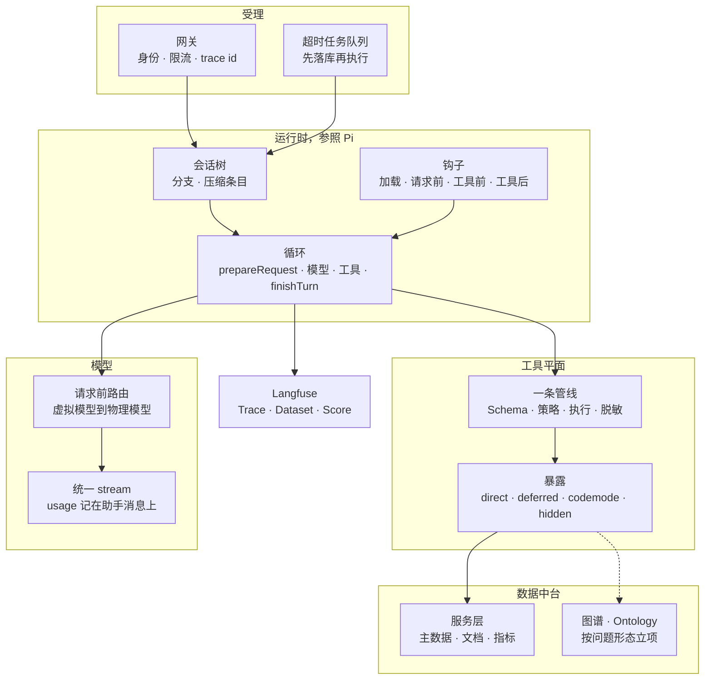
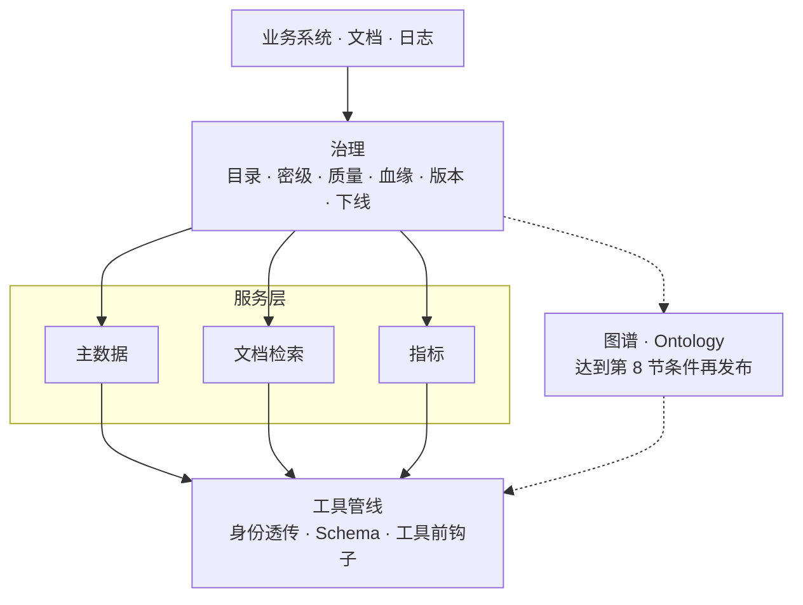
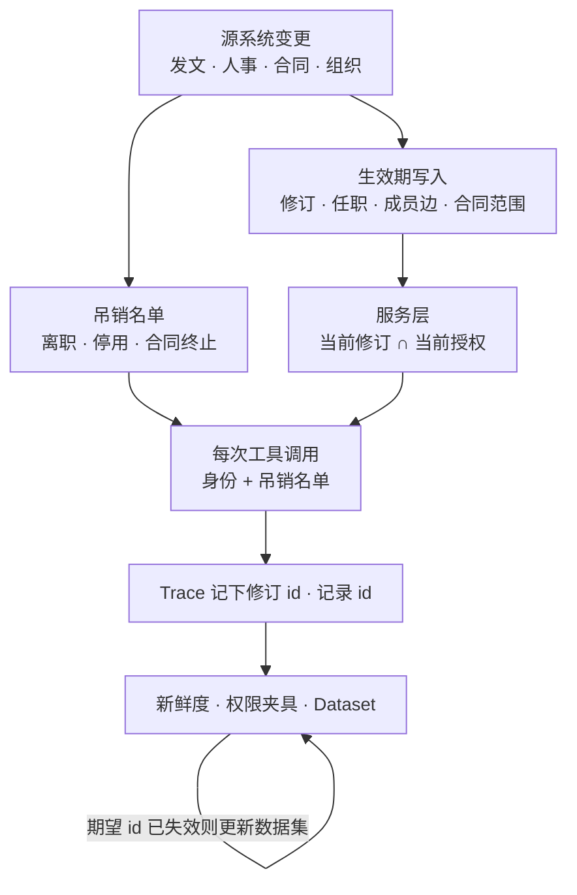
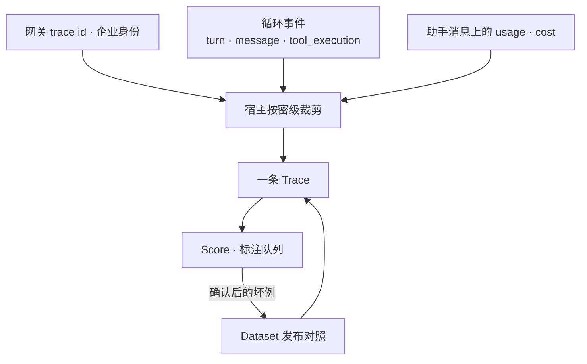

# 企业级 AI Agent 架构梳理

> 版本：v2.8　｜　运行时参照：[earendil-works/pi](https://github.com/earendil-works/pi) 1.4.0　｜　数据中台与 Langfuse 按同一套循环契约接入。文档、组织、权限和准确率按生效期持续治理，见第 9 节。兜底与重试见第 3 节。意图见第 1 节。会话只追加、模型视图另算，见第 13 节

Pi 被当作运行时的参考实现，用来替换分层方案里不成熟的做法。企业系统沿用它的循环、会话树、工具管线和钩子，不在循环外面再套一层「意图拆解器」。数据中台提供事实，Langfuse 提供发布门禁和追踪。


## 1. 用 Pi 的设计替换不成熟的做法

下面每条都来自当前仓库里已经分开的机制，不是把 Pi 没有的平台能力说成运行时功能。表是索引，后面各小节是容易做错的规则。

| 原先的做法 | Pi 里已经分开的机制 | 企业架构怎么用 |
|---|---|---|
| Skill 层编排 MCP，MCP 再调外部系统 | Skill 只贡献提示词；内置工具、扩展、MCP 同属一份 `AgentTool` 列表 | 一条工具管线。Skill 不站在工具前面 |
| 先检索、再拆任务、再让模型自评 | 一轮是准备上下文、流式回复、执行工具、`finishTurn`。`finishTurn` 只决定还要不要再请求 | 检索和审批是工具或钩子。分数在 Langfuse |
| 一个策略引擎包住模型、工具、检索 | 项目信任、`prepareRequest`、`beforeToolCall` 是三个时机。门闩做不了决定就拒绝 | 三次判定分开，见第 6 节 |
| 会话、界面、审计和模型上下文共用一份文本 | `AgentMessage` 比供应商消息宽。`details` 不进模型；`convertToLlm` 才得到 `user` / `assistant` / `toolResult` | 审计留详情。模型只收转换后的内容 |
| 摘要是一段模型复述，可以覆盖原文 | 会话是树。摘要条目之外，机器从工具 `details` 累计读过和改过的路径 | 摘要尾部附查阅过的记录 id 和写过的对象。当前值再查中台 |
| 工具要么全并行，要么全串行 | 默认同批并行。同一文件按真实路径排队。工具自声明 `sequential` 时整批改顺序 | 同一主键的写排队。对外副作用声明整批顺序 |
| 人敲的命令和模型的工具调用记成同一种结果 | `!` 命令是 `bashExecution`，不是 `toolResult`。`excludeFromContext` 可让它不进模型 | 人工操作与模型工具分类型。审计都留，进不进模型分开 |
| 大结果切半行，截断的参数仍执行 | 工具输出按行数和字节截断，不切半行，并给出继续读取的位置。`stopReason: length` 的工具调用整批不执行 | 中台大结果带 id 和续读位置。残缺参数不执行 |
| 工具全部写进提示词 | `direct` / `deferred` / `codemode` / `hidden`。codemode 的嵌套调用不进模型上下文 | 大接口走 codemode。破坏性接口 `hidden` |
| 每个环境复制一整份工具表 | 用户设置为底，项目设置叠加。纯名字列表替换继承；`+name` / `-name` 增减 | 企业基线加环境差异，不复制整份配置 |
| 固定话术也先让模型生成 | 提示词模板在变成 user 消息之前展开。`input` 事件返回 handled 则本轮不进模型，先返回的那个为准 | 套话和斜杠命令走展开或门闩，不占模型回合 |
| 扩展同名就冲突，或包一层再包一层 | 内置 MCP、codemode、tool_search 标记 `replaceable`：同名注册换掉内置。通知、变换、门闩三种 handler 不混用 | 企业包按名字替换能力。安全门闩失败即拒绝 |
| 模型网关在回合中途换供应商 | 逻辑模型与物理模型分开记录。`error` 结束本次运行 | 路由在 `stream` 之前完成 |
| 长任务挂在同步请求上 | 运行内只有 steering 与 follow-up。durable 提交成功才对外可见；非幂等工具崩溃不自动重放 | 超时任务先落库。有副作用的工具默认不重放 |
| 中断丢掉已经排队的话 | 交互模式把 steering 和 follow-up 清出队列，拼回编辑器，再中止运行 | 取消运行不丢未消费的输入 |
| 返回响应和写审计各走各的 | `agent_end` 监听器按注册顺序 await，`prompt()` 等它们结束 | 会话和 Trace 写完再向网关返回 |
| 日志里全量保存提示词 | `pi.ai.request` 只记供应商、模型、stop、用量、费用 | Langfuse 元数据与正文分开脱敏 |
| 文档和权限一次导入后长期有效 | 每次工具调用重新判定；结果带记录 id | 生效期和吊销名单，见第 9 节 |
| 评测直接打生产模型和生产库 | 管线测试用 faux provider，不打真实供应商 | 循环回归不打生产。准确率和权限用 Langfuse 夹具 |
| 会话中途改写系统提示词，指望前缀缓存还在 | 工具集合变化写成带 `toolsAdded` / `toolsRemoved` 的 system 消息，不改已提交历史。MCP 摘要变化也追加。摘要请求转发 sessionId，但不写 prompt cache | 稳定前缀只追加。一次性调用不写缓存 |
| 压缩从工具调用和结果中间切开 | 切点只在 user 或 assistant。工具结果必须跟在对应的 tool call 后面。切在回合中部时，前半单独摘要。溢出只对产生错误的那个物理模型重试一次，用户中止不触发 | 调用和结果成对保留。换了更大窗口的模型后，不用旧模型的溢出去压缩 |
| 每个工具自己连库、读盘 | `ReadOperations`、`EditOperations`、`BashOperations` 可替换。工具定义不绑定本地文件系统 | Schema 与执行环境分离。沙箱、远端、测试假实现接同一份工具 |
| 模型叫了不存在的工具，进程就失败 | 未知工具和 `beforeToolCall` 的拦截变成 error 的 `toolResult`，循环继续。钩子自己抛错才阻断执行 | 策略拒绝把原因交回模型。钩子故障才失败关闭 |
| 启动时取一次令牌，多个请求同时刷新 | 供应商拥有自己的 auth。过期刷新在凭证存储的锁里进行，并发请求不会双刷新 | 令牌不进会话。刷新串行，在每次 `stream` 时解析 |
| 失败了就原样再打一次，或无限重试 | 传输重试和回合重试分开。配额、账单、上下文溢出不进回合重试。中止不重试。失败尝试留在会话里，但从模型上下文成对删掉 | 见第 3 节。有副作用的外部调用默认不重试 |
| 进模型前先跑一个意图分类器，再选 Skill 和工具 | 斜杠命令和 `input` 在模型之前处理。Skill 只放名称和描述，由同一次模型调用决定读哪份。工具搜索是 BM25，加载结果记入分支。虚拟模型只在用户新消息时改路由，工具续写和重试粘住上一物理模型 | 确定性入口走命令。开放意图走同一次循环。中途不重新分类 |

### 模型看见的，和记下来的，不是同一份

会话保存 `AgentMessage`。供应商只接受 `system`、`user`、`assistant`、`toolResult`。`convertToLlm`（`core/messages.ts`）负责收窄：

- `custom` 消息的 `content` 变成 user 文本。`details` 留下给界面和审计，不进请求。
- `display` 只决定界面画不画，不决定模型看不看。
- 人直接敲的 `!` 命令记成 `bashExecution`。它不是模型发起的工具结果。`excludeFromContext` 为真时，审计还在，下一次请求跳过它。
- 压缩摘要和分支摘要在会话里是独立角色，送给模型时才包成 user 文本。

企业侧同样拆开。审批单号、命中的内部 id、脱敏前正文放在 `details`。模型看到的 `content` 只保留完成这一步需要的短摘、版本和记录 id。Langfuse 的 Generation 从 `content` 抄脱敏后的文本；审计从 `details` 对账。不要把 `details` 再塞进提示词。

### 压缩摘要附带机器清单

压缩模型写出的是散文。Pi 在散文之后另附 `<read-files>` 和 `<modified-files>`，名单来自工具结果里的 `details`，按路径合并，改过的路径从只读名单里去掉（`compaction/utils.ts` 的 `computeFileLists`）。下一次压缩把上一份名单再并进来。摘要模型不负责回忆自己碰过哪些文件。

企业摘要沿用这个结构。散文后面附两份从工具 `details` 累计的名单：查阅过的 `doc_id` / `revision_id`，以及写过的主键。名单不从摘要正文里解析。当前订单和指标仍以数据中台为准，名单只防止压缩后忘记「已经查过哪一版、改过哪一笔」。

### 并行的粒度是资源，不是整批

`runLoop` 默认并行执行同一批工具。批次里只要有一个工具声明 `executionMode: "sequential"`，整批改为顺序执行。文件工具本身不靠这个开关：`withFileMutationQueue` 用文件真实路径做键，同一文件的写排队，不同文件仍并行。

企业工具分成两档：

- 点查、文档检索、指标：默认同批并行。
- 写同一主键：在工具内部按主键排队，不同主键并行。
- 发信、改生产、对外提交：工具声明 `sequential`，整批顺序执行，并在 `beforeToolCall` 核对审批单。

不要因为批次里出现一次点查就把所有读改成串行，也不要让两笔对同一订单的写同时执行。

### 扩展按职责组合，同名能力替换

扩展 handler 按加载顺序执行，四种结果不要混用（`docs/extensions.md` 的 Handler Composition）：

| 种类 | 行为 | 企业里谁用 |
|---|---|---|
| 通知 | 返回值被忽略 | 写 Trace、采样。不做慢操作，不改结果 |
| 就地修改或链式变换 | 后一个 handler 看见前一个改过的请求、上下文或工具结果 | 脱敏、补引用、注入本轮身份 |
| 门闩 | 第一个生效的 handled、block 或取消停下正常路径 | 工具前策略、斜杠命令。决定做不了就拒绝 |
| 收尾 | `turn_end`、`agent_before_settle` 看见到目前为止的条目和是否继续 | 采样进标注队列。不在这里改变本轮是否返回 |

内置的 MCP、codemode、tool_search 带 `replaceable`。另一个扩展在加载时注册了同名工具、命令或标志，内置那份就让位，而不是两份一起跑。企业要换检索或换 MCP 客户端时，用同名替换，不要在内置实现外面再包一层。

配置也按层叠加，不整份复制。用户设置打底，受信任的项目设置盖上去。工具名单如果全是 `+name` / `-name`，就在继承结果上增减；出现不带符号的名字，则整份替换继承的名单（`settings-manager.ts`）。环境差异写成增量。生产基线是底层，项目只写自己要加减的工具。

固定话术不进模型。提示词模板在编辑器输入变成 user 消息之前展开。`input` 事件返回 handled 时，本轮不调用模型，先返回的 handler 生效。审批查询、帮助命令、点名装载某个 Skill，走这条路径。

### 持久任务先提交；不完整的输出留在模型外面

交互会话和超时任务继续用两套持久化。超时任务采纳 durable 的三条规则：

1. 输入和工具意图提交成功之后，界面和下游才看得见。没提交的半段回复可以丢失，已提交的条目不再改。
2. 进程死在模型请求中，这一次算失败尝试并退避重试。连续崩溃有上限，超过后运行结束，而不是无限重启。
3. 工具默认不重放。只有声明幂等的工具，才在重启后续跑；其他工具把已提交的输出记成 `interrupted` 交回模型。嵌套调用用稳定的 key 取回已经完成的结果，避免副作用做第二次。

中断和截断同样不把半成品交给模型：

- 取消运行时，尚未消费的 steering 和 follow-up 退回输入，再发出 abort。队列里的话不删掉。
- 工具输出默认最多 2000 行或 50KB，先到为准，不切断一行。结果里写明下一偏移，完整内容留在原处。
- 模型因为长度停机时，这条消息里的工具调用全部记失败，不执行可能残缺的参数。

`prompt()` 在 `agent_end` 的监听器跑完后才返回。写会话、写 Trace 的监听器注册在返回给网关的路径上，避免网关已经把答案交给用户、审计却还没落盘。

### 前缀保持稳定，变更用追加

供应商的 prompt cache 认的是请求前缀。Pi 因此不回头改已经写进会话的系统消息：

- `declareToolChanges` 把可执行工具表和会话里已声明的工具表做差，差量写成 `toolsAdded` / `toolsRemoved`。回放这段差量之后，模型看见的工具集合等于运行时真正能执行的集合。
- MCP 服务器连上、说明变了，新的 `mcp_servers` 段落追加到对话里，不改早先的工具声明，已经缓存的前缀还在（`docs/mcp.md`）。
- 压缩和分支摘要是一次性请求。它们可以带上 sessionId 做路由，但不打开 prompt cache 写入。
- 缓存预热只重放「预计能省下的钱超过 0.05 美元」且重放不会改变缓存键的请求。会改动思考预算、从而换掉缓存键的模型不预热（`cache-warmer.ts`）。

企业提示词同样分成稳定前缀和追加。身份规则、工具说明、已发布 Skill 索引放在前缀里，发布时整段替换并新开缓存。一轮之内的工具裁剪、检索版本、吊销名单版本写成新的 system 消息。摘要、裁判模型、权限夹具不写生产缓存。预热只在省下的费用盖得过预热本身时做。

### 压缩不拆开工具对，溢出只救一次

`findValidCutPoints` 的切点只落在 user 或 assistant 上，从不落在 toolResult 上。切在带工具调用的 assistant 上时，它后面的工具结果留在保留尾部。切点落在回合中部时，这一回合的前半单独摘要，不把没有结果的 tool call 直接留给模型。

溢出恢复在 `agent-session.ts` 里每种运行只做一次：上下文溢出或可恢复的 `length` 停机时，去掉失败的那条助手消息，压缩，再继续。用户中止不压缩。消息若来自另一个物理模型，不用那个模型的溢出去压当前模型；窗口以产生这条消息的物理模型为准。已经位于最近一次压缩边界之前的用量不再触发新的压缩。

企业侧同样：检索工具调用和它的 `toolResult` 一起保留或一起摘要。一次运行里的溢出重试只有一次。用户取消是中止，不是待恢复的错误。

### 工具定义和执行环境分开

`read`、`edit`、`bash` 的参数和说明是一份，读写由 `operations` 注入。默认实现打本地文件系统；注释里写明可以换成远端，例如 SSH。`pi-env` 把同一类操作放到另一台机器，凭证和存储留在本地。测试可以注入只记录调用的假实现。

数据中台工具沿用这个切分。Schema、名称、暴露方式属于运行时。查询、授权过滤、只读账号属于执行环境。沙箱、远端和单测替换 operations，不复制一份工具定义。

未知工具不会抛到进程外面。`prepareToolCall` 找不到工具时，写入一条 error `toolResult`，说明工具不存在，循环继续，模型可以改叫别的工具。`beforeToolCall` 返回 block 时同样写成 error 结果，原因进上下文。扩展钩子自己抛错则阻断执行，按失败关闭处理。策略拒绝要让模型看见原因；钩子或执行环境坏了，才停止这一轮。

### 凭证在请求时解析，刷新加锁

一家供应商拥有自己的目录和 auth：环境变量、凭证存储、OAuth 刷新。`models.getAuth` 和请求路径在凭证存储的锁里刷新过期令牌，并发的请求和进程不会同时刷新两次。登录用统一的 `prompt` / `notify`，并带上 abort signal。

企业令牌不写进会话 JSONL，也不在进程启动时取一次用到底。每次 `stream` 解析当前凭证。刷新串行。网关身份和供应商凭证是两套：前者进工具的授权索引，后者只进模型请求。

### 意图留在同一次循环里

用户文本进入循环之前，只有确定性的入口，没有分类模型。`docs/extensions.md` 里的顺序是：

1. 扩展命令（`/cmd`）命中则执行，不再发 `input`。
2. `input` 事件。`handled` 直接结束，第一个生效的为准。`transform` 可以改写文本，然后继续。
3. `/skill:name` 把该 Skill 的正文展开成这次的用户消息。`disable-model-invocation` 的 Skill 只能从这里进入。
4. 提示词模板展开。
5. 才开始 `before_agent_start` 和模型请求。

开放文本不经过第 1 到第 4 步时，同一次模型调用同时完成三件事：理解这句话、决定要不要读某个 Skill、决定要不要调工具。Skill 索引只有名称、描述和路径（`formatSkillsForPrompt`）。描述写清适用场合。模型用 `read` 打开 `SKILL.md`，正文才进入上下文。点名 `/skill:name` 是强制装载，不依赖模型自己想起。

工具也按同样的原则暴露。声明给模型的是小集合。其余工具用 `tool_search` 或 codemode 的 `searchTools()` 查找。排序是对名称、描述、参数说明和命名空间做 BM25，默认上限 8 条（`extensions/tool-search/tool.ts`）。排上的工具写入该分支的工具声明，恢复和分叉之后还在。检索器接口是 `ToolRanker`，可以换成带向量的实现，替换的是排序，不是循环外面的意图阶段。

模型路由可以看这句话，但不在工具回合中途改主意。虚拟模型的 `route()` 在每次请求前运行，`reason` 把请求分成四类（`docs/virtual-models.md`）：

| reason | 何时 | 路由 |
|---|---|---|
| `user` | 用户写下的消息，含 steering 和 follow-up | 可以按文本、thinking level 或自有状态换物理模型 |
| `continuation` | 工具结果之后的请求 | 沿用上一成功回复的物理模型 |
| `retry` | 失败后的自动重试，含溢出压缩之后 | 沿用失败的那次物理模型，除非错误说明要换 |
| `direct` | 压缩摘要、扩展直接调用 | 单独决定，不写进对话缓存 |

`route()` 可以返回 `state`，存在这条分支上，下次再传回来。文档里的例子用它保存 `plan` / `build`。分类器结果如果要参与选模型，放在这里，并且只在 `reason === "user"` 时更新。`pi-ai` 的 classifier 是另一种模型类型，给 `classify()` 和 codemode 里的 `models.classify` 用，不站在主循环前面。

企业侧按这四层做：

- 审批、帮助、点名 Skill、固定查询走命令或 `handled`，不占用模型。
- Skill 和数据服务的说明只保留「做什么、何时用」。正文和结果按需读取。
- 工具发现用可替换的排序器，把命中记入分支。不在提示词里堆满接口。
- 只有新的用户消息才重新选择物理模型。工具续写和重试粘住上一模型，避免缓存和思考签名失效，也避免同一回合里前后两家模型各解释一次意图。


## 2. 总体结构



受理层发身份和 trace id。运行时不认识企业组织，只认识这次上下文、这份工具表和这个模型。工具平面不关心调用来自文件、MCP 还是数据中台。数据中台不把结果直接写进系统提示词，只通过工具返回。Langfuse 订阅循环事件，不参与 `finishTurn` 的调度。


## 3. 运行时循环

参照 `packages/agent/src/agent-loop.ts` 的 `runLoop`。企业宿主调用同一条循环，不在前面加编排器。

```text
受理到的输入
→ prepareNextTurn     上一回合已结束才发生：压缩、接上 steering
→ 写入本轮新消息       工具表变化记成一条 system 消息，保证回放后仍是当前可执行集合
→ prepareRequest      每次模型请求前，含第一次。注入已发布的提示词快照、身份、本轮工具声明
→ 流式 assistant
→ error 或 aborted    finishTurn 之后结束本次运行
→ 否则执行 toolCall
→ finishTurn          end 则停止；continue 则保证再请求一次模型
→ 有 steering 则立刻下一回合；运行本会停止时再取 follow-up
→ agent_end
```

steering 在当前助手回合结束后进入，给用户打断。follow-up 在运行即将结束时进入，给「做完再补一句」。两者默认一次取一条。它们是内存队列，进程退出即丢，用来改进交互，不用来受理超时任务。

超时任务的提交、重试上限和副作用不重放，按第 1 节的 durable 规则。交互会话仍用会话树。两种持久化不要合成一个对象。

工具执行采用同一条管线：

1. `stopReason === "length"` 的工具参数可能被截断，整批失败，不执行。
2. 其余调用先做 JSON Schema 校验（含宽松类型转换），再进入 `beforeToolCall`。策略只看见校验后的参数。
3. 默认同批并行。同一主键的写在工具内排队。声明 `sequential` 的副作用工具让整批改为顺序执行。
4. `afterToolCall` 在结果写回会话之前做脱敏、截断和补引用。
5. 只有本批每一个结果都标记 `terminate`，才跳过下一轮模型请求。单个工具不能在其他工具还返回了数据时把运行停掉。

`finishTurn` 只回答还要不要再请求模型。错误和中止是硬退出。它不给回答打分。循环内部不重试供应商。重试发生在循环结束之后，由会话层决定要不要再 `continue`。

### 兜底、异常与重试

失败先分类，再决定重试、压缩、交回模型，还是结束。下表是分类，不是一条「失败就再试」的流水线。

| 失败 | Pi 的处理 | 企业侧 |
|---|---|---|
| 用户中止，或退避睡眠中被中止 | `stopReason: aborted`。不重试。退避中的中止也收成 aborted，不另抛一种错误 | 取消就是取消。不把取消记成供应商故障 |
| 上下文溢出，或过早的 `length` | 不进回合重试。对产生错误的物理模型压缩并再跑一次。用户已取消的不压缩 | 窗口不够就压缩。不把同一段上下文再打给同一家 |
| 配额、账单、套餐用尽 | `isRetryableAssistantError` 先排除这类文案，立即返回 | 配额失败交给网关限额和人工。退避解决不了 |
| 过载、429、5xx、断流、超时 | 回合级重试。默认最多 3 次，延迟 `2s × 2^(n-1)`，单次不超过 60 秒 | 只重试这一类。次数和上限放在配置里 |
| 供应商要求的等待超过上限 | 请求包装直接失败，不睡到几分钟 | 尊重 `Retry-After`，但长于 60 秒就失败，让外层决定 |
| 工具抛错、参数不合法、工具不存在、策略拦截 | 写成 `isError` 的 `toolResult`。`runToolCall` 不因工具失败 reject | 模型看见原因后可以改参数或换工具。进程不退出 |
| `length` 停机时消息里带了工具调用 | 整批记失败，不执行 | 残缺参数不落到数据中台 |
| MCP 只读请求遇到 408、429 或 5xx（不含 501） | 再试一次 | 查询可以再试一次 |
| MCP 工具调用遇到同样的瞬时错误 | 不重试。调用可能已经在服务端执行 | 写和有副作用的 MCP 不自动重放 |
| MCP 会话过期 | 再试一次。服务端已不认识这次会话，请求没有执行 | 只在能确定没执行时重试 |
| 进程死在模型请求或工具中途 | durable：模型请求算一次失败并退避；非幂等工具不重放，已有输出记 `interrupted`。连续崩溃默认 5 次后停止 | 超时任务用这套上限。交互会话不假装能从半次调用接着执行 |

两层重试不要叠用。供应商 SDK 自带的定时器不响应中止，所以请求以 `maxRetries: 0` 交给 SDK，再包一层可中断的重试（`provider-retry.ts`）。这层看 HTTP 状态和 `x-should-retry`：408、409、429 和 5xx 可再试，没有状态码的传输错误也可再试。它的默认次数是 0，也就是不在单次 `stream` 里面重试，除非配置了 `retry.provider.maxRetries`。供应商要求的等待长于 `maxRetryDelayMs`（默认 60 秒）时，这次请求直接失败。

回合级重试在循环已经以 `error` 结束之后进行（`agent-session.ts` 的 `_prepareRetry`）。默认开着：`maxRetries` 为 3，`baseDelayMs` 为 2000。一次成功的助手回复把计数清零，避免同一次用户任务里的多次模型调用把次数累加光。上下文溢出先被拿掉，交给压缩，不跟瞬时错误抢同一次预算。

重试前，失败的助手消息和它的工具结果一起从模型投影里去掉，原始条目仍留在会话树上。缺了结果的 tool call 不会被单独送去下一次请求。退避期间可以中止，中止之后不再 `continue`。

MCP 把「可能已经执行」和「确定没执行」分开。只读请求和过期会话各再试一次；工具调用的瞬时失败变成错误结果，由模型或人决定是否再调。断线的服务器在下一次调用时重连，不在失败的那一次里盲重放。

工具和数据中台的异常走结果，不走进程崩溃。校验失败、未知工具、策略拦截、`execute` 抛错，都是 `isError: true` 的工具结果，循环继续。钩子自己抛错才阻断，按失败关闭。数据中台的 4xx 业务拒绝（无权、修订不存在、参数不对）同样写成工具错误，不重试。只有查询超时、429 和 5xx 可以再查一次，并且再查之前确认服务端没有产生写。

超时任务沿用 durable 的收尾原因，不把所有失败合成一个「出错了」：`model_error`、`aborted`、`interrupted`、`restart_limit`、`turn_limit` 分开记。失败运行后面排队的输入默认留着，等下一次输入；配置可以改成继续跑，或标成未回答并撤掉。宿主可以根据某一类 `task_faulted` 做熔断，熔断在受理层，不在回合内部换供应商。


## 4. 会话、上下文、压缩

模型看见的消息和会话里保存的消息分开处理：

```text
会话条目 → 活动分支上的 AgentMessage
        → transformContext   裁剪、注入本轮材料
        → convertToLlm       去掉只给界面的消息，得到 user / assistant / toolResult
        → 模型
```

系统提示词按可替换的段落发布，参照 `system-prompt.ts` 的顺序：身份与规则、从已注册工具生成的工具说明、项目上下文、Skill 索引、工作目录。工具说明从可执行工具表生成，不另维护一份手写清单。Langfuse 上的提示词版本发布成这些段落的快照；运行中不回读 Langfuse。

Skill 参照 `docs/skills.md`：启动时只放 name、description、位置。正文在任务需要时再读入。`/skill:name` 用来强制装载。Skill 目录里的脚本仍通过工具执行，并走第 3 节的管线。

会话文件是树。当前条目标出活动分支，分支就是下一次请求的历史。从旧条目继续会新开一条分支，失败尝试不覆盖成功路径。

压缩在工具结果已经写入、下一轮模型请求之前触发。条件沿用 Pi 的默认值作为起点：

```text
contextTokens > contextWindow - reserveTokens    reserveTokens 默认 16384
```

从后往前保留约 20000 token 的近期消息，更早的部分写成摘要条目。切点只在 user 或 assistant 上，工具结果留在对应的 tool call 后面。摘要正文之后附上从工具 `details` 累计的查阅 id 和写过的主键，不从散文里解析。此后模型看见「摘要 + 名单 + 保留尾部」，原始条目仍在树里。摘要请求不写 prompt cache。上下文溢出或过早的 `length` 停机，对产生这条消息的物理模型允许一次压缩后重试。用户中止不压缩。

因此会话摘要是工作记忆，不是事实来源。订单、指标、规章的当前值在下一轮向数据中台再查。


## 5. 工具平面

所有能力注册成 `AgentTool`：名称、说明、JSON Schema、`execute`。执行路径只有第 3 节那一条。来源可以不同。

| 来源 | 在架构里的角色 |
|---|---|
| 文件与命令 | `read`、`edit`、`write` 以及按需打开的 `grep`、`find`、`ls`。默认集合保持小：读、命令、编辑、写入 |
| 扩展 | 企业策略、审批查询、数据中台客户端，注册为工具并监听钩子 |
| MCP | 外部系统的适配器。工具名 `mcp__服务器__工具`，进入同一份列表 |
| Codemode | 模型编写的脚本在隔离环境里调用工具。多次查询留在脚本里，只有短结果回到模型 |
| Skill | 指令与附属文件。决定模型何时去读哪段说明，不直接产生副作用 |

暴露方式决定模型怎么看见工具，参照 `docs/mcp.md`：

| 暴露 | 行为 | 用在 |
|---|---|---|
| `direct` | 像内置工具一样声明给模型 | 参数少、调用频繁：查一笔订单、查一个指标 |
| `deferred` | 搜索命中后才进入下一次声明，并记入该分支 | 偶尔使用的接口 |
| `codemode` | 脚本里发现并调用，声明列表里不出现 | 文档检索、需要过滤或拼接的一组接口。这是大工具集的默认 |
| `hidden` | 注册但到不了模型 | 破坏性写接口，只留给带审批的入口 |

数据中台因此不必做成模型前面的固定检索阶段。点查走 `direct` 工具。跨多份材料的整理走 codemode：脚本拿到完整结果，模型只看见引用、版本和短摘。超过上下文预算的正文在 `afterToolCall` 里截断，完整内容留在服务层按 id 再取。

读操作同批并行。同一主键的写在工具内排队。对外动作声明 `sequential`，并在 `beforeToolCall` 核对审批单。工具的 Schema 固定，查询和文件系统通过 operations 注入，沙箱和远端替换执行环境，不另写一份工具。


## 6. 治理挂在三个时机

Pi 把「能不能加载这份项目资源」和「工具实际以什么操作系统权限执行」分成两件事（`docs/security.md`）。企业策略沿用这个切分，并补上数据行级判定。三次判定的输入不同，合成一次总检会在错误的时间做决定。

| 时机 | 决定 | 参照 | 企业规则放在哪 |
|---|---|---|---|
| 加载 | 这份环境启用哪些扩展、Skill、MCP、提示词段落 | 项目信任。未获信任不加载项目扩展和项目 MCP | 发布单。生产环境只加载已签名的包和已发布快照 |
| 请求前 | 这次模型请求用哪段快照、哪份工具声明、哪个物理模型 | `prepareRequest`、`before_provider_request` | 按身份裁剪工具声明。路由在这里选定物理模型 |
| 工具前 | 这次调用能不能执行 | Schema 通过之后的 `beforeToolCall` | 配额、白名单、审批单号。参数已是结构化对象 |
| 工具后 | 什么能进会话 | `afterToolCall` | 脱敏、截断、附上数据集版本和记录 id |
| 返回数据时 | 这一行该不该出现 | 数据中台查询 | 按企业身份过滤。过滤发生在结果进入工具之前 |

高危动作不单开一条并行分支。`beforeToolCall` 拒绝执行并给出原因；交互界面可以当场确认后放行。没有界面的 print、RPC、队列任务改为：工具返回「已提交审批」，本批在需要时 `terminate`，审批通过后用 follow-up 或一次新的受理继续。确认框只存在于有人值守的界面。

进程边界单独成立。代理以专用用户或容器运行，只能看见任务需要的目录和网络。这约束文件和命令。记录级权限在数据中台，因为操作系统不理解订单和文档密级。钩子负责把网关身份传进工具；钩子与工具同进程，不能代替容器。

加载上下文文件（仓库里的 `AGENTS.md` 一类）和加载可执行扩展是两件加载决策。说明文件可以随仓库进入，可执行扩展必须走发布单。两类文件都按不可信输入对待：它们能影响模型的下一步，不能扩大进程权限。


## 7. 模型路由

模型接入参照 `pi-ai`：一个模型集合、统一的 `stream`、认证在请求时解决、用量和费用写在助手消息上。聊天模型必须支持工具调用。

路由参照虚拟模型：

- 受理时记录用户选择的逻辑模型。
- 每次 `prepareRequest` 把逻辑模型和 thinking level 映射成物理模型和物理 level。映射可以看任务、费用和供应商状态。
- 助手消息记录实际回答的物理模型，便于回放和计费。
- 压缩用的窗口是这次物理模型的窗口。
- 供应商错误使本回合以 `error` 结束。换供应商是下一次请求前的路由决定，包含用户重试和队列重试。回合内部不做隐式换家，避免同一条助手消息无法对应一次调用。

熔断、备用和缓存做在路由函数里：打开 `stream` 之前就选定物理模型。费用以消息上的 `usage.cost` 为准，网关按身份累计，超限拒绝新的受理。Langfuse 按同一 user 核对。

供应商凭证在每次请求时解析。过期刷新走凭证存储的锁，避免并发双刷新。令牌不进入会话。提示词前缀在一轮之内只追加、不改写；压缩和评测请求不写 prompt cache。


## 8. 数据中台

数据中台是事实的服务层。会话树、压缩摘要和 Skill 不保存订单、人员和指标的当前值。Agent 只通过第 5 节的工具访问服务层。



服务层契约：

- 返回进 `toolResult` 的内容带数据集名、版本和记录 id。`afterToolCall` 保证这三项还在。
- 网关身份传到工具，再传到查询。缓存键包含身份和数据版本。
- 下线版本从服务层消失。会话里已有的旧工具结果仍留在树上，下一轮要当前值就再查一次。
- 已知范围的材料可以在 `transformContext` 注入。开放问题由模型调用检索工具或 codemode。两种材料进入同一条上下文，不构成循环前的独立阶段。

最小服务层是治理，加上业务真正要查的主数据、文档、指标。缺的一种用工具返回「无此服务」，不用另一种检索去凑。

| 问题形态 | 服务 | 接入方式 |
|---|---|---|
| 规章、手册、制度原文 | 文档检索。切片有版本，回答带引用 id | 材料多时走 codemode，模型只收短摘和 id |
| 人、组织、订单的当前值 | 主数据，按主键点查 | `direct` 工具 |
| 已定义口径的数值 | 指标服务。口径在中台发布 | `direct` 工具。若允许查库，使用只读账号和沙箱，返回同一套口径名 |
| 归属链、上下游、影响面 | 知识图谱 | 达到下面的条件后再发布查询工具 |
| 多域共用对象、关系和「哪类对象由哪个服务回答」 | Ontology | 达到下面的条件后再改工具 Schema |

### 知识图谱

三条同时满足再发布查询工具：

1. 问题要沿关系多跳，主键点查回答不了。
2. 主数据里同一实体已有稳定 id，跨系统对齐有负责人。
3. 每种边能追溯到源记录。没有来源的边不入库。

查询返回路径和每一步的记录 id。路径上任一节点对该身份不可见，整段路径不返回，邻居 id 也不进入 `toolResult`。文档原文仍走文档检索。

### Ontology

Ontology 是服务层已发布的契约：实体类型、关系类型、每种类型由哪个服务回答。工具描述、主数据字段、图谱边使用同一套类型名。

至少两个业务域要共用这套类型，并且类型变更要单独发布，才建立 Ontology。一个域用工具的 JSON Schema 和主数据字段说明。Ontology 全文不进入系统提示词。工具说明只保留本轮用得到的类型名，并从已发布版本生成。

类型改名时同时改 Schema 和中台字段，先跑 Langfuse 数据集再发布。运行中不读草稿。

实例会过期：文档被替换、人员调动、合作方更换、部门合并。这些变化走第 9 节的生效期，不发布新的 Ontology。


## 9. 持续治理

运行时不保存「现在哪份文档有效、这个人属于哪个部门」。它每次工具调用把企业身份交给服务层，服务层只返回当前生效且该身份可见的记录。会话里已经出现过的旧 `toolResult` 仍留在树上，下一轮要当前值就再查。



对象使用不复用的 id。名称、上级部门、合作公司名称是带生效期的属性。查询默认按「现在」过滤：`valid_from <= now < valid_to`，且状态为已发布。用户明确询问过去某个时点时，工具参数传入该时点，返回该时点有效的修订和边。

### 文档与检索

一份文档一个 `doc_id`。每次发布是一条修订：`revision_id`、生效起止、状态。状态只有草稿、已发布、已替代、已作废、已到期。切片继承 `doc_id` 和 `revision_id`。

| 业务动作 | 数据动作 | 服务层 |
|---|---|---|
| 更新、替换 | 新修订发布，旧修订标为已替代并记下后继 id | 该 `doc_id` 的检索指针原子切到新修订，只嵌入新修订的切片 |
| 失效、撤回 | 状态改为已作废，生效止时间写成现在 | 立即离开服务层，不等到原来的生效止时间 |
| 到期 | 到达生效止时间 | 离开服务层 |
| 仅改密级或归属部门 | 改修订上的授权属性，正文不变 | 不重新嵌入。授权索引单独更新 |

检索先取向量候选，再与两份小索引求交：当前可服务的修订、当前身份的授权。授权不写进向量。人员调动和部门改名因此不必重嵌全文。

工具结果和引用带 `doc_id` 与 `revision_id`。回答若引用了已经不在服务层的修订，记为新鲜度失败。

### 人员、合作方、组织

任职是边：`person_id`、`org_unit_id`、`role_id`、生效起止。部门改名只改属性。人员调动是关闭旧任职、打开新任职。离职把任职的生效止时间写成离职时间，并把 `person_id` 写入吊销名单。

合作按合同授权，不按公司名称授权。合同保存 `partner_id`、`legal_entity_id`、可见的文档集合或组织 id、生效起止。更换合作公司时旧合同结束，新公司使用新的 `partner_id` 和新合同，不复制旧授权。

组织调整只动成员边和上级边：

- 改名：id 不变，检索和权限不重建。
- 划转：旧的上级边写下生效止时间，新的上级边从生效日起算。
- 合并：保留一个 `org_unit_id`，被合并 id 记成别名。文档归属改挂到保留 id，由数据负责人确认未迁移的文档。
- 拆分：新 id 从生效日起有效。归属边逐条迁出。没有迁出的文档仍属于原 id，新部门的身份查不到它们。

图谱已发布时，上述边就是图上的边，同样只做关闭和新建，不改写已经结束的边。主数据出现重复人员时，保留一个 id，旧 id 进入别名表；查询先解析到保留 id。全量重建只在 Ontology 的不兼容变更之后进行。

### 权限

每次工具调用重新决议身份，不在会话开始时把权限快照做进上下文。决议顺序：

1. 读吊销名单。名单中的人或合同直接无权限。名单覆盖离职、账号停用、合同终止，供主数据同步延迟时使用。
2. 用现在有效的任职和合同计算可见的组织、密级和文档集合。
3. 到服务层查询，候选结果与授权索引求交。
4. 图谱路径上任一节点不可见，整段不返回。

缓存键包含身份决议版本和服务层修订版本。吊销名单或修订指针变化后，旧缓存不命中。长会话进行到一半时，同一次运行里的下一次工具调用已经看见新的名单。

### Ontology

部门改名、人员流动、合同更换、文档换版，改的是实例和边，不发布 Ontology。Ontology 只在类型变化时发布：新增一种关系，或废弃一种类型。

废弃类型保留一个过渡版本。过渡期内旧类型名解析到新类型，工具 Schema 两份都列。过渡结束之后旧名从工具说明中去掉。映射表（源系统字段到类型名）单独版本化，源库表结构变化时先改映射，再决定要不要改 Ontology。

### 准确率

准确率拆成四项，分别打分，不用一个总分盖过权限失败。

| 项 | 判定 | 何时算失败 |
|---|---|---|
| 新鲜度 | 引用的 `revision_id` 等于该文档当前可服务修订 | 引用已替代、已作废或已到期的修订 |
| 忠实度 | 结论能在所引切片中找到 | 结论超出引用，或引用 id 在服务层不存在 |
| 权限 | Trace 里的记录 id 用当次身份再查仍然可见 | 出现无权 id，或路径带回了不可见邻居 |
| 工具 | Dataset 要求的工具名出现在 Span 里 | 该查主数据时只做了文档检索 |

Dataset 的期望 id 本身也要治理。文档被替代或作废后，指向旧 `revision_id` 的条目标为过期：更新期望或退役之前，不把它算作通过，也不把它算作模型退步。组织发布之后，用固定夹具重跑权限，夹具至少包括：已离职的人、刚调动的人、已终止的合同、已合并走的部门、合并后的新部门。夹具失败则这次组织发布或索引发布不生效。

线上裁判模型只对照「回答」和「所引切片」，分数写入 Langfuse，不阻断当次返回。生产 Trace 按固定比例做新鲜度和权限复核。索引发布、Ontology 发布、组织生效之后各跑一轮 Dataset run。

| 变化 | 进入查询的时限 | 准确率动作 |
|---|---|---|
| 离职、停用、合同终止 | 写入吊销名单后，下一次工具调用生效 | 当日权限夹具加上该身份 |
| 文档作废或替换 | 服务层指针切换，目标为分钟级 | 引用旧修订的 Dataset 条目标过期；线上新鲜度按新指针复核 |
| 调动、改名、部门划转 | 按生效日。主数据可以延迟，不超过一个工作日 | 生效日跑权限夹具。改名不重嵌文档 |
| Ontology 或映射发布 | 发布单生效后的新会话使用新 Schema | 发布前 Dataset run。过渡期内旧类型名仍可解析 |


## 10. 评测与追踪：Langfuse

循环已经把一次运行拆成稳定事件。Langfuse 按这些事件记录，用来做发布门禁和事后抽检。`packages/evals` 仍回归运行时自身；业务任务放在 Langfuse Dataset。

一次受理对应一条 Trace。trace id 在网关生成，覆盖到 `agent_end`。会话 id 写入 Langfuse session，企业身份写入 user。



| 循环里的对象 | Langfuse | 写什么 |
|---|---|---|
| 一次 `prompt()` 到 `agent_end` | Trace | 与网关同一个 id |
| `turn_start` 到 `turn_end` | Span | 一轮模型调用和该轮工具 |
| 助手消息 | Generation | 物理模型、`usage`、`usage.cost`。输入输出由宿主从消息拷贝并脱敏。span 元数据沿用 Pi 的边界，不含提示词 |
| 工具执行 | Span | 工具名、是否错误、数据集版本、命中记录 id、因权限丢弃的条数 |
| 人工、用户、裁判模型 | Score | 挂在 Trace 上 |
| 一条业务任务 | Dataset item | 期望包含必须命中的记录 id 或必须出现的工具名 |
| 提示词、Skill、路由、Ontology、索引的一次变更 | Dataset run | 与上一版比 Score |

三件事分开：

1. **发布门禁**是 Dataset run。低于基线不发布快照。
2. **线上抽检**是 Score 和标注队列。确认后的坏例变成新的 Dataset item，不把整份会话原样入库。
3. **裁判模型**只产生 Score。它不进入 `finishTurn`，也不阻断当次返回。

提示词、Skill 索引和规则段落在 Langfuse Prompt 里版本化。发布动作把快照交给运行时的对应段落。已发布的运行不依赖 Langfuse 在线。

机密运行只写工具名、记录 id 和结果哈希。Langfuse 与数据中台同一安全域，脱敏规则与会话导出一致。


## 11. 落地顺序

先把运行时收成第 3 到第 7 节，再接数据服务和 Langfuse。图谱和 Ontology 不在第一批。

### 第一批

| 项 | 完成时的行为 |
|---|---|
| 一条循环 | 受理进入 `prepareRequest`、模型、工具管线、`finishTurn`。没有循环外的检索阶段和自评阶段 |
| 会话树与压缩 | 失败与分支不覆盖历史。压缩后原文仍在，模型只看见摘要加尾部 |
| 工具管线 | Schema、工具前钩子、并行读、顺序写、工具后脱敏都在这一条路径上 |
| 小默认工具集与暴露策略 | 生产默认工具保持读、命令、编辑、写入这一档。数据接口按 direct 或 codemode 声明，写接口默认 hidden |
| 进程隔离 | 容器或专用用户。发布单决定加载哪些扩展和 MCP |
| 路由在请求前完成 | 助手消息能对上物理模型。供应商失败由下一次路由处理 |
| 数据服务 | 业务要用的主数据、文档或指标已是工具。查询时过滤。文档按修订服务，作废和替换会切走旧修订 |
| Langfuse | 一条 Trace 对上一次受理。变更提示词、Skill、模型、索引前有 Dataset run。权限夹具失败则不发布 |

### 第二批

- 吊销名单在每次工具调用前读取。离职和合同终止不依赖全量组织同步
- 授权索引与向量索引分开。调动和改名不重嵌全文
- 任职、合同、组织边带生效期。图谱只关闭旧边、打开新边
- 线上新鲜度与权限复核。旧修订的 Dataset 条目自动标过期
- 线上 Score 与标注队列，坏例写回 Dataset
- 主数据覆盖已经结构化的点查，同一事实不再走向量检索
- 按物理模型窗口调节压缩阈值
- 超时任务改为先落库再执行

### 达到条件再做

- 知识图谱：第 8 节三条都满足
- Ontology：至少两个域共用类型，并与 Schema、主数据一起发布
- 按身份的预算熔断。用量已经在助手消息和 Langfuse 里
- 水印与存证


## 12. 失败对照

| 现象 | 架构原因 | 按本方案收住 |
|---|---|---|
| 一句指令就执行了命令 | 命令在默认工具集里，工具前没有统一钩子 | 缩小默认集。副作用走 `beforeToolCall`。进程放在容器里 |
| 答出无权的单据或邻居 id | 过滤写在提示词里，或图查询在应用层补滤 | 查询时过滤。路径上任一节点无权则整段不返回 |
| 改完 Skill 或检索就变差 | 全文 Skill 不在启动上下文里，发布没有对照 | Dataset run 低于基线不发布。必须使用的 Skill 在受理时点名装载 |
| 文档更新后仍引用旧内容 | 把压缩摘要或旧 `toolResult` 当成当前值 | 服务层只暴露当前修订。引用旧 `revision_id` 记新鲜度失败。当前值再查 |
| 分不清召回错和幻觉 | 检索与生成没有分开记 | Trace 里检索 Span 带版本和记录 id，Generation 另记模型输出 |
| 供应商故障后行为不稳定 | 回合中途换模型，消息对不上一次调用 | 错误结束本轮。备用模型由下一轮路由写入新的助手消息。瞬时错误先按第 3 节重试，不换家 |
| 配额用尽仍在退避重试 | 429 一律当限流 | 账单和套餐用尽立即失败。只有过载和瞬时 429 进入回合重试 |
| 写接口超时后又自动调用了一次 | 瞬时错误一律重放 | 可能已经执行的工具和 MCP 调用不重试。只读查询和确定未执行的过期会话才再试一次 |
| 一个慢查询卡死全部运行 | 工具与循环共享等待，没有独立超时 | 工具自己的超时。读并行，同一主键的写排队。大查询放进 codemode，只把短结果交回 |
| 两笔写同一单据互相覆盖 | 一批工具全部并行，没有按资源排队 | 同一主键进写队列。对外副作用声明 `sequential` |
| 压缩后模型看到没有结果的工具调用 | 切点落在 toolResult 上，调用和结果被拆开 | 切点只在 user 或 assistant。结果跟在对应调用后面 |
| 改一句系统提示词，整段缓存失效 | 回头修改已经发送过的系统消息 | 一轮之内只追加 system 差量。发布新前缀时才换缓存 |
| 审计里的内部 id 被模型复述出来 | 界面、审计和模型共用一份文本 | 内部字段放 `details`。`convertToLlm` 只送 `content` |
| 费用月底才看见 | 用量没有随助手消息按身份累计 | 网关用 `usage.cost` 做限额。Langfuse 按 user 核对 |
| 离职或换合作方后仍能查到原范围 | 会话开始时记下了权限，或授权按公司名称、部门名称写在切片上 | 每次工具调用查吊销名单和当前任职、合同。授权索引与向量分开 |
| 部门合并后答案串了归属 | 图上的边被原地改写，或文档归属写的是部门名称 | 边只关闭和新建。归属挂组织 id。未迁移文档仍属于原 id |
| 换了规章版本，回归却显示模型变差 | Dataset 期望仍指向旧修订 | 旧 `revision_id` 的条目标过期，更新期望前不计入通过或退步 |


## 13. 会话只追加，模型视图另算

前面各节已经用过循环、工具、压缩、重试和意图。下面这些还在源码里，并且会改变会话和资源怎么落地。

### 记录只追加，叶子决定现在

会话文件是 JSONL。除了文件头，每条都有 `id` 和 `parentId`。当前叶子到根的路径才是这一次的上下文。从旧条目继续会在同一文件里长出新枝，失败尝试留在另一枝上。`/fork`、`/clone` 把选中的历史写进新文件，文件头用 `parentSession` 指向原文件，不改原文件。

旧会话在加载时迁到当前版本。版本 1 是线性记录，版本 2 起是树，版本 3 把扩展消息统一成 `custom`。企业会话同样只追加。纠正、重试、换分支都是新条目。导出和审计读原始树。模型不读原始树。

### 提示词没有第二份状态

系统提示词不是会话旁边的另一张表。第一条 system 消息写下全部分段和当时的工具声明。之后的变更是新的 system 消息：`sections` 按名字打补丁，`null` 删掉一段，`toolsAdded` / `toolsRemoved` 记工具差量。按顺序重放，就得到现在的提示词和工具表。没有单独的「当前提示词」记录，避免它和会话不一致。

企业提示词快照用同样的办法发布。一段规则改了，追加一条补丁。回放会话就能得到当时模型看见的提示词，不必另存一份会漂移的配置。

### 模型视图用补丁，不改原条目

`buildContextEntries()` 从叶子走到根。路径上若有压缩条目，只用最新的一条，加上它保留的尾部和它之后的条目。原始条目还在文件里。

`context_edit` 再在这上面做投影。它指向某条的 `targetId`：`null` 表示模型看不见这条，有内容则只替换内容，角色和元数据仍来自原条目。同一目标多次编辑，后一次为准。原始条目不改。重试时从模型上下文拿掉失败尝试，用的就是这种省略，树上仍能对账。

`turn_end` 可以提议新的 `custom`、`context_edit` 或压缩条目。提议先整批校验，通过后按顺序追加。某个 handler 抛错会记下来，后面的 handler 继续跑。校验挡住语义上写了一半的提案。真正落盘不是一次事务，所以提案里不要做「写到一半也算数」的副作用。

自定义消息在 `turn_end`、助手消息和全部工具结果都已落下之后才写入。这样它不会插在 tool call 和 toolResult 中间，下一次请求也不会看到不成对的调用。

### 同名资源先到先得，坏的一条不挡住其余

Skill 按发现顺序装入。同名时保留先装入的，后一个记一条碰撞诊断，并写明赢的路径和输的路径。同一文件经由符号链接再出现一次，直接跳过。格式坏了的 `SKILL.md` 不装入，其他 Skill 继续装。MCP 里无效的服务器条目同样跳过，并单独报错。

企业资源目录沿用这个规则。生产基线先装，项目目录后装。同名 Skill、提示词模板以基线为准，碰撞写进启动诊断，不让后装的悄悄盖掉已发布的版本。一份坏配置不阻止进程启动。

### 参数先做宽松转换，业务约束放在执行里

工具参数在校验前把模型常见的松散 JSON 收紧：数字字符串变成数，`"true"` 变成布尔，单个值收成单元素数组，可选字段上的 `null` 去掉。然后按 JSON Schema 检查。模型看到的错误是字段路径加原因，例如缺少字段、类型不对。

TypeBox 的 `Refine`、自定义 format、编解码不会在这一步运行。范围、权限、枚举以外的业务规则放在 `execute` 或 `beforeToolCall`。数据中台工具同样：Schema 只管形状，密级和生效期在查询时判断。

## 14. 源码对照

架构里的运行时条款以这些文件为准。数据中台和 Langfuse 没有对应包，接入点是宿主、网关 trace id 和 `AgentTool`。

| 条款 | 源码 |
|---|---|
| 循环、队列、工具管线、terminate | `packages/agent/src/agent-loop.ts`，`packages/agent/src/types.ts` |
| 会话消息与模型消息 | `packages/coding-agent/src/core/messages.ts`，`docs/message-types.md` |
| 同一文件的写排队 | `packages/coding-agent/src/core/tools/file-mutation-queue.ts` |
| 工具与执行环境分离 | `packages/coding-agent/src/core/tools/read.ts` 的 `ReadOperations`，`packages/env` |
| 压缩切点与一次溢出重试 | `packages/coding-agent/src/core/compaction/compaction.ts` 的 `findValidCutPoints`，`core/agent-session.ts` 的 `_checkCompaction` |
| 回合重试与错误分类 | `packages/ai/src/utils/retry.ts`，`core/agent-session.ts` 的 `_prepareRetry` |
| 可中断的供应商重试 | `packages/ai/src/utils/provider-retry.ts` |
| MCP 只读重试与会话过期 | `packages/coding-agent/src/extensions/mcp/runtime.ts` 的 `withClient` |
| 工具差量与前缀缓存 | `packages/agent/src/agent-loop.ts` 的 `declareToolChanges`，`core/cache-warmer.ts`，`docs/mcp.md` |
| 凭证刷新锁 | `packages/ai/README.md` 的 How Auth Resolves |
| 输入、Skill 与模板的先后 | `packages/coding-agent/docs/extensions.md` 的 Input Events，`src/core/skills.ts` 的 `formatSkillsForPrompt` |
| 工具发现 | `packages/coding-agent/src/extensions/tool-search/tool.ts` |
| 按请求路由且续写粘住模型 | `packages/coding-agent/docs/virtual-models.md` |
| 会话树、分叉、版本迁移 | `packages/coding-agent/docs/session-format.md` |
| 模型视图上的省略和替换 | `packages/coding-agent/src/core/session-manager.ts` 的 `context_edit`，`buildSessionProjection` |
| 提示词分段补丁 | `docs/session-format.md` 的 SessionMessageEntry |
| Skill 同名与符号链接 | `packages/coding-agent/src/core/skills.ts` 的 `loadSkills` |
| 参数宽松转换 | `packages/coding-agent/docs/extensions.md` 的 Tool parameter schemas |
| 扩展 handler 与同名替换 | `packages/coding-agent/docs/extensions.md` 的 Handler Composition |
| 工具输出截断 | `packages/coding-agent/src/core/tools/truncate.ts` |
| 会话树、五种入口 | `packages/coding-agent/docs/how-pi-works.md` |
| 提示词段落、Skill 索引 | `packages/coding-agent/src/core/system-prompt.ts`，`docs/skills.md` |
| 压缩 | `packages/coding-agent/docs/compaction.md` |
| 加载信任与进程边界 | `packages/coding-agent/docs/security.md`，`docs/containerization.md` |
| 扩展钩子 | `packages/coding-agent/docs/extensions.md` |
| 工具暴露、codemode | `packages/coding-agent/docs/mcp.md`，`packages/codemode` |
| 逻辑模型与物理模型 | `packages/coding-agent/docs/virtual-models.md` |
| 用量、费用、span 字段边界 | `packages/ai/README.md` 的 Telemetry 与 usage |
| 先落库再执行 | `packages/durable/README.md` |
| 运行时自身的回归 | `packages/evals/README.md` |
