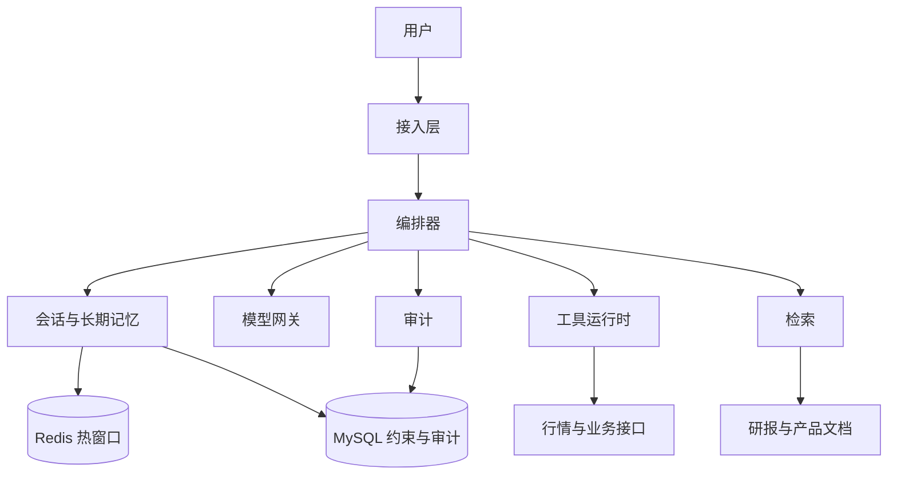

# 恒生电子AI Agent开发岗面经：八股+Agent混合双打轻松拿捏

> 根据面试截图整理。题干来自原帖，参考答案用于复习，不是候选人当时的口述。

## 面试感受

面得还行。八股问得比较全，但 Agent 部分像是临时补的课，问得比较浅。二面面试官对架构设计更感兴趣，聊得比较深入。手撕算法都写出来了，注解那道题偏一些，好在之前看过类似实现。整体感觉他们确实在招做 Agent 的人，团队可能刚起步，机会不错。

## 一面

### 1. 自我介绍

**答题思路**

控制在一分钟到一分半，按「现在做什么 → 一个最相关的项目 → 为什么匹配这个岗位」讲。

1. 用自己的真实年限和方向开头，点出 Java 后端，以及你确实写过的检索、工具调用或对话链路。不要报公司编制和薪资。
2. 只展开一个项目：谁在用、要完成什么事、你负责哪一层。结果只用自己拿得出来的事实；没有数字就说你怎么判断它是好的。
3. 对齐这个岗位：金融场景里数字不能靠模型现编，工具要有超时、幂等和审计。把话停在这个项目上，方便对方往下问。

### 2. 项目介绍

**答题思路**

面试官要确认你做过一条能跑的链路，而不是只调过聊天接口。用真实项目按这个顺序讲。

1. 一句话说明用户是谁、什么问题用单次问答解决不了。
2. 沿着一次请求讲：入口、编排、检索或工具、校验、回复。每一步说清输入和输出，以及状态存在哪。
3. 划清你写的部分和团队已有的部分。例如你做的是编排、工具网关、RAG 或评测。
4. 准备一个你亲手处理过的失败：现象、原因、改了哪一层、用什么样例验证。常见的真问题是数字对不上、工具超时被重复执行、多轮把约束覆盖了。
5. 如果这个项目不是金融业务，直接说明领域，不要临时改成证券系统。主动留下三个追问：权限在哪一层做、失败时用户看到什么、关键数字从哪个接口来。

### 3. Java 中 synchronized 和 ReentrantLock 的区别是什么？在 AI Agent 开发中，哪种锁更适合用于工具调用的并发控制？

**参考答案**

两者都可重入。`synchronized` 是 JVM 监视器，进出由编译器配对，异常也会释放。`ReentrantLock` 基于 AQS，必须在 `finally` 里 `unlock`，否则锁会泄漏。

能力上，`ReentrantLock` 可以 `tryLock` 超时、`lockInterruptibly`、挂多个 `Condition`，也可以做成公平锁。`synchronized` 只有一个等待集合，拿不到锁时也不能按超时放弃。无竞争的短临界区，JVM 对 `synchronized` 有锁消除和锁粗化；现在的膨胀路径主要是轻量级锁变成重量级监视器。偏向锁从 JDK 15 起默认关闭，后续版本已移除，不要再把它当成默认实现。

工具调用的并发度不要用互斥锁硬扛。同时能打出多少外部请求，用有界线程池或信号量做舱壁。真正要保护的是会话状态这类互斥数据。这里更适合 `ReentrantLock`：用户取消或本步超时时，等待加锁的线程必须能停下来。锁只包住改状态的几行，不要包住 HTTP。JDK 21 到 23 里，虚拟线程在 `synchronized` 中阻塞时会钉住载体线程，`ReentrantLock` 的等待可以卸下来；JDK 24 起这种钉住已消除。选型的主因仍是超时和取消。

### 4. JVM 内存模型中，元空间和永久代的区别是什么？如果线上 AI Agent 服务出现 Metaspace 内存溢出，你会怎么排查？

**参考答案**

元空间和永久代都属于运行时数据区，不是 JMM 里主存与工作内存那套 happens-before 模型。面试说的「内存模型」这里应按内存结构来答。

永久代在 JDK 7 及更早存放类元数据。字符串常量池在 JDK 7 已经移到堆。它有 `-XX:MaxPermSize` 这种固定上限，类卸载也不利落。JDK 8 用本地内存上的 Metaspace 取代它，类加载器可以被回收时，对应的类元数据才能释放。不设 `-XX:MaxMetaspaceSize` 时，它会一直向操作系统要内存。压缩类指针开启时，还有一块单独的压缩类空间，默认上限约 1GB，溢出信息和 Metaspace 不是同一句。

线上先看 OOM 原文，区分 Metaspace、Compressed class space 和堆。用 `jcmd <pid> GC.class_histogram`、`VM.classloader_stats`、`VM.metaspace` 看是类数量暴涨还是某个类加载器没释放。Native Memory Tracking 必须在启动时打开，出事之后再开看不到完整基线。

Agent 服务里常见原因是每次请求都生成新类：没缓存的 CGLIB、脚本引擎、表达式编译、按插件反复 `new` 的 `URLClassLoader`。线程池里的 `ThreadLocal`、静态 Map 持有 `Class` 或加载器，都会让元空间只增不减。先停掉按请求生成类的路径，插件加载器使用完要关闭。把 `-XX:MaxMetaspaceSize` 设上，是为了失败可控，不能代替修泄漏。

### 5. Spring Boot 自动装配的原理是什么？在 AI Agent 项目中，如何自定义一个 Starter 来集成大模型服务？

**参考答案**

自动装配不靠启动类去扫描第三方包。`@SpringBootApplication` 带有 `@EnableAutoConfiguration`，`AutoConfigurationImportSelector` 读取清单里的配置类，再用条件注解决定是否生效。Boot 2.7 之前写在 `META-INF/spring.factories` 的 `EnableAutoConfiguration` 项；2.7 同时认 `META-INF/spring/org.springframework.boot.autoconfigure.AutoConfiguration.imports`。Boot 3 的自动配置只认 imports 文件，`spring.factories` 仍可能被别的扩展点使用。

条件常用 `@ConditionalOnClass`、`@ConditionalOnProperty`、`@ConditionalOnMissingBean`。用户自己声明的 Bean 优先，自动配置的默认实现退开。`@ConditionalOnBean` 不要随便放，依赖的 Bean 若在更晚的自动配置里，条件会误判，需要 `@AutoConfigureAfter`。

集成大模型可以拆两个模块：`llm-spring-boot-autoconfigure` 放 `@AutoConfiguration` 和 `@ConfigurationProperties`，`llm-spring-boot-starter` 只聚合自动配置和 HTTP SDK。配置里放 provider、baseUrl、model、超时和是否启用，密钥从环境变量进，不写进 jar。HTTP 客户端单独设连接超时和读取超时。Bean 上加 `@ConditionalOnMissingBean`，业务才能替换实现。自动配置类放在应用组件扫描不到的包名下，只靠 imports 加载，避免被扫进容器两次。

### 6. Redis 在 AI Agent 系统中通常用来存储什么？如果用来存储会话历史，遇到大 Key（比如很长的对话记录）你会如何拆分？

**参考答案**

Redis 适合放热数据：最近若干轮对话和滚动摘要、工具幂等键及短时结果、限流计数、会话互斥锁、检索结果的短 TTL 缓存。知识库原文、审计和任务流水以数据库为准。Redis 丢了，会话应能从持久存储恢复最近状态，而不是整段历史只活在一条缓存里。

一条 String 塞进整段对话，就是大 key。读取、过期删除和集群迁移都会在单线程上卡住，RDB `fork` 时的复制也更贵。拆法是把「一个会话一个 value」改成「一个会话一组小 value」：Hash 或 String 只存摘要、更新时间和窗口指针；消息用 List 或 Stream，一条消息一个元素，并用 `LTRIM` 只留最近窗口。更早的原文在 MySQL，需要时按消息 id 回查。单条工具结果仍然太大，就把原文放到对象存储，Redis 里只留 id、状态和关键字段。

元素很多的 List 同样是大 key，不是只有 String 才算。已经形成的大 key 用 `UNLINK` 异步释放。经验上把单条 value 控制在几十 KB 内，避免接近 MB。会话 id 分散时，热 key 一般不会打满同一个 slot；超长会话靠截断窗口解决，不靠把 key 再哈希散开。

### 7. MySQL 的索引结构是什么？为什么 B+ 树适合做数据库索引？在 Agent 的任务记录表中，如何设计索引来优化按用户和时间的查询？

**参考答案**

InnoDB 的主键索引是 B+ 树，叶子节点就是数据行，所以叫聚簇索引。二级索引的叶子存的是索引列加主键，不是一份行拷贝。查非索引列时要拿主键回表。

B+ 树适合索引，是因为非叶子只放键和子指针，扇出大，树高低，三四层就能覆盖很大的表。叶子之间有链表，范围扫描按叶节点顺序走。哈希索引等值很快，但做不了范围和排序。B 树如果在内部节点也放整行，扇出会下降，范围也不如叶子链表直接。

任务表按 `user_id = ? and created_at between ? and ? order by created_at desc` 查询时，索引用 `(user_id, created_at)`。等值列在前，时间列在后，范围和排序都能用上。把时间放在第一列，会先扫出所有用户在这段时间的任务。若查询总是再带 `status = ?` 这种等值条件，把 `status` 放在时间前面：`(user_id, status, created_at)`。状态若是可选条件，就不要为了它打乱时间列。

InnoDB 二级索引叶子已经带主键，覆盖查询时只需把要返回的非主键列放进索引。主键用自增或雪花这类稳定单列，避免用业务字段当主键导致二级索引频繁变胖。

### 8. 什么是 RAG？请简述 RAG 的实现流程，并说明在金融领域 AI Agent 中，RAG 可能遇到哪些特殊挑战？

**参考答案**

RAG 是先从外部知识检索证据，再让模型基于证据生成。条款、产品规则和公告以检索结果为准，用来减少模型凭参数记忆编造。

离线：解析文档，去掉页眉和过期版本，按章节或表格切块，块上带上来源、生效区间和权限，再写入向量索引。证券代码、产品编号同时进关键词索引。在线：多轮对话先把当前问句改写完整，向量召回和关键词召回合并，按权限和 as-of 时间过滤，精排后把少量证据和引用 id 交给模型。生成后核对论断能不能在证据里找到。

金融场景里有几件特别容易错。行情、净值和费率会过期，索引必须能按生效时间淘汰旧版，不能新旧条款一起被召回。权限要在召回时过滤，事后再丢，名额会被无权文档占满。嵌入模型不保证代码和金额精确，数字和证券代码走结构化库或关键词，向量只负责语义。招募说明书里的费率表按固定长度切开会丢掉适用条件，表格要整表成块。检索到研报也不等于可以输出个性化买卖指令，生成侧还要单独的合规约束。

### 9. Agent 开发中，工具调用（Tool Calling）的安全如何保证？如何设计一个工具注册中心？

**参考答案**

模型只能提出调用，不能决定自己有没有权限。每次调用都带着用户身份，用用户的 scope 鉴权，不信任参数里的 userId。工具集是服务端按角色下发的白名单，检索文本和工具结果里的指令不能临时增加工具。参数用 JSON Schema 校验，多余字段丢掉。会变成 URL、SQL 或路径的参数要做允许列表，防止 SSRF 和注入。密钥放在适配器里，不进提示词。读和写分开；下单、转账、删除默认不给模型，必须走应用签发的确认。每次调用记工具名、参数摘要、结果、耗时和 trace，敏感字段脱敏。超时、限流、熔断和幂等键放在运行时，不要指望模型自己少调用。

注册中心存的是可执行描述，而不是一段提示词。每个工具有稳定名字、版本、描述、入参和出参 schema、负责人、读写级别、是否幂等、超时和所需 scope。启动时从注解或配置注册，一次请求中途不允许模型注册新工具。同名不同版本要能灰度。描述要写清边界，它会直接影响模型选哪个工具。执行链是：解析名字 → 校验 schema → 鉴权 → 限流 → 超时执行 → 裁剪结果 → 审计。未知工具名直接失败。

### 10. 线程池的核心参数有哪些？在 AI Agent 异步处理用户请求时，如何根据任务类型（IO 密集型、CPU 密集型）配置线程池？

**参考答案**

`ThreadPoolExecutor` 的参数是 corePoolSize、maximumPoolSize、keepAliveTime、时间单位、workQueue、threadFactory、RejectedExecutionHandler。

提交顺序是：工作线程数小于核心线程数就新建核心线程；否则入队；队列满了才继续建线程直到最大线程数；再失败走拒绝策略。空闲超过存活时间的是超出核心的那些线程，除非打开 `allowCoreThreadTimeOut`。默认拒绝策略是抛 `RejectedExecutionException`。`Executors.newFixedThreadPool` 用无界队列，队列不会满，最大线程数和拒绝策略都不会生效。

调用大模型和外部工具是 IO，本地重排、解析是 CPU，必须分池。IO 池用有界队列，线程数从「核数 ×（1 + 等待时间 / 计算时间）」估算，再用压测修正，并且不超过下游连接池。CPU 池的核心和最大都接近核数，队列要短，尽快拒绝，避免所有请求一起变慢。拒绝时向用户返回系统忙。`CallerRuns` 会退回 Tomcat 或网关线程，交互链路里一般不合适。

用 `TaskDecorator` 传递 trace 和用户身份。池不会替你取消已经发出的 HTTP，超时要设在客户端上。Java 21 的虚拟线程适合阻塞 IO，但仍要用信号量限制在途请求；CPU 任务继续放在小的平台线程池上。

### 11. Kafka 和 RocketMQ 在消息模型上有何区别？如果要用消息队列解耦 Agent 的规划模块和执行模块，你会选择哪个？为什么？

**参考答案**

两边实质都是客户端拉取。RocketMQ 的 PushConsumer 只是长轮询之后再回调业务，不是 broker 把消息推进进程。

Kafka 的主题是分区日志。不同消费组各有一份位点，组与组之间是发布订阅；组内一个分区只给一个消费者，是竞争消费。消息按保留时间删除，不因为被消费了就消失。组内做不到「每个实例都收全量」，广播要给每个消费者单独的组。位点是连续的，一条消息不提交，同分区后面的消息会被挡住。

RocketMQ 同样有主题和队列。集群消费是组内竞争，广播消费是组内每个消费者都收到全量，这是显式的两种消费模式。Tag 可以在服务端做一层过滤。并发的集群消费里，单条返回稍后重试会进入重试主题，当前队列可以继续；顺序消费则会停住该队列。RocketMQ 5 的 Pop 也是按条确认。

规划模块和执行模块之间，我选 RocketMQ。执行的是一条条任务，一条超时不应堵住其他会话。RocketMQ 的单条重试直接对应这件事。依赖顺序放在任务表的状态机里，不要求队列全局有序；只把 sessionId 作为 sharding key，让同一会话落到同一队列。Kafka 要用同样的语义，就得自己把失败消息转到延迟主题，并且先提交原位点。公司如果已经统一用 Kafka，就按这个补偿方式用 Kafka，不为这一条链路再引入一套集群。

### 12. Elasticsearch 的倒排索引原理是什么？在 Agent 的知识库检索中，除了 ES，还有哪些向量数据库可选？它们各自适合什么场景？

**参考答案**

倒排索引把文档分析成词项，再维护「词项 → 文档列表」。分析链一般是字符过滤、分词、词元过滤。倒排表里除了文档 id，还可以有词频、位置和偏移。查一个词就是拿倒排表；布尔查询对多张表做交并；相关性常用 BM25，用到词频、文档频率和字段长度。短语查询依赖位置信息。`_source` 是原始文档，排序和聚合用的是列式 doc values，这三样不要混成一个结构。

知识库若已经在 ES 里，并且要关键词加语义，可以用 ES 的 `dense_vector` 和 kNN，与 BM25 同一套过滤、权限和分片，少维护一个系统。向量是主负载、规模还要继续涨，用 Milvus 这类独立向量库，索引和扩容空间更大，运维也更重。业务数据和权限本来就在 PostgreSQL、规模在百万到千万级，用 pgvector 可以把过滤和事务放在一起，超大 ANN 不是它的强项。过滤条件多、又希望比 Milvus 轻，可以看 Qdrant。Faiss 是库不是服务，适合单机实验；线上要持久化、过滤和多副本时再选上面的引擎。证券代码这类精确条件仍然走关键词或过滤，不要只靠向量。

### 13. 手写算法：给定一个字符串，请你找出其中不含有重复字符的最长子串的长度。

**参考答案**

滑动窗口。右端点逐个纳入字符，左端点只在重复字符还落在窗口内时，跳到它上次出现位置的下一位。时间 O(n)，额外空间 O(min(n, 字符集大小))。

每个字符记录最近一次下标。当前字符上次出现的位置大于等于 `left`，说明它还在 `[left, right]` 里，把 `left` 设为那个下标加一。旧下标已经在窗口左边时，左端点不能往回拨。然后更新下标，并用 `right - left + 1` 刷新答案。

`abcabcbb` 的答案是 3，`abba` 是 2。`abba` 走到最后一个 `a` 时，它的上一次下标已经在窗口外；如果无条件把左端点设成那个下标加一，窗口会错。空串是 0，全相同字符是 1。Java 的 `char` 是 UTF-16 码元，题目若按 Unicode 码点计，要改用 `codePointAt`。

```java
public int lengthOfLongestSubstring(String s) {
    if (s == null || s.isEmpty()) {
        return 0;
    }
    java.util.Map<Character, Integer> last = new java.util.HashMap<Character, Integer>();
    int left = 0;
    int best = 0;
    for (int right = 0; right < s.length(); right++) {
        char c = s.charAt(right);
        Integer prev = last.get(c);
        if (prev != null && prev >= left) {
            left = prev + 1;
        }
        last.put(c, right);
        best = Math.max(best, right - left + 1);
    }
    return best;
}
```

### 14. 场景题：用户向金融 AI Agent 提问「帮我对比一下茅台和五粮液最近一年的股价走势」，后端需要调用哪些工具？数据如何拼装给 LLM？

**参考答案**

价格不走 RAG，也不让模型回忆。后端按固定链路取数，模型只解释已经算好的结果。

先做证券解析。「茅台」在这个问法里通常是贵州茅台 A 股，「五粮液」是对应的 A 股，但要以证券主数据的返回为准；有多只同名证券就先澄清，不要猜代码。再用交易日历把「最近一年」收成明确区间：数据截止日期往前一个自然年，按交易日取 K 线。两只证券使用同一种复权，比较涨跌幅时常用前复权，并在结果里写明。行情工具返回日期和收盘价即可。收益率、最大回撤由代码在收盘价序列上计算，不交给模型做算术。这道题没有要求解释原因，就不要顺便检索新闻当价格依据。

拼给模型的是小 JSON：as-of 日期、区间、复权方式、来源，以及每只证券的名称、代码、首尾收盘价和已算好的统计。日 K 点太多时只留统计值和抽样点，或者给一张图的引用，不把全年逐日点灌进提示词。提示词要求只使用这份 JSON，缺一侧数据就说明缺了哪一侧。话术限定为历史走势描述，不预测，也不构成投资建议。任一工具失败，就不要用模型把缺失的价格补上。

### 15. 如果 Agent 在任务执行过程中，某个工具调用失败（比如网络超时），你会设计怎样的容错和重试机制？

**参考答案**

先分类，再重试。超时、连接重置、429 和 502/503/504 可以重试。参数错误、401/403、404 和业务拒绝不要重试。读接口天然可重复；写接口只有声明了幂等键才自动重试，否则先按幂等键查询状态，确认没有成功再决定是否补发。

重试放在工具运行时，不要把每一次传输失败都交回规划循环，否则 Max Iterations 会被网络错误吃光。次数要少，例如两次到三次，加上指数退避和抖动。单次有超时，总耗时不能超过这一步剩下的预算。同一个工具连续失败就熔断，后续步骤改为备用数据源，或者明确告诉用户这一项没有拿到。

任务用状态机：待执行、执行中、成功、可重试失败、终态失败。调用前先落幂等键。进程在超时后崩溃，恢复时看见执行中的记录，先查下游状态，不盲目再打一次。对用户展示哪一步失败、结果是否完整，不把缺失字段编成数字。

## 二面

### 1. 自我介绍

**答题思路**

二面时间让给架构，背景压到两三句。

1. 说明你的方向，以及你负责的是一条多轮、带工具的链路。用定性描述说清有没有副作用，不报职级和编制。
2. 用一句讲你做过的结构决策，例如同步编排和异步执行怎么拆、数字从哪个系统来。
3. 把话筒交回去，请对方从模块和数据流往下问。不要把一面已经讲过的项目故事再讲一遍。

### 2. 详细介绍一下你简历中 AI Agent 项目的架构设计，包括核心模块和数据流。

**答题思路**

按真实系统讲，不要临时补一个没上线的模块。顺序固定，方便对方打断。

1. 先说目标和非目标：只读问答，还是会触发交易、工单这类副作用。
2. 模块控制在四块：接入和会话、编排循环、能力层（检索、工具、记忆）、模型接入。每块说清谁调用谁，不堆框架名。
3. 走一条真实请求：鉴权，装入上下文，模型决定是否调用工具，运行时校验并执行，观察写回，直到回答或失败，审计落库。
4. 说明状态放哪：最近对话、任务流水、知识库原文分别的存储。哪一个是准的，丢了怎么恢复。
5. 只展开一个你做过的权衡，例如规划失败后是运行时重试，还是把错误交回模型。说清你放弃的那条路。
6. 边界：模型不持有数据库账号；写操作有权限和人工确认。简历里只是参与的部分，明确说你没有亲自实现。

### 3. 在 Agent 的规划模块中，ReAct 框架的具体工作流程是怎样的？如何防止 Agent 陷入死循环（Max Iterations）？

**参考答案**

ReAct 把一步拆成推理和动作，再把环境的观察追加进轨迹，直到给出最终答案。论文里的轨迹是 Thought、Action、Observation。工程上动作应是结构化 tool call，观察是运行时写回的结果，不要从一段自然语言里抠参数。

一轮的流程是：把系统约束、工具 schema、会话和当前问题交给模型；模型要么给出最终回答，要么给出工具名和参数；运行时校验、鉴权并执行，把裁剪后的观察追加到上下文；再调用模型。传输层的超时重试算在工具运行时里面，不单独算成一次新的规划。

Max Iterations 是硬上限，不是唯一手段。同时限制墙钟时间和 token。同一工具加同一组规范化参数重复出现，就停止再试。观察没有新信息，也要停。到达上限后，再做一次不允许调用工具的收束，强制它根据已有观察回答，或者明确说哪一步没完成。上限的具体次数按任务配置，没有统一标准值。用户文本和工具结果不能把上限改掉。

### 4. 多轮对话中，对话上下文过长会导致 OOM 或 API 成本飙升，你的截断策略是什么？如何保留关键信息？

**参考答案**

按 token 预算切，不按字符数。预算先扣掉系统约束、工具 schema、当前问题和预留的回答，剩下的才给历史。本地模型的 KV 和激活显存也会随上下文涨，所以截断同时防账单和 OOM。

保留顺序是：安全策略和当前用户问题整段保留；最近几轮原文保留；更早的轮次收成滚动摘要，隔几轮增量更新，不要每次从全文重新摘要。用户明确说过的约束、关注的证券、日期区间放进结构化状态，需要时再取回来。工具原文按 id 存在库里，提示词里只留状态和关键字段。

裁剪时按完整消息组丢弃，从最老的原文开始。一对 tool call 和 tool result 不能切开，否则兼容 OpenAI 风格的接口会直接拒绝请求。摘要不能改写行情数字，数字留在结构化字段里，摘要只引用字段名。金融场景里，合规约束和上一轮工具给出的数字优先于寒暄和重复提问。

### 5. Spring AI 的核心价值是什么？它是如何统一不同 AI 提供商（如 OpenAI、Ollama）的接口的？

**参考答案**

Spring AI 的价值是用 Spring 的方式接入模型、向量库和工具，业务代码不必绑死某一家 SDK。它提供 ChatModel、流式接口、ChatClient、EmbeddingModel、VectorStore，以及记忆、检索这类 Advisor。结构化输出和工具回调也走这层。换供应商时，主要换 starter 和配置。

统一方式是各厂商 starter 各自注册一个实现了 ChatModel 的 Bean。OpenAI 和 Ollama 都接受同一套 Prompt 和 Message，再返回 ChatResponse。应用注入 ChatModel，或用它构建 ChatClient。多个实现同时在 classpath 上时，用 `spring.ai.model.chat` 指定用哪一个，也可以按 Bean 名注入。工具调用由这层转成各厂商的报文格式。

这层统一的是编程接口，不是模型能力。某个模型不支持工具、JSON 模式或图像，调用时仍会失败，所以部署里要有自己的能力声明。Spring AI 基于 Spring Framework 6，需要 Java 17 和 Spring Boot 3，不能当成依赖塞进 Boot 2 的进程。业务侧最好再包一层自己的端口，避免 Spring AI 的类型扩散到整个领域代码。

### 6. Agent 的评测体系如何设计？如何量化一个金融 AI Agent 的回答质量？

**参考答案**

金融回答先过硬门槛，再谈是否好读。数字错了或违规了，和一个流畅度分数平均，没有意义。

离线准备一批带证据的真实问法。每个样例分开记：价格、涨跌幅、日期、代码是否与工具返回逐项一致，用规则比对；定性说法能否在引用片段里找到；该调用的工具是否调用了，缺失时有没有承认缺失；是否出现承诺收益，或把未授权内容说成个性化买卖指令；多轮里用户的约束是否还在。延迟、token 和工具成功率单独报表。发布前，数字不一致或合规失败就阻断。

线上看纠错、追问「这个数对吗」的比例，以及人工抽检。失败样例补进回归集，避免只在旧题上越调越高。裁判模型可以辅助看忠实度和措辞，不能用来给行情数字打分。检索命中率和回答正确率分开，否则会把「没检索到」和「检索到了但说错」混在一起。

### 7. MySQL 事务的隔离级别有哪些？在 Agent 执行涉及多个数据库操作的任务时，如何保证数据的一致性？

**参考答案**

四个级别是读未提交、读已提交、可重复读、串行化。读未提交允许脏读。读已提交下，同一事务里两次普通查询可能看到不同的已提交数据。InnoDB 默认是可重复读：普通 `SELECT` 用事务级快照，所以快照读看不到别的事务后来插入的行。`SELECT ... FOR UPDATE` 这类当前读会加临键锁，用来挡住间隙插入，代价是更多锁等待。串行化时，普通查询也会变成加锁读。面试里常说的「可重复读防不可重复读、串行化防幻读」可以作为起点，InnoDB 要补上快照读和临键锁这一句。

同一库里的任务行和步骤行，放在一个短事务里提交，并用 `(task_id, step_no)` 唯一约束兜底。隔离级别保持可重复读即可，不要为了 Agent 默认升到串行化。模型调用和外部工具是 HTTP，不能包在这个事务里，否则锁和连接会被长耗时占住。

跨工具的一致性用状态机和幂等：每个步骤先落库，执行成功后再推进状态；失败记可重试或终态失败，补偿动作单独成步骤。需要通知下游时，用同一本地事务写 outbox，不要先提交业务再碰运气发消息。两个库之间不要默认上 XA。任务状态只认一个库，另一个库的副作用用幂等键和补偿对齐。

### 8. 分布式锁有哪些实现方案？在 Agent 集群部署时，如何保证同一个用户会话的上下文不被多个节点重复处理？

**参考答案**

常见实现有三种。Redis 用 `SET key token NX PX` 加过期时间占位，释放时用 Lua 比较 token 再删除，避免删掉别人的锁。ZooKeeper 或 etcd 用会话和租约，一致性更强，组件也更重。数据库可以用唯一插入或 `SELECT ... FOR UPDATE`，简单，但高并发下连接和锁开销更大。Redis 主从切换时，锁可能还没复制到新主就丢失，所以它适合互斥优化，不能单独作为资金操作的正确性证明。

同一会话不被两个节点同时处理，要三层一起做。第一层按 sessionId 做粘性路由或消息分区，让一次处理尽量落在同一节点，重新均衡时仍可能重叠。第二层在处理前拿会话租约，执行中续期，总时长另设上限；等待加锁的重复请求直接返回「处理中」，而不是并行再跑一遍。释放锁必须校验持有者：

```lua
if redis.call('get', KEYS[1]) == ARGV[1] then
  return redis.call('del', KEYS[1])
else
  return 0
end
```

第三层是 fencing。租约值用单调递增的 token，写会话存储时带上版本条件，过期前的旧节点不能再覆盖新节点。客户端消息 id 在库里唯一，重复提交返回同一次结果。会话正文放在 Redis 或 MySQL，不放在节点本地内存。锁解决互斥，分区解决归属，幂等解决锁失效后的重复副作用。

### 9. Redis 的持久化机制有哪些？在金融场景中，如果用作会话缓存，你会选择哪种持久化方式？为什么？

**参考答案**

RDB 按间隔把内存打成快照，文件紧凑，恢复快，两次快照之间的写入会丢。`fork` 之后靠写时复制，大实例和大量写入时会有延迟尖刺。AOF 把写命令追加到日志。`appendfsync everysec` 大约每秒刷盘，崩溃时可能丢一秒左右的写入；`always` 每次写入都刷，更稳也更慢；`no` 交给操作系统，丢失窗口不确定。Redis 4 之后可以在 AOF 里用 RDB 前导，重写后的加载更快。AOF 开启时，重启优先用 AOF 恢复。

金融会话缓存我以 MySQL 为准，Redis 只放最近窗口和摘要。这时用 RDB 就够，它的作用是重启后少回源，不是保证每一句都不丢。缓存丢了，从数据库把最近窗口装回来。

如果最新几轮在落库前暂时只存在于 Redis，再打开 AOF，并使用 `everysec`，把这个空窗压到大约一秒，同时尽快异步落库。不为会话缓存使用 `always`，延迟不值当。交易指令和审计不能只放 Redis。大 key 会放大 RDB 和 AOF 重写的成本，所以会话仍然要限制窗口长度。

### 10. Kafka 如何保证消息不丢失？如果 Agent 的任务执行结果需要确保被下游系统消费，如何设计消息的可靠性投递？

**参考答案**

丢失发生在三段。生产者没等到足够副本确认，或进程在回调成功前就崩溃，消息没进集群。broker 只写了 leader、`min.insync.replicas` 仍是默认的 1 时，`acks=all` 只表示当前 ISR 确认了，leader 在复制前宕掉仍会丢；副本因子至少 3，`min.insync.replicas` 设为 2，并关闭 unclean leader election。消费者自动提交后才处理失败，这条消息不会再投递。Kafka 3.0 起生产者默认 `acks=all` 且开启幂等，旧客户端默认不是这样，不能靠默认值。

幂等生产者用序列号去掉重试造成的重复，它不覆盖「消费者处理完、数据库没提交」。端到端不是只改 Kafka 配置就能 exactly-once。Kafka 事务覆盖的是 Kafka 自己的生产与消费，不自动包括外部数据库。

任务结果要用本地事务加 outbox。执行成功时，在同一个 MySQL 事务里写结果和待发送记录，字段包括任务 id、主题、key、载荷和状态。转发进程发送时用任务 id 做消息 key，成功后再把 outbox 标成已发送。下游按任务 id 做唯一约束，重复投递不会重复记账。处理成功才提交位点，自动提交关掉。失败进入有限次重试，超过后进死信，并留下可人工重放的记录。

### 11. Elasticsearch 的深分页问题如何解决？如果 Agent 知识库有千万级文档，如何保证检索效率？

**参考答案**

`from + size` 会让每个分片先找出 `from + size` 条再交给协调节点合并，越翻越贵。`index.max_result_window` 默认 10000，把窗口调大不是解法。在线问答只取 top-k，不应提供跳到第几千页。

顺序翻页用 `search_after`，排序键必须唯一，例如时间加文档 id。只按时间排序时，相同时间的文档会漏或重复。导出或需要稳定视图时，加上 point in time，避免翻页过程中刷新导致结果漂移。scroll 适合旧的全量导出，会占着上下文，在线检索不用它。

千万级文档对 ES 是普通规模，慢通常是因为查询扫得太宽，不是因为总数本身。按业务或时间拆索引，权限、产品和生效时间用 keyword 先过滤。向量检索把过滤放进 kNN 的 filter，并限制候选数量，不要先在全索引上找近邻再在应用层丢掉大半。在线只对几十到一百个候选做重排。返回字段裁剪，大原文放对象存储。读用副本承担。研报索引可以放宽刷新间隔，行情不要靠 ES 当实时库。分片不要小到成千上万，也不要大到恢复困难。检索质量用评测集看召回，不靠把 size 调大。

### 12. 设计题：设计一个支持多轮对话、工具调用和长期记忆的智能投顾 Agent 系统，请画出核心组件图，并说明关键的技术选型理由。

**参考答案**

这个系统默认只读。下单不进同一套工具，走独立的授权流程。



接入层负责认证、限流和 trace。编排器按 ReAct 式循环工作，自己持有次数、时间和 token 上限。模型网关用统一的 ChatModel 端口，业务不直接依赖某一家 SDK。工具运行时做 schema、用户权限、超时和幂等；行情、日历和收益计算都在这里，数字不进向量库。检索只覆盖研报、产品和合规文档，并带权限与生效时间。会话热窗口和摘要放 Redis，风险约束、用户确认过的偏好、任务和审计放 MySQL。长期记忆只写用户明确确认的事实，并允许查看和删除，不能把模型猜的风险偏好写进去。

交互式多轮放在进程内编排，只有慢的批处理才进消息队列。Redis 丢了可以从 MySQL 恢复窗口。审计至少留下工具名、参数摘要和证据 id，便于事后核对一句话里的数字。

### 13. 手写算法：实现一个简单的 Java 注解 @Tool 和一个处理器，用于在运行时扫描并注册所有被 @Tool 标记的方法，作为 Agent 可用的工具。

**参考答案**

注解的保留策略必须是 `RUNTIME`，否则反射看不到。`@Inherited` 不会把方法上的注解传给实现方法，它只对标在类上的注解有效。工具方法用 public，这样不用 `setAccessible`，也避开模块系统的限制。参数名需要编译参数 `-parameters`，否则字节码里没有真实名字。

Spring 里用 `BeanPostProcessor.postProcessAfterInitialization` 注册，此时代理已经包上。调用对象用容器里的代理，事务和鉴权才会生效；注解则要回到用户类或接口上找。CGLIB 子类名里带 `$$`，注解在父类方法上，用父类方法去调用子类实例仍会进到代理。纯 JDK 动态代理只能扫到接口上的注解，也必须用接口方法去 `invoke`；注解放在实现类上时，要用 Spring 的 `AopUtils.getTargetClass` 拿到实现类，再用 `AopUtils.selectInvocableMethod` 选一个能在代理上调用的方法。下面处理了 CGLIB 展开和 JDK 代理扫接口。同名工具直接失败，同一个 Bean 被重复扫到则跳过。

```java
import java.lang.annotation.ElementType;
import java.lang.annotation.Retention;
import java.lang.annotation.RetentionPolicy;
import java.lang.annotation.Target;
import java.lang.reflect.InvocationTargetException;
import java.lang.reflect.Method;
import java.lang.reflect.Parameter;
import java.lang.reflect.Proxy;
import java.util.ArrayList;
import java.util.Arrays;
import java.util.LinkedHashMap;
import java.util.List;
import java.util.Map;

@Retention(RetentionPolicy.RUNTIME)
@Target(ElementType.METHOD)
@interface Tool {
    String name() default "";
    String description();
}

class ToolRegistry {
    static final class Item {
        final String name;
        final String description;
        final Object bean;
        final Method method;

        Item(String name, String description, Object bean, Method method) {
            this.name = name;
            this.description = description;
            this.bean = bean;
            this.method = method;
        }
    }

    private final Map<String, Item> tools = new LinkedHashMap<String, Item>();

    void register(Object bean) {
        if (Proxy.isProxyClass(bean.getClass())) {
            Class<?>[] interfaces = bean.getClass().getInterfaces();
            for (int i = 0; i < interfaces.length; i++) {
                scan(bean, interfaces[i]);
            }
            return;
        }
        scan(bean, userClass(bean));
    }

    private void scan(Object bean, Class<?> type) {
        Method[] methods = type.getMethods();
        for (int i = 0; i < methods.length; i++) {
            Method method = methods[i];
            if (method.getDeclaringClass() == Object.class || method.isBridge()) {
                continue;
            }
            Tool ann = find(method);
            if (ann == null) {
                continue;
            }
            String name = ann.name().isEmpty() ? method.getName() : ann.name();
            Item item = new Item(name, ann.description(), bean, method);
            Item prev = tools.get(name);
            if (prev != null) {
                if (prev.bean == bean && sameMethod(prev.method, method)) {
                    continue;
                }
                throw new IllegalStateException("duplicate tool: " + name);
            }
            tools.put(name, item);
        }
    }

    private static Class<?> userClass(Object bean) {
        Class<?> type = bean.getClass();
        while (type.getName().contains("$$") && type.getSuperclass() != null) {
            type = type.getSuperclass();
        }
        return type;
    }

    private static Tool find(Method method) {
        Tool ann = method.getAnnotation(Tool.class);
        if (ann != null) {
            return ann;
        }
        Class<?>[] interfaces = method.getDeclaringClass().getInterfaces();
        for (int i = 0; i < interfaces.length; i++) {
            try {
                ann = interfaces[i]
                        .getMethod(method.getName(), method.getParameterTypes())
                        .getAnnotation(Tool.class);
                if (ann != null) {
                    return ann;
                }
            } catch (NoSuchMethodException ignored) {
                // 这个方法不是该接口声明的
            }
        }
        return null;
    }

    private static boolean sameMethod(Method left, Method right) {
        return left.getName().equals(right.getName())
                && Arrays.equals(left.getParameterTypes(), right.getParameterTypes());
    }

    List<Map<String, Object>> descriptors() {
        List<Map<String, Object>> result = new ArrayList<Map<String, Object>>();
        for (Item item : tools.values()) {
            Map<String, Object> spec = new LinkedHashMap<String, Object>();
            spec.put("name", item.name);
            spec.put("description", item.description);
            List<String> params = new ArrayList<String>();
            Parameter[] parameters = item.method.getParameters();
            for (int i = 0; i < parameters.length; i++) {
                Parameter parameter = parameters[i];
                params.add(parameter.isNamePresent()
                        ? parameter.getName()
                        : parameter.getType().getSimpleName());
            }
            spec.put("parameters", params);
            result.add(spec);
        }
        return result;
    }

    Object invoke(String name, Object... args) throws Exception {
        Item item = tools.get(name);
        if (item == null) {
            throw new IllegalArgumentException("unknown tool: " + name);
        }
        try {
            return item.method.invoke(item.bean, args);
        } catch (InvocationTargetException ex) {
            if (ex.getCause() instanceof Exception) {
                throw (Exception) ex.getCause();
            }
            throw ex;
        }
    }
}
```

启动期用这个注册表生成给模型的工具清单。运行时只按注册表里的名字调用，模型编造的名字进 `invoke` 后会直接失败。Spring AI 自带的 `@Tool` 也是同一思路：注解描述方法，框架在运行时扫描并转成工具回调。手写这道题是为了把扫描、代理和重名这三件事讲清楚。

### 14. 如果让你在技术选型时，在稳定的旧框架（如 Spring Boot 2.x）和新技术（如 Spring AI）之间权衡，你会考虑哪些因素？

**参考答案**

这不是两个同层框架二选一。Spring Boot 2 是应用运行时，Spring AI 是模型接入库，并且建立在 Java 17 和 Spring Boot 3 上。选 Spring AI，意味着新进程或一次运行时升级，不能把 starter 丢进现有的 Boot 2 应用。

我会按这几件事判断。第一，现有系统有没有必须留在 Boot 2 的内部组件，以及 `javax` 到 `jakarta` 的改造面有多大。Boot 2.7 的开源维护已经结束，继续用要接受安全补丁来源有限。第二，需求是不是只包一层聊天 HTTP。只调一个兼容接口时，一个薄客户端就够；要同时覆盖多家模型、流式、工具调用、结构化输出和向量库时，Spring AI 省下的适配代码才抵得过升级。第三，能不能把 Agent 做成独立服务：旧系统继续跑已验证的 Boot 2，新服务用 Boot 3 和 Spring AI，中间走 API。这样供应商故障、密钥和提示词不会进原来的核心进程。第四，锁定 GA 版本，业务依赖自己的端口，不把仍在变动的 API 写进领域代码。第五，团队能不能在排期内完成升级并保住原有回归。全系统本来就要迁到 Boot 3 时，再把主机和 Agent 一起迁；否则不要为了用一个库去改核心系统。
