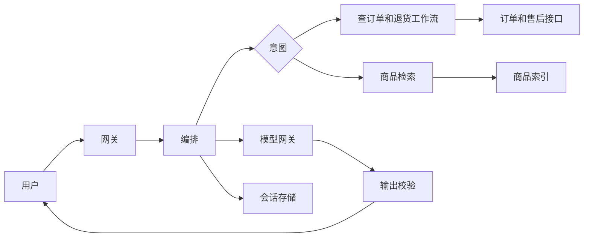

# 阿里淘天 AI Agent 智能体开发三轮面试

> 根据面试截图整理。题干来自原帖，参考答案用于复习，不是候选人当时的口述。

## 一面

**现场记录**

本轮约 60–70 分钟，重点是 Java、Agent 框架原理、RAG、工具调用和手撕。手撕大概率是图或字符串。JVM、GPU 成本和电商业务都会问，只讲框架 API 不够。

### 1. 请做一个自我介绍（2–3 分钟，突出 Agent 或大模型工程经验）

**答题思路**

控制在两到三分钟，按「我是谁、做过哪条链路、为什么能做这个岗位」讲。

1. 年限和主语言一句话。技术栈按相关度排：Java 服务、MySQL、Redis、消息队列，然后是你真写过的模型调用、检索或工具编排。
2. 只展开一个 Agent 或大模型项目：谁在用，请求进来之后经过哪几步，你负责的是编排、检索、工具还是上线后的稳定性。
3. 留一个能追问的工程点，例如工具超时、检索评测、上下文裁剪或费用。只用你能对上日志的经历。
4. 收在电商约束上：价格、库存、优惠和售后以接口为准，模型负责理解和说明。
5. 停住。QPS、GPU 和项目细节等对方追问，不要把简历上每个系统都点一遍。

### 2. JVM 的堆、栈、元空间，在 Agent 服务里有哪些内存泄漏风险？

**参考答案**

结论：堆泄漏来自没有上限的会话和缓存，栈泄漏来自停不下来的平台线程，元空间泄漏来自没释放的类加载器。流式调用还要单独看堆外直接内存。

对话、工具原文、检索片段和向量都在堆上。它们如果放进没有条数、字节上限和 TTL 的 Map，请求结束后仍被引用，老年代会一直涨。线程池复用工作线程时，ThreadLocal 里的大上下文不摘掉，会跟着那条线程活到进程退出。

平台线程的栈不在堆里。池子不断建线程时，进程 RSS 上升，堆使用率可以仍然不高。虚拟线程的栈块由 GC 管理，请求里抓住的大对象仍然算堆占用。

元空间存的是类元数据。动态编译表达式、脚本化工具、热加载插件时，旧 ClassLoader 还被缓存引用，类就卸不掉，Full GC 也降不了这块内存。

Netty 和 gRPC 的 DirectByteBuffer 在堆外。流式订阅不取消、缓冲不释放时，堆看起来正常，进程仍会因为直接内存耗尽退出。会话缓存要有上限和过期；请求结束要取消订阅，并清理 ThreadLocal。

### 3. G1 和 ZGC 在长连接、流式服务下的表现有什么差异？

**参考答案**

结论：流式输出怕停顿把 token 间隔拉开。G1 复制存活对象时要停下应用线程，停顿随存活集变长；ZGC 的移动和业务线程并发进行，停顿通常在毫秒级，不随堆大小线性增加，CPU 和内存开销更高。

G1 按区回收。年轻代回收和混合回收里的复制阶段是 Stop-The-World，默认停顿目标 200 毫秒，这是目标不是保证。大于等于半个 Region 的对象走巨型分配，一份很大的提示词或图片字节数组会占满整区，造成碎片，严重时触发整堆回收。

ZGC 用染色指针和读屏障，重定位期间应用还能继续跑。JDK 21 起可以启用分代 ZGC，JDK 23 起分代是默认模式。流式响应会制造大量短命对象，分代能把它们挡在年轻代；非分代模式在这种分配速度下更吃力。ZGC 还要预留空闲堆给重定位。

长连接本身不制造垃圾。连接对象如果抓住整段生成结果，存活集变大，G1 的停顿会跟着上升。两种收集器都解决不了泄漏，只改变停顿的形状。G1 停顿期间事件循环写不了 socket，客户端看到的就是 token 间隔尖刺。

### 4. Agent 异步调用外部 API 时，ThreadPoolExecutor 的参数和拒绝策略怎么设？

**参考答案**

结论：这是 IO 等待，线程数按在途调用估算，队列必须有界，拒绝要变成一次可见的工具失败。

在途数大约等于 QPS 乘以单次耗时（秒），并且要小于下游配额。核心线程覆盖常态，最大线程只留给突发。超过核心线程数的线程设置回收时间，突发过去就退出。

扩展顺序是核心线程、队列、最大线程、然后拒绝。队列无界时，线程数停在核心线程，最大线程和拒绝策略都不会生效，积压变成内存。所以用有界队列。

拒绝策略用 Abort。捕获 `RejectedExecutionException`，写成「工具忙」，让模型和用户都看得见。CallerRuns 会在编排线程上直接打外部接口，拖住事件循环；编排线程若还在等这个池，可能死锁。Discard 会把调用丢掉，模型却以为工具已经执行。

HTTP 超时、按下游设置的并发信号量、线程名和 Trace 上下文要一起配。超时不在线程池的构造参数里，但没有它，慢调用会把池占满。

### 5. CompletableFuture 如何把多个工具调用编排成并行或串行？

**参考答案**

结论：互不依赖的工具用 `allOf` 并行；下一步要用上一步结果时用 `thenCompose` 串行。每个分支先把异常收成结果，执行器使用专门的 IO 池。

`supplyAsync` 不传执行器时进入 `ForkJoinPool.commonPool()`，阻塞 HTTP 会把这个公共池占满。`thenApply` 不会拆开嵌套的 Future，依赖关系要写成 `thenCompose`。`allOf` 本身只给出完成信号，结果要从各个 Future 取。某个分支失败时，`allOf` 会整体失败；比较商品这类场景，一个工具失败不应该丢掉另一个工具已经拿到的结果。

`orTimeout` 和 `cancel` 只会结束 Future，不会打断已经发出的 HTTP。客户端自己要有超时，用户取消时要真正关掉那次调用。

```java
Executor executor = toolExecutor;
List<CompletableFuture<ToolResult>> calls = tools.stream()
        .map(tool -> CompletableFuture
                .supplyAsync(() -> tool.call(), executor)
                .orTimeout(timeoutMillis, TimeUnit.MILLISECONDS)
                .handle((result, error) -> error == null
                        ? result
                        : ToolResult.failed(tool.name(), error)))
        .toList();
CompletableFuture<List<ToolResult>> parallel = CompletableFuture
        .allOf(calls.toArray(CompletableFuture[]::new))
        .thenApply(done -> calls.stream().map(CompletableFuture::join).toList());
CompletableFuture<Spec> serial = search.thenCompose(items -> items.isEmpty()
        ? CompletableFuture.completedFuture(Spec.none())
        : loadSpec(items.get(0).sku()));
```

### 6. 对比 LangChain、LlamaIndex 和 AgentScope 的优劣

**参考答案**

结论：LangChain 适合快搭编排，LlamaIndex 适合做检索管道，AgentScope 适合把多个角色拆开跑。淘天真正要卡的是超时、幂等和权限，不是示例多不多。

LangChain 的工具、记忆和集成全，原型快。现在常用 LangGraph 把流程做成显式状态图，能暂停和恢复。代价是抽象变化快，隐藏的重试容易把一次写操作做两遍。Java 侧的 LangChain4j 是另一套代码，不能假定和 Python 版行为一致。

LlamaIndex 强在数据接入、切分、索引和查询路由。检索管道比开放式代理完整。事务型工具、人工确认和长链路状态不是它的重点。

AgentScope 是阿里开源的多智能体运行时，角色之间用消息协作，可以分布式部署，适合把检索、解答和审核拆开。它不替代商品和订单服务。内部若还有自研编排，就比状态是否显式、副作用能否被运行时拦住。

退换货需要工具白名单、幂等键和人工卡点。能把这些写进状态图的运行时就可以用。

### 7. ReAct（Reasoning + Acting）的实现流程是怎样的？

**参考答案**

结论：运行时循环调用模型；模型要么给出最终回答，要么给出注册表里的工具调用，执行结果再作为观察送回去。

每一步的输入是系统约束、工具的参数模式和已有消息。模型返回最终回答，循环结束。返回工具名和参数时，运行时先对名字、模式和当前用户的权限做校验，通过后才执行。结果按 `tool_call_id` 追加为观察，再进入下一轮。思考和工具调用可以在同一条助手消息里。

参数解析失败、工具返回错误，都写成观察，让下一步修正，不把异常栈抛给用户。写操作只在运行时发生。模型正文里自拟的地址或 JSON，对不上注册表就忽略。

步数、时间和重复调用这些停止条件放在运行时，不指望提示词里的「不要循环」。

### 8. 如何防止 Agent 陷入死循环？最大步数（Max Iterations）怎么发挥作用？

**参考答案**

结论：最大步数是运行时的硬上限，但挡不住两种工具交替空转。还要识别重复动作、没有新信息，以及时间和 token 预算。

每发生一次模型调用就加一，到配置的上限就停。客服场景通常把上限放在个位数到十来步，研究型任务可以更高。这个数按场景配置，没有放之四海的默认值。

只数步数时，两个工具来回调用，要到上限才停。把工具名和规范化后的参数做成签名，同样的签名连续出现就停；参数要先规范化，否则 JSON 字段顺序不同会被当成两次新调用。连续观察没有新信息，或同一个错误重复出现，也停。另外设墙钟时间和 token 预算。

停止之后，用已经拿到的工具结果套模板回复，或转人工，并把整段轨迹写入日志。提示词可以要求模型及时收束，但不能代替计数器。

### 9. 电商知识库的文档切分（Chunking）怎么设计？

**参考答案**

结论：按文档结构切，并带上可过滤的元数据。属性、问答和政策不要共用一个固定长度。

属性表按字段切成「商品、属性名、值」，表格行不要从中间断开。FAQ 一问一答一块。政策按章节切，只在同一章节内做少量重叠。活动规则必须带生效时间、类目和店铺。

检索用小块，交给模型时带回所属章节，避免数字失去主语。每块带商品、SKU、文档类型、版本和生效时间，检索前先按这些条件过滤。过期活动在进入结果前就排除。

叙述文本可以用几百 token 的窗口；精确字段用短块。重叠只加在叙述上。加在表格上会让同一个数字重复出现，模型更难判断以哪一次为准。

### 10. 向量检索遇到「语义相近、答案却错」的文档怎么办？

**参考答案**

结论：向量近邻只说明像，不说明能回答。先按业务条件过滤，再混合召回，最后用交叉编码器重排；价格和库存仍以接口为准。

双编码器把查询和文档分开编码。「支持七天无理由」和「不支持七天无理由」、相邻型号的退货政策，距离都可以很近。

过滤条件用类目、SKU、文档类型和生效时间。召回同时走关键词和向量，融合两边的名次，取前几十条做重排。交叉编码器同时看查询和正文，能把「像」和「能用来回答」分开，最后留少数几条给模型。

重排解决的是证据选错。成交价、库存和优惠以对应接口为准，不从段落里摘。型号这种精确词，让关键词召回命中全称，减少只靠语义碰到邻近型号。

### 11. 如何设计一个安全的工具注册中心？

**参考答案**

结论：模型只能看见当前场景的工具名单。权限、资源归属和出站地址都由运行时检查，提示词不能给工具加权限。

每个工具注册名字、参数模式、读写类型、所需权限、超时、幂等规则、负责人和版本。退货场景的名单里不出现改价。参数先按模式校验，再按登录用户校验资源，例如订单必须属于这个用户。校验通过才发起调用。

写操作带幂等键，调用写入审计日志。工具的出站主机用白名单，避免参数把请求打到内网。模型输出的文本不直接变成代码或 URL。

工具模式改版时保留版本。在途对话仍按它开始时的模式执行，避免旧参数打到新接口上。

### 12. 工具执行失败（例如 HTTP 500）时，应该重试、报错，还是 fallback 到别的工具？

**参考答案**

结论：按这次调用是读还是写、是否幂等来决定。没有一种全局动作能覆盖所有工具。

读工具遇到 500 或 429，做有限次退避重试，并遵守 `Retry-After`。仍然失败，就把失败写成观察。只有事先声明的备用读工具可以承接同一次查询。

写工具收到 500 时，提交可能已经成功。先按幂等键查询结果。确认没有提交，并且操作本身可以安全重放，才重试。退货失败不能改去调退款。

关键工具失败就结束循环，用已有结果解释，或转人工。模型不能编造订单状态把流程走完。把失败写成观察，是为了让下一步知道事实，不是为了再换一个有副作用的工具碰运气。

### 13. 对话上下文过长，导致内存溢出或 API 费用飙升。截断策略怎么定？LRU 和关键信息提取怎么取舍？

**参考答案**

结论：完整记录放在存储里，提示词只放工作集。LRU 会先丢掉最早的约束，不能单独使用。

系统提示、工具名单、当前目标和最近几轮原文保留。更早的内容收成结构化摘要：意图、已经确认的订单号和商品、用户明确说过的限制。摘要按轮增量更新。

工具返回的大报文只留一行观察，需要细节时再查，并走短缓存。裁剪时先丢大段观察，再丢较早的闲聊。系统约束和用户刚刚说的那句话留到最后。

调用前按 token 预算裁剪。应用里也不要把全部历史一直挂在会话对象上，否则费用还没涨，堆先满了。很长的提示词中间也容易被模型忽略，所以裁剪同时是质量手段。

### 14. Redis 在 Agent 系统里存什么？会话历史这种大 Key 怎么拆？

**参考答案**

结论：Redis 放会话工作集、短时工具缓存、幂等键和限流计数。整段历史放 MySQL，不做成一个大字符串。

工作集包括当前意图、已确认的单号和商品、摘要，以及最近消息的指针。公开规格和知识片段可以短缓存，键里带知识版本。订单、价格和库存要么不缓存，要么按用户和 SKU 设很短的 TTL，避免把别人的结果读出来。

一个会话的完整历史如果是单个 String 或 Hash，读取会把全部内容拉回来，删除也会堵住 Redis 的主线程。消息正文放 MySQL，Redis 用 List 或 Stream 只留最近的消息编号，并用 `LTRIM` 限制长度。删除大键用 `UNLINK`。

同一个会话的热键仍落在一个槽上。组装提示词时只读尾部，不把整个列表取回应用。

### 15. 用户说「帮我对比一下 iPhone 15 和华为 Mate 60」。后端要调哪些工具，结果怎么拼给模型？

**参考答案**

结论：先消歧，再并行取规格和实时价格。通常是解析商品、批量查规格、批量查价格三类工具。有批量接口时每类一次；没有就按商品各调一次。评价和售后只有用户问到才查。

两个名字都可能对应多个 SKU，也可能和 Pro 版本混淆。解析结果不唯一时先问清楚，不替用户选一个再去查价格。

拼给模型的是对齐后的规格表，缺失写「未知」，不补一个看起来合理的值。价格、优惠带上接口返回的时间和活动条件。详情页原文和完整 JSON 不放进提示词。提示词要求只比较表里的字段，并说明价格以这次接口结果为准。

两个商品的规格和价格互不依赖，可以并行。表格在运行时拼好，模型只负责组织比较，不负责从文案里摘数字。

### 16. LeetCode 127. 单词接龙。按 BFS 做状态转换，面试里会类比 Agent 的路径规划

**参考答案**

结论：每个单词是一个状态，改一个字母且新词在词表里就是一条边，边权都是 1。最短变换用 BFS，返回单词个数，到不了就返回 0。

对词表两两比较是 \(O(N^2 \cdot L)\)。更快的做法是每个词只扩展一次，对每个位置尝试 26 个字母，命中词表才入队。访问标记在入队时做。等到出队再标记，同一个词会多次入队。`beginWord` 不要求在词表里，`endWord` 必须在。

时间是 \(O(26 \cdot N \cdot L^2)\)：每个词扩展 \(L \times 26\) 次，每次构造长度为 \(L\) 的字符串并做哈希。空间是 \(O(N \cdot L)\)。双向 BFS 从两端扩展，每次扩较小的一侧，最坏上界相同，分支大时访问的词更少。

单词接龙的动作空间是确定的。Agent 的动作空间会变，不能照搬这张图；「状态入队、访问过就不再进入」这个控制方式是一样的。

```java
public int ladderLength(String beginWord, String endWord, List<String> wordList) {
    Set<String> dict = new HashSet<>(wordList);
    if (!dict.contains(endWord)) {
        return 0;
    }
    dict.remove(beginWord);
    Queue<String> queue = new ArrayDeque<>();
    queue.add(beginWord);
    int steps = 1;
    while (!queue.isEmpty()) {
        int level = queue.size();
        for (int i = 0; i < level; i++) {
            char[] chars = queue.poll().toCharArray();
            for (int j = 0; j < chars.length; j++) {
                char original = chars[j];
                for (char c = 'a'; c <= 'z'; c++) {
                    chars[j] = c;
                    String next = new String(chars);
                    if (!dict.contains(next)) {
                        continue;
                    }
                    if (next.equals(endWord)) {
                        return steps + 1;
                    }
                    dict.remove(next);
                    queue.add(next);
                }
                chars[j] = original;
            }
        }
        steps++;
    }
    return 0;
}
```

### 17. LeetCode 22. 括号生成。用 DFS 回溯生成全部合法组合

**参考答案**

结论：长度固定为 \(2n\)。只要左括号还没用完就可以放左括号，右括号数量小于左括号时才放右括号。这样每个合法串恰好生成一次。

先生成全部 \(2^{2n}\) 个串再过滤，会做大量必然非法的分支。回溯在放置时剪掉「右括号多于左括号」和「左括号超过 n」的路径。结果数是第 \(n\) 个卡特兰数，时间大约 \(O(4^n / \sqrt{n})\)，递归栈 \(O(n)\)。输出本身占用的空间另算。

用字符数组填到定长，避免字符串反复拼接。收集结果时再复制成字符串，因为数组在回溯中会被覆盖。

```java
public List<String> generateParenthesis(int n) {
    List<String> answers = new ArrayList<>();
    char[] path = new char[n * 2];
    fill(answers, path, 0, 0, 0, n);
    return answers;
}

private void fill(List<String> answers, char[] path, int index,
                  int open, int close, int n) {
    if (index == path.length) {
        answers.add(new String(path));
        return;
    }
    if (open < n) {
        path[index] = '(';
        fill(answers, path, index + 1, open + 1, close, n);
    }
    if (close < open) {
        path[index] = ')';
        fill(answers, path, index + 1, open, close + 1, n);
    }
}
```

## 二面

**现场记录**

交叉面，约 60 分钟。重点是微服务治理、容灾、消息队列和分库分表。

### 1. 深挖简历里的 Agent 项目：QPS 怎么算，GPU 利用率怎么监控，成本怎么控？Spot 实例能不能用？

**答题思路**

按对方追问的顺序讲。数字只用你能在监控里对上的，对不上就讲口径和指标打在哪一层。

1. QPS 先定义口径。入口对话、模型调用和工具调用分开说，因为一次用户请求会放大成多次模型和工具请求。再讲峰值出现在什么场景，瓶颈在配额、线程还是下游。
2. GPU 先分清卡是不是你自己的。调用外部 API 时，你能监控的是 token、排队和首 token 时间，没有一张卡的利用率可以看。自建推理时，把算力利用率、显存、KV Cache、批大小和队列时间分开。卡被占着但批是空的，利用率可以很低；批太大时利用率高，延迟会变差。
3. 成本先分清按 token 付费还是按卡付费。外部 API 优先减少重复检索、限制循环步数和输出长度。自建时，在线基线用稳定实例；可中断的离线评测，以及有备用容量的无状态副本，才用 Spot。抢占之后任务回到队列重试。唯一的在线副本不放在 Spot 上。
4. 讲一个你真实做过的取舍就停。不报记不清的利用率，也不编节省了多少钱。

### 2. Agent 服务在 K8s 上扩缩容时，怎么保证 Nacos 里不留下脏实例？

**参考答案**

结论：进程起来不等于可以接流量，进程退出也不等于名单里已经没有它。注册和注销要绑在同一个生命周期上，并且和 K8s 的摘流一起做。

实例使用临时实例。依赖和模型都就绪之后再注册，就绪探针和这次注册用同一套判断。只把 Pod 从 Service 摘掉不够，Nacos 里仍可能留着这个实例。

缩容时在 `preStop` 里先注销或把权重调成 0，再等待已经开始的流式请求结束，然后退出。`terminationGracePeriodSeconds` 要盖住这段排空时间，并设置上限，避免一个超长生成把下线拖住。Nacos 2 的客户端用长连接感知上下线，连接断开后仍有一小段摘除延迟。这段窗口里调用方要能快速失败并换一个实例。

进程被强制杀掉时来不及注销，所以不能只依赖主动注销。客户端的实例列表要能更新，不能永远用一份本地缓存。手工注册的持久实例不会随 Pod 消失，调试完要删掉。

### 3. 流式响应里，gRPC 相比 HTTP 有什么优势？

**参考答案**

结论：服务之间的 token 流，gRPC 把多路复用、流控、超时和取消做成了调用约定。面向浏览器的接口仍然常用 HTTP 上的 SSE。

gRPC 跑在 HTTP/2 上，用 protobuf 传输。一条连接上可以同时有多个生成流，慢的客户端通过流控窗口限制发送，不会无界堆积。截止时间从网关传到推理服务。客户端断开时，服务端能收到取消；推理循环必须检查这个取消，否则 GPU 上的生成还会继续。

HTTP/2 本身也能双向流。很多现成的 HTTP 接口其实是 HTTP/1.1 加 SSE：单向文本帧，代理还可能把响应缓冲住，客户端要自己发现连接已经断开。gRPC 省的是每家再定义一套帧、超时和取消。它不会让模型本身变快。

浏览器不直接讲 gRPC，需要 grpc-web 或在网关转成 SSE。负载均衡要识别 HTTP/2。排障时二进制也不如文本直观。公网入口用 SSE，东西向用 gRPC，是常见拆法。

### 4. Agent 生成很慢，如何用 RocketMQ 异步化？怎样做到消息不丢，消费也不重复？

**参考答案**

结论：网关把任务落库并投递消息后就返回任务号，生成放在消费者里做。不丢靠事务消息和可靠投递，不重复靠消费端幂等。事务消息仍然可能投递多次。

本地事务写入一条 PENDING 任务，同时发送事务消息的半消息。事务提交后，消息才对消费者可见；事务回滚，消息丢弃。生产者在提交前崩溃时，Broker 回查任务表，按库里的状态决定提交或回滚。回查要读库，不读本机内存。重要任务用同步发送。同步刷盘和同步复制能挡住宕机丢消息，延迟更高，只给不能丢的主题，不给所有流量。

消费者处理完并把结果落库之后再确认消息。崩溃会导致重新投递，这是正常的。任务表以任务号做唯一键，状态用条件更新从 PENDING 到 RUNNING 再到 SUCCESS。写工具也用这个任务号做幂等键，看到 SUCCESS 就跳过副作用。

不同用户的任务不需要全局有序。同一会话要有序时，用会话号做分片键，让它进同一个队列。

### 5. MySQL 订单表太大，怎么分库分表？跨分片查询怎么做？

**参考答案**

结论：在线交易按买家分片，订单和明细使用同一个分片键。不带买家条件的搜索走由 binlog 同步的 ES，不在支付链路上扇出所有分片。

「我的订单」是主路径，分片键用买家。按订单号查询时，让订单号带上路由信息，或先查一张订单号到买家的映射。明细和订单放在同一分片，避免分布式关联。

商家、商品、状态加时间这种条件没有分片键。ES 里商家、状态、商品走倒排，时间用范围结构，先查出订单号，列表展示够用的字段放在索引里，支付状态和详情回 MySQL。同步走 binlog。应用里同时写 MySQL 和 ES，会和本地事务脱节。ES 有延迟，支付和库存以 MySQL 为准。

深分页用 `search_after` 这类游标，不用很大的偏移。对账和全量统计走离线，不在一次用户请求里合并所有分片。

### 6. 热点商品的 RAG 知识被高频访问，多级缓存（本地缓存 + Redis）怎么设计？用户问一个知识库里不存在的问题时，缓存穿透怎么发生？

**参考答案**

结论：本地缓存挡住打向同一个 Redis 槽的热点，Redis 放带版本的公开检索结果。穿透是源头就没有这份资料，而空结果又没被缓存，于是每次都打到向量库。

进程内缓存只放最热的公开知识，条数和 TTL 都小。价格和订单不放进去。Redis 的键带知识版本，商品更新后旧键自然失效。本地的单飞只能合并一个进程里的并发。热点键在 Redis 过期时，要用锁把回源收成一次，否则每个节点都会去打向量库。那是击穿，和穿透不是同一件事。

用户问一个知识库里没有的商品或政策时，本地和 Redis 都没有，向量库也没有。如果只缓存命中，下一次同样的问题仍会走完检索，甚至再调用模型。脚本换着问不存在的单号，会把这条路径放大。

空结果用很短的 TTL 缓存，并限制这种键的数量，避免垃圾问题占满 Redis。检索为空就直接回复没有资料，不再调用大模型。商品 id 可以用布隆过滤器拦住肯定不存在的 id；新商品要及时写进过滤器，否则会被当成不存在。自然语言每次都换一种说法时，空结果缓存打不中，还要按用户限流。

### 7. LLM API 很贵，怎么用 Sentinel 按用户限流？

**参考答案**

结论：在进入编排之前按用户限流。单机计数在扩容后会放大总配额，花钱的预算要有一份集群内的总数。

Sentinel 的普通流控是整个资源共用的 QPS 或并发线程数。按用户限流用热点参数，把用户 id 当作参数，每个用户一个阈值，个别用户可以单独配置。

网关有多台机器时，单机阈值乘以机器数才是实际放行量。扩容会把总配额变大。金额预算用集群限流，或用 Redis 做按天的配额。瞬时突发看令牌桶，钱看自然日配额，两套一起用。

超限直接返回忙，不开始多步工具调用，避免前面的步骤已经花了钱。单次请求再限制最大输入和输出 token，防止 QPS 合格但一次请求极长。

### 8. GPU 推理服务挂了，怎么降级到规则引擎或更小的模型？

**参考答案**

结论：先熔断，再按场景降级。查订单和退货回到规则和工作流；更小的模型只承接推荐和闲聊，不能获得写权限。

熔断看错误率和超时比例，不让每个请求都等满完整超时。意图已经确定时，查订单和退货继续调原来的接口，回复用模板，金额仍由业务服务计算。负责意图分类的模型如果也在这张卡上，就引导用户去订单页，并给出入口。不让一个更小的模型决定退款是否成功。

推荐和闲聊可以切到更小的模型，或只返回已经检索到的片段。小模型的工具名单里仍然没有写操作。

降级结果带上标记，客户端可以说明这是简版回答。还没开始的任务可以晚一点重试；正在流式输出的请求尽快结束并告诉用户中断了。

### 9. 怎么监控一次 Agent 调用的耗时？TraceId 上要能分开模型推理、工具调用和网络 IO

**参考答案**

结论：一次用户请求一个 TraceId，每个阶段一个 Span。模型要分开首 token 和总时间，工具要能看见网络时间，异步消息要把 TraceId 带过去。

网关生成 TraceId，通过 HTTP 或 gRPC 的头继续传。Span 包括鉴权、检索、重排、每一次工具调用、模型推理和写会话。模型 Span 记录模型名、输入输出 token、首 token 时间和总时间。工具 Span 记录工具名、状态码和是否命中缓存。客户端里的远程调用单独计时，不和服务端自己的处理混在一个数里，否则分不清是下游慢还是链路慢。

重试写成多个子 Span，不覆盖同一次耗时。生成任务进消息队列时，把 TraceId 放进消息属性，消费者接着起子 Span，否则队列前后会断成两段。

链路看单次请求，指标看 P99、token、工具失败率和循环次数。提示词全文不进链路，体积大，还可能带有隐私。

### 10. 设计一个电商智能客服 Agent，支持退货、查订单、推荐商品。说明架构和数据库表

**参考答案**

结论：查订单和退货走工作流，推荐走检索加生成。订单和售后的状态留在原业务库，Agent 只保存会话、消息和工具调用。

请求先进网关，完成登录、限流和 TraceId。编排按意图分流。槽位缺了就追问，齐了再调订单或售后接口。退货的资格和金额由售后状态机决定，幂等键用用户、订单、动作和请求号。推荐走商品检索和排序，模型只组织语言。政策解释可以用知识库，能不能退以接口为准。回复出去前校验金额和优惠。写操作失败就停止并转人工。



- `agent_session`：session_id，user_id，scene，state，summary，updated_at
- `agent_message`：msg_id，session_id，role，content，trace_id，created_at
- `agent_tool_log`：id，session_id，trace_id，tool_name，idempotency_key（唯一），status，created_at

工具日志的幂等键唯一，重复请求读到同一次结果。这里不建一份可提交退款的订单副本。

## 三面

**现场记录**

总监面加 HR，约 50 分钟。重点是技术选型、协作和业务判断。从最大的技术挑战起是 HR 题。

### 1. 为什么用 ReAct，而不是传统的 if-else 工作流？淘天这种高确定性场景（例如退换货）里，Agent 的自主性边界在哪里？

**参考答案**

结论：开放说法用模型来理解和填槽，退换货的提交用工作流。ReAct 不决定能不能退、退多少。

固定分支盖不住说法的长尾。用户说「耳机一边没声，又不想寄回去」时，规则树容易直接走丢。模型适合识别意图、抽出订单和原因，并用知识库解释政策。

资格、金额、风控和提交是确定的，由售后状态机完成。模型没有提交权，也不能临时造一个工具。置信度不够或槽位缺失，就追问或转人工。

自主性停在建议和草稿。优惠、库存和时效只转述这次工具结果。落地时按场景列白名单：查订单和退货是工作流，推荐可以检索后生成，生成结果仍然过校验。

### 2. Agent 响应慢、P99 过高时，从哪些维度排查？模型瓶颈、网络延迟、工具超时、序列化分别看什么？

**参考答案**

结论：用同一次 TraceId 把耗时拆开，先分清是排队还是服务时间。模型、网络、工具超时和序列化都要看，循环步数和 GC 停顿也经常把尾巴拉长。

模型要分开首 token 和后续生成。提示词过长、输出过长、批处理排队和冷启动，都会抬高 P99。利用率高而且队列变长，是批太大或副本不够；再加一次重试通常会让尾巴更长。

网络看跨机房、TLS，以及反向代理把流式响应缓冲住。模型已经在出 token，客户端的首包仍然很晚，问题在缓冲。

工具的超时如果设得很长，一次下游故障会把整条 P99 钉在这个超时上。并行工具的耗时取最慢的一个。

大段工具 JSON、图片的 base64，以及在请求线程上打印完整提示词，都会占住线程。最后看这轮对话跑了几步。步数一多，前面每一步的优化都会被乘上去。把慢请求和同场景的 P50 按 Span 对比，哪一段只在 P99 变长，就先处理那一段的排队和超时。

### 3. Agent 可能写出虚假优惠。内容安全怎么做拦截？敏感词、规则引擎、二次验证各管什么？

**参考答案**

结论：价格和优惠不由模型创作。敏感词处理不了禁售和辱骂以外的假满减，金额要用工具结果做确定性校验。

金额、库存、赠品和时效只从接口或当前生效的活动配置写入回复，模型组织原因和步骤。检索政策时按生效时间过滤，过期活动进不了提示词。

草稿生成后做实体校验：回复里的价格、门槛、赠品和日期必须能在这次工具结果里找到。对不上就换成「以页面为准」的模板，或重新生成一次。必赔、全网最低这类绝对承诺，没有对应规则就删掉。

敏感词和违禁类目仍然要有，它们管的是不该出现的商品和辱骂。再问一次同一个模型「对不对」会沿着原答案继续编，不能当作二次验证。拦截日志带上工具结果和草稿，方便回放。高风险场景直接走规则模板。

### 4. 怎么收集用户的点赞和点踩，并用于模型微调？数据标注流程怎么设计？

**参考答案**

结论：反馈先用来定位是检索、工具、事实还是表达的问题。真正改权重时，用偏好对，不把点踩的原文当成标准答案。

采集时把 TraceId、提示词版本、检索到的文档、工具结果、模型输出和点赞点踩记在一起。没有上下文的一次点踩，无法判断该改哪一层。点踩的人更愿意反馈，这个分布不能代表全部用户。

样本先分成检索错、工具错、事实错和表达差。前三类修索引、工具和提示词，权重先不动。偏好学习需要被接受的回答和被拒绝的回答。人工改写可以作为被接受的一侧。点踩原文如果拿去做监督微调的目标，模型学的就是错误输出。经典 RLHF 是监督微调、训练奖励模型，再用 PPO 更新策略。同一批偏好对也可以直接做 DPO，少维护一个奖励模型。上线前用固定评测集看事实有没有变差，再放小流量。

标注要有书面标准，说明什么是虚假优惠、什么是没回答问题。准备黄金集，双人标注并看一致率，退款和安全类单独复核。数据离开生产环境前去掉身份和订单详情。训练集和测试集按时间、按用户切开。

### 5. 业务要支持「图片找同款」，后端架构要怎么改？

**参考答案**

结论：新增一条视觉召回链。图片先裁剪、编码、检索，再由模型组织说明。不要只把原图塞进原来的文本提示词，订单和退货工作流不用改。

上传图进对象存储。检测并裁掉背景，避免环境把向量带偏。图像编码和文本编码维度不同时，商品图使用单独的向量集合；只有图文对齐模型，才让图片和文字落在同一个空间。索引按 SKU 的主图和规格图离线建好，带上类目和在售状态。

召回后按类目和在售过滤，再用更强的模型精排。视觉近邻多半是相似款。精确同款还要品牌、型号和 SKU 图，必要时用专门的商品匹配。余弦相近不等于同款。

意图里增加「找同款」，检索完成后再生成说明。用户图片要有保留期限，链路里不存原图。

### 6. 如果面 P7 以上：怎么带新人上手 Agent 项目？Code Review 看什么？

**答题思路**

这一问看你怎么让别人安全地改一条会调用工具的链路。用你真实带过人的做法；没有带过，就讲你会怎么安排，不编团队人数和职级。

1. 上手先给一张请求路径：注册工具、提示词、评测和链路各自在哪。第一周让新人改一个有评测罩着的小点，例如给读工具补上超时和失败观察。一起看一条真实的失败链路。
2. Review 先看这是读还是写。写操作的幂等键在哪，权限是不是运行时用登录用户校验的，失败时用户看到什么。
3. 提示词或工具模式变了，要有同一批对话的评测对比。只靠读 diff 看不出召回有没有变差。
4. 评论里讲清一条原则。方案如果有明确的正确性问题，直接指出失败路径；不把别人的实现改成自己的习惯写法。

### 7. 你遇到的最大技术挑战是什么？怎么解决的？

**答题思路**

只准备一个你亲手处理的故事，两分钟讲完。没有 Agent 事故，就用真实的线上故障，不借别人的项目。

1. 影响：谁被挡住了，问题在正确性、延迟还是费用。
2. 你先看了哪条证据，排除了哪个看起来像、其实不对的原因。
3. 修的是哪一层：提示词、检索、工具、超时还是发布方式。
4. 怎么确认已经修好，以及留下了什么：评测、告警或幂等键。
5. 下次会更早做的一件事。

对方追问时，要能说到日志或代码的位置。说不出的数字不要报。

### 8. 为什么离开上家公司？

**答题思路**

用一件事实说明阶段变了，一两句讲完，原因向前看。

1. 讲你现在负责的系统到了什么阶段，你下一段想深入的是哪类问题：有副作用的工具、检索质量、成本或稳定性。
2. 原因停在工作内容上。不评价前司管理，不谈薪资，不罗列委屈。
3. 对方追问时重复同一个原因，不临时再找一条新的。

### 9. 为什么选择淘天？

**答题思路**

把这个岗位真实的约束说出来，对应到你已经做过的工作。

1. 淘天的客服和导购是高并发、强正确的交易链路。价格、库存、优惠和退换货以接口为准，模型负责理解和说明。
2. 用你真实做过的一段接上去：工具权限、检索、评测或稳定性。没有对应项目就说明你准备怎么补，不安一个项目名。
3. 收在你能先做稳的一块。职业规划留给下一问，不在这里把职级目标一起说了。

### 10. 未来的职业规划是技术专家还是管理者？

**答题思路**

分近和远，绑定这条链路的工作，不报一个职级时间表。

1. 近一两年：把一个场景从能对话做到可上线，包括评测、工具的权限和幂等、超时降级、成本和链路。
2. 再往后用你已经在做的事选择。一直在追检索、运行时和成本，就走专家。已经在带人，而且你想对团队结果负责，再谈管理。管理不是职级的代称。
3. 最后问对方，这个岗位前两年更看重专家深度还是带人。用对方的回答校正规划，不现场改口迎合。
