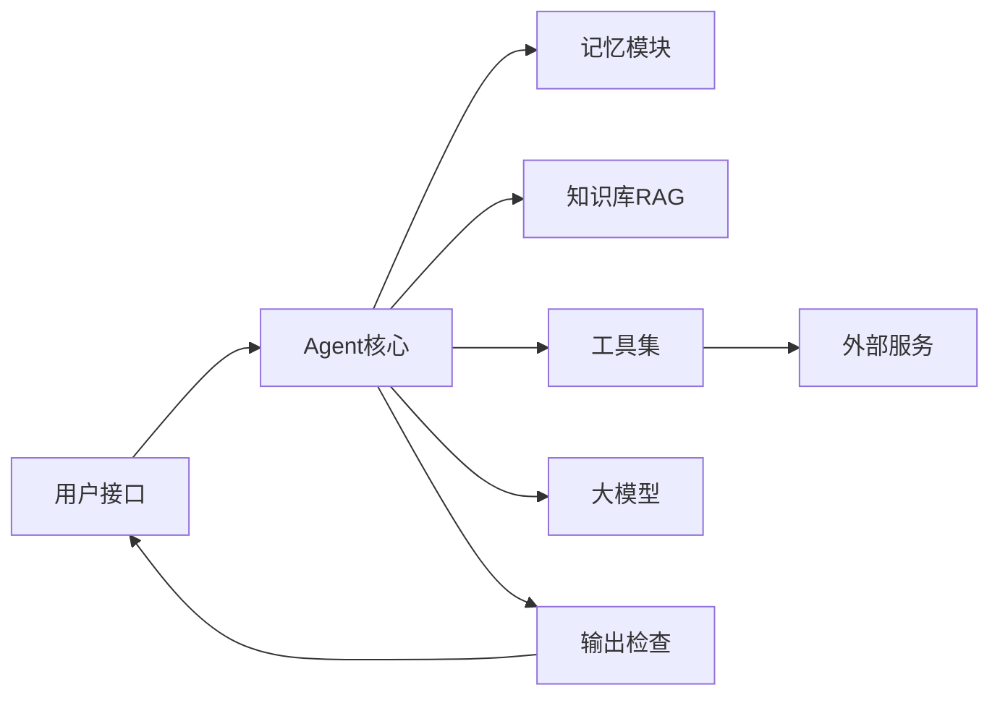

# 阿里淘天agent开发三轮技术面贼难

> 根据面试截图整理。题干来自原帖，参考答案用于复习，不是候选人当时的口述。

## 面试感受

面完了，感觉还行。一面问得挺扎实，RAG 和记忆那块儿我在项目里实际踩过坑，答得比较顺。算法题是经典滑动窗口，秒了。二面面试官有点东西，一直追着项目细节问，好在架构设计平时琢磨得多，没被问住。三面聊得比较开，总监更关注技术决策和业务落地，感觉是在考察能不能把技术变成实际生产力，而不只是会写代码。HR 面就正常聊，真诚点就行。

整体感觉，淘天这边确实很务实，问题都紧扣高并发电商场景下的 AI 工程化。光会调包肯定不够，得对系统整体有思考。面试官水平都在线，交流起来挺舒服的。

## 一面

### 1. 自我介绍

**答题思路**

控制在一两分钟，按「我是谁、做过什么、为什么能做这个岗位」讲。

1. 年限和方向：后端、算法工程或大模型应用，一句话交代主语言。
2. 挑一个你主导或深度参与的 Agent 项目，说清用户是谁、链路是什么、你负责哪一段。
3. 留一个可追问的点：RAG 召回、记忆、工具调用、延迟或评测，只用你真做过的结果。
4. 收尾落到电商场景：商品知识会变、价格库存必须实时、大促要稳。

不要背完整份简历，也不要编项目名和指标。

### 2. 项目介绍（请选择一个你主导或深度参与的 AI Agent 项目进行介绍）

**答题思路**

用一条真实链路讲完，方便后面追问。

1. 背景：解决什么问题，为什么普通搜索或规则机器人不够。
2. 架构：用户输入、意图和槽位、检索、工具、生成、校验、写回记忆。口头能画出边界。
3. 你的模块：明确哪些是你做的，哪些是现成服务。
4. 一个难点：例如召回看起来像、答案却错，或工具超时。讲你放弃过的方案和最后的取舍。
5. 结果：只引用真实的完成率、延迟或人工抽检结论，并补一句上线后仍存在的问题。

### 3. Python 和 Java 在 AI Agent 项目开发中分别扮演什么角色？你如何权衡和结合使用这两种语言？

**参考答案**

Python 承担模型、检索和实验迭代，Java 承担接入现有电商服务和高并发入口。两边用稳定的接口对接，而不是全站只留一种语言。

Python 侧常用 FastAPI 跑编排、离线建索引、评测脚本和 Prompt 试验。PyTorch、Transformers、主流 Agent 和 RAG 库都先提供 Python 接口，改检索策略很快。Agent 大部分时间在等模型和 RPC，可以用 `asyncio` 扛 IO。向量化、重排这类吃 CPU 的计算放到独立的推理进程，避免堵在请求协程里。

Java 侧适合做网关、登录、限流，以及调用商品、交易、营销这些已有服务。线程模型、连接池、熔断和链路追踪都成熟。编排如果主要是调内部 RPC，用 Spring AI 或 LangChain4j 把循环放在 JVM 里，超时和鉴权可以收在一处。

选型看工具在哪、谁值班。检索要天天改，循环放 Python，Java 做网关。工具都是 Java 服务，循环放 Java，Python 只做模型和离线评测。契约用版本化的 JSON Schema 或 protobuf，评测集两边共用。

### 4. 请解释 RAG（检索增强生成）的核心流程，并说明它在电商 Agent 场景中解决了哪些关键问题？

**参考答案**

RAG 先从外部知识里找出证据，再让模型据此生成。它解决的是「这条商品、这家店的说明模型参数里没有」，不替代实时价格和库存。

离线把详情页解析、清洗、按结构分块，带上商品、类目、章节和更新时间，同时建向量索引和关键词索引。商品变更后增量更新，下架商品要能被过滤掉。

在线先做意图识别和查询改写，再在「在售、类目」等条件下做混合检索，用重排模型留下少数片段，放进提示词。提示词要求只依据资料回答，并指出来源；资料里没有就明确说不知道。

电商里它能跟上详情、尺码、售后和长尾商品的变化，不用为这些文字重新训练模型，客服回答也能回指到具体段落，减少编造参数。成交价、库存、优惠和物流以商品、交易接口为准，检索结果只解释「为什么」。

### 5. 在 RAG 系统中，文档分块（Chunking）的策略有哪些？针对商品详情页这种结构化和非结构化混合的文本，你会如何设计分块策略？

**参考答案**

分块决定检索单元。常见做法有：定长窗口加重叠、按段落和句子递归切、按标题或 HTML 结构切、按相邻句子的向量差异做语义切、检索小片段但回带父章节，以及把整页编码后再按区间池化的 late chunking。

详情页先按区块拆开：标题、属性表、图文、尺码、包装售后、问答。属性表每一行收成短句，例如「电池容量：5500mAh」，并保留字段名供精确过滤。图文按段落切，只在同一章节内做少量重叠，避免售后说明黏进参数区。表格行不要从中间切断。

检索用这些短片段，生成时带回所属章节，防止数字失去主语。评论和问答另建索引。图片单独做说明或走图搜，用商品 ID 关联。每条都带商品、SKU、章节、在售状态和更新时间，下架和错类目在检索前过滤。

属性表整段嵌在一起时，「电池容量」很难被单独命中；行被切断后，数值对不上字段名。

### 6. 什么是 Agent 的三层记忆架构？请分别阐述短期记忆、会话记忆和长期记忆的作用与典型技术实现。

**参考答案**

三层记忆对应三个生命周期：这一步推理、这一次会话、跨会话仍然有效的事实。

短期记忆是当前请求的工作记忆，包括最近几轮原文、本步的计划和工具返回。它放在模型上下文里，用 token 预算截断。请求结束就可以丢掉，不必单独落库。

会话记忆保存同一次咨询的状态：历史消息、滚动摘要、已经确认的槽位（类目、预算、正在看的商品）。实现上按会话 ID 放在 Redis，并在 PostgreSQL 里追加消息，设置过期时间。下一句可能打到另一台机器，所以要在本轮写成功之后再回复。

长期记忆保存跨会话的偏好和稳定事实，例如常看的品牌、不希望被推荐的品类。结构化字段放数据库，模糊内容用向量检索，键必须带用户 ID。订单状态这类会变的数据不写死在记忆里，用的时候再查订单服务。

写入要有筛选。工具怎么调用属于技能说明，放配置，不放进用户记忆。

### 7. 在长期记忆的实现中，除了向量数据库，还有哪些存储或组织方式？知识图谱在其中能起到什么作用？

**参考答案**

向量库负责「这句话像哪段记忆」。能精确更新、能解释的事实，还要有别的组织方式。

关系库保存偏好键值、置信度、证据和失效时间，更新是覆盖某一行，而不是再插一条相似向量。Redis 缓存热点画像。搜索引擎负责型号、品牌这类关键词。原始对话可以归档到对象存储，记忆里只留指针。

知识图谱补的是关系。用户偏好某品牌、商品属于某类目、手机具备长续航或大字体，这些边可以做多跳：送长辈会走到「大字体、简易模式、长续航」，而不只是和原句向量接近的手机文案。边可以展示，也方便在用户改口时删掉。

图谱建设成本高，只放高价值、相对稳定的关系，并记录来源和更新时间。召回时结构化查找、图关系和向量一起用，再按类型和时效重排。

### 8. 你了解哪些 BERT 的小模型变体（如 BERT-Tiny、BERT-Mini）？在资源受限的线上服务中，选择小模型时主要考虑哪些因素？

**参考答案**

BERT-Tiny、BERT-Mini 是 Google 发布的预训练小型编码器，不是把 BERT-Base 随便砍层。Tiny 是 2 层、隐藏维度 128、2 个注意力头，大约 440 万参数；Mini 是 4 层、隐藏维度 256、4 个头，大约 1100 万参数。同系列还有 Small（4 层、隐藏 512）和 Medium（8 层、隐藏 512）。

相近路线还有：DistilBERT，6 层、约 6600 万参数，从 Base 蒸馏；TinyBERT 分通用蒸馏和任务蒸馏两阶段；ALBERT 用跨层共享参数，参数量下降，但每一层的计算还在，延迟不会按参数量同比下降。

线上先确认任务是分类、匹配、抽取或重排。这类编码器不做开放生成。然后在目标 CPU 或 GPU 上测 P99 和 QPS，用业务评测集看相对教师模型掉了多少。序列长度对注意力是平方级影响。再看能否导出到 ONNX Runtime、OpenVINO 或 TensorRT，以及能否做 INT8。

英文 Tiny 的词表不适合中文商品文本，应换中文预训练的同量级模型，或从业务教师模型蒸馏。参数量大头可能在词嵌入上，比较延迟时看层数、隐藏维度和序列长度。

### 9. 微调一个 BERT 小模型时，有哪些关键的优化手段可以防止过拟合并加速训练？

**参考答案**

从小模型已有的预训练权重开始微调。随机初始化既容易记住小训练集，也要更多步才能收敛。

防止过拟合：

- 按线上分布划分验证集，用验证损失早停。驱动早停的验证集不要再当成最终测试。
- 保留 BERT 里大约 0.1 的 dropout。优化器用 AdamW，学习率在 2e-5、3e-5、5e-5 这档里选，weight decay 再按验证集试一档较小的值。
- 标注少时冻结底层，只训练上层和分类头；可以用更大教师模型的软标签做蒸馏。
- 去重、纠正明显错标，类别极不均衡时再处理采样。训练损失还在降，不代表还要继续训。

加速训练：

- 混合精度使用 FP16 或 BF16。
- `max_length` 收到业务里的真实长度。注意力随长度平方增长，无故用 512 会慢一个数量级的注意力计算。
- 按长度分桶、动态 padding，并缓存已经分好词的数据，减少无效计算和数据加载等待。
- 小模型通常显存不是瓶颈，批大小以喂饱设备为准。数据量不大时，单机多卡的通信可能比计算还贵。

### 10. PostgreSQL 在 Agent 系统中可能用于存储哪些数据？如果用它来存储和检索对话历史（作为会话记忆），你会如何设计表结构？

**参考答案**

PostgreSQL 适合 Agent 域里要事务、要按键更新的数据：会话消息、摘要和槽位、结构化长期记忆、工具审计、用户反馈和评测标注，以及文档块元数据。中等规模可以用 pgvector 存向量。订单、库存和支付仍以交易服务为准，这里只存订单号、商品 ID 这类引用。

对话历史用追加写。大段工具原文放对象存储，表里留摘要和指针。

```sql
CREATE TABLE conversation_message (
    id           BIGSERIAL PRIMARY KEY,
    session_id   TEXT        NOT NULL,
    user_id      TEXT        NOT NULL,
    role         TEXT        NOT NULL CHECK (role IN ('system', 'user', 'assistant', 'tool')),
    content      TEXT        NOT NULL,
    token_count  INTEGER,
    tool_name    TEXT,
    created_at   TIMESTAMPTZ NOT NULL DEFAULT now()
);

CREATE INDEX conversation_message_session_idx
    ON conversation_message (session_id, created_at DESC, id DESC);

CREATE TABLE session_state (
    session_id         TEXT PRIMARY KEY,
    user_id            TEXT        NOT NULL,
    summary            TEXT        NOT NULL DEFAULT '',
    slots              JSONB       NOT NULL DEFAULT '{}',
    covered_until_id   BIGINT      NOT NULL DEFAULT 0,
    updated_at         TIMESTAMPTZ NOT NULL DEFAULT now()
);
```

拉最近消息用 `(session_id, created_at, id)` 做键集分页，避免大偏移量。本轮消息先写成功再回复，下一次请求读得到。所有查询带 `user_id`。量大以后按时间分区并到期删除。会话回放走会话 ID 和时间；向量检索用在长期记忆，不拿来代替这次会话的顺序读取。

### 11. 场景题：用户向电商客服 Agent 提问「帮我找一款适合送长辈的、续航长的手机」，请描述后端系统从接收到 Query 到给出最终回复，可能涉及哪些模块和技术流程？

**参考答案**

这是选购咨询。候选商品和续航参数来自商品搜索，适老理由可以来自知识库，价格和库存来自实时接口。

1. 接入层做登录、限流和 trace，并加载会话。
2. 查询理解得到意图「选购」，槽位是类目手机、对象长辈、约束续航长。预算和品牌还没有，可以先搜一版再追问，也可以先问一句，取决于产品对回复时延的要求。
3. 读取长期偏好和本会话已经确认的条件。
4. 规划出工具：把「长辈」展开成大字体、大音量、简易模式，「续航长」映射到电池容量等可筛选属性。
5. 商品搜索按类目和属性取候选，再查实时价格、库存和活动。知识库只补充适老说明和常见取舍。
6. 模型只用工具返回的商品组织推荐，并写清关键参数。输出检查核对价格、库存和绝对化承诺。
7. 用户随后说出的预算、品牌写入会话槽位。稳定偏好再进入长期记忆。

详情页检索找不到「现在哪台有货」。这一步必须调用商品服务。

### 12. 手写算法：给定一个字符串，请你找出其中不含有重复字符的最长子串的长度。

**参考答案**

用滑动窗口维护一段没有重复字符的区间。右指针扫过每个字符；如果它上次出现的位置还在窗口里，左指针移到上次位置的下一位。窗口长度的最大值就是答案。

每个下标只进出窗口一次，时间是 O(n)。空间是字符表大小，上界为 O(min(n, 字符集大小))。子串必须连续。若还要返回子串，记下最优起点即可，复杂度不变。

左指针只能向右。上次出现的位置已经在窗口左边时，不能把左指针拉回去。`"abba"` 的答案是 2。

```python
def length_of_longest_substring(s: str) -> int:
    last_index: dict[str, int] = {}
    left = 0
    best = 0
    for right, ch in enumerate(s):
        prev = last_index.get(ch)
        if prev is not None and prev >= left:
            left = prev + 1
        last_index[ch] = right
        best = max(best, right - left + 1)
    return best


if __name__ == "__main__":
    assert length_of_longest_substring("") == 0
    assert length_of_longest_substring("abcabcbb") == 3
    assert length_of_longest_substring("bbbbb") == 1
    assert length_of_longest_substring("pwwkew") == 3
    assert length_of_longest_substring("abba") == 2
```

## 二面

### 1. 自我介绍

**答题思路**

比一面更短，把时间留给项目。用三四句说明年限、你负责的 Agent 模块，以及一个你准备展开的技术决策。术语点到为止，等面试官往下问。

### 2. 请深入介绍你简历中与 Agent 最相关的项目。你负责的模块是什么？遇到了哪些技术挑战，是如何解决的？

**答题思路**

只深挖一个模块，按下面的顺序讲。

1. 用两句重述业务和你的边界，避免把团队的工作说成自己的。
2. 把模块的输入、输出和上下游说清楚，例如检索返回什么、谁来消费。
3. 挑战选真实故障：语义相近但答非所问、工具重复执行、记忆串用户、P99 被排队拖高。
4. 讲排查顺序：先看日志和坏例，再定位是数据、检索、提示词还是依赖。
5. 讲保留的方案和放弃的方案，以及上线后的真实变化。数字只用你能解释的。
6. 补一条今天还会改的地方。

### 3. 在你设计的 Agent 系统中，RAG 的检索模块遇到「语义相似但答案错误」的文档时，有哪些优化策略？（例如重排序、查询扩展等）

**参考答案**

双编码器的相似度表示话题接近，不表示片段里有可引用的答案。优化目标改成「这段能不能支撑回答」，并用标注坏例验收。

重排是第一层。先混合召回几十条，再用交叉编码器按查询和片段联合打分，留下几条。重排比双编码器准，也更慢，所以不对全库做。过滤条件下推到检索里，避免先召回再过滤，结果被滤空。

查询扩展用来补用户没说出的属性，例如把「续航」扩到电池容量，或用多查询、HyDE 生成假设答案再检索。扩展能提高召回，假设答案写错时也会把检索带偏，后面必须重排，低分就拒答。

关键词和向量一起召回，用 RRF 这类按名次融合，因为两边的分数不能直接相加。片段嵌入前补上商品标题和章节。把「很像但答错」的片段当成难负例，微调向量模型或重排模型。

生成阶段要求引用证据。价格和参数用规则核对；抽检再用蕴含模型看回答是否被证据支持。切片把结论和主语切开时，先改分块，换嵌入模型解决不了。

### 4. 你如何实现和管理 Agent 的「工具调用」（Tool Calling）能力？如何设计一个安全、可扩展的工具注册与执行框架？

**参考答案**

工具调用是一个固定循环：模型按 schema 选出工具和参数，服务端校验并执行，把结果放回上下文，直到模型给出最终回复或到达步数上限。

每个工具独立注册，清单包括名字、说明、JSON Schema、超时、是否幂等、读或写、所需权限和版本。新增工具不改循环本身。一次请求只下发当前意图允许的工具，选购不会看到退款工具。

执行前校验参数类型和必填项，未知工具名把错误退回模型，不执行任意字符串。鉴权使用用户自己的权限。写操作，尤其是退款和改地址，先给用户确认，并用幂等键防止重试造成重复执行。只对幂等的读操作做有限次重试，配超时和熔断。工具如果会访问 URL，要限制目标地址。

工具结果视为不可信数据，单独分区，不能改写系统指令。返回给模型前截断，大对象只留摘要和 ID。审计记录工具名、参数摘要、耗时和结果码，少落敏感原文。

### 5. 详细描述你如何为 Agent 设计和实现「长期记忆」功能。信息的存入、更新和检索流程是怎样的？如何保证记忆的准确性和时效性？

**参考答案**

长期记忆是跨会话的小规模事实，不是把历史对话全部嵌进向量库。

存入发生在本轮结束之后。抽取器提出候选：偏好、明确事实、与本次咨询相关的事件。闲聊丢弃。每条带用户 ID、类型、键、内容、置信度、证据位置和有效期。用户亲口说的置信度高；从订单里推断的偏好标成推断，使用时换一种说法，或者先向用户确认。

更新按键合并。同一偏好有了新的明确说法，就覆盖旧值并留下版本。向量很近的重复内容合并。两条矛盾又分不清先后时，向用户确认，不把两条都当成事实。地址、订单状态以主数据为准，记忆里最多记「用户在跟进哪张订单」。

检索在下一轮开始时做。先按用户 ID 过滤，再查已知的键，并用向量召回少数相关条目，按类型和新鲜度排序，控制注入的 token。记忆放在独立区域，只作为事实，不作为新的系统指令。

准确性来自证据和删除能力。模型自己猜的内容不入库。时效靠分类失效时间，以及主数据变更时主动作废相关记忆。

### 6. 如果让你优化一个已上线的 BERT 小模型服务，以降低 P99 延迟，你会从哪些方面入手？（可从模型、输入、计算、部署等多个层面阐述）

**参考答案**

先把 P99 拆成排队时间和计算时间。尾延迟经常是队列和批次里的长样本，不先量清楚就去剪模型，会剪错地方。

模型：在校准集上做 INT8 量化，用评测集确认精度还能接受。按硬件导出到 ONNX Runtime、OpenVINO 或 TensorRT。分类服务只返回标签。只有评测仍有余量时，才继续蒸馏。

输入：`max_length` 按线上长度分位设置。按长度分桶，避免一条长文本拖住整批。热点查询归一化后缓存结果。使用快分词器，同一文本不重复分词。

计算：动态批处理的等待时间要短，等待越久吞吐越高、P99 越差。推理线程数按压测设置，并发上来以后线程过多会让尾延迟变大。热点路径离开纯 Python 循环。

部署：按队列深度或延迟扩容，负载均衡偏向在途请求更少的实例。发布后先预热。队列设上限，超过就降级，而不是无限排队。不要和离线批处理抢同一张卡，调用方和模型尽量同机房。

### 7. 在多轮对话中，上下文（Context）过长会导致 LLM API 成本激增和性能下降。你有哪些有效的上下文管理或压缩策略？

**参考答案**

任务型对话把「还有效的状态」和「近期原文」分开保存。更早的闲聊收成摘要。

具体做法是给系统说明、槽位、检索证据、近期对话各自设 token 上限。槽位里的商品 ID、预算、收货对象保持原值，摘要不能改写这些字段。近期几轮留原文，更早的增量摘要进会话状态。

工具的大 JSON 不整段留在历史上，只留 ID 和一句话结果，需要时再查。更早的对话按当前问题检索相关轮次，而不是每次全带上。

服务商的前缀缓存能降低稳定前缀的重复计费和首包延迟，那些 token 仍然占着上下文窗口。该丢掉的历史还是要丢掉。

用小模型压缩原文可以再省一些 token，但可能删掉型号和否定词，要放进评测集看任务有没有变差，不能只看 token 下降。

### 8. 在分布式 Agent 系统中，如何保证多个 Agent 实例之间的状态同步或记忆共享？会引入哪些中间件，可能带来什么新的问题？

**参考答案**

实例本身不保存会话。任意一台都能接下一句，状态放在外部。在线路径用 Redis 放热点会话，用 PostgreSQL 做持久记录和结构化记忆；长期语义召回用向量索引。消息队列用在审计和索引更新这种可以晚一点的链路上，下一句对话不从消费者读。

写后读要成立：本轮消息写成功再回复，下一次读主库或具备写后读的存储。同一会话的并发请求用版本号或租约锁。锁过期后，存储用单调的 fencing token 拒绝旧持有者的写入。会改数据的工具带幂等键。

新问题主要是这些：Redis 故障时会话要有降级；热会话会被重试打满；队列积压会让向量索引短暂落后，回答里要能接受「索引稍旧、主数据以数据库为准」。每条记忆的键和查询都带用户 ID，避免串记忆。粘滞会话实现简单，发布、宕机和扩容时会话会钉在一台机器上，只适合作为过渡。

### 9. 如何监控和评估一个线上 Agent 系统的整体效果？你会设计哪些指标（除了准确率）？如何收集用户反馈并形成数据闭环？

**参考答案**

准确率覆盖不了「办没办成、事实站不站得住、贵不贵、慢不慢」。按意图分别看。

线上指标包括：任务完成率、转人工率、不该转时的误转；抽检里价格、库存、规则能否在工具结果中找到；工具成功率、参数错误率、平均步数、空召回率；首 token 和整段 P99、单次会话的 token 与费用；安全拦截次数；点赞点踩。推荐场景的点击要做对照实验，不能直接当成模型准确率。

离线按意图维护黄金集，发版前回归。检索看证据里有没有答案，生成看是否被证据支持。

反馈来自点赞点踩、用户立刻改口、放弃会话，以及转人工后客服改过的答案。记录查询、上下文、工具轨迹和最终回复。坏例分成检索错、工具错、没遵守指令、用户没说清。修完提示词、索引或工具后，把坏例放进回归集，再小流量发布。退款类规则用确定性核对，不只靠模型打分。

### 10. 设计题：请为一个电商「购物顾问」Agent 设计一个简化的系统架构图，需包含用户接口、Agent 核心、记忆模块、工具集、知识库（RAG）以及外部服务等关键组件，并简要说明数据流。

**参考答案**

购物顾问的核心是一个有步数上限的工具循环。知识库解释商品，外部服务提供可成交的数据。



数据流是：

1. 用户接口完成登录和限流，把会话 ID 交给核心。
2. 记忆模块提供本次槽位、近期对话，以及该用户的长期偏好。
3. 核心让模型决定这一步要检索、搜商品，还是查订单。
4. 知识库返回可引用的说明。工具集调用商品、价格、库存、营销和订单等外部服务。
5. 模型组织回复。输出检查核对数字、库存口径和承诺用语。
6. 回复和槽位写回会话记忆。值得长期保留的偏好另写入长期记忆。

商品文案可以短时缓存。价格和库存以外部服务本次返回为准。

## 三面

### 1. 自我介绍

**答题思路**

总监面少讲框架名单。用一两分钟讲你做过的业务结果、一个你拍过的技术决策，以及你怎么看待电商里的稳定性和体验。给后面的架构取舍留下入口。

### 2. 在淘天高并发、高可用的电商场景下，将一个实验性质的 Agent Demo 改造为能支撑「双十一」级别流量的生产系统，最大的架构挑战是什么？你会如何应对？

**参考答案**

最大的挑战是多步模型调用又慢又贵，重试还会把流量打到商品和交易服务上。要把这条路径收成有超时、有容量上限、失败时能降级的在线系统。

高频、规则清楚的意图走固定流程；开放问题才进 Agent，并限制步数和并行工具数。模型服务单独规划容量，队列有上限，满了就退回搜索或模板，不让队列无限变长。

商品和交易调用设超时、有限重试、熔断和舱壁隔离。商品文案可以短缓存；价格和库存走实时接口，回答里不用缓存价。实例无状态，会话放外部存储。退款等写操作保持幂等，大促可以用开关收紧。

压测要覆盖模型和下游，不只压自己的网关。链路追踪采样，避免日志本身成为瓶颈。相同热点查询合并，减少重复打到模型上。

### 3. 技术选型探讨：在构建 Agent 的编排框架时，你会选择 LangChain、LlamaIndex 这类开源框架，还是选择自研？请对比利弊并阐述你的理由。

**参考答案**

原型用开源框架把链路跑通。生产环境自己掌握状态、超时、权限和评测，框架当成可替换的库。

LangChain 集成多、上手快，适合试工具和提示词。它的抽象和版本变化快，默认提示词藏在框架里，故障时调用栈不好读。需要状态机时，应使用能看清节点和持久化的写法，并锁住版本，而不是把早期不透明的 Agent 执行器直接放进大促链路。

LlamaIndex 强在文档接入、索引和查询编排，做知识库原型很快。商品过滤、权限和交易流程很重时，业务代码会绕过它的默认查询链。它适合当检索库，不适合当整站的业务流程引擎。

自研的薄运行时只保留：加载状态、调用模型、执行已注册工具、校验输出、写回状态。超时、步数、追踪和评测钩子写在自己的代码里。代价是模型厂商的工具调用格式要自己适配，起步更慢。

淘天已经有 Java 服务和大促值班。循环放在能值班的那一侧，检索库可以继续用现成组件。团队小、场景就是标准问答时，可以暂时把锁版本的框架包在自己的接口后面，升级框架不等于发布业务。

### 4. 如何控制 Agent 的「自主性」边界？例如在明确的退换货规则场景下，是让 Agent 严格遵循规则引擎，还是允许其有一定自主推理空间？如何设计安全护栏（Safety Guardrail）？

**参考答案**

退换货能不能退、退多少钱、运费谁承担，由规则引擎根据订单、类目和规则计算。模型负责听懂原因、抽出订单、把缺的信息问出来、用白话解释结果，以及在规则要求人工时转接。模型不发明例外。

规则没有覆盖的个案交给人工。送礼推荐这类软任务可以让模型规划和比较。

护栏分三层。输入层识别注入和越权要求。工具层按意图下发白名单，退款工具在规则允许前不出现，工具内部再校验一次规则结果；动钱前要用户确认，并使用幂等键。输出层核对金额、时效和承诺是否与工具结果一致，不一致就改用模板或转人工。

再加步数上限和全量审计。评测集里专门放「用户要求破例」的样本，确认系统拒绝破例并给出规则理由。

### 5. Agent 可能产生「幻觉」（Hallucination）或生成不合规内容。在工程层面，有哪些机制可以在生成前后进行控制和拦截？

**参考答案**

事实类回答以检索片段和工具结果为唯一依据。没有依据时，流程直接拒答或追问，不让模型补全。

生成前按风险分流：退款、支付、医疗功效走规则或模板。同时做输入过滤，挡住注入和不适用的请求。工具参数用 schema 约束。把温度调低只能让措辞更稳定，不能证明事实正确。

生成后做确定性检查：价格、库存、商品 ID、链接必须出现在本次工具结果里；「全网最低」「保证治愈」这类承诺用语直接拦截。再用安全分类器看辱骂、隐私和广告法风险。失败后最多带上错误原因重生成一次，仍然失败就用固定模板或转人工。

退款和支付不以另一个大模型的评分作为放行条件。被拦截的样本进入评测集。

### 6. 如果业务方希望为 Agent 增加「通过商品图片找同款」的多模态能力，你的后端架构需要进行哪些改造和扩充？

**参考答案**

同款是商品图向量检索，再回表拿价格和库存。做法与站内「拍立淘」一类能力相同。不要把原图塞进每一轮对话当主要检索手段。

接入层增加上传：限制类型和大小，做安全扫描，图片进对象存储，后面只传图片 ID。离线用视觉编码器把主图和 SKU 图写入向量索引，键是商品和 SKU。在线注册工具 `search_by_image`：编码查询图，按类目等条件检索，必要时用更细的模型重排，再调用原来的商品服务补标题、价格和库存。用户同时说了颜色、价格时，这些是过滤条件。

用多模态模型先写图片说明再做文本搜索，只能在视觉索引不可用时兜底，它对同款的区分更弱。

用户图片设置保留时间，没有明确授权不拿去训练。评测用标注过的同款对，看召回和点进去的商品是否真是同款。Agent 的编排循环不用重写，只是多了一个工具和一套图片索引。

### 7. 你如何保持自己的技术敏锐度并学习一项新技术（例如一年前出现的某个新 Agent 框架）？请描述你完整的学习路径和方法。

**答题思路**

讲一条你真的走过的路径，框架名必须是你读过文档或写过代码的。

1. 从手头的问题出发，例如状态不好调试、工具超时不清晰，而不是因为某个仓库热就学。
2. 用官方文档跑通最小例子，记下它的状态、工具、记忆和失败重试分别在哪。
3. 用现有系统里的一条真实链路重写一小段，对比调试、测试和超时怎么写。
4. 读核心循环的源码，确认重试和持久化的实际行为。
5. 写一页结论：哪些机制吸收进现有运行时，哪些不引入。
6. 用已有评测集跑一遍，把结果讲给团队，并约定以后谁跟踪这个方向的重要变更。

### 8. 当你和团队成员在技术方案上产生严重分歧时（例如选用 A 数据库还是 B 数据库），你会如何处理以推动项目前进？

**答题思路**

先把分歧写成需求，再拿证据决定。

1. 对齐查询方式、一致性、数据量、值班能力和交付时间。
2. 双方各写一页：数据怎么存、怎么失败、怎么回滚。
3. 用真实查询做原型或压测，例如会话按时间翻页、带过滤的向量检索。
4. 差距不大时，选团队能运维、也更容易回退的方案。
5. 决定之后一起执行，写明什么指标变差就重新讨论。
6. 只有数据正确性或合规没有负责人时才升级。升级时带上证据，不针对人。

不要在面试里编一个你没参与过的选型胜利。

### 9. 你如何看待 AI Native 应用与传统软件工程在开发模式、团队协作上的差异？一个优秀的 AI 应用研发工程师应该具备哪些独特的素质？

**参考答案**

传统软件把规则写成确定的代码，测试断言明确的输出。AI 应用里的模型是会出错的组件，需求还要包括评测集、工具契约、拒答条件和可以接受的失败比例。

开发对象除了代码，还有提示词、模型版本和索引版本。测试改为检查关键事实、该调用的工具有没有调用、违规能不能拦住，并对随机输出看一组样本，而不是比整段字符串相等。发布要过离线评测和小流量，回滚时能单独退回模型或提示词。

协作上，工程负责运行时、工具和稳定性，算法负责模型和检索质量，产品与运营提供规则和坏例。共同契约是评测集和工具 schema。

工程师需要能判断哪一段写成代码、哪一段交给模型；能按坏例分类推动修改；能把延迟、费用、权限和降级设计进链路；也能向业务说明这是概率系统，哪些结果必须由规则兜住。

### 10. 你最近读过的一本技术书籍是什么？它给你带来的最大启发或思考是什么？

**答题思路**

说一本你真读过、也能被追问章节的书。结构是：书名、一个具体观点、它改变了你的哪个设计。没读完就说读完的部分，不要现场现编。

可以这样组织，内容换成你自己的：

《数据密集型应用系统设计》里关于派生数据和日志的部分，会让人把 Agent 的对话和记忆做成先写入、可回放的记录，而不是只放在进程内存里。下一句打到任何实例都能读到，索引更新允许稍微滞后，但订单和库存仍以主数据为准。

追问时能讲出你不同意书里的哪一点，或者哪一条你还没做到。

## HR面

### 1. 请做一个简单的自我介绍。

**答题思路**

四五句话，少用术语。说明你是谁、这些年在做什么、一件你负责过的事、为什么来看这个机会。技术细节等对方问。语气自然，控制在一分钟左右。

### 2. 你为什么离开上一家公司 / 为什么选择看新的机会？

**答题思路**

动机讲成长和业务匹配，不贬低前公司，也不把薪资说成唯一原因。

1. 离开：阶段完成、业务方向变化，或你想做的 Agent 工程化在现有团队空间有限。只讲事实。
2. 看机会：希望做高并发业务里的真实用户问题，而不是只做演示。
3. 如果被追问薪资或职级，按真实情况说期望区间，不报一个没有依据的数字。

### 3. 你对我们淘天这个 AI Agent 开发岗位有什么了解？为什么感兴趣？

**答题思路**

把公开能了解到的业务和岗位连起来。

1. 淘天面对的是商品多、规则多、大促流量高的购物和客服场景，Agent 要接商品、订单和售后，不只是聊天。
2. 你感兴趣的点对应自己的经历：检索、工具调用、稳定性或评测，举一个真实片段。
3. 说明你希望把实验链路做成能降级、能核对事实的生产系统。

不编造内部团队名或未公开的项目。

### 4. 在你过去的经历中，遇到最大的技术或项目挑战是什么？你是怎么克服的？

**答题思路**

用一件真事，按背景、你的责任、行动、结果来讲。

1. 背景用业务语言说，项目用「我负责的 Agent 模块」这种说法即可。
2. 行动讲你怎么定位、和谁合作、放弃了什么。
3. 结果只讲真实变化。
4. 收尾说如果重来会提前做什么，例如先建评测集再改提示词。

挑战可以是协调或需求变化，不必刻意选最难的算法。

### 5. 你的职业规划是怎样的？未来 3-5 年希望成为什么样的人？

**答题思路**

和这个岗位接得上，不报虚构职级。

1. 近一两年：独立负责一条 Agent 链路，从效果、延迟、成本和故障里把系统做稳。
2. 三到五年：能为一个场景的技术方案和线上质量负责，带好协作；如果团队需要，再承担一个小方向。
3. 表达你想在复杂业务里长期做，而不是把这里当短期跳板。

问到管理意愿时，如实说你更想先把技术判断做强，还是已经准备好带人。

### 6. 你如何看待加班和工作压力？

**答题思路**

承认大促和故障会有峰值，同时说明你怎么处理压力。

1. 双十一这类节点可以投入，前提是目标清楚。
2. 平时用排期和范围取舍降低无效加班，举一个你砍掉需求或提前预案的例子。
3. 压力大时先保证主链路和回滚，再谈优化。

不表现成只靠加班，也不说自己完全不接受峰值。

### 7. 你目前有其他公司的面试流程或 Offer 吗？

**答题思路**

如实说进度。在流程中就说面试阶段，不必点名；没有其他流程就直接说。口头通知和已签订的 Offer 要分清。不编造公司、薪资和截止日期来施加压力。如果淘天是你的优先选择，说明原因是业务和技术匹配。

### 8. 你有什么问题想问我或公司的吗？

**答题思路**

准备两三个你真的关心的问题，听完回答可以再追问一句。

1. 这个岗位当前主要是导购、客服还是商家工具，成功怎么衡量。
2. 工程、算法和产品怎么分工，线上坏例谁来归类。
3. 大促期间的值班和降级预期是什么。

薪资和职级留到对方进入这个话题时再问。不问隐私，也不用打听说来的负面传闻开场。
