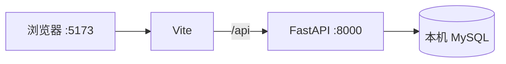
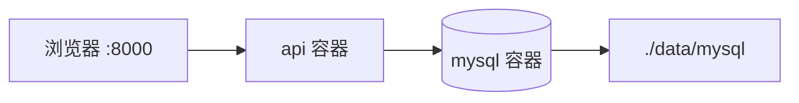

# 待办清单实现方案

界面按参考图实现：浅灰底、居中白卡片、标题「待办清单」、副标题「记录每天要完成的事」、输入框占位「输入待办内容」、通栏蓝色「添加」按钮，卡片下方是「全部 / 未完成 / 已完成」三个筛选。参考图上的半透明水印不属于页面。

列表在筛选按钮下面。每条记录可以改状态、改内容、删除。已完成的记录只允许改状态和删除，不允许改内容。刷新页面后仍能看到以前保存过、还没删除的记录，这些记录来自 MySQL，不放在浏览器本地。

做完之后要满足四件事：

1. 本机可以同时跑前端开发服务和 FastAPI，数据进本机 MySQL。
2. 前端构建结果是 `backend/dist/index.html` 加上 `backend/dist/static/`。
3. 把整个 `backend` 目录拷到 Linux，用 Docker 拉起后，浏览器只访问这一个服务就能打开页面并完成增删改查。
4. 容器重启、`docker compose down` 后再 `up`，待办还在。数据在 `backend/data/mysql`，这个目录相对 `backend`。

本方案不做登录，打开页面的人看到的是同一份清单。

## 1. 技术选型

| 层 | 选择 | 原因 |
|---|---|---|
| 前端 | Vue 3 + Vite | 单页就一个表单加列表。Vite 的 `outDir`、`assetsDir` 可以直接产出 `index.html` 和 `static` |
| 后端 | FastAPI + Uvicorn | 接口和静态页面由同一个进程提供，上线只部署后端目录 |
| 数据库 | MySQL 8 | 本机开发用本机 MySQL；Linux 上用 Compose 里的 MySQL 8，数据目录挂到宿主机 |
| 驱动 | SQLAlchemy 2 + PyMySQL | FastAPI 里同步写库足够。PyMySQL 配合 `cryptography` 可以连 MySQL 8 默认的 `caching_sha2_password` |

接口形状和目录不绑死在 Vue 上。以后改成 React，仍然把构建结果输出到 `backend/dist`，`assets` 目录名仍叫 `static`，后端一行都不用改。

Python 使用 3.11 或更高版本，与镜像 `python:3.11-slim` 一致。

## 2. 业务规则

状态只有两个值：`0` 未完成，`1` 已完成。新记录固定是 `0`。

| 操作 | 规则 |
|---|---|
| 新增 | 去掉首尾空格后不能为空，最长 255 个字。空字符串、纯空格返回 400 |
| 查列表 | `全部` 不传状态；`未完成` 传 `status=0`；`已完成` 传 `status=1`。按创建时间倒序，同一秒再按 id 倒序 |
| 改状态 | `0` 和 `1` 可以互相改 |
| 改内容 | 只有当前状态是 `0` 才允许。当前已经是 `1` 时，接口返回 400，文案是「已完成的待办不能修改内容」。想改正文，先改回未完成 |
| 删除 | 物理删除。删掉的记录不再出现 |

「过往历史」就是 `todo` 表里还在的行，包含已完成。页面每次打开都重新请求接口，不把清单存在 `localStorage`。不另建操作审计表。

同一条请求里如果既改内容又改状态，仍以改之前的状态判断能不能改内容。已完成的记录不能借「同时改回未完成」把内容一起改掉。

## 3. 目录和路径

项目名 `todo-app`。放在哪台机器、哪个盘都行。下文路径都从 `todo-app/` 写起。代码、Vite 输出、Compose 卷、SQL 文件都不写盘符，也不写某台 Linux 的家目录。

```text
todo-app/
├── frontend/
│   ├── index.html
│   ├── package.json
│   ├── vite.config.js
│   └── src/
│       ├── main.js
│       ├── App.vue
│       ├── style.css
│       └── api/
│           └── todo.js
└── backend/
    ├── app/
    │   ├── __init__.py
    │   ├── main.py
    │   ├── config.py
    │   ├── database.py
    │   ├── models.py
    │   ├── schemas.py
    │   └── routers/
    │       ├── __init__.py
    │       └── todos.py
    ├── sql/
    │   ├── init.sql
    │   └── local_user.sql
    ├── dist/                    # 前端构建后才有，不要手写业务文件
    │   ├── index.html
    │   └── static/
    ├── data/                    # 容器第一次启动后生成，不要提交
    │   └── mysql/
    ├── Dockerfile
    ├── docker-compose.yml
    ├── .dockerignore
    ├── .env.example
    ├── .env                     # 本机使用，从 example 复制，不要提交
    └── requirements.txt
```

两条根要分开看：

- 开发时的项目根是 `todo-app/`。前端构建写的是相对路径 `../backend/dist`，站在 `frontend/` 里看，就是项目根下的 `backend/dist`。
- 上线时把整个 `backend/` 拷到 Linux。在这个目录里执行 `docker compose`。此时运行根就是 `backend/`，卷路径写成 `./data/mysql`。`frontend/` 源码不上服务器，服务器不装 Node。

容器里的 `/app`、MySQL 镜像里的 `/var/lib/mysql` 是镜像内部路径，由 Dockerfile 和官方镜像规定。宿主机一侧一律用相对路径。

开发阶段接口走相对路径 `/api`。Vite 把它代理到 `127.0.0.1:8000`。打包之后页面和接口同端口，仍然请求 `/api`，前端代码里不出现主机名和端口。

## 4. 请求怎么走

开发：



上线：



本机 `.env` 里数据库主机是 `127.0.0.1`。容器里必须是 Compose 服务名 `mysql`。这两个值不要混用：容器里的 `127.0.0.1` 是容器自己，不是旁边那个 MySQL 容器，也不是宿主机。

## 5. 本机建库建表

本机安装 MySQL 8，并确认服务已启动，端口 `3306`。下面的命令都在 `todo-app/` 下执行。

`backend/sql/init.sql`：

```sql
CREATE DATABASE IF NOT EXISTS todo_db
  DEFAULT CHARACTER SET utf8mb4
  DEFAULT COLLATE utf8mb4_unicode_ci;

USE todo_db;

CREATE TABLE IF NOT EXISTS todo (
  id BIGINT UNSIGNED NOT NULL AUTO_INCREMENT COMMENT '主键',
  content VARCHAR(255) NOT NULL COMMENT '待办内容',
  status TINYINT NOT NULL DEFAULT 0 COMMENT '0未完成 1已完成',
  created_at DATETIME NOT NULL DEFAULT CURRENT_TIMESTAMP COMMENT '创建时间',
  updated_at DATETIME NOT NULL DEFAULT CURRENT_TIMESTAMP ON UPDATE CURRENT_TIMESTAMP COMMENT '更新时间',
  PRIMARY KEY (id),
  KEY idx_todo_status_created (status, created_at),
  CONSTRAINT chk_todo_status CHECK (status IN (0, 1))
) ENGINE=InnoDB DEFAULT CHARSET=utf8mb4 COLLATE=utf8mb4_unicode_ci COMMENT='待办';
```

`backend/sql/local_user.sql` 只在本机执行。Docker 里的账号由 Compose 的 `MYSQL_USER` 创建，不要把这个文件挂进容器。

从 `127.0.0.1` 连进来时，MySQL 匹配的是 `'todo'@'127.0.0.1'`，不是 `'todo'@'localhost'`。两个都建上。

```sql
CREATE USER IF NOT EXISTS 'todo'@'localhost' IDENTIFIED BY 'todo_pass';
CREATE USER IF NOT EXISTS 'todo'@'127.0.0.1' IDENTIFIED BY 'todo_pass';
GRANT ALL PRIVILEGES ON todo_db.* TO 'todo'@'localhost';
GRANT ALL PRIVILEGES ON todo_db.* TO 'todo'@'127.0.0.1';
FLUSH PRIVILEGES;
```

PowerShell 在项目根执行。`mysql` 客户端需要已经在 PATH 里。密码换成自己的 root 密码。示例库密码是 `todo_pass`，本机随便用，拷到别人能访问的机器之前要换掉。

```powershell
cmd /c "mysql -u root -p --default-character-set=utf8mb4 < backend\sql\init.sql"
cmd /c "mysql -u root -p --default-character-set=utf8mb4 < backend\sql\local_user.sql"
```

Linux 或 Git Bash 上对应的是：

```bash
mysql -u root -p --default-character-set=utf8mb4 < backend/sql/init.sql
mysql -u root -p --default-character-set=utf8mb4 < backend/sql/local_user.sql
```

建完后核对：

```sql
SHOW DATABASES LIKE 'todo_db';
USE todo_db;
SHOW TABLES;
DESC todo;
SELECT user, host FROM mysql.user WHERE user = 'todo';
```

`DESC todo` 里应能看到 `content`、`status`、`created_at`、`updated_at`。程序启动时不执行 `create_all`，表结构只以这份 SQL 为准。

程序用的账号是 `todo`，不是 root。连接串带 `charset=utf8mb4`。

## 6. 接口

基础地址：开发时 `http://127.0.0.1:8000`，上线后就是页面所在的源。

| 方法 | 路径 | 作用 |
|---|---|---|
| GET | `/api/health` | 进程和数据库是否可用 |
| GET | `/api/todos` | 全部 |
| GET | `/api/todos?status=0` | 未完成 |
| GET | `/api/todos?status=1` | 已完成 |
| POST | `/api/todos` | 新增，状态固定为 0 |
| PATCH | `/api/todos/{id}/status` | 改状态 |
| PATCH | `/api/todos/{id}/content` | 改内容，已完成返回 400 |
| DELETE | `/api/todos/{id}` | 删除，成功无响应体 |

新增请求体：

```json
{ "content": "买牛奶" }
```

改状态：

```json
{ "status": 1 }
```

改内容：

```json
{ "content": "买两盒牛奶" }
```

成功时返回这条记录。列表返回数组。

```json
{
  "id": 1,
  "content": "买牛奶",
  "status": 0,
  "created_at": "2026-11-10T15:42:00",
  "updated_at": "2026-11-10T15:42:00"
}
```

失败时 HTTP 状态码是 400、404 或 422，响应体是：

```json
{ "detail": "已完成的待办不能修改内容" }
```

时间用 MySQL `DATETIME`，不做时区换算。本机 MySQL、本机 Python、Linux 容器都使用 `Asia/Shanghai`。页面上把 `created_at` 显示成 `YYYY-MM-DD HH:mm`，作为这条记录的历史时间。

## 7. 后端

`backend/requirements.txt`：

```text
fastapi>=0.115
uvicorn[standard]>=0.32
SQLAlchemy>=2.0
PyMySQL>=1.1
cryptography>=42.0
python-dotenv>=1.0
```

`backend/.env.example`，复制成 `backend/.env` 后本机就能连。容器不读这个文件。

```text
MYSQL_HOST=127.0.0.1
MYSQL_PORT=3306
MYSQL_USER=todo
MYSQL_PASSWORD=todo_pass
MYSQL_DATABASE=todo_db
```

`backend/app/config.py`：

```python
import os
from pathlib import Path
from urllib.parse import quote_plus

from dotenv import load_dotenv

BASE_DIR = Path(__file__).resolve().parent.parent
load_dotenv(BASE_DIR / ".env")


def read_env(name: str, default: str) -> str:
    value = os.getenv(name)
    return value if value else default


MYSQL_HOST = read_env("MYSQL_HOST", "127.0.0.1")
MYSQL_PORT = read_env("MYSQL_PORT", "3306")
MYSQL_USER = read_env("MYSQL_USER", "todo")
MYSQL_PASSWORD = read_env("MYSQL_PASSWORD", "todo_pass")
MYSQL_DATABASE = read_env("MYSQL_DATABASE", "todo_db")

DATABASE_URL = (
    f"mysql+pymysql://{quote_plus(MYSQL_USER)}:{quote_plus(MYSQL_PASSWORD)}"
    f"@{MYSQL_HOST}:{MYSQL_PORT}/{MYSQL_DATABASE}?charset=utf8mb4"
)
```

`load_dotenv` 默认不覆盖已经存在的环境变量。Compose 写进容器的 `MYSQL_HOST=mysql` 不会被镜像里的文件盖掉。镜像里本来也不拷贝 `.env`。

`backend/app/database.py`：

```python
from sqlalchemy import create_engine
from sqlalchemy.orm import sessionmaker

from app.config import DATABASE_URL

engine = create_engine(DATABASE_URL, pool_pre_ping=True)
SessionLocal = sessionmaker(bind=engine, autoflush=False, autocommit=False)


def get_db():
    db = SessionLocal()
    try:
        yield db
    finally:
        db.close()
```

`backend/app/models.py`：

```python
from datetime import datetime

from sqlalchemy import DateTime, SmallInteger, String
from sqlalchemy.orm import DeclarativeBase, Mapped, mapped_column


class Base(DeclarativeBase):
    pass


class Todo(Base):
    __tablename__ = "todo"

    id: Mapped[int] = mapped_column(primary_key=True, autoincrement=True)
    content: Mapped[str] = mapped_column(String(255))
    status: Mapped[int] = mapped_column(SmallInteger, default=0)
    created_at: Mapped[datetime] = mapped_column(DateTime)
    updated_at: Mapped[datetime] = mapped_column(DateTime)
```

字段默认值放在 SQL 里。插入后 `refresh`，把数据库生成的时间和 id 读回来。

`backend/app/schemas.py`：

```python
from datetime import datetime
from typing import Literal

from pydantic import BaseModel, ConfigDict, field_validator


class ContentIn(BaseModel):
    content: str

    @field_validator("content")
    @classmethod
    def normalize(cls, value: str) -> str:
        text = value.strip()
        if not text:
            raise ValueError("待办内容不能为空")
        if len(text) > 255:
            raise ValueError("待办内容不能超过 255 个字")
        return text


class StatusIn(BaseModel):
    status: Literal[0, 1]


class TodoOut(BaseModel):
    model_config = ConfigDict(from_attributes=True)

    id: int
    content: str
    status: int
    created_at: datetime
    updated_at: datetime
```

`backend/app/routers/todos.py`：

```python
from fastapi import APIRouter, Depends, HTTPException, Query
from sqlalchemy import select
from sqlalchemy.orm import Session

from app.database import get_db
from app.models import Todo
from app.schemas import ContentIn, StatusIn, TodoOut

router = APIRouter()


def get_todo_or_404(db: Session, todo_id: int) -> Todo:
    todo = db.get(Todo, todo_id)
    if todo is None:
        raise HTTPException(status_code=404, detail="待办不存在")
    return todo


@router.get("", response_model=list[TodoOut])
def list_todos(
    status: int | None = Query(default=None),
    db: Session = Depends(get_db),
):
    if status is not None and status not in (0, 1):
        raise HTTPException(status_code=400, detail="status 只能是 0 或 1")
    stmt = select(Todo)
    if status is not None:
        stmt = stmt.where(Todo.status == status)
    stmt = stmt.order_by(Todo.created_at.desc(), Todo.id.desc())
    return db.scalars(stmt).all()


@router.post("", response_model=TodoOut, status_code=201)
def create_todo(body: ContentIn, db: Session = Depends(get_db)):
    todo = Todo(content=body.content, status=0)
    db.add(todo)
    db.commit()
    db.refresh(todo)
    return todo


@router.patch("/{todo_id}/status", response_model=TodoOut)
def update_status(todo_id: int, body: StatusIn, db: Session = Depends(get_db)):
    todo = get_todo_or_404(db, todo_id)
    todo.status = body.status
    db.commit()
    db.refresh(todo)
    return todo


@router.patch("/{todo_id}/content", response_model=TodoOut)
def update_content(todo_id: int, body: ContentIn, db: Session = Depends(get_db)):
    todo = get_todo_or_404(db, todo_id)
    if todo.status == 1:
        raise HTTPException(status_code=400, detail="已完成的待办不能修改内容")
    todo.content = body.content
    db.commit()
    db.refresh(todo)
    return todo


@router.delete("/{todo_id}", status_code=204)
def delete_todo(todo_id: int, db: Session = Depends(get_db)):
    todo = get_todo_or_404(db, todo_id)
    db.delete(todo)
    db.commit()
```

`backend/app/main.py`：

```python
import time
from contextlib import asynccontextmanager

from fastapi import FastAPI
from fastapi.exceptions import RequestValidationError
from fastapi.middleware.cors import CORSMiddleware
from fastapi.responses import FileResponse, JSONResponse
from fastapi.staticfiles import StaticFiles
from sqlalchemy import text
from sqlalchemy.exc import SQLAlchemyError

from app.config import BASE_DIR
from app.database import engine
from app.routers import todos

DIST_DIR = BASE_DIR / "dist"


def wait_for_database() -> None:
    deadline = time.time() + 30
    last_error: Exception | None = None
    while time.time() < deadline:
        try:
            with engine.connect() as conn:
                conn.execute(text("SELECT 1"))
            return
        except SQLAlchemyError as exc:
            last_error = exc
            time.sleep(1)
    raise RuntimeError(f"数据库连接失败: {last_error}")


@asynccontextmanager
async def lifespan(app: FastAPI):
    wait_for_database()
    yield


app = FastAPI(title="todo", lifespan=lifespan)
app.add_middleware(
    CORSMiddleware,
    allow_origins=[
        "http://127.0.0.1:5173",
        "http://localhost:5173",
    ],
    allow_methods=["*"],
    allow_headers=["*"],
)
app.include_router(todos.router, prefix="/api/todos", tags=["todos"])


@app.exception_handler(RequestValidationError)
async def validation_handler(request, exc: RequestValidationError):
    messages = []
    for item in exc.errors():
        msg = str(item.get("msg", "参数不正确"))
        msg = msg.removeprefix("Value error, ")
        messages.append(msg)
    detail = "；".join(messages) if messages else "参数不正确"
    return JSONResponse(status_code=422, content={"detail": detail})


@app.get("/api/health")
def health():
    with engine.connect() as conn:
        conn.execute(text("SELECT 1"))
    return {"status": "ok"}


@app.get("/")
def index():
    index_file = DIST_DIR / "index.html"
    if not index_file.is_file():
        return {
            "message": "前端还没打包。开发时打开 Vite；打包后再访问这个地址。"
        }
    return FileResponse(index_file)


static_dir = DIST_DIR / "static"
if static_dir.is_dir():
    app.mount("/static", StaticFiles(directory=static_dir), name="static")
```

`backend/app/__init__.py` 和 `backend/app/routers/__init__.py` 留空即可。

静态目录要在接口路由注册之后再挂。只挂 `/static`，不要把整个 `/` 挂成静态目录，否则 `/api` 会被挡住。`dist` 还不存在时，接口仍然可以单独调试。

## 8. 前端

`frontend/package.json`：

```json
{
  "name": "todo-frontend",
  "private": true,
  "version": "1.0.0",
  "type": "module",
  "scripts": {
    "dev": "vite",
    "build": "vite build"
  },
  "dependencies": {
    "vue": "^3.5.0"
  },
  "devDependencies": {
    "@vitejs/plugin-vue": "^5.2.0",
    "vite": "^6.0.0"
  }
}
```

`frontend/vite.config.js`：

```javascript
import { defineConfig } from 'vite'
import vue from '@vitejs/plugin-vue'

export default defineConfig({
  plugins: [vue()],
  base: '/',
  server: {
    host: '127.0.0.1',
    port: 5173,
    proxy: {
      '/api': {
        target: 'http://127.0.0.1:8000',
        changeOrigin: true,
      },
    },
  },
  build: {
    outDir: '../backend/dist',
    assetsDir: 'static',
    emptyOutDir: true,
  },
})
```

`outDir` 在 `frontend` 外面时，Vite 只有看到 `emptyOutDir: true` 才会清空旧文件。`assetsDir: 'static'` 让脚本和样式进 `backend/dist/static`，`index.html` 里的引用是 `/static/...`。

`frontend/index.html`：

```html
<!DOCTYPE html>
<html lang="zh-CN">
  <head>
    <meta charset="UTF-8" />
    <meta name="viewport" content="width=device-width, initial-scale=1.0" />
    <title>待办清单</title>
  </head>
  <body>
    <div id="app"></div>
    <script type="module" src="/src/main.js"></script>
  </body>
</html>
```

`frontend/src/main.js`：

```javascript
import { createApp } from 'vue'
import App from './App.vue'
import './style.css'

createApp(App).mount('#app')
```

`frontend/src/api/todo.js`。地址全是相对路径。

```javascript
async function request(url, options = {}) {
  const response = await fetch(url, {
    ...options,
    headers: {
      'Content-Type': 'application/json',
      ...(options.headers || {}),
    },
  })
  if (response.status === 204) {
    return null
  }
  const data = await response.json().catch(() => ({}))
  if (!response.ok) {
    const detail = data.detail
    throw new Error(typeof detail === 'string' ? detail : '请求失败')
  }
  return data
}

export function listTodos(status) {
  const query = status === undefined ? '' : `?status=${status}`
  return request(`/api/todos${query}`)
}

export function createTodo(content) {
  return request('/api/todos', {
    method: 'POST',
    body: JSON.stringify({ content }),
  })
}

export function updateTodoStatus(id, status) {
  return request(`/api/todos/${id}/status`, {
    method: 'PATCH',
    body: JSON.stringify({ status }),
  })
}

export function updateTodoContent(id, content) {
  return request(`/api/todos/${id}/content`, {
    method: 'PATCH',
    body: JSON.stringify({ content }),
  })
}

export function deleteTodo(id) {
  return request(`/api/todos/${id}`, { method: 'DELETE' })
}
```

`frontend/src/App.vue`：

```vue
<script setup>
import { onMounted, ref } from 'vue'
import {
  createTodo,
  deleteTodo,
  listTodos,
  updateTodoContent,
  updateTodoStatus,
} from './api/todo'

const content = ref('')
const items = ref([])
const filter = ref('all')
const errorText = ref('')
const adding = ref(false)
const editingId = ref(null)
const editingText = ref('')

const filters = [
  { key: 'all', label: '全部' },
  { key: '0', label: '未完成' },
  { key: '1', label: '已完成' },
]

function statusParam() {
  return filter.value === 'all' ? undefined : Number(filter.value)
}

async function load() {
  errorText.value = ''
  items.value = await listTodos(statusParam())
}

async function onAdd() {
  const text = content.value.trim()
  if (!text) {
    errorText.value = '请输入待办内容'
    return
  }
  adding.value = true
  try {
    await createTodo(text)
    content.value = ''
    await load()
  } catch (error) {
    errorText.value = error.message
  } finally {
    adding.value = false
  }
}

async function changeFilter(key) {
  filter.value = key
  editingId.value = null
  try {
    await load()
  } catch (error) {
    errorText.value = error.message
  }
}

async function toggle(item) {
  const next = item.status === 1 ? 0 : 1
  if (editingId.value === item.id) {
    editingId.value = null
  }
  try {
    await updateTodoStatus(item.id, next)
    await load()
  } catch (error) {
    errorText.value = error.message
  }
}

function startEdit(item) {
  if (item.status === 1) {
    return
  }
  editingId.value = item.id
  editingText.value = item.content
  errorText.value = ''
}

function cancelEdit() {
  editingId.value = null
}

async function saveEdit(item) {
  try {
    await updateTodoContent(item.id, editingText.value)
    editingId.value = null
    await load()
  } catch (error) {
    errorText.value = error.message
  }
}

async function onDelete(item) {
  if (!window.confirm('删除这条待办？')) {
    return
  }
  try {
    await deleteTodo(item.id)
    await load()
  } catch (error) {
    errorText.value = error.message
  }
}

function formatTime(value) {
  const date = new Date(value)
  if (Number.isNaN(date.getTime())) {
    return ''
  }
  const pad = (n) => String(n).padStart(2, '0')
  return `${date.getFullYear()}-${pad(date.getMonth() + 1)}-${pad(date.getDate())} ${pad(date.getHours())}:${pad(date.getMinutes())}`
}

onMounted(async () => {
  try {
    await load()
  } catch (error) {
    errorText.value = error.message
  }
})
</script>

<template>
  <main class="page">
    <h1>待办清单</h1>
    <p class="subtitle">记录每天要完成的事</p>

    <section class="card">
      <input
        v-model="content"
        class="composer"
        type="text"
        maxlength="255"
        placeholder="输入待办内容"
        @keyup.enter="onAdd"
      />
      <button class="add" type="button" :disabled="adding" @click="onAdd">
        添加
      </button>
      <p v-if="errorText" class="error">{{ errorText }}</p>
    </section>

    <div class="filters">
      <button
        v-for="item in filters"
        :key="item.key"
        type="button"
        class="filter"
        :class="{ active: filter === item.key }"
        @click="changeFilter(item.key)"
      >
        {{ item.label }}
      </button>
    </div>

    <section class="list">
      <p v-if="items.length === 0" class="empty">还没有待办</p>
      <article v-for="item in items" :key="item.id" class="item">
        <button
          class="check"
          :class="{ on: item.status === 1 }"
          type="button"
          :aria-label="item.status === 1 ? '标为未完成' : '标为已完成'"
          @click="toggle(item)"
        />
        <div class="body">
          <template v-if="editingId === item.id">
            <input
              v-model="editingText"
              class="editor"
              type="text"
              maxlength="255"
              @keyup.enter="saveEdit(item)"
              @keyup.esc="cancelEdit"
            />
            <div class="row-actions">
              <button type="button" @click="saveEdit(item)">保存</button>
              <button type="button" @click="cancelEdit">取消</button>
            </div>
          </template>
          <template v-else>
            <p class="text" :class="{ done: item.status === 1 }">{{ item.content }}</p>
            <time>{{ formatTime(item.created_at) }}</time>
          </template>
        </div>
        <div class="ops">
          <button v-if="item.status === 0" type="button" @click="startEdit(item)">
            编辑
          </button>
          <button type="button" class="danger" @click="onDelete(item)">删除</button>
        </div>
      </article>
    </section>
  </main>
</template>
```

已完成的条目不渲染「编辑」。圆点按钮负责状态切换，松开后才按接口结果重绘，避免请求失败时界面先改过去。

`frontend/src/style.css`：

```css
* {
  box-sizing: border-box;
}

body {
  margin: 0;
  background: #f4f6f8;
  color: #1f2329;
  font-family: "PingFang SC", "Microsoft YaHei", sans-serif;
}

button,
input {
  font: inherit;
}

.page {
  width: min(440px, calc(100% - 32px));
  margin: 0 auto;
  padding: 48px 0 40px;
}

h1 {
  margin: 0;
  text-align: center;
  font-size: 32px;
  font-weight: 700;
}

.subtitle {
  margin: 8px 0 0;
  text-align: center;
  color: #8b919a;
  font-size: 14px;
}

.card {
  margin-top: 28px;
  padding: 20px;
  background: #fff;
  border-radius: 16px;
  box-shadow: 0 8px 24px rgba(31, 35, 41, 0.06);
}

.composer,
.editor {
  width: 100%;
  height: 44px;
  padding: 0 14px;
  border: 1px solid #e6e8eb;
  border-radius: 10px;
  outline: none;
}

.composer:focus,
.editor:focus {
  border-color: #3b82f6;
}

.add {
  width: 100%;
  height: 44px;
  margin-top: 16px;
  border: 0;
  border-radius: 10px;
  background: #3b82f6;
  color: #fff;
  font-size: 16px;
  cursor: pointer;
}

.add:disabled {
  opacity: 0.7;
  cursor: default;
}

.error {
  margin: 12px 0 0;
  color: #d92d20;
  font-size: 13px;
}

.filters {
  display: flex;
  justify-content: center;
  gap: 12px;
  margin-top: 20px;
}

.filter {
  min-width: 88px;
  height: 40px;
  padding: 0 16px;
  border: 1px solid #e6e8eb;
  border-radius: 10px;
  background: #fff;
  color: #1f2329;
  cursor: pointer;
}

.filter.active {
  border-color: transparent;
  background: #3b82f6;
  color: #fff;
}

.list {
  display: flex;
  flex-direction: column;
  gap: 10px;
  margin-top: 16px;
}

.empty {
  margin: 8px 0 0;
  text-align: center;
  color: #8b919a;
  font-size: 14px;
}

.item {
  display: grid;
  grid-template-columns: 22px 1fr auto;
  gap: 12px;
  align-items: start;
  padding: 14px 16px;
  background: #fff;
  border-radius: 12px;
  box-shadow: 0 4px 16px rgba(31, 35, 41, 0.04);
}

.check {
  width: 18px;
  height: 18px;
  margin-top: 2px;
  padding: 0;
  border: 2px solid #c5cad1;
  border-radius: 50%;
  background: #fff;
  cursor: pointer;
}

.check.on {
  border-color: #3b82f6;
  background: #3b82f6;
  box-shadow: inset 0 0 0 3px #fff;
}

.text {
  margin: 0;
  line-height: 1.5;
  word-break: break-word;
}

.text.done {
  color: #a0a4ab;
  text-decoration: line-through;
}

time {
  display: block;
  margin-top: 4px;
  color: #a0a4ab;
  font-size: 12px;
}

.ops,
.row-actions {
  display: flex;
  gap: 8px;
}

.ops button,
.row-actions button {
  border: 0;
  background: transparent;
  color: #667085;
  cursor: pointer;
}

.danger {
  color: #d92d20;
}
```

当前筛选是「已完成」时，新加的未完成记录不会出现在这张列表里。数据已经在库里，切到「全部」或「未完成」就能看到。添加成功后保持当前筛选，并重新请求这一档。

## 9. 本地跑通

在 `todo-app/backend`：

```powershell
python -m venv .venv
.\.venv\Scripts\Activate.ps1
pip install -r requirements.txt
copy .env.example .env
uvicorn app.main:app --reload --host 127.0.0.1 --port 8000
```

这时还没有 `dist`，打开 `http://127.0.0.1:8000/` 只会看到「前端还没打包」。先确认接口。PowerShell 里用 `curl.exe`，不要用 `curl` 这个别名。

```powershell
curl.exe http://127.0.0.1:8000/api/health
curl.exe -X POST http://127.0.0.1:8000/api/todos -H "Content-Type: application/json" -d "{\"content\":\"买牛奶\"}"
curl.exe http://127.0.0.1:8000/api/todos
curl.exe "http://127.0.0.1:8000/api/todos?status=0"
```

再进 MySQL 看是不是同一行：

```sql
USE todo_db;
SELECT id, content, status, created_at, updated_at FROM todo ORDER BY id DESC;
```

另开一个终端，在 `todo-app/frontend`：

```powershell
npm install
npm run dev
```

浏览器打开 `http://127.0.0.1:5173`。按第 13 节把页面点一遍。这一步过了，再打包。

## 10. 打包到 backend/dist

仍在 `frontend/`：

```powershell
npm run build
```

构建完成后，项目根下应有：

```text
backend/dist/index.html
backend/dist/static/
```

打开 `backend/dist/index.html`，脚本和样式的地址应是 `/static/` 开头。如果仍是 `/assets/`，说明 `assetsDir` 没生效，不要继续做镜像。

停掉 `--reload` 的开发进程，在 `backend/` 再启动一次：

```powershell
uvicorn app.main:app --host 127.0.0.1 --port 8000
```

浏览器改开 `http://127.0.0.1:8000/`。页面应来自 `dist`，添加和筛选仍走 `/api/todos`。这一步确认打包文件和接口在同一个服务里能工作。开发用的 `5173` 可以关掉。

`dist` 是构建产物。开发仓库可以忽略它；拷到 Linux 的那份 `backend` 必须带上它。服务器上不再执行 `npm run build`。

## 11. Docker 持久化

下面几个文件都在 `backend/` 里。镜像构建上下文也是 `backend/`。

`backend/Dockerfile`：

```dockerfile
FROM python:3.11-slim

WORKDIR /app

ENV PYTHONDONTWRITEBYTECODE=1 \
    PYTHONUNBUFFERED=1 \
    TZ=Asia/Shanghai

RUN apt-get update \
    && apt-get install -y --no-install-recommends tzdata \
    && ln -snf /usr/share/zoneinfo/$TZ /etc/localtime \
    && echo $TZ > /etc/timezone \
    && rm -rf /var/lib/apt/lists/*

COPY requirements.txt .
RUN pip install --no-cache-dir -r requirements.txt

COPY app ./app
COPY sql ./sql
COPY dist ./dist

EXPOSE 8000

CMD ["uvicorn", "app.main:app", "--host", "0.0.0.0", "--port", "8000"]
```

只拷 `app`、`sql`、`dist` 和依赖清单。`.env`、`.venv`、`data` 不进镜像。

`backend/.dockerignore`：

```text
.venv
.env
data
**/__pycache__
*.pyc
```

`backend/docker-compose.yml`：

```yaml
services:
  api:
    build: .
    ports:
      - "8000:8000"
    environment:
      MYSQL_HOST: mysql
      MYSQL_PORT: "3306"
      MYSQL_USER: todo
      MYSQL_PASSWORD: todo_pass
      MYSQL_DATABASE: todo_db
      TZ: Asia/Shanghai
    depends_on:
      mysql:
        condition: service_healthy
    restart: unless-stopped

  mysql:
    image: mysql:8.0
    environment:
      MYSQL_ROOT_PASSWORD: root_pass
      MYSQL_DATABASE: todo_db
      MYSQL_USER: todo
      MYSQL_PASSWORD: todo_pass
      TZ: Asia/Shanghai
    command:
      - --character-set-server=utf8mb4
      - --collation-server=utf8mb4_unicode_ci
      - --default-time-zone=+08:00
    volumes:
      - ./data/mysql:/var/lib/mysql
      - ./sql/init.sql:/docker-entrypoint-initdb.d/init.sql:ro
    healthcheck:
      test: ["CMD-SHELL", "mysqladmin ping -h 127.0.0.1 -uroot -p$$MYSQL_ROOT_PASSWORD || exit 1"]
      interval: 5s
      timeout: 5s
      retries: 20
    restart: unless-stopped
```

这里有意不把 `3306` 映射到宿主机。库只给 `api` 容器走 Compose 网络访问。待办数据在相对目录 `./data/mysql`。`api` 的 `MYSQL_HOST` 写成服务名 `mysql`，不要改成 `127.0.0.1`，也不要改成某台机器的内网 IP。

官方镜像只在数据目录是空的那一次执行 `docker-entrypoint-initdb.d`。第一次 `up` 会建库建表。之后改了 `init.sql`，不会自动再跑。需要改表时，进容器手动执行，或者确认可以丢数据后删掉 `data/mysql` 再启动。`docker compose down -v` 会删卷，这份方案用的是绑定目录，不要加 `-v`，也不要随手删除 `data/mysql`。

第一次初始化失败后，数据目录里会留下半成品，后面的 `up` 不会重跑 SQL。处理办法是停掉容器，删掉 `backend/data/mysql` 里的内容，再启动。这会清掉这一套 Docker 库里的待办。

部署步骤：

1. 在开发机完成第 10 节，确认 `backend/dist/index.html` 和 `backend/dist/static/` 都在。
2. 把整个 `backend` 目录拷到 Linux。里面要有 `app`、`sql`、`dist`、`Dockerfile`、`docker-compose.yml`、`requirements.txt`。可以不带 `.venv`、本机 `.env`、`data`。
3. 在服务器的 `backend` 目录执行：

```bash
docker compose up -d --build
docker compose ps
```

4. 浏览器打开 `http://服务器IP:8000/`。防火墙放行 `8000`。
5. 加一条待办，然后：

```bash
docker compose restart
```

刷新页面，这条还在。再执行：

```bash
docker compose down
docker compose up -d
```

不要加 `-v`。刷新后记录仍在，并且 `backend/data/mysql` 里已经有 MySQL 的数据文件。

看接口日志：

```bash
docker compose logs -f api
```

进库抽查：

```bash
docker compose exec mysql mysql -utodo -ptodo_pass --default-character-set=utf8mb4 todo_db -e "SELECT id, content, status, created_at FROM todo ORDER BY id DESC LIMIT 20;"
```

改密码时，`docker-compose.yml` 里 api 的 `MYSQL_PASSWORD`、mysql 的 `MYSQL_PASSWORD` 和 `MYSQL_ROOT_PASSWORD` 一起改。库已经初始化之后，只改 Compose 不会改掉旧数据目录里的账号密码，需要进库 `ALTER USER`，或者在可以丢数据时重建 `data/mysql`。

本机继续开发时，仍然连 Windows 上的 MySQL，不要去连容器里那份库，除非你是在服务器上排障。两份库的表结构相同，数据各自一份。

## 12. 可以忽略的文件

`todo-app/.gitignore`：

```text
frontend/node_modules/
backend/.venv/
backend/.env
backend/data/
backend/dist/
**/__pycache__/
*.pyc
```

忽略 `dist` 只针对 Git。发给 Linux 的目录是构建之后的文件夹拷贝，拷贝之前确认 `dist` 还在。

## 13. 验收

本机 `http://127.0.0.1:5173` 和打包后的 `http://127.0.0.1:8000` 都做一遍。Docker 部署后再做一遍页面，并补上重启那两条。

| 步骤 | 预期 |
|---|---|
| 打开页面 | 标题、副标题、输入框、添加按钮、三个筛选与参考图一致。默认「全部」是蓝底 |
| 空着点添加 | 提示请输入待办内容，库里不新增 |
| 输入「买牛奶」后添加 | 列表出现这条，时间是刚才，状态未完成。MySQL 里有对应行 |
| 刷新 | 记录还在，说明是接口从库里读的 |
| 点「未完成」 | 只请求 `status=0`，能看到「买牛奶」 |
| 点「已完成」 | 请求 `status=1`，这条先不出现 |
| 回到「全部」，点圆点 | 状态变为已完成，正文变灰并划线，「编辑」消失 |
| 再点「已完成」 | 能看到它 |
| 对已完成的记录调用改内容接口 | HTTP 400，正文不变 |
| 再点圆点改回未完成 | 「编辑」出现 |
| 编辑成「买两盒牛奶」并保存 | 库里的 `content` 和 `updated_at` 更新 |
| 删除并确认 | 三个筛选里都没有它，表里也没有这一行 |
| 只重启 api 容器，或本机只重启 Uvicorn | 没删的记录都还在 |
| `docker compose down` 后再 `up` | 记录还在，`backend/data/mysql` 还在 |

改内容的 400 可以用一条已完成记录的 id 直接打：

```powershell
curl.exe -X PATCH http://127.0.0.1:8000/api/todos/1/content -H "Content-Type: application/json" -d "{\"content\":\"不应被改掉\"}"
```

id 换成实际的已完成记录。响应体里的 `detail` 应是「已完成的待办不能修改内容」。

## 14. 排障

| 现象 | 处理 |
|---|---|
| 本机接口报 Access denied | 确认跑过 `local_user.sql`，并且 `.env` 的主机是 `127.0.0.1`、用户是 `todo`。`'todo'@'localhost'` 覆盖不到 TCP 的 `127.0.0.1` |
| 报 `caching_sha2_password` | `requirements.txt` 里保留 `cryptography`，重新 `pip install` |
| 页面能开，添加失败，且地址是 `localhost:5173` 直接请求 `8000` | 前端应请求 `/api/...`。开发环境靠 Vite 代理，不要在代码里写死后端端口 |
| 打包后页面白屏，静态资源 404 | 看 `index.html` 是否引用 `/static/`。确认 Uvicorn 是在带 `dist` 的那份后端里启动的 |
| 容器一直重启，日志是数据库连接失败 | `MYSQL_HOST` 必须是 `mysql`。看 `docker compose ps`，mysql 要先变成 healthy |
| 改了 `init.sql` 但容器里的表没变 | 初始化脚本只在空的 `./data/mysql` 上执行一次。已有数据时手动执行 SQL |
| 重启后数据没了 | 查 Compose 的卷是不是 `./data/mysql:/var/lib/mysql`，以及有没有执行过 `down -v` 或删过这个目录 |
| 中文变成问号 | 建库语句、连接串、MySQL 启动参数都要是 `utf8mb4`。客户端导入时带 `--default-character-set=utf8mb4` |

## 15. 实施顺序

1. 建 `todo-app/frontend` 和 `todo-app/backend`，文件按上面的相对路径放好。
2. 在本机 MySQL 执行 `init.sql` 和 `local_user.sql`。
3. 配 `backend/.env`，装 Python 依赖，启动 Uvicorn，用 `curl.exe` 把增删改查打通，并在库里看到行。
4. 装前端依赖，打开 `5173`，把第 13 节的页面操作做完。
5. `npm run build`，确认产物在 `backend/dist`，再只开 `8000` 复测一遍。
6. 把整个 `backend` 拷到 Linux，`docker compose up -d --build`。
7. 用页面加一条数据，重启容器和重新 `up`，确认 `backend/data/mysql` 里的数据还在。
